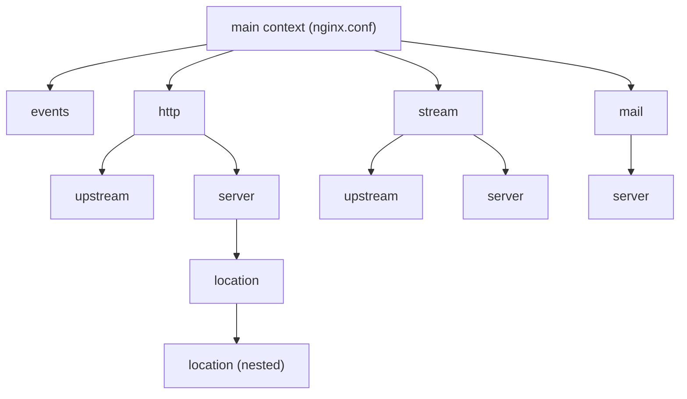

## Overview

NGINX and NGINX Plus read their settings from a text file, by default named **nginx.conf**. Use this guide to find that file, understand how it's organized, split it into smaller files, and apply your changes safely.

The information on this page applies to both NGINX Open Source and NGINX Plus.

---

## Before you begin

Before you begin, make sure you have:

- **NGINX Open Source or NGINX Plus installed**: Refer to [Installing NGINX Open Source]() or [Installing NGINX Plus]().
- **Permission to edit the configuration and control NGINX**: On most systems, this means root or `sudo` access.

---

## How the configuration is organized

### Directives

The configuration file consists of _directives_ and their parameters. A _simple directive_ ends with a semicolon (`;`). A simple directive can span several lines; the semicolon ends it, not the line break.

A _block directive_ groups other directives inside curly braces (`{}`) instead of ending with a semicolon. A block directive that contains directives is called a _context_.

These are simple directives:

```nginx
user             nobody;
error_log        logs/error.log notice;
worker_processes 1;
```

### Contexts

A few top-level contexts group the directives that apply to different types of traffic:

- [events](https://nginx.org/en/docs/ngx_core_module.html#events) – General connection processing. Every configuration must have an `events` block, even an empty one.
- [http](https://nginx.org/en/docs/http/ngx_http_core_module.html#http) – HTTP traffic
- [mail](https://nginx.org/en/docs/mail/ngx_mail_core_module.html#mail) – Mail traffic
- [stream](https://nginx.org/en/docs/stream/ngx_stream_core_module.html#stream) – TCP and UDP traffic

Directives outside these contexts are in the _main_ context.

NGINX Plus and most packages include the `mail` and `stream` modules. If you build NGINX Open Source from source, add the `--with-mail` and `--with-stream` options to `configure` to include them. Otherwise, NGINX reports `unknown directive "stream"`.

### Virtual servers

In each traffic context, one or more `server` blocks define _virtual servers_. A virtual server controls how NGINX processes the traffic it receives. The directives allowed in a `server` block depend on the traffic type.

For HTTP traffic (the `http` context), each [server](https://nginx.org/en/docs/http/ngx_http_core_module.html#server) block handles requests for particular domain names, IP addresses, or ports. Inside a `server` block, one or more [location](https://nginx.org/en/docs/http/ngx_http_core_module.html#location) blocks define how to process specific sets of URIs.

For mail and TCP/UDP traffic (the [mail](https://nginx.org/en/docs/mail/ngx_mail_core_module.html) and [stream](https://nginx.org/en/docs/stream/ngx_stream_core_module.html) contexts), each `server` block handles traffic that arrives at a particular port or UNIX-domain socket.

The following simplified diagram shows how the main contexts nest. It leaves out other blocks, such as `map`, `if`, and `types`.



Text description: The main context contains the `events`, `http`, `stream`, and `mail` contexts. The `http` context contains `upstream` and `server` blocks, and each HTTP `server` block contains `location` blocks, which can contain nested `location` blocks. The `stream` context contains `upstream` and `server` blocks. The `mail` context contains `server` blocks.

### Inheritance

A _child_ context is a context inside another context, its _parent_. For example, a `location` block is a child of a `server` block. A child context inherits the settings of directives from its parent. To change an inherited setting, include the directive again in the child context.

Some directives can appear several times in the same context, such as [proxy_set_header](https://nginx.org/en/docs/http/ngx_http_proxy_module.html#proxy_set_header) and [add_header](https://nginx.org/en/docs/http/ngx_http_headers_module.html#add_header). By default, these directives are inherited only if the child context doesn't contain any of them. If a `location` block has one `add_header` directive, it doesn't inherit any `add_header` directives from its `server` block. To keep the inherited `add_header` directives as well, add `add_header_inherit merge;` to the child context.

### Sample configuration file with multiple contexts

The following configuration shows where each context goes.

```nginx
user nobody; # a directive in the 'main' context

events {
    # configuration of connection processing
}

http {
    # Configuration specific to HTTP and affecting all virtual servers

    server {
        # configuration of HTTP virtual server 1
        listen      80;
        server_name www.example.com;

        location /one {
            # configuration for processing URIs starting with '/one'
        }
        location /two {
            # configuration for processing URIs starting with '/two'
        }
    }

    server {
        # configuration of HTTP virtual server 2
        listen      80;
        server_name api.example.com;
    }
}

stream {
    # Configuration specific to TCP/UDP and affecting all virtual servers
    server {
        # configuration of TCP virtual server 1
        listen 12345;
    }
}
```

---

## Find the configuration file

The location of **nginx.conf** depends on how NGINX was installed:

- **NGINX Plus**: `/etc/nginx/nginx.conf` on Linux, or `/usr/local/etc/nginx/nginx.conf` on FreeBSD.
- **NGINX Open Source**: Depends on the package system and the operating system. It's usually `/usr/local/nginx/conf/nginx.conf`, `/etc/nginx/nginx.conf`, or `/usr/local/etc/nginx/nginx.conf`.

The quickest way to find the file is to test the configuration. The output names the file that NGINX reads:

```shell
sudo nginx -t
```

```none
nginx: the configuration file /etc/nginx/nginx.conf syntax is ok
nginx: configuration file /etc/nginx/nginx.conf test is successful
```

You can also find the default path that NGINX was built with. Look for the `--conf-path=` parameter in the output of `nginx -V`:

```shell
nginx -V 2>&1 | sed -n 's/^configure arguments: *//p' | xargs -n1
```

Sample output:

```none
--prefix=/etc/nginx
--sbin-path=/usr/sbin/nginx
--modules-path=/usr/lib64/nginx/modules
--conf-path=/etc/nginx/nginx.conf
--error-log-path=/var/log/nginx/error.log
--http-log-path=/var/log/nginx/access.log
--pid-path=/var/run/nginx.pid
--...<MORE_PARAMETERS>
```

Here, `--conf-path=` shows the configuration file, and `<MORE_PARAMETERS>` stands for other build-time `configure` arguments left out of the sample. If there's no `--conf-path=` parameter, the file is `conf/nginx.conf` inside the `--prefix=` directory. If there's no `--prefix=` either, the prefix is `/usr/local/nginx`.

Both methods show the default file. If NGINX was started with the `-c` option, it uses the file named there instead. To check, look at the command line of the master process:

```shell
ps -ef | grep 'nginx: master'
```

<span id="feature-specific-configuration-files"></span>

## Split the configuration into feature-specific files

A large configuration is easier to maintain as a set of smaller files. Store feature-specific files in a directory such as `/etc/nginx/conf.d`, and pull them into **nginx.conf** with the [include](https://nginx.org/en/docs/ngx_core_module.html#include) directive.

1. Check whether **nginx.conf** already includes the directory. Packages from nginx.org and F5 already have `include /etc/nginx/conf.d/*.conf;` in the `http` block. If yours does, go to step 3. Including the same files twice causes errors or warnings about duplicate names.

2. Add an `include` directive at the place where the files' contents belong. For files of `server` blocks, add this line inside your existing `http` block:

    ```nginx
    include conf.d/*.conf;
    ```

3. Create a file for each feature, for example `/etc/nginx/conf.d/example.conf`. The file's contents replace the `include` directive, so the file must contain only directives that are valid in that context. For an `include` in the `http` block, a file can contain `server` blocks:

    ```nginx
    server {
        listen       80;
        server_name  www.example.org;

        location / {
            root   /usr/share/nginx/html;
        }
    }
    ```

Keep these rules in mind:

- A relative path in `include` is relative to the directory that contains the main configuration file. For `/etc/nginx/nginx.conf`, `conf.d/*.conf` means `/etc/nginx/conf.d/*.conf`.
- A path can contain the wildcards `*`, `?`, and `[...]`. NGINX includes the matching files sorted by byte value, not by locale. For example, `10-a.conf` comes before `9-b.conf`, and `B.conf` comes before `a.conf`. To control the order, use prefixes with the same number of digits, such as `05-` and `10-`.
- If a wildcard matches no files, NGINX continues without an error. A mistyped directory name in a wildcard path is ignored silently. If a path without wildcards doesn't exist, the configuration test fails.

<span id="reload-configuration-file"></span>

## Test and apply changes

NGINX reads its configuration at startup and when it reloads. Changes to the file don't take effect until then.

1. Test the configuration for errors:

    ```shell
    sudo nginx -t
    ```

    NGINX reads the whole configuration, including the included files, and reports the first error it finds. It also opens the log files and checks that it can listen on the configured ports, so run it with the same privileges as NGINX. The test doesn't change the running NGINX.

2. Reload the configuration:

    ```shell
    sudo nginx -s reload
    ```

    On systems that manage NGINX with systemd, you can run `sudo systemctl reload nginx` instead. If you started NGINX with the `-c` or `-p` option, pass the same options with `-s reload`.

    The command checks the syntax first. If the syntax isn't valid, it prints the error, exits with a non-zero status, and doesn't reload. Otherwise, it signals the master process, which loads the new configuration. If that succeeds, NGINX starts new worker processes and gracefully shuts down the old ones. Connections in progress aren't interrupted.

3. Check the error log for the result of the reload. Some errors, such as a port that's already in use, appear only there. If the master process can't apply the new configuration, it keeps running with the old one.

For more ways to control NGINX, refer to [Control NGINX Processes at Runtime]().

With NGINX Plus, you can change some settings without a reload. You can reconfigure [load balancing]() across the servers in an upstream group with the NGINX Plus API. You can also use the API and the key-value store to control access, for example [based on client IP address]().

---

## Example

This **nginx.conf** serves files for one website and reads extra `server` blocks from `conf.d`. Before you use it, adapt the `user` name, the paths, and any `include` directives to match the file your package installed. For example, Debian and Ubuntu packages run NGINX as `www-data`.

```nginx
user  nginx;
worker_processes  auto;

error_log  /var/log/nginx/error.log notice;
pid        /var/run/nginx.pid;

events {
    worker_connections  1024;
}

http {
    include       mime.types;
    default_type  application/octet-stream;

    access_log  /var/log/nginx/access.log;

    server {
        listen       80;
        server_name  www.example.com;

        location / {
            root   /usr/share/nginx/html;
            index  index.html;
        }
    }

    include conf.d/*.conf;
}
```

---

## Verify the configuration

Run the configuration test:

```shell
sudo nginx -t
```

If the configuration is valid, the output looks like this. The file path matches your installation:

```none
nginx: the configuration file /etc/nginx/nginx.conf syntax is ok
nginx: configuration file /etc/nginx/nginx.conf test is successful
```

If the second line says `test failed`, read the error between the two lines. The syntax can be correct while the test still fails, for example because NGINX can't open a log file or listen on a port.

To print the configuration files on disk, with all included files, run:

```shell
sudo nginx -T 2>/dev/null | less
```

Each file starts with a `# configuration file` comment line. This shows the files on disk, not the configuration that the running NGINX loaded. If the last reload failed, they differ.

---

## Troubleshooting

### The test reports a syntax error

**Symptom**: `nginx -t` fails with a message such as:

- `unexpected end of file, expecting ";" or "}"`
- `unexpected end of file, expecting "}"`
- `unexpected "}"` or `unexpected "{"`
- `directive "listen" is not terminated by ";"`
- `invalid parameter "server_name"`
- `invalid number of arguments in "root" directive`
- `unknown directive "servername"`

**Cause**: A directive is missing its closing semicolon, the braces don't match, or a directive name or parameter is misspelled. A missing semicolon often makes NGINX report the error on the next line.

**Fix**: Check the line in the message and the line before it. Make sure each simple directive ends with `;`, each `{` has a matching `}`, and directive names are spelled correctly.

### The test reports that a directive is not allowed here

**Symptom**: `nginx -t` fails with `"<directive>" directive is not allowed here` or `"http" directive is duplicate`.

**Cause**: The directive is in a context where it isn't valid. Common examples are a `server` block in a file that's included outside the `http` context, and a second `http` block.

**Fix**: Find the directive's allowed contexts in its reference documentation, and move the directive or the `include` directive.

### A change has no effect

**Symptom**: You edited the configuration, but NGINX still behaves the same way.

**Cause**: NGINX hasn't reloaded, the reload failed, or you edited a file that isn't included. A mistyped directory in a wildcard `include` path is ignored without an error.

**Fix**: Run `sudo nginx -t`, then `sudo nginx -s reload`, and check the error log. Run `sudo nginx -T 2>/dev/null | grep '^# configuration file'` to confirm that your file is part of the configuration.

### Settings from a parent context are missing

**Symptom**: Headers set with `add_header` or `proxy_set_header` at the `server` level don't appear for some locations.

**Cause**: The `location` block has its own directive of the same kind, so it doesn't inherit any of them from its parent. For details, see [Inheritance](#inheritance).

**Fix**: Repeat all the needed directives in the `location` block. For `add_header`, you can add `add_header_inherit merge;` to the `location` block instead.

---

## References

For more information, see:

- [Control NGINX Processes at Runtime]()
- [Configuring NGINX and NGINX Plus as a Web Server]()
- [Core functionality reference](https://nginx.org/en/docs/ngx_core_module.html)
- [Beginner's Guide on nginx.org](https://nginx.org/en/docs/beginners_guide.html)
