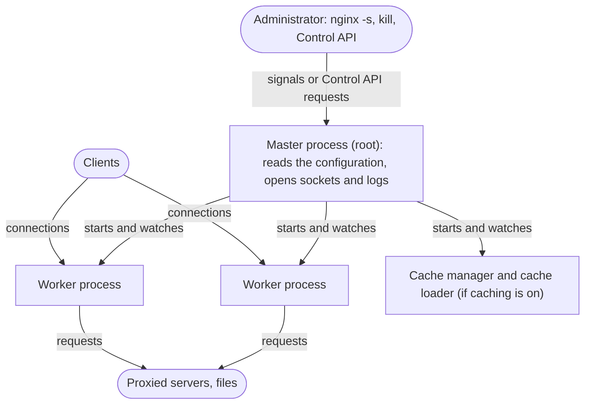
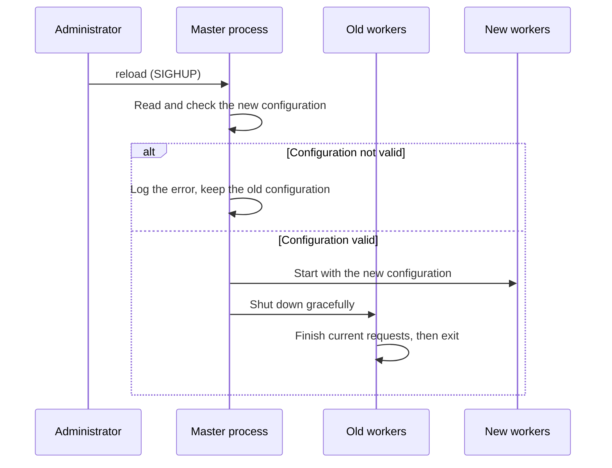

## Overview

NGINX Open Source and F5 NGINX Plus run as a group of processes. Use this guide to understand what each process does, and to reload the configuration, reopen log files, and stop NGINX without dropping connections.

---

## Before you begin

Before you begin, make sure you have:

- **NGINX Open Source or NGINX Plus installed and running**.
- **Permission to control NGINX**: On most systems, this means root or `sudo` access.

---

## Master and worker processes {#processes}

NGINX has one master process and one or more worker processes. If the configuration defines a cache, for example with [proxy_cache_path](), the cache manager and cache loader processes also run.

- The **master process** reads and checks the configuration, opens the listening sockets and log files, and starts and watches the other processes. It usually runs as root.
- The **worker processes** handle the connections and requests. When the master process runs as root, they run as the user set by the [user](https://nginx.org/en/docs/ngx_core_module.html#user) directive. The operating system distributes new connections among them. The [worker_processes](https://nginx.org/en/docs/ngx_core_module.html#worker_processes) directive sets their number: a fixed number, or `auto` for one per available CPU, counting each logical CPU.
- The **cache manager** removes old responses from the cache. The **cache loader** starts about a minute after NGINX starts or reloads, loads the cache metadata that isn't loaded yet, and exits.



Text description: The administrator controls the master process with signals or Control API requests. The master process reads the configuration and opens the sockets and log files, then starts and watches the worker processes and, if a cache is configured, the cache processes. Clients connect to the worker processes, which serve files or pass requests to proxied servers.

### What happens when NGINX reloads

The `nginx -s reload` command first reads and checks the whole configuration itself. If it finds an error, it prints the error, exits with a non-zero status, and doesn't send the signal. Otherwise, it sends the `reload` signal to the master process. Some errors, such as a port that's already in use, show up only when the master process applies the configuration. Then `nginx -s reload` still exits with status `0`, and the error appears only in the error log.

When the master process gets the `reload` signal, it does the following:

1. It reads and checks the new configuration, and opens any new listening sockets and log files.
2. If that fails, it logs the error and keeps running with the old configuration.
3. If it succeeds, it starts new worker processes with the new configuration.
4. It tells the old worker processes to shut down gracefully. They stop accepting new connections, finish the requests in progress, and exit.



Text description: The administrator sends the reload signal. The master process checks the new configuration. If it isn't valid, the master logs the error and keeps the old configuration. If it's valid, the master starts new worker processes and tells the old ones to shut down gracefully after their current requests.

---

## Control NGINX with signals {#signals}

To control NGINX, send signals to the master process. The `nginx` command sends a signal with the `-s` option:

```shell
sudo nginx -s <SIGNAL>
```

`<SIGNAL>` is one of these:

- `quit` – Shut down gracefully, after the current requests finish (the `SIGQUIT` signal).
- `reload` – Reload the configuration (the `SIGHUP` signal).
- `reopen` – Reopen the log files (the `SIGUSR1` signal).
- `stop` – Shut down immediately (the `SIGTERM` signal).

The `nginx -s` command finds the master process through the PID file named in the configuration file on disk. If you started NGINX with the `-c`, `-p`, or `-g` option, pass the same options with `-s`. If you change the `pid` directive, stop NGINX before the change and start it afterward instead of reloading. On systems that manage NGINX with systemd, use `systemctl reload nginx` and `systemctl stop nginx` instead.

You can also send a signal to the master process with the `kill` command. The master process writes its process ID to the file set by the [pid](https://nginx.org/en/docs/ngx_core_module.html#pid) directive, by default **logs/nginx.pid** inside the installation directory. Packages usually use **/var/run/nginx.pid** or **/run/nginx.pid**:

```shell
sudo kill -QUIT $(cat /var/run/nginx.pid)
```

### Rotate log files

To rotate log files without losing entries, rename the files and then send the `reopen` signal. NGINX keeps writing to the renamed files until it reopens them. This works for the error log and the access logs; keep the renamed files on the same file system:

```shell
sudo mv /var/log/nginx/access.log /var/log/nginx/access.log.1
sudo nginx -s reopen
```

Packages usually include a `logrotate` configuration that does this for you.

For more signals, for example to upgrade the NGINX binary without stopping it, see [Controlling nginx](https://nginx.org/en/docs/control.html) on nginx.org.

---

## Control NGINX with Control API {#control-api}

Besides [signals](#signals), you can control NGINX Plus and NGINX Open Source with the Control REST API. It's available in [NGINX Plus PLS.37.0.0.1 LTS]() and later, and in NGINX Open Source 1.31.5 and later. It isn't available on Windows, or with `master_process off`.

The [master process](#processes) provides the Control API. With it, you can:

- View information about the child processes of the master: process name, PID, and whether the process is shutting down.
- Get the configuration files that NGINX loaded.
- Reload the configuration, like `nginx -s reload`, and view the result.

The Control API has these endpoints:

- `/1/nginx` – The NGINX version and the build name set with the `--build` option of `configure`.
- `/1/control/processes` – The worker and cache processes, each with its name, PID, and an `exiting` field that's `true` while the process shuts down.
- `/1/control/config` – The loaded configuration; send a `PATCH` request to reload it. The response has status `200` if the reload succeeded, or `422` if it failed, and lists the messages of the `warn` level and higher in its `logs` field.

For details, see the [NGINX Control REST API reference]().

### Enable NGINX Control API

The Control API is off by default.

1. If you use NGINX Open Source 1.31.5 or later, check that NGINX was built with the `--with-control-api` option:

    ```shell
    nginx -V 2>&1 | grep -o -- '--with-control-api'
    ```

    If the output is empty, NGINX was built without the Control API.

2. Stop NGINX if it's running, then start it with the `-l` command-line option and a UNIX-domain socket or a TCP address. Pass the option at every start, for example in the `ExecStart` line of the systemd service. The socket stays open across reloads.

    ```shell
    sudo nginx -s quit
    sudo nginx -l unix:/run/nginx-control.sock
    ```

    For a TCP socket, give the IP address too, such as `-l 127.0.0.1:8090`. A port on its own listens on all interfaces, and the Control API has no authentication.

3. Send a request to the Control API, for example with `curl`:

    ```shell
    sudo curl --unix-socket /run/nginx-control.sock http://localhost/1/nginx
    ```

    The output is a JSON object with the NGINX version and build name, for example:

    ```none
    {"version":"1.31.9","build":""}
    ```

4. Reload the configuration through the Control API:

    ```shell
    sudo curl --unix-socket /run/nginx-control.sock -X PATCH http://localhost/1/control/config
    ```

    If the reload succeeds, the response has status `200` and a JSON object with a `logs` field. If it fails, the status is `422`, and `logs` contains the error.

### Security implications

- Never expose the Control API to the public internet. Restrict access to it with firewalls or access control lists. Where possible, put it on a dedicated interface or VLAN.
- Prefer a UNIX-domain socket. NGINX creates the socket file so that only the user that runs the master process can use it, so file permissions control access.
- Keep NGINX and the operating system up to date.

### Control API reference documentation

For details on the endpoints, request parameters, and response schemas, see the [NGINX Control REST API reference]().

[Download Control API OpenAPI YAML specification](/nginx/admin-guide/yaml/nginx-control-api/1/nginx_control_api.yaml) or copy this link to explore the API using standard OpenAPI-compatible tools such as Redoc or Swagger UI.

---

## Verify the processes

1. List the NGINX processes:

    ```shell
    ps -o pid,user,args -C nginx
    ```

    The output shows the master process and the worker processes of all NGINX instances on the host, plus the cache processes if a cache is configured, for example:

    ```none
        PID USER     COMMAND
       1201 root     nginx: master process /usr/sbin/nginx -c /etc/nginx/nginx.conf
       1202 nginx    nginx: worker process
       1203 nginx    nginx: worker process
    ```

2. Reload NGINX and list the processes again:

    ```shell
    sudo nginx -s reload
    ps -o pid,user,args -C nginx
    ```

    The master process keeps its PID, and the worker processes have new PIDs. Old workers that still finish requests show as `nginx: worker process is shutting down`.

---

## Troubleshooting

### nginx -s reports "invalid PID number" or "open() ... nginx.pid failed"

**Symptom**: `nginx -s reload` fails with `invalid PID number "" in "/var/run/nginx.pid"` or `open() "/var/run/nginx.pid" failed`.

**Cause**: NGINX isn't running, or `nginx -s` reads another PID file than the running NGINX uses, for example because NGINX was started with `-c`, `-p`, or `-g`. A PID file left over from a crash gives `kill(..., 1) failed (3: No such process)`, and running without root gives `(1: Operation not permitted)`.

**Fix**: Start NGINX if it isn't running. Otherwise, pass the same options as at startup, use `sudo`, or use `systemctl`.

### A reload doesn't change anything

**Symptom**: After `nginx -s reload`, NGINX still uses the old configuration.

**Cause**: The new configuration isn't valid, so the master process keeps the old one. `nginx -s reload` can still report success, because it doesn't see errors that only the master process finds, such as a port that's in use.

**Fix**: Run `sudo nginx -t`, and check the error log for the reason. With the Control API, a `PATCH` request to `/1/control/config` returns the result of the reload.

### Old worker processes don't exit after a reload

**Symptom**: Processes named `nginx: worker process is shutting down` stay for a long time.

**Cause**: They still serve long requests or connections, such as large downloads or WebSocket connections.

**Fix**: To limit how long they wait, set the [worker_shutdown_timeout](https://nginx.org/en/docs/ngx_core_module.html#worker_shutdown_timeout) directive. It applies to worker processes started with the configuration that sets it, also when NGINX quits. When the time runs out, NGINX closes the remaining connections, so clients get incomplete responses.

### NGINX doesn't start with the Control API

**Symptom**: `nginx -l unix:...` returns without an error, but NGINX isn't running, and the error log shows `control: bind() failed (98: Address already in use)`.

**Cause**: The socket file is left over, for example after a crash. NGINX removes it only when it stops normally.

**Fix**: Delete the socket file, and start NGINX again.

---

## References

For more information, see:

- [Create NGINX Plus and NGINX Configuration Files]()
- [Controlling nginx](https://nginx.org/en/docs/control.html) on nginx.org
- [Command-line parameters](https://nginx.org/en/docs/switches.html) on nginx.org
