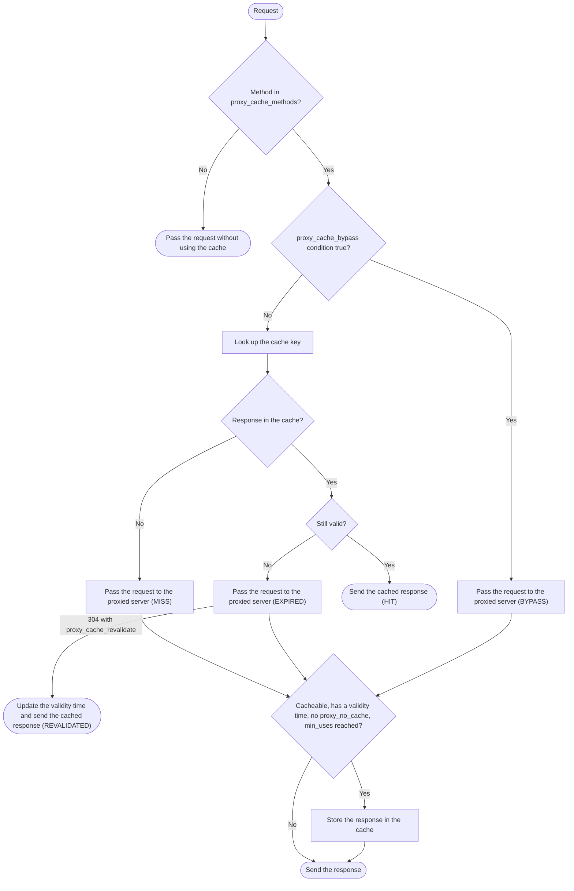

<span id="intro"></span>

## Overview

With caching on, NGINX Open Source and F5 NGINX Plus save responses from proxied servers in a disk cache. They answer later requests for the same content from the cache, without passing the requests to the proxied server. This speeds up responses and lowers the load on the proxied servers.

---

## Before you begin

Before you begin, make sure you have:

- **NGINX configured as a reverse proxy**: Refer to [NGINX Reverse Proxy]().
- **A disk with enough free space for the cache**. NGINX creates the cache directory itself, but its parent directory must exist and be writable by the user who starts NGINX.
- **Permission to edit the configuration and reload NGINX**: On most systems, this means root or `sudo` access.

---

## How caching works

For each request in a location with `proxy_cache`, NGINX does the following:

1. If the request method isn't in [proxy_cache_methods](https://nginx.org/en/docs/http/ngx_http_proxy_module.html#proxy_cache_methods), `GET` and `HEAD` by default, NGINX doesn't use the cache for it at all.
2. If a [proxy_cache_bypass](https://nginx.org/en/docs/http/ngx_http_proxy_module.html#proxy_cache_bypass) condition is true, NGINX passes the request to the proxied server without looking in the cache.
3. Otherwise, NGINX computes the cache key, by default `$scheme$proxy_host$request_uri`, and looks it up in the cache.
4. If it finds a response that's still valid, NGINX sends it from the cache.
5. If the response is missing or has expired, NGINX passes the request to the proxied server. With [proxy_cache_revalidate](https://nginx.org/en/docs/http/ngx_http_proxy_module.html#proxy_cache_revalidate), NGINX asks the server whether an expired response is still current. If the server answers `304 Not Modified`, NGINX updates the validity time of the cached response and sends it.
6. NGINX stores the new response, also for a bypassed request, if the response is cacheable and gets a validity time, as described in [Set how long responses are valid](#bypass). It doesn't store it if a [proxy_no_cache](https://nginx.org/en/docs/http/ngx_http_proxy_module.html#proxy_no_cache) condition is true, or if the key hasn't been requested [proxy_cache_min_uses](https://nginx.org/en/docs/http/ngx_http_proxy_module.html#proxy_cache_min_uses) times yet.



Text description: If the request method isn't cached, NGINX doesn't use the cache. If a `proxy_cache_bypass` condition is true, NGINX passes the request to the proxied server. Otherwise, NGINX looks up the cache key, and sends a valid cached response. If there's no cached response or it has expired, NGINX passes the request to the proxied server. A `304` answer to a revalidation refreshes the cached response. NGINX stores a new response if it's cacheable, has a validity time, no `proxy_no_cache` condition is true, and `proxy_cache_min_uses` is reached. The labels in parentheses are values of the `$upstream_cache_status` variable.

The [$upstream_cache_status](https://nginx.org/en/docs/http/ngx_http_upstream_module.html#var_upstream_cache_status) variable shows what happened: `MISS`, `BYPASS`, `EXPIRED`, `STALE`, `UPDATING`, `REVALIDATED`, or `HIT`. It's empty when NGINX didn't use the cache. `STALE` and `UPDATING` appear only with [proxy_cache_use_stale](https://nginx.org/en/docs/http/ngx_http_proxy_module.html#proxy_cache_use_stale) or [proxy_cache_background_update](https://nginx.org/en/docs/http/ngx_http_proxy_module.html#proxy_cache_background_update), which let NGINX send an expired response while it gets a new one.

---

<span id="enable"></span>

## Enable the caching of responses

1. Create the parent directory of the cache. NGINX creates the cache directory itself, but not its parent directories:

    ```shell
    sudo mkdir -p /data/nginx
    ```

2. Define a cache with the [proxy_cache_path](https://nginx.org/en/docs/http/ngx_http_proxy_module.html#proxy_cache_path) directive in the `http` context. The first parameter is the directory for the cached files. The required `keys_zone` parameter sets the name and size of the shared memory zone that holds the cache keys and information about the cached responses:

    ```nginx
    http {
        proxy_cache_path /data/nginx/cache keys_zone=mycache:10m;
    }
    ```

    A 1 MB zone holds about 8,000 keys.

3. Turn on caching with the [proxy_cache](https://nginx.org/en/docs/http/ngx_http_proxy_module.html#proxy_cache) directive and the zone name, in the `http`, `server`, or `location` context. Also set how long responses are valid with [proxy_cache_valid](https://nginx.org/en/docs/http/ngx_http_proxy_module.html#proxy_cache_valid). Without a validity time from the proxied server or from `proxy_cache_valid`, NGINX doesn't cache a response. For details, see [Set how long responses are valid](#bypass).

    ```nginx
    http {
        proxy_cache_path /data/nginx/cache keys_zone=mycache:10m;

        server {
            listen 80;
            proxy_cache       mycache;
            proxy_cache_valid 200 302 10m;

            location / {
                proxy_pass http://localhost:8000;
            }
        }
    }
    ```

4. Test the configuration, and start or reload NGINX:

    ```shell
    sudo nginx -t && sudo nginx -s reload
    ```

The `keys_zone` size doesn't limit the amount of cached data, but it limits the number of cached responses: when the zone is full, NGINX removes the least recently used responses. NGINX stores the cached responses in files. To limit their total size, add the `max_size` parameter to `proxy_cache_path`. The cache can exceed this limit for a short time, as described in the next section.

<span id="processes"></span>

## NGINX processes involved in caching

Two extra NGINX processes work with the cache:

- The **cache manager** runs periodically. It removes cached responses that haven't been requested for the time set by the `inactive` parameter of `proxy_cache_path` (10 minutes by default), even if they're still valid. If the cache is larger than `max_size`, it removes the least recently used responses. Between its runs, the cache can be larger than `max_size`.

- The **cache loader** runs once, about a minute after NGINX starts. It loads information about the cached responses on disk into the shared memory zone. To avoid slowing NGINX down, it loads the cache in steps, with a pause after each step. To tune the steps, add these parameters to `proxy_cache_path`:

    - `loader_threshold` – The maximum duration of one step, by default `200` milliseconds.
    - `loader_files` – The maximum number of items loaded in one step, by default `100`.
    - `loader_sleep` – The pause between steps, by default `50` milliseconds.

In this example, each step lasts up to 300 milliseconds or loads up to 200 items:

```nginx
proxy_cache_path /data/nginx/cache keys_zone=mycache:10m loader_threshold=300 loader_files=200;
```

<span id="select"></span>

## Specify which requests to cache

By default, NGINX caches responses to `GET` and `HEAD` requests. It doesn't cache a response that has:

- A `Set-Cookie` header or `Vary: *`.
- `Cache-Control: no-cache`, `no-store`, `private`, or `max-age=0`, or an `Expires` time in the past. A non-zero `X-Accel-Expires` header overrides these.
- `X-Accel-Expires: 0`.

The [proxy_ignore_headers](https://nginx.org/en/docs/http/ngx_http_proxy_module.html#proxy_ignore_headers) directive makes NGINX ignore these headers. If a cached response matches a request's key, NGINX sends the cached response.

To change the cache key, use the [proxy_cache_key](https://nginx.org/en/docs/http/ngx_http_proxy_module.html#proxy_cache_key) directive:

```nginx
proxy_cache_key "$host$request_uri$cookie_user";
```

To cache a response only after a number of requests with the same key, use the [proxy_cache_min_uses](https://nginx.org/en/docs/http/ngx_http_proxy_module.html#proxy_cache_min_uses) directive:

```nginx
proxy_cache_min_uses 5;
```

To cache responses to other request methods, list them with the [proxy_cache_methods](https://nginx.org/en/docs/http/ngx_http_proxy_module.html#proxy_cache_methods) directive. NGINX always adds `GET` and `HEAD`:

```nginx
proxy_cache_methods GET HEAD POST;
```

The default cache key includes neither the method nor the request body. If you cache `POST` responses, add `$request_method`, and if needed `$request_body`, to `proxy_cache_key`. Otherwise, all `POST` requests to a URL share one cached response, and a `GET` request to the URL can get it too.

By default, NGINX turns a `HEAD` request into a `GET` request to fill the cache. The [proxy_cache_convert_head](https://nginx.org/en/docs/http/ngx_http_proxy_module.html#proxy_cache_convert_head) directive controls this.

<span id="bypass"></span>

## Limit or disable caching

### Set how long responses are valid

NGINX takes the validity time of a response from the proxied server's `X-Accel-Expires`, `Cache-Control` (`max-age` or `s-maxage`), or `Expires` header, in this order. If these headers don't set a time, NGINX uses the [proxy_cache_valid](https://nginx.org/en/docs/http/ngx_http_proxy_module.html#proxy_cache_valid) directive. If neither gives a time, NGINX doesn't cache the response.

```nginx
proxy_cache_valid 200 302 10m;
proxy_cache_valid 404      1m;
```

In this example, responses with code `200` or `302` are valid for 10 minutes, and responses with code `404` for 1 minute. To set the time for all codes, use `any`:

```nginx
proxy_cache_valid any 5m;
```

If you give only a time, such as `proxy_cache_valid 5m;`, NGINX caches responses with codes `200`, `301`, and `302`.

### Skip the cache for some requests

To pass some requests to the proxied server without looking in the cache, use the [proxy_cache_bypass](https://nginx.org/en/docs/http/ngx_http_proxy_module.html#proxy_cache_bypass) directive. Each parameter is a condition made of variables. If at least one parameter isn't empty and isn't `0`, NGINX doesn't look in the cache. NGINX still stores the response it gets, which replaces the cached one. To stop that, also add `proxy_no_cache` with the same conditions:

```nginx
proxy_cache_bypass $cookie_nocache $arg_nocache$arg_comment;
```

To keep NGINX from storing some responses, use the [proxy_no_cache](https://nginx.org/en/docs/http/ngx_http_proxy_module.html#proxy_no_cache) directive, with parameters that work the same way:

```nginx
proxy_no_cache $http_pragma $http_authorization;
```

<span id="purge"></span>
<span id="purging-content-from-the-cache"></span>

## Purge content from the cache

This feature needs NGINX Plus.

NGINX Plus can remove outdated responses from the cache, so that it doesn't serve old and new versions of a page at the same time. It purges the cache when it gets a special purge request, which uses a custom HTTP header or the HTTP `PURGE` method.

<span id="purge_configure"></span>

### Configure cache purge

This configuration deletes the matching URLs when a request uses the `PURGE` method.

1. In the `http` context, create a variable, for example `$purge_method`, that depends on the `$request_method` variable:

    ```nginx
    map $request_method $purge_method {
        PURGE   1;
        default 0;
    }
    ```

2. In the `location` block where caching is configured, add the [proxy_cache_purge](https://nginx.org/en/docs/http/ngx_http_proxy_module.html#proxy_cache_purge) directive with the condition for purge requests, here the `$purge_method` variable from step 1:

    ```nginx
    server {
        listen      80;
        server_name www.example.com;

        location / {
            proxy_pass  https://localhost:8002;
            proxy_cache mycache;

            proxy_cache_purge $purge_method;
        }
    }
    ```

<span id="purge_request"></span>

### Send the purge command

With `proxy_cache_purge` configured, send a purge request, for example with `curl`:

```shell
curl -X PURGE -D - "http://www.example.com/*"
```

```none
HTTP/1.1 204 No Content
Server: nginx/1.15.0
Date: Sat, 19 May 2018 16:33:04 GMT
Connection: keep-alive
```

In this example, NGINX Plus purges the responses whose URLs start with the part before the asterisk. These entries stay on disk until they're removed for inactivity (the `inactive` parameter of `proxy_cache_path`), until the cache purger removes them (the `purger` parameter of [proxy_cache_path](https://nginx.org/en/docs/http/ngx_http_proxy_module.html#proxy_cache_path)), or until a client requests them.

<span id="purge_secure"></span>

### Restrict access to the purge command

Allow purge requests only from a few IP addresses:

```nginx
geo $purge_allowed {
   default         0;  # deny from other
   10.0.0.1        1;  # allow from 10.0.0.1 address
   192.168.0.0/24  1;  # allow from 192.168.0.0/24
}

map $request_method $purge_method {
   PURGE   $purge_allowed;
   default 0;
}
```

In this example, NGINX checks whether a request uses the `PURGE` method. If it does, `$purge_method` gets the value of `$purge_allowed`, which depends on the client IP address: `1` allows purging, and `0` denies it. This `map` replaces the one in [Configure cache purge](#purge_configure).

<span id="purge_remove"></span>

### Completely remove files from the cache

To delete the files of purged entries from disk, turn on the cache purger. The purger is a process that goes through all cache entries and deletes the ones that match a purged wildcard key. Add the `purger` parameter to [proxy_cache_path](https://nginx.org/en/docs/http/ngx_http_proxy_module.html#proxy_cache_path) in the `http` context:

```nginx
proxy_cache_path /data/nginx/cache levels=1:2 keys_zone=mycache:10m purger=on;
```

<span id="purge_example"></span>

### Cache purge configuration example

```nginx
http {
    proxy_cache_path /data/nginx/cache levels=1:2 keys_zone=mycache:10m purger=on;

    geo $purge_allowed {
       default         0;
       10.0.0.1        1;
       192.168.0.0/24  1;
    }

    map $request_method $purge_method {
       PURGE   $purge_allowed;
       default 0;
    }

    server {
        listen      80;
        server_name www.example.com;

        location / {
            proxy_pass        https://localhost:8002;
            proxy_cache       mycache;
            proxy_cache_purge $purge_method;
        }
    }
}
```

<span id="slice"></span>

## Byte-range caching

Filling the cache with a large file can take a long time. For example, when a client requests part of a video file, NGINX downloads the whole file to cache it. Meanwhile, other requests for the file also go to the proxied server, or, with [proxy_cache_lock](https://nginx.org/en/docs/http/ngx_http_proxy_module.html#proxy_cache_lock), wait for the download to finish.

The [Cache Slice](https://nginx.org/en/docs/http/ngx_http_slice_module.html) module solves this. It divides files into smaller slices. NGINX requests from the proxied server only the slices that cover the requested range, and caches each slice. Later requests for these slices get them from the cache.


Slicing doesn't work with [background cache update](https://nginx.org/en/docs/http/ngx_http_proxy_module.html#proxy_cache_background_update), because the background request doesn't support byte ranges.


To turn on byte-range caching:

1. Make sure NGINX includes the Cache Slice module. NGINX Plus and the packages from nginx.org include it. If you build NGINX Open Source from source, add `--with-http_slice_module` to `configure`.

2. Set the size of a slice with the [slice](https://nginx.org/en/docs/http/ngx_http_slice_module.html#slice) directive:

    ```nginx
    location / {
        slice  1m;
    }
    ```

    Choose a size that makes slices fast to download. A very small size uses a lot of memory and many file descriptors for one request. A very large size increases latency.

3. Add the [$slice_range](https://nginx.org/en/docs/http/ngx_http_slice_module.html#var_slice_range) variable to the cache key:

    ```nginx
    proxy_cache_key $uri$is_args$args$slice_range;
    ```

4. Cache responses with the `206` status code:

    ```nginx
    proxy_cache_valid 200 206 1h;
    ```

5. Pass range requests to the proxied server by setting the `Range` header to `$slice_range`:

    ```nginx
    proxy_set_header  Range $slice_range;
    ```

This is the full `location` block. The `proxy_cache` zone, here `cache`, must be defined with `proxy_cache_path`:

```nginx
location / {
    slice             1m;
    proxy_cache       cache;
    proxy_cache_key   $uri$is_args$args$slice_range;
    proxy_set_header  Range $slice_range;
    proxy_cache_valid 200 206 1h;
    proxy_pass        http://localhost:8000;
}
```

With slice caching on, don't change the original file on the proxied server. If it changes, the cache can mix slices of the old and new versions.

<span id="example"></span>

## Combined configuration example

This configuration combines some of the options on this page. It's a whole **nginx.conf**, so back up your existing file before you use it. To add only the caching to a configuration that reads files from `conf.d`, put the `proxy_cache_path` directive and the `server` block in a file there.

```nginx
events {}

http {
    proxy_cache_path /data/nginx/cache keys_zone=mycache:10m loader_threshold=300
                     loader_files=200 max_size=200m;

    server {
        listen 8080;
        proxy_cache mycache;
        add_header X-Cache-Status $upstream_cache_status always;

        location / {
            proxy_pass http://127.0.0.1:8001;
            proxy_cache_valid 200 1h;
        }

        location /some/path {
            proxy_pass http://127.0.0.1:8002;
            proxy_cache_valid any 1m;
            proxy_cache_min_uses 3;
            proxy_cache_bypass $cookie_nocache $arg_nocache$arg_comment;
        }
    }
}
```

In this example, two locations use the same cache in different ways:

- Responses from the server on port 8001 rarely change, so NGINX keeps responses with code `200` for 1 hour, unless the server's headers set another time.
- Responses from the server on port 8002 change often. They're valid for only 1 minute. NGINX stores the response to the third request for a URL, so the fourth request is the first one served from the cache. If a request matches a `proxy_cache_bypass` condition, NGINX passes it to the server without looking in the cache.

The `add_header` directive adds an `X-Cache-Status` header with the value of `$upstream_cache_status`, which helps when you test the cache.

---

## Verify the configuration

1. Test the configuration, and start NGINX or reload it if it's running:

    ```shell
    sudo nginx -t && sudo nginx -s reload
    ```

2. Request the same URL twice on the port of the [combined example](#example), 8080, and look at the `X-Cache-Status` header:

    ```shell
    curl -s -o /dev/null -D - http://localhost:8080/ | grep -i x-cache-status
    curl -s -o /dev/null -D - http://localhost:8080/ | grep -i x-cache-status
    ```

    The first request goes to the proxied server, and the second comes from the cache:

    ```none
    X-Cache-Status: MISS
    X-Cache-Status: HIT
    ```

3. Check that the cache directory has files:

    ```shell
    sudo find /data/nginx/cache -type f | head
    ```

---

## Troubleshooting

### Responses are never cached

**Symptom**: `$upstream_cache_status` is always `MISS`, `BYPASS`, or empty, and the cache directory stays empty.

**Cause**: The responses have no validity time, or they aren't cacheable. Common reasons are a missing `proxy_cache_valid` directive; a `Set-Cookie` header, `Vary: *`, or `X-Accel-Expires: 0` from the proxied server; `Cache-Control: private`, `no-cache`, `no-store`, or `max-age=0`; or an `Expires` time in the past. `proxy_cache_min_uses`, `proxy_cache_bypass`, and a request method that isn't in `proxy_cache_methods` also keep responses out of the cache.

**Fix**: Add `proxy_cache_valid` for the status codes you want to cache. Check the proxied server's response headers with `curl -sI`. To cache responses despite these headers, see [proxy_ignore_headers](https://nginx.org/en/docs/http/ngx_http_proxy_module.html#proxy_ignore_headers), and make sure that responses with personal data aren't shared between users.

### NGINX fails to start with a cache directory error

**Symptom**: `nginx -t` or NGINX at startup shows `mkdir() "/data/nginx/cache" failed (2: No such file or directory)` or `mkdir() "/data/nginx/cache" failed (13: Permission denied)`.

**Cause**: NGINX creates only the last directory of the path. The parent directory doesn't exist, or the user who starts NGINX can't write to it.

**Fix**: Create the parent directory, for example with `sudo mkdir -p /data/nginx`. When NGINX starts as root, it makes the worker processes' user the owner of the cache directory it creates.

### Clients get outdated content

**Symptom**: After the content changes on the proxied server, clients still get the old version.

**Cause**: The cached response is still valid.

**Fix**: Shorten the validity time with `proxy_cache_valid` or with headers from the proxied server. To check whether content changed after the time expires, add `proxy_cache_revalidate on`. Revalidation works only when the cached response has an `ETag` or `Last-Modified` header. With NGINX Plus, you can also [purge](#purge) the outdated responses.

---

## References

For more information, see:

- [NGINX Reverse Proxy]()
- [ngx_http_proxy_module reference](https://nginx.org/en/docs/http/ngx_http_proxy_module.html) on nginx.org
- [ngx_http_slice_module reference](https://nginx.org/en/docs/http/ngx_http_slice_module.html) on nginx.org
