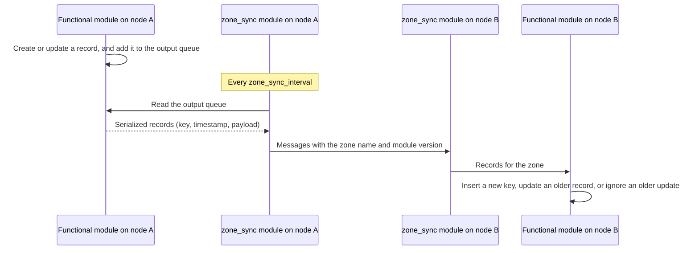

This page describes the design and the limits of zone synchronization in F5 NGINX Plus. For the configuration steps, see [Runtime State Sharing in a Cluster]().

## What is zone synchronization

Zone synchronization copies the records of shared memory zones between the NGINX Plus nodes of a cluster. Each node handles requests on its own, without asking the other nodes. It sends its changes to the other nodes later, so all nodes reach the same state eventually, not at once.

Records can expire. Synchronization doesn't delete records on the other nodes: each node deletes a record when its lifetime ends.

This page covers the modules involved, how records move between nodes, and how to monitor and scale a cluster.

---

## How zone synchronization works

Three parts of NGINX Plus work together:

- **The [ngx_stream_zone_sync_module](https://nginx.org/en/docs/stream/ngx_stream_zone_sync_module.html)** handles the network. It finds the cluster nodes, manages the connections to them, and protects them with TLS. It pushes the data of the other modules to the remote nodes, accepts data from them, and passes it to the right module. It also tracks the changes in the zones, and processes the output queue of each zone. On the receiving side, it's a regular stream module, so access control, [TLS](https://nginx.org/en/docs/stream/ngx_stream_ssl_module.html), and limits work as for any stream server.
- **The functional modules** use the shared zones, for example the [sticky](https://nginx.org/en/docs/http/ngx_http_upstream_module.html#sticky) and [limit_req](https://nginx.org/en/docs/http/ngx_http_limit_req_module.html) modules. They serialize their records for the network, with a key and a timestamp. They update the local zone with remote data, and keep a queue of local changes that the cluster still needs.
- **The core** of NGINX Plus connects the zone synchronization module with the functional modules.

### Data model

Each functional module keeps its changes in a queue of records. The records are opaque to the zone synchronization module: it handles only their serialized form. The queue holds the records that the node still needs to send to the cluster. Only records that the node created can be in its output queue, and the queue can include all records of the zone.

The zone synchronization module polls the output queues at a fixed [interval](https://nginx.org/en/docs/stream/ngx_stream_zone_sync_module.html#zone_sync_interval). The interval sets how long the nodes can differ. It also reduces the data sent when one record changes often, for example a session that is updated many times after it's created.

Synchronized records can be created or updated. Synchronization has no delete operation. Instead, each record has a lifetime that the configuration sets. When a record expires, the node deletes it locally, and sends no update to the cluster. The functional module decides whether an access or an update extends the lifetime of a record.

The data is eventually consistent: for some time after a change, a value differs between the nodes. A shorter [synchronization interval](https://nginx.org/en/docs/stream/ngx_stream_zone_sync_module.html#zone_sync_interval) reduces this time, but can't remove it. In terms of the [CAP theorem](https://en.wikipedia.org/wiki/CAP_theorem), a zone synchronization cluster is an AP system. It stays available and tolerates network partitions, at the cost of consistency.

Each node eventually receives all events of the cluster, and orders them by timestamp. All nodes process the events with the same algorithm, so they reach the same state. If two nodes create a record with the same key, the newer record wins. This depends on the clocks of all nodes being in sync, so set up NTP or a similar service on all nodes.

There's no state file for the synchronized data, because the cluster holds it. Only the key-value store can save the state of a node to disk, with the `state` parameter of [`keyval_zone`](https://nginx.org/en/docs/http/ngx_http_keyval_module.html#keyval_zone).

### Data flow

This diagram shows how a change on one node reaches another node:

In text, the steps are:

1. The functional module creates a record, for example a new sticky session, and puts it in its output queue.
1. The functional module keeps working. Before the record reaches the other nodes, it can change many times, or be deleted locally, for example after a direct request.
1. A periodic timer fires, and the zone synchronization module checks the output queue of the functional module.
1. If the queue isn't empty, the zone synchronization module asks the functional module to serialize the queued records into its [buffer](https://nginx.org/en/docs/stream/ngx_stream_zone_sync_module.html#zone_sync_buffers). Each functional module has its own format, which usually includes a key, a timestamp, and a payload.
1. The zone synchronization module reads the queue until the buffer is full or the queue is empty.
1. The zone synchronization module sends the data to every node that it's connected to, in messages with the name and version of the zone. If a record can't reach a node, it closes the connection to that node, and connects again, as described in [Initial state](#initial_state).
1. The receiving node passes each message to the right functional module and zone. The functional module then updates its zone:
    - It inserts the record, if the key doesn't exist yet.
    - It updates the existing record, if the remote timestamp is newer.
    - It ignores the update, if the local timestamp is newer.
1. A functional module that saves its zone to disk, such as the key-value store with the `state` parameter, saves the timestamps of the records too. Records then expire correctly after a restart.

### Topology

The cluster is a full mesh: each node connects to all other nodes, and pushes its changes to them.

All nodes are equal. There's no central node, and each node handles requests without waiting for the other nodes. A node commits its changes to its local memory, and goes on with its work. The other nodes learn about the changes later. A node doesn't know whether its local values are the latest ones. It uses them until updates from other nodes arrive, and applies the updates as they come.

### Initial state

A node that connects to the cluster already has a state, and doesn't know which parts of it the cluster already has. So the node and the cluster merge their whole states, in a process called snapshotting. When a connection to a node is established, both sides exchange snapshots, and the newest version of each record becomes part of the joint state. Snapshotting runs in parallel with the normal work, so the node doesn't wait for it to end.

The same happens when parts of a split cluster join again: the nodes exchange their states. With a large state and many nodes, this takes some time, and adds load for a while.

A node that is isolated from the cluster works as a single node. It keeps its sessions locally, answers clients, and keeps trying to connect to the other nodes. When it connects again, it sends all its records to the cluster, and receives the records of the other nodes. All nodes then reach the same state eventually.

When a node goes offline, the other nodes notice it with a delay. Their next reads from the zones wait until the write timeout expires or a write error occurs, and then they disconnect the node. The remaining nodes keep synchronizing until the node connects again.

NGINX Plus can't reject connections until synchronization is complete, because there's no such state. Each node receives a stream of updates from the other nodes, and sends its own updates. Only when no new data arrives do all nodes have empty queues, which rarely happens while clients send requests.

### Wire format

The module sends changes through a set of [buffers](https://nginx.org/en/docs/stream/ngx_stream_zone_sync_module.html#zone_sync_buffers) for each node connection, which it allocates in advance. A buffer holds a message header and serialized records. The header contains:

- The length of the whole message, including its payload
- The protocol version, currently `1`
- The length of the zone name
- The module tag, a unique module ID
- The module version
- The name of the destination zone

The fixed part of the header is 12 bytes. A node accepts a message only if its signature, the module tag and the version, matches the destination zone. It ignores messages with unknown signatures, which can happen, for example, after you add a zone on another node.

The length of a serialized record depends on the functional module. For example, the sticky module uses a fixed header of 21 bytes, and a session ID of up to 32 bytes. If one serialized record is larger than the buffer, NGINX Plus logs an error, and doesn't synchronize the record. In that case, increase the buffer size.

### Monitoring

The access log of the stream server shows the sessions with the other nodes. It can log stream variables, such as [`$remote_addr`](https://nginx.org/en/docs/stream/ngx_stream_core_module.html#var_remote_addr), [`$status`](https://nginx.org/en/docs/stream/ngx_stream_core_module.html#var_status), [`$upstream_bytes_sent`](https://nginx.org/en/docs/stream/ngx_stream_upstream_module.html#var_upstream_bytes_sent), and [`$bytes_received`](https://nginx.org/en/docs/stream/ngx_stream_core_module.html#var_bytes_received).

The error log records the events of the cluster at the `notice` and `info` levels. Examples are the discovery of nodes, connections to nodes, and accepted clients. The default level of [`error_log`](https://nginx.org/en/docs/ngx_core_module.html#error_log) is `error`, so set it to `info` to see these events. NGINX Plus logs errors at their own levels.

The [`stream/zone_sync`](https://nginx.org/en/docs/http/ngx_http_api_module.html#stream_zone_sync_) endpoint of the NGINX Plus [API](https://nginx.org/en/docs/http/ngx_http_api_module.html) has these counters:

- [`status`](https://nginx.org/en/docs/http/ngx_http_api_module.html#def_nginx_stream_zone_sync): The counters of the node. `nodes_online` is the number of other nodes that the node is connected to, usually the number of nodes in the cluster minus one. The other counters add up the messages and bytes that the node received and sent.
- [`zones`](https://nginx.org/en/docs/http/ngx_http_api_module.html#def_nginx_stream_zone_sync_zone): The counters of each zone. `records_total` is the number of records in the zone, and `records_pending` is the number of records in the output queue.

To judge the health of a cluster, compare these counters between the nodes:

- **Records**: In a healthy cluster, all nodes have about the same number of records in each zone, and almost empty output queues.
- **Connections**: In a healthy cluster, `nodes_online` is the same on all nodes, and equals the number of nodes minus one. If it drops, some nodes are down or disconnected.
- **Output queues**: Ideally, `records_pending` is zero under low load, or about constant under average load. If it keeps growing while you aren't adding or removing nodes, look for network problems or nodes that are down.

### Scaling

With synchronization, each node receives the updates of all other nodes. To insert or update the records, it locks parts of the shared memory. With many worker processes and nodes, this can become a bottleneck. With many events, the use of network bandwidth and CPU grows too.

To take a node out of the cluster on purpose, see [Manage the nodes of the cluster]().

---

## Background

- NGINX Plus [R15]() introduced the synchronization of shared memory zones. It supported only the sessions of the [sticky learn](https://nginx.org/en/docs/http/ngx_http_upstream_module.html#sticky_learn_sync) method.
- NGINX Plus [R16]() added the [key-value store](https://nginx.org/en/docs/http/ngx_http_keyval_module.html) and [rate limits](https://nginx.org/en/docs/http/ngx_http_limit_req_module.html#limit_req).
- NGINX Plus [R18]() lets the `zone_sync` server [listen](https://nginx.org/en/docs/stream/ngx_stream_core_module.html#listen) on a wildcard address. All nodes of a cluster can then use the same `zone_sync` configuration.

---

## Use cases

Zone synchronization suits data that each node can handle on its own, that can arrive late, and that expires.

### Share sessions across a cluster

An operator runs an application that keeps user sessions, behind several NGINX Plus nodes. The first request of a user creates a session, and zone synchronization shares it with the other nodes. Later requests use the same session on any node. If a node doesn't have the session yet, the request costs more time, but doesn't fail.

### Limit resources across a cluster

An operator limits the request rate of each client, but clients reach several nodes. Each node measures its own traffic and tells the other nodes. On average, the cluster enforces the limit.

### Share dynamic configuration

An operator changes access rules, temporary redirects, or limits at runtime, through the key-value store of one node. Zone synchronization copies the entries to the other nodes, which apply the new rules as soon as they receive them.

---

## References

For more information, see:

- [Runtime State Sharing in a Cluster]()
- [Module ngx_stream_zone_sync_module](https://nginx.org/en/docs/stream/ngx_stream_zone_sync_module.html)
- [The zone_sync objects of the NGINX Plus API](https://nginx.org/en/docs/http/ngx_http_api_module.html#def_nginx_stream_zone_sync)
