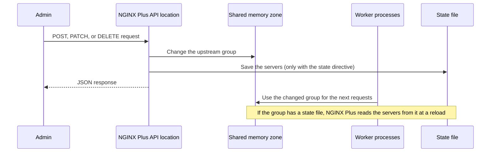

<span id="overview"></span>

## Overview

With F5 NGINX Plus, you can change the servers of an upstream group while NGINX runs, without reloading the configuration. This is useful for:

- Autoscaling, when you add servers.
- Maintenance, when you remove a server, set a backup server, or take a server down for a while.
- Tuning, when you change server parameters such as the weight, the maximum number of connections, slow start, or the failure timeout.
- Monitoring, when you get the state of a server or a server group with one request.

You make these changes with requests to the NGINX Plus REST API.

 In NGINX Plus [Release 12]() and earlier, the `upstream_conf` handler did dynamic configuration. That API, and the extended `status` API, were replaced by the NGINX Plus API in Release 13, and are no longer included since [Release 16](). 

NGINX Open Source doesn't have this API. In NGINX Open Source 1.27.3 and later, the `resolve` parameter of the [server](https://nginx.org/en/docs/http/ngx_http_upstream_module.html#server) directive updates the servers of a group when the IP addresses of a domain name change in DNS. It needs a `zone` in the group and a [resolver](https://nginx.org/en/docs/http/ngx_http_core_module.html#resolver) directive.

<span id="prereq"></span>

## Prerequisites

- NGINX Plus [R13]() or later. The examples on this page use version `9` of the API, which needs NGINX Plus [R30]() or later. With an earlier release, use the highest API version that your release supports, as listed in the [API compatibility notes](https://nginx.org/en/docs/http/ngx_http_api_module.html#compatibility).
- Upstream groups of application or web servers, as described in [HTTP Load Balancing]() and [TCP and UDP Load Balancing]().
- A shared memory zone in each group, as described in [Share data with multiple worker processes]().
- Permission to edit the configuration and reload NGINX. On most systems, this means root or `sudo` access.

---

## How dynamic configuration works

1. The configuration of each upstream group is kept in its shared memory zone. All worker processes use it.
2. You send a request to the location with the `api` directive. With `api write=on`, NGINX Plus accepts requests that change the group.
3. NGINX Plus changes the group in the shared memory zone. All worker processes use the changed group for the next requests, without a reload.
4. Without a state file, a configuration reload replaces the group with the servers in the configuration file, so the changes are lost. With a [state](#state) file, NGINX Plus saves each change in the file, and reads the servers from it at the next reload or restart.



Text description: An administrator sends a `POST`, `PATCH`, or `DELETE` request to the NGINX Plus API location. NGINX Plus changes the upstream group in the shared memory zone, saves the servers to the state file if the group has a `state` directive, and returns a JSON response. All worker processes use the changed group for the next requests. If the group has a state file, NGINX Plus reads the servers from it at a configuration reload. Otherwise, a reload restores the servers in the configuration file.

---

<span id="api_setup"></span>

## Enabling dynamic configuration

1. Create an upstream group, as described in [Proxy HTTP traffic to a group of servers](). Replace the server names with your own servers:

    ```nginx
    http {
        upstream appservers {
            server appserv1.example.com      weight=5;
            server appserv2.example.com:8080 fail_timeout=5s;
            server reserve1.example.com:8080 backup;
            server reserve2.example.com:8080 backup;
        }

        server {
            listen 80;

            # Location that passes requests to the upstream group
            location / {
                proxy_pass http://appservers;
            }
        }
    }
    ```

2. Add the [zone](https://nginx.org/en/docs/http/ngx_http_upstream_module.html#zone) directive to the `upstream` block. It sets the name and size of a shared memory zone. NGINX Plus keeps the configuration of the group in this zone, so all worker processes use the same configuration. The rest of the configuration stays the same:

    ```nginx
    http {
        upstream appservers {
            zone appservers 64k;

            server appserv1.example.com      weight=5;
            server appserv2.example.com:8080 fail_timeout=5s;
            server reserve1.example.com:8080 backup;
            server reserve2.example.com:8080 backup;
        }

        # ...
    }
    ```

3. Turn on the NGINX Plus API in read-write mode with the [api](https://nginx.org/en/docs/http/ngx_http_api_module.html#api) directive. Add a separate [location](https://nginx.org/en/docs/http/ngx_http_core_module.html#location) block for it to the `server` block from step 1.

    Restrict access to the location, and to the `PATCH`, `POST`, and `DELETE` methods. In this example, the [allow](https://nginx.org/en/docs/http/ngx_http_access_module.html#allow) and [deny](https://nginx.org/en/docs/http/ngx_http_access_module.html#deny) directives allow access only from the local address `127.0.0.1`. The [limit_except](https://nginx.org/en/docs/http/ngx_http_core_module.html#limit_except) block requires [HTTP basic authentication]() for all methods except `GET` and `HEAD`:

    ```nginx
    server {
        listen 80;

        location / {
            proxy_pass http://appservers;
        }

        # Location for dynamic configuration requests
        location /api {
            limit_except GET {
                auth_basic           "NGINX Plus API";
                auth_basic_user_file /etc/nginx/api.htpasswd;
            }
            api   write=on;
            allow 127.0.0.1;
            deny  all;
        }
    }
    ```

4. Create the password file with a user for the API, for example `admin`. The `openssl` command asks for the password twice:

    ```shell
    hash=$(openssl passwd -apr1) && printf 'admin:%s\n' "$hash" | sudo tee /etc/nginx/api.htpasswd >/dev/null
    ```

    The `tee` command replaces the file. To add another user to an existing file, use `tee -a`.

5. Test and reload the configuration:

    ```shell
    sudo nginx -t && sudo nginx -s reload
    ```

<span id="api_use"></span>

## Using the API for dynamic configuration

The NGINX Plus REST API supports these HTTP methods:

- `GET` – Show information about an upstream group or a server in it.
- `POST` – Add a server to the upstream group.
- `PATCH` – Change the parameters of a server.
- `DELETE` – Remove a server from the upstream group.

The endpoints and methods of the NGINX Plus API are described in the [ngx_http_api_module reference](https://nginx.org/en/docs/http/ngx_http_api_module.html). To explore the API in a browser, you can set up the Swagger UI, as described in [Enabling the Swagger UI](). NGINX Plus packages don't include it. It needs its own `location /swagger-ui` block; otherwise, `location /` passes its requests to the upstream group.

To change an upstream group, send an HTTP request with the matching method. These examples use `curl`, but any HTTP client works. Request bodies and responses are in JSON format.

Because the API location requires authentication for every method except `GET` and `HEAD`, the `-u admin` option makes `curl` ask for the password of the `admin` user. In scripts, use a `.netrc` file with the `--netrc-file` option instead of typing the password.

The URL of a request has these parts, in order:

- The host name or IP address of NGINX Plus. These examples use `127.0.0.1`.
- The location of the `api` directive, `/api`.
- The API version, here `9`.
- The path of the upstream group in the configuration: the context, `upstreams`, and the name of the group, for example `http/upstreams/appservers`.
- For a single server, `servers` and the server's ID. In the examples, replace `{server_id}` with the ID.

1. List the servers of the `appservers` group with their IDs:

    ```shell
    curl -s 'http://127.0.0.1/api/9/http/upstreams/appservers/servers'
    ```

2. Add a server to the group. The example adds it as a backup server that is down, so that it doesn't get traffic yet:

    ```shell
    curl -u admin -X POST -s 'http://127.0.0.1/api/9/http/upstreams/appservers/servers' \
         -H 'Content-Type: application/json' -d '{
        "server": "10.0.0.1:8089",
        "weight": 4,
        "max_conns": 0,
        "max_fails": 0,
        "fail_timeout": "10s",
        "slow_start": "10s",
        "backup": true,
        "down": true
    }'
    ```

    To find the ID of the new server, list the servers again.

3. Change a parameter of a server, for example take it down:

    ```shell
    curl -u admin -X PATCH -s 'http://127.0.0.1/api/9/http/upstreams/appservers/servers/{server_id}' \
         -H 'Content-Type: application/json' -d '{ "down": true }'
    ```

    To bring the server back, send `{ "down": false }`.

4. Remove a server from the group:

    ```shell
    curl -u admin -X DELETE -s 'http://127.0.0.1/api/9/http/upstreams/appservers/servers/{server_id}'
    ```

<span id="example"></span>

### Interactive example

You can explore the Swagger interface to the NGINX Plus API in read-only mode at [https://demo.nginx.com/swagger-ui/](https://demo.nginx.com/swagger-ui/).

<span id="state"></span>

## Configuring persistence of dynamic configuration

With the configuration in [Enabling dynamic configuration](#api_setup), NGINX Plus keeps the changes that you make with the API only in the shared memory zone. A configuration reload discards them.

To keep the changes across configuration reloads and restarts, keep the servers of the group in a state file instead of in `server` directives. A group can't have both.

1. Create a directory for state files that NGINX can write to. The recommended directory is `/var/lib/nginx/state/` on Linux, and `/var/db/nginx/state/` on FreeBSD.

2. Add the [state](https://nginx.org/en/docs/http/ngx_http_upstream_module.html#state) directive to the group, and remove the `server` directives:

    ```nginx
    http {
        upstream appservers {
            zone  appservers 64k;
            state /var/lib/nginx/state/appservers.conf;

            # All servers are defined in the state file
            # server appserv1.example.com      weight=5;
            # server appserv2.example.com:8080 fail_timeout=5s;
            # server reserve1.example.com:8080 backup;
            # server reserve2.example.com:8080 backup;
        }
    }
    ```

3. Reload the configuration, and add the servers with `POST` requests, as in [Using the API for dynamic configuration](#api_use).

4. List the servers with a `GET` request to check them.

Change the state file only with requests to the [API](https://nginx.org/en/docs/http/ngx_http_api_module.html). Don't edit the file directly, for example in a text editor.

---

## Complete example

This configuration passes requests to the `appservers` group, and lets local clients change the group with the NGINX Plus API. Add the `upstream` and `server` blocks to the `http` context of your configuration, and replace the server names with your own servers:

```nginx
http {
    # Configuration of the server group
    upstream appservers {
        zone appservers 64k;

        server appserv1.example.com      weight=5;
        server appserv2.example.com:8080 fail_timeout=5s;
        server reserve1.example.com:8080 backup;
        server reserve2.example.com:8080 backup;
    }

    server {
        listen 80;

        # Location that passes requests to the upstream group
        location / {
            proxy_pass http://appservers;
            health_check;  # NGINX Plus active health checks
        }

        # Location for dynamic configuration requests
        location /api {
            limit_except GET {
                auth_basic           "NGINX Plus API";
                auth_basic_user_file /etc/nginx/api.htpasswd;
            }
            api   write=on;
            allow 127.0.0.1;
            deny  all;
        }
    }
}
```

The `health_check` directive turns on [active health checks](), which use the same zone.

---

## Verify the configuration

1. List the servers of the group, and note the ID of a server:

    ```shell
    curl -s 'http://127.0.0.1/api/9/http/upstreams/appservers/servers'
    ```

    The output is a JSON array with one object for each server, with its `id`, `server` address, and parameters.

2. Take the server down, and get its parameters:

    ```shell
    curl -u admin -X PATCH -s 'http://127.0.0.1/api/9/http/upstreams/appservers/servers/{server_id}' \
         -H 'Content-Type: application/json' -d '{ "down": true }'
    curl -s 'http://127.0.0.1/api/9/http/upstreams/appservers/servers/{server_id}'
    ```

    The server now has `"down": true`.

3. Bring the server back:

    ```shell
    curl -u admin -X PATCH -s 'http://127.0.0.1/api/9/http/upstreams/appservers/servers/{server_id}' \
         -H 'Content-Type: application/json' -d '{ "down": false }'
    ```

---

## Troubleshooting

### Requests that change the group return 401

**Symptom**: `POST`, `PATCH`, and `DELETE` requests return `401 Unauthorized`, with an HTML page titled "401 Authorization Required", while `GET` requests work.

**Cause**: The `limit_except` block requires a user name and password for all methods except `GET` and `HEAD`. The request has no credentials, or wrong ones, or the password file has an empty or wrong password for the user.

**Fix**: Send the credentials, for example with `curl -u admin`. Check the error log for `user "admin": password mismatch` or `user "admin" was not found`, and create the password file again if needed.

### API requests from another host return 403

**Symptom**: Requests to the API from another host return `403 Forbidden`, even with the correct credentials.

**Cause**: The `allow 127.0.0.1` and `deny all` directives allow only local requests. The error log shows `access forbidden by rule`.

**Fix**: Add an `allow` directive for the address of your management host, before `deny all`. Basic authentication sends the password unencrypted, so use HTTPS for API requests from other hosts.

### The API rejects the request body

**Symptom**: A `POST` or `PATCH` request returns an error about the JSON body.

**Cause**: The request body isn't valid JSON. For example, a backslash at the end of a line inside single quotes stays in the body.

**Fix**: Write the JSON body without backslashes inside the quotes, as in the examples, and check it with a JSON tool.

### Changes are lost after a reload

**Symptom**: Servers that you added or changed with the API disappear after `nginx -s reload`.

**Cause**: The upstream group has no state file, so NGINX Plus reads the servers from the configuration file again.

**Fix**: Add a `state` directive to the group, as described in [Configuring persistence of dynamic configuration](#state).

---

## References

For more information, see:

- [ngx_http_api_module reference](https://nginx.org/en/docs/http/ngx_http_api_module.html) on nginx.org
- [HTTP Load Balancing]()
- [Restricting Access with HTTP Basic Authentication]()
