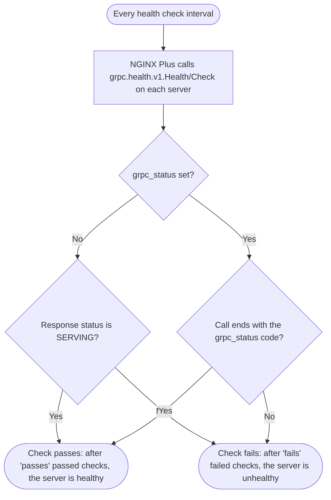

<span id="intro"></span>

## Introduction

F5 NGINX Plus can check the health of upstream gRPC servers with active health checks. NGINX Plus R23 and later support the [gRPC health checking protocol](https://github.com/grpc/grpc/blob/master/doc/health-checking.md#grpc-health-checking-protocol), so NGINX Plus can test whether a gRPC service is ready for new requests. This matters most in dynamic and containerized environments: with the `mandatory` parameter, NGINX Plus sends requests to a new instance of a gRPC service only after it's fully running.

NGINX Open Source has only passive health checks, as described in [HTTP Health Checks](). They detect servers that refuse connections or time out. They don't detect a server that answers but reports that it isn't serving.

<span id="prereq"></span>

## Prerequisites

- NGINX Plus R23 or later.
- An upstream group of gRPC servers in the `http` context, with a shared memory zone that keeps the state of the servers, for example:

    ```nginx
    http {
        upstream grpc_backend {
            zone   grpc_backend 64k;
            server 10.0.0.1:50051;
            server 10.0.0.2:50051;
        }
    }
    ```

- A server that accepts HTTP/2 and passes gRPC requests to the upstream group with the [grpc_pass](https://nginx.org/en/docs/http/ngx_http_grpc_module.html#grpc_pass) directive. gRPC requests have paths such as `/package.Service/Method`, so use `location /` unless you route services separately:

    ```nginx
    server {
        listen 80;
        http2  on;

        location / {
            grpc_pass grpc://grpc_backend;
        }
    }
    ```

    The `http2` directive is available in NGINX 1.25.1 and later, and in the NGINX Plus releases based on it. In earlier versions, add the `http2` parameter to the `listen` directive instead: `listen 80 http2;`. If you build NGINX Open Source from source, add the `--with-http_v2_module` option to `configure`. Without it, NGINX doesn't build the gRPC module either.

---

## How gRPC health checks work

With the `type=grpc` parameter of the `health_check` directive, NGINX Plus calls the `Check` method of the `grpc.health.v1.Health` service on each server in the group at regular intervals. By default, the call asks about the empty service name, which stands for the health of the whole server:

- By default, a server passes the check if it responds with the status `SERVING`.
- With the `grpc_status` parameter, a server passes the check if the call ends with that gRPC status code. Use it for servers that don't implement the health checking protocol.

As with other active health checks, NGINX Plus marks a server unhealthy after the number of consecutive failed checks set by the `fails` parameter, and healthy after the number of passed checks set by `passes`. Both are `1` by default. NGINX Plus sends client requests only to healthy servers.



Text description: At each health check interval, NGINX Plus calls the `Check` method of the gRPC health service on each server. Without `grpc_status`, the check passes if the server responds with `SERVING`. With `grpc_status`, the check passes if the call ends with that status code. After `passes` passed checks, a server is healthy, and after `fails` failed checks, it's unhealthy. NGINX Plus sends client requests only to healthy servers.

<span id="hc_grpc"></span>

## gRPC servers that support the health checking protocol

If your gRPC services support the gRPC health checking protocol, add the [type=grpc](https://nginx.org/en/docs/http/ngx_http_upstream_hc_module.html#health_check_grpc) parameter to the `health_check` directive:

```nginx
location / {
    grpc_pass    grpc://grpc_backend;
    health_check mandatory type=grpc;
}
```

NGINX Plus calls the `Check` method of the `Health` service, and considers servers that respond with `SERVING` healthy.

The `mandatory` parameter makes a server pass the health check before it gets traffic, for example when you add it to the group or reload the configuration.

If each upstream server has several gRPC services, you can check the most important one. Set its name with the `grpc_service` parameter. The name must be the name that the server's health service knows, often a full name such as `package.Service`:

```nginx
location / {
    grpc_pass    grpc://grpc_backend;
    health_check mandatory type=grpc grpc_service=MyStatus;
}
```

<span id="hc_grpc_status"></span>

## gRPC servers that don't support the health checking protocol

If your gRPC services don't implement the gRPC health checking protocol, you can still check that they respond to gRPC requests. NGINX Plus calls the `Check` method anyway, and expects a particular [status code](https://github.com/grpc/grpc/blob/master/doc/statuscodes.md#status-codes-and-their-use-in-grpc). Set the code with the `grpc_status` parameter:

```nginx
location / {
    grpc_pass    grpc://grpc_backend;
    health_check type=grpc grpc_status=12; # 12=unimplemented
}
```

A server that doesn't implement the `Health` service ends the call with status `12` (`UNIMPLEMENTED`), so it passes this check. A server that does implement it ends the call with status `0` (`OK`), so use `grpc_status=12` only for servers without the health service.

Rules for the parameters:

- `type=grpc` doesn't work together with the `uri` or `match` parameters of the `health_check` directive.
- `type=grpc` must come after all other parameters, except `grpc_service` and `grpc_status`, which must come after `type=grpc`.

---

## Example

This complete configuration passes gRPC requests on port 80 to two servers, and checks their health with the gRPC health checking protocol. It's a whole **nginx.conf**, so back up your existing file first. To add only the gRPC proxy to a configuration that reads files from `conf.d`, put the `upstream` and `server` blocks in a file there. If another server, such as the default website, also listens on port 80, make the gRPC server the default server for the port with `listen 80 default_server;`, or use another port. NGINX decides whether a connection uses HTTP/2 from the default server of the port.

```nginx
events {}

http {
    upstream grpc_backend {
        zone   grpc_backend 64k;
        server 10.0.0.1:50051;
        server 10.0.0.2:50051;
    }

    server {
        listen 80;
        http2  on;

        location / {
            grpc_pass    grpc://grpc_backend;
            health_check mandatory type=grpc;
        }
    }
}
```

To try the gRPC proxy with NGINX Open Source, remove the `health_check` line.

---

## Verify the configuration

1. Test and reload the configuration:

    ```shell
    sudo nginx -t && sudo nginx -s reload
    ```

2. Call the health service through NGINX, for example with the [grpc_health_probe](https://github.com/grpc-ecosystem/grpc-health-probe) tool. If you installed it with `go install`, the command is `grpc-health-probe`. This step works because `location /` passes the `/grpc.health.v1.Health/Check` path to the servers:

    ```shell
    grpc_health_probe -addr=127.0.0.1:80
    ```

    The output is `status: SERVING`. If you set `grpc_service`, add `-service=MyStatus`. A server that reports that it isn't serving gives `service unhealthy (responded with "NOT_SERVING")`.

3. To see the health check work, make one server report `NOT_SERVING`, and run the command several times. NGINX Plus stops sending requests to that server, so the output is always `status: SERVING`. Without the health check, the output alternates between the two servers' answers.

4. In NGINX Plus, check the state of the servers with the [NGINX Plus API](), or on the live activity monitoring dashboard. The API must be turned on in the configuration. A server that passes the health checks has the state `up`, and a server that fails them has the state `unhealthy`.

---

## Troubleshooting

### The configuration test reports "no port in upstream"

**Symptom**: `nginx -t` fails with `no port in upstream "grpc_backend"`.

**Cause**: There's no `upstream` block with that name in the `http` context. For example, the block is in the `stream` context, but `grpc_pass` is an HTTP directive and looks for the group in the `http` context. Or the block is missing, or its name is misspelled.

**Fix**: Define the `upstream` block in the `http` context, with the name that `grpc_pass` uses.

### gRPC clients can't connect through NGINX

**Symptom**: Clients report an error such as `error reading server preface: http2: frame too large`, or `grpc_health_probe` reports `timeout: failed to connect service "127.0.0.1:80" within 1s`. The access log shows `"PRI * HTTP/2.0" 400`.

**Cause**: The server that gets the connections doesn't accept HTTP/2, which gRPC needs. Either the gRPC server block doesn't have `http2 on;`, or another server block is the default server for the port. NGINX decides whether a connection uses HTTP/2 from the default server of the port.

**Fix**: Add `http2 on;` to the `server` block, or `listen 80 http2;` in versions before 1.25.1. Make the gRPC server the default server for its port with `listen 80 default_server;`, or give it its own port.

### All servers are unhealthy

**Symptom**: Clients get an error such as `unexpected HTTP status code received from server: 502 (Bad Gateway)`, the error log shows `no live upstreams`, and NGINX Plus marks all servers unhealthy.

**Cause and fix**: One of these:

- The servers don't implement the gRPC health checking protocol. They end the call with status `12`. Implement the health service, or use `grpc_status=12` for these servers.
- The service set with `grpc_service` doesn't exist on the servers. They end the call with status `5` (`NOT_FOUND`). Correct the name, or remove `grpc_service`.
- `grpc_status=12` is set, but the servers implement the health service. Remove `grpc_status`.
- The servers report `NOT_SERVING`, or NGINX can't connect to them. Check the servers and the network.

<span id="see_also"></span>

## References

For more information, see:

- [HTTP Health Checks]()
- [ngx_http_upstream_hc_module reference](https://nginx.org/en/docs/http/ngx_http_upstream_hc_module.html) on nginx.org
- [ngx_http_grpc_module reference](https://nginx.org/en/docs/http/ngx_http_grpc_module.html) on nginx.org
- [Deploying NGINX Plus as an API Gateway, Part 3: Publishing gRPC Services](https://www.nginx.com/blog/deploying-nginx-plus-as-an-api-gateway-part-3-publishing-grpc-services/)
