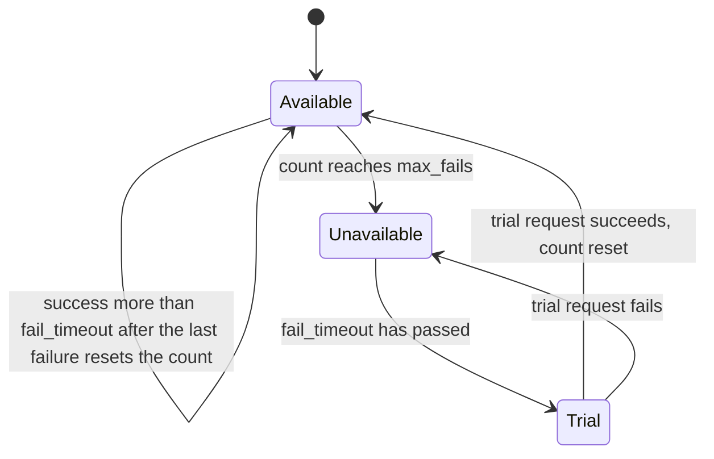
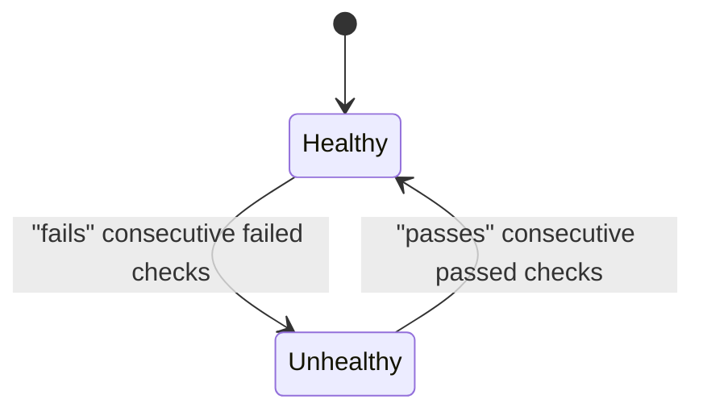

<span id="intro"></span>

## Introduction

NGINX Open Source and F5 NGINX Plus can test your upstream servers, stop sending requests to servers that fail, and add recovered servers back to the load-balanced group. There are two kinds of health checks:

- **Passive health checks**, in NGINX Open Source and NGINX Plus: NGINX watches the requests it passes to each server, and marks a server unavailable after failures.
- **Active health checks**, in NGINX Plus: NGINX Plus sends its own health-check requests to each server at regular intervals, and checks the responses.

<span id="prereq"></span>

## Prerequisites

- For passive health checks, [NGINX Open Source](https://nginx.org/en/) or [NGINX Plus](https://www.f5.com/products/nginx/nginx-plus).
- For active health checks and the [live activity monitoring dashboard](), NGINX Plus.
- A load-balanced group of [HTTP upstream servers]().
- Permission to edit the configuration and reload NGINX. On most systems, this means root or `sudo` access.

---

<span id="hc_passive"></span>

## Passive health checks

With passive health checks, NGINX counts the failed attempts to pass requests to each server. These attempts count as failures:

- An error or a timeout while NGINX connects to the server, sends the request, or reads the response header.
- An invalid response header.
- A response that matches a condition listed in [proxy_next_upstream](https://nginx.org/en/docs/http/ngx_http_proxy_module.html#proxy_next_upstream), such as `http_500` or `http_503`. It counts only if NGINX then passes the request to the next server. For that, a server must be left to try, and the [proxy_next_upstream_tries](https://nginx.org/en/docs/http/ngx_http_proxy_module.html#proxy_next_upstream_tries) and [proxy_next_upstream_timeout](https://nginx.org/en/docs/http/ngx_http_proxy_module.html#proxy_next_upstream_timeout) limits must allow it. Requests such as `POST` also need the `non_idempotent` parameter. The `http_403` and `http_404` conditions never count as failures.

Errors, timeouts, and invalid headers count as failures even with `proxy_next_upstream off`.

Two parameters of the [server](https://nginx.org/en/docs/http/ngx_http_upstream_module.html#server) directive in the `upstream` block control when NGINX marks a server unavailable:

- [max_fails](https://nginx.org/en/docs/http/ngx_http_upstream_module.html#max_fails) – The number of failures after which NGINX marks the server unavailable. The default is `1`. The value `0` turns off the accounting for the server.
- [fail_timeout](https://nginx.org/en/docs/http/ngx_http_upstream_module.html#fail_timeout) – How long NGINX then considers the server unavailable. The default is `10s`.

NGINX adds each failure to a count for the server. A successful request resets the count only if NGINX sent it more than `fail_timeout` after the last failure. So failures that are further apart than `fail_timeout` still add up, unless such a request succeeds in between. When the count reaches `max_fails`, NGINX marks the server unavailable. After `fail_timeout`, NGINX sends one trial request to the server. If it succeeds, the count is reset and the server is available again. If it fails, the server is unavailable for another `fail_timeout`.



Text description: A server starts as available. Each failure adds to its count of failures, and a successful request more than `fail_timeout` after the last failure resets the count. When the count reaches `max_fails`, NGINX marks the server unavailable. After `fail_timeout`, NGINX sends one trial request: if it succeeds, the server is available again, and if it fails, the server is unavailable for another `fail_timeout`.

In the following example, NGINX marks `backend2.example.com` unavailable for 30 seconds after 3 failures:

```nginx
upstream backend {
    server backend1.example.com;
    server backend2.example.com max_fails=3 fail_timeout=30s;
}
```

If a group has only one server address and no backup servers, NGINX ignores `max_fails` and `fail_timeout` and never marks that server unavailable.

NGINX logs `upstream server temporarily disabled` at the `warn` level when it marks a server unavailable, so set the [error_log](https://nginx.org/en/docs/ngx_core_module.html#error_log) level to `warn` or lower to see it. If no server in the group is available, NGINX logs `no live upstreams` and returns `502`.

Without a shared memory zone, each worker process keeps its own count of failures for each server. With several worker processes, a failed server then gets more requests before every worker process stops using it. To share the counts between the worker processes, add the [zone](https://nginx.org/en/docs/http/ngx_http_upstream_module.html#zone) directive to the upstream group, as in the [example](#example).

<span id="slow_start"></span>

### Server slow start

This feature needs NGINX Plus.

A recently recovered server can get more connections than it can handle, and be marked unavailable again. With slow start, a server's weight rises from zero to its configured value over a set time after it recovers or becomes available. Set it with the [slow_start](https://nginx.org/en/docs/http/ngx_http_upstream_module.html#slow_start) parameter of the [server](https://nginx.org/en/docs/http/ngx_http_upstream_module.html#server) directive:

```nginx
upstream backend {
    server backend1.example.com slow_start=30s;
    server backend2.example.com;
    server 192.0.2.1 backup;
}
```

If a group has only one server, NGINX Plus ignores `slow_start`.

<span id="hc_active"></span>

## Active health checks

This feature needs NGINX Plus.

NGINX Plus can check the health of upstream servers by sending health-check requests to each server at regular intervals and checking the responses.

To turn on active health checks:

1. In the [location](https://nginx.org/en/docs/http/ngx_http_core_module.html#location) that passes requests ([proxy_pass](https://nginx.org/en/docs/http/ngx_http_proxy_module.html#proxy_pass)) to an upstream group, add the [health_check](https://nginx.org/en/docs/http/ngx_http_upstream_hc_module.html#health_check) directive:

    ```nginx
    server {
        location / {
            proxy_pass   http://backend;
            health_check;
        }
    }
    ```

    By default, NGINX Plus sends a request for **/** to each server in the `backend` group every five seconds. The health check fails if an error or a timeout occurs, or if the server responds with a status code outside the range `200` to `399`. NGINX Plus then marks the server unhealthy, and sends it no client requests until it passes a health check again.

    To send health checks to another port, for example to monitor several services on the same host, use the [port](https://nginx.org/en/docs/http/ngx_http_upstream_hc_module.html#health_check_port) parameter:

    ```nginx
    server {
        location / {
            proxy_pass   http://backend;
            health_check port=8080;
        }
    }
    ```

2. In the upstream group, define a shared memory zone with the [zone](https://nginx.org/en/docs/http/ngx_http_upstream_module.html#zone) directive. Active health checks need it:

    ```nginx
    http {
        upstream backend {
            zone backend 64k;
            server backend1.example.com;
            server backend2.example.com;
            server backend3.example.com;
            server backend4.example.com;
        }
    }
    ```

    The zone is shared by all worker processes and stores the configuration of the upstream group. This [lets the worker processes]() use the same counters for the servers in the group.

3. Optionally, change the defaults with parameters of the `health_check` directive:

    ```nginx
    location / {
        proxy_pass   http://backend;
        health_check interval=10 fails=3 passes=2;
    }
    ```

    - [interval](https://nginx.org/en/docs/http/ngx_http_upstream_hc_module.html#health_check_interval) sets the time between health checks, here 10 seconds instead of the default 5 seconds.
    - [fails](https://nginx.org/en/docs/http/ngx_http_upstream_hc_module.html#health_check_fails) sets how many consecutive failed checks mark the server unhealthy, here 3 instead of 1.
    - [passes](https://nginx.org/en/docs/http/ngx_http_upstream_hc_module.html#health_check_passes) sets how many consecutive passed checks mark the server healthy again, here 2 instead of 1.

    To reuse health-check connections, use the [keepalive_time](https://nginx.org/en/docs/http/ngx_http_upstream_hc_module.html#health_check_keepalive_time) parameter. For TLS upstream servers, this avoids a full TLS handshake for every health check:

    ```nginx
    location / {
        proxy_http_version 1.1;
        proxy_set_header   Connection "";
        proxy_pass         https://backend;
        health_check       interval=1 keepalive_time=60s;
    }
    ```



Text description: With active health checks, NGINX Plus marks a healthy server unhealthy after the number of consecutive failed checks set by `fails`, and marks it healthy again after the number of consecutive passed checks set by `passes`.

<span id="hc_uri"></span>

### Specifying the requested URI

Use the [uri](https://nginx.org/en/docs/http/ngx_http_upstream_hc_module.html#health_check_uri) parameter of the `health_check` directive to set the URI that the health checks request:

```nginx
location / {
    proxy_pass   http://backend;
    health_check uri=/some/path;
}
```

NGINX Plus appends the URI to the domain name or IP address of each server in the `upstream` block. For the first server in the `backend` group above, a health check requests `http://backend1.example.com/some/path`.

<span id="hc_match"></span>

### Defining custom conditions

You can set conditions that the response must meet for the server to pass the health check. Define them in a [match](https://nginx.org/en/docs/http/ngx_http_upstream_hc_module.html#match) block, and refer to the block with the [match](https://nginx.org/en/docs/http/ngx_http_upstream_hc_module.html#health_check_match) parameter of the `health_check` directive.

1. In the `http` context, add a `match` block and name it, for example `server_ok`:

    ```nginx
    http {
        match server_ok {
            # tests are here
        }
    }
    ```

2. Refer to the block with the `match` parameter of the `health_check` directive:

    ```nginx
    http {
        match server_ok {
            status 200-399;
            body   !~ "maintenance mode";
        }

        server {
            location / {
                proxy_pass   http://backend;
                health_check match=server_ok;
            }
        }
    }
    ```

    Here, the server passes the health check if the response status code is in the range `200` to `399`, and the body doesn't contain the string `maintenance mode`.

A `match` block can test the status code, header fields, and the body of a response. It can check whether the status is in a range, whether a response has a header, and whether a header or the body matches a regular expression. A `match` block can contain one status condition, one body condition, and several header conditions. The response must meet all conditions in the block.

For example, this `match` block matches responses with status code `200`, the exact value `text/html` in the `Content-Type` header, and the text `Welcome to nginx!` in the body:

```nginx
match welcome {
    status 200;
    header Content-Type = text/html;
    body   ~ "Welcome to nginx!";
}
```

An exclamation point (`!`) defines what the response must not have. In this example, the health check passes if the status code isn't `301`, `302`, `303`, or `307`, and there's no `Refresh` header:

```nginx
match not_redirect {
    status ! 301-303 307;
    header ! Refresh;
}
```

<span id="hc_mandatory"></span>

### Mandatory health checks

By default, NGINX Plus considers a new server in an upstream group healthy and sends it traffic right away. For servers added through the API or through DNS resolution, you might want a health check to pass first.

The [mandatory](https://nginx.org/en/docs/http/ngx_http_upstream_hc_module.html#health_check_mandatory) parameter requires every new server to pass all configured health checks before NGINX Plus sends it traffic. Combined with [slow start](#slow_start), it also gives a new server time to connect to databases and warm up before it gets its full share of traffic.

With the [persistent](https://nginx.org/en/docs/http/ngx_http_upstream_hc_module.html#health_check_persistent) parameter together with `mandatory`, NGINX Plus remembers the state of each server across configuration reloads:

```nginx
upstream my_upstream {
    zone   my_upstream 64k;
    server backend1.example.com slow_start=30s;
    server backend2.example.com slow_start=30s;
}

server {
    location / {
        proxy_pass   http://my_upstream;
        health_check mandatory persistent;
    }
}
```

Here, servers added to the upstream group with the API, or by DNS with the `resolve` parameter of the `server` directive, are marked unhealthy and get no traffic until they pass the health check. Then, over 30 seconds, they get a gradually increasing share of traffic. If a server was healthy before a configuration reload, NGINX Plus doesn't repeat the mandatory health check after the reload, and considers the server `up`.

Active health checks are also available for other protocols, such as [FastCGI](https://nginx.org/en/docs/http/ngx_http_fastcgi_module.html), [memcached](https://nginx.org/en/docs/http/ngx_http_memcached_module.html), [SCGI](https://nginx.org/en/docs/http/ngx_http_scgi_module.html), [uwsgi](https://nginx.org/en/docs/http/ngx_http_uwsgi_module.html), and [TCP and UDP]().

---

## Example

This complete configuration uses passive health checks, which work in NGINX Open Source and NGINX Plus. It's a whole **nginx.conf**, so back up your existing file first. To add only the load balancer to a configuration that reads files from `conf.d`, put the `upstream` and `server` blocks in a file there, and check that the `error_log` level is `warn` or lower. Replace `192.0.2.11` and `192.0.2.12` with the addresses of your servers.

```nginx
error_log /var/log/nginx/error.log warn;

events {}

http {
    upstream backend {
        zone backend 64k;
        server 192.0.2.11:8080 max_fails=3 fail_timeout=30s;
        server 192.0.2.12:8080 max_fails=3 fail_timeout=30s;
    }

    server {
        listen      80;
        server_name www.example.com;

        location / {
            proxy_pass http://backend;
            proxy_next_upstream error timeout http_502 http_503;
        }
    }
}
```

- The `zone` directive shares the failure counts between the worker processes.
- `proxy_next_upstream` adds `http_502` and `http_503` responses to the failures that NGINX passes to the other server and counts.
- With NGINX Plus, add `health_check;` to the `location` block to also run active health checks.

---

## Verify the configuration

1. Test and reload the configuration:

    ```shell
    sudo nginx -t && sudo nginx -s reload
    ```

2. Stop the web service on one of the upstream servers, but leave the host running. Then send 10 requests:

    ```shell
    for i in $(seq 1 10); do curl -s -o /dev/null -w '%{http_code}\n' -H 'Host: www.example.com' http://127.0.0.1/; done
    ```

    All 10 requests return `200`: NGINX passes the failed requests to the other server. Round robin sends about every second request to the stopped server, so after about 5 requests, NGINX has counted 3 failures and marks the server unavailable.

3. Check the error log:

    ```shell
    sudo grep -E 'connect\(\) failed|temporarily disabled' /var/log/nginx/error.log | tail -4
    ```

    The output has three `[error] ... connect() failed` lines and one `[warn] ... upstream server temporarily disabled` line. Each line ends with the address of the stopped server, for example `upstream: "http://192.0.2.11:8080/"`.

---

## Troubleshooting

### A failed server still gets requests

**Symptom**: Requests keep going to a server that returns errors.

**Cause**: One of these:

- Its responses don't count as failures. Only errors, timeouts, invalid headers, and the conditions listed in `proxy_next_upstream` count. A listed status counts only if NGINX passes the request to another server, so it doesn't count for `POST` requests unless `non_idempotent` is listed.
- The group has only one server address and no backup servers, so NGINX never marks the server unavailable.
- The server has `max_fails=0`.

**Fix**: Add the status codes to `proxy_next_upstream`, for example `http_502 http_503`. With NGINX Plus, use active health checks with a `match` block.

### All servers are marked unavailable at once

**Symptom**: Requests return `502`, and the error log shows `no live upstreams`.

**Cause**: Every server reached `max_fails`, for example after a short network problem. Or every server returns a status listed in `proxy_next_upstream`, so NGINX counts each response as a failure. Clients then get `502` instead of the servers' own error responses.

**Fix**: Raise `max_fails`, or lower `fail_timeout` so that servers come back sooner. Check the servers and the network.

---

## References

For more information, see:

- [HTTP Load Balancing]()
- [TCP Health Checks]()
- [ngx_http_upstream_hc_module reference](https://nginx.org/en/docs/http/ngx_http_upstream_hc_module.html) on nginx.org
