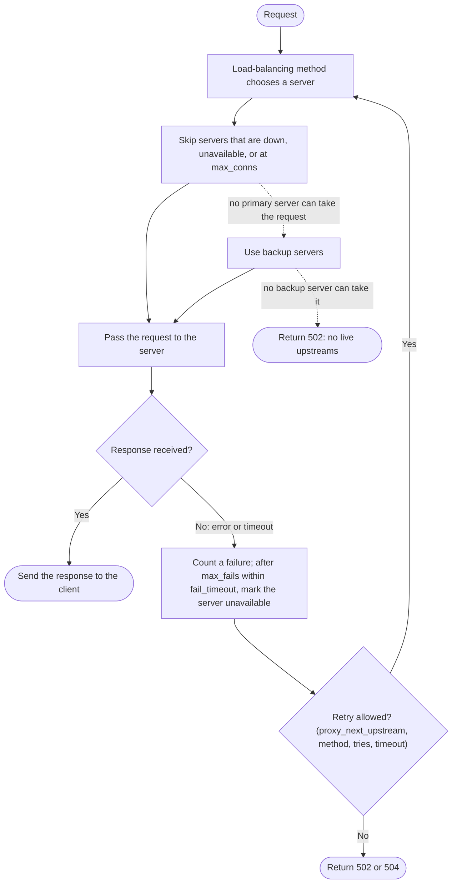

## Overview {#overview}

[Load balancing](https://www.f5.com/glossary/load-balancer) distributes requests across several instances of an application. It improves resource use, throughput, response time, and fault tolerance.

NGINX Open Source and F5 NGINX Plus load balance HTTP and HTTPS traffic at Layer 7, the application layer. Use this guide to define a group of servers, choose how NGINX distributes requests among them, and control what happens when a server fails.

For Layer 4 (transport layer) load balancing, see [TCP and UDP Load Balancing]().

---

## Before you begin

Before you begin, make sure you have:

- **NGINX Open Source or NGINX Plus installed and running**. Some features need NGINX Plus or a recent NGINX Open Source version. This page marks them.
- **Two or more servers that run your application**.
- **Permission to edit the configuration and reload NGINX**: On most systems, this means root or `sudo` access.

---

## How load balancing works

For each request to a location with `proxy_pass http://<group>`, NGINX does the following:

1. It uses the group's load-balancing method to choose a server. It skips servers that are marked `down`, servers that NGINX considers unavailable, and servers that have reached their `max_conns` limit.
2. It passes the request to that server.
3. If the attempt fails, NGINX counts a failure for the server. An error or a timeout always counts. The other conditions listed in [proxy_next_upstream](https://nginx.org/en/docs/http/ngx_http_proxy_module.html#proxy_next_upstream) count too, except `http_403` and `http_404`.
4. NGINX passes the request to the next server if `proxy_next_upstream` allows it (by default, after `error` and `timeout`). It doesn't retry a `POST`, `LOCK`, or `PATCH` request that it has already sent, unless `proxy_next_upstream` has `non_idempotent`. The `proxy_next_upstream_tries` and `proxy_next_upstream_timeout` directives limit the retries.
5. If a server fails `max_fails` times (default `1`) within `fail_timeout` (default `10s`), NGINX considers it unavailable for `fail_timeout`, then tries it again.
6. If no primary server can take the request, NGINX uses the servers marked `backup`. This happens when all primary servers are down, unavailable, at their `max_conns` limit, or already tried for this request. If no backup server can take it either, NGINX returns `502` and logs `no live upstreams`.



Text description: The load-balancing method chooses a server, skipping servers that are down, unavailable, or at their connection limit. If the server responds, NGINX sends the response to the client. If the attempt fails, NGINX counts a failure, marks the server unavailable after `max_fails` failures, and tries the next server if a retry is allowed. Otherwise, it returns `502` or `504`. When no primary server can take the request, NGINX uses the backup servers, and returns `502` if none of them can take it either.

---

## Proxy HTTP traffic to a group of servers {#proxy_pass}

1. Define the group of servers with the [upstream](https://nginx.org/en/docs/http/ngx_http_upstream_module.html#upstream) directive in the [http](https://nginx.org/en/docs/http/ngx_http_core_module.html#http) context. Add each server with the [server](https://nginx.org/en/docs/http/ngx_http_upstream_module.html#server) directive. This `server` directive isn't the `server` block that defines a virtual server.

    This group, named **backend**, has three `server` directives. A domain name can resolve to several IP addresses, so the group can contain more than three servers:

    ```nginx
    http {
        upstream backend {
            server backend1.example.com weight=5;
            server backend2.example.com;
            server 192.0.0.1 backup;
        }
    }
    ```

2. Pass requests to the group by its name in the [proxy_pass](https://nginx.org/en/docs/http/ngx_http_proxy_module.html#proxy_pass) directive:

    ```nginx
    server {
        listen 80;

        location / {
            proxy_pass http://backend;
        }
    }
    ```

    For other protocols, use the matching directive: [fastcgi_pass](https://nginx.org/en/docs/http/ngx_http_fastcgi_module.html#fastcgi_pass), [memcached_pass](https://nginx.org/en/docs/http/ngx_http_memcached_module.html#memcached_pass), [scgi_pass](https://nginx.org/en/docs/http/ngx_http_scgi_module.html#scgi_pass), [uwsgi_pass](https://nginx.org/en/docs/http/ngx_http_uwsgi_module.html#uwsgi_pass), or [grpc_pass](https://nginx.org/en/docs/http/ngx_http_grpc_module.html#grpc_pass).

NGINX resolves the domain names in an `upstream` group when it loads the configuration. If a name doesn't resolve, the configuration test fails with `host not found in upstream`. To resolve names again while NGINX runs, see [Configure HTTP load balancing using DNS](#resolve).

<span id="choosing-a-load-balancing-method"></span>

## Choose a load balancing method {#method}

NGINX Open Source and NGINX Plus support these load-balancing methods: Round Robin, Least Connections, Least Time, IP Hash, Generic Hash, and Random.

Put the directive of the method ([least_conn](https://nginx.org/en/docs/http/ngx_http_upstream_module.html#least_conn), [least_time](https://nginx.org/en/docs/http/ngx_http_upstream_module.html#least_time), [ip_hash](https://nginx.org/en/docs/http/ngx_http_upstream_module.html#ip_hash), [hash](https://nginx.org/en/docs/http/ngx_http_upstream_module.html#hash), or [random](https://nginx.org/en/docs/http/ngx_http_upstream_module.html#random)) in the `upstream` block, before the `server` directives.

1. **Round Robin** – NGINX distributes requests evenly across the servers, taking [server weights](#weights) into account. This is the default method. It has no directive.

    ```nginx
    upstream backend {
        # no load balancing method is specified for Round Robin
        server backend1.example.com;
        server backend2.example.com;
    }
    ```

2. **[Least Connections](https://nginx.org/en/docs/http/ngx_http_upstream_module.html#least_conn)** – NGINX sends each request to the server with the fewest active connections, taking server weights into account.

    ```nginx
    upstream backend {
        least_conn;
        server backend1.example.com;
        server backend2.example.com;
    }
    ```

3. **[IP Hash](https://nginx.org/en/docs/http/ngx_http_upstream_module.html#ip_hash)** – NGINX chooses the server from the client IP address. It uses the first three octets of an IPv4 address, or the whole IPv6 address. Requests from the same address go to the same server, unless that server is unavailable.

    ```nginx
    upstream backend {
        ip_hash;
        server backend1.example.com;
        server backend2.example.com;
    }
    ```

    To take a server out of rotation temporarily, mark it with the [down](https://nginx.org/en/docs/http/ngx_http_upstream_module.html#down) parameter. This keeps the mapping of client addresses to the other servers. NGINX sends the requests for the removed server to another server in the group.

    ```nginx
    upstream backend {
        ip_hash;
        server backend1.example.com;
        server backend2.example.com;
        server backend3.example.com down;
    }
    ```

4. **Generic [Hash](https://nginx.org/en/docs/http/ngx_http_upstream_module.html#hash)** – NGINX chooses the server from a key that you define. The key can be text, variables, or both, for example the client IP address and port. This example uses the request URI:

    ```nginx
    upstream backend {
        hash $request_uri consistent;
        server backend1.example.com;
        server backend2.example.com;
    }
    ```

    The optional `consistent` parameter of the `hash` directive turns on ketama consistent hashing. When you add a server to the group or remove one, only a few keys move to other servers. This keeps cache misses low, which helps for cache servers and other applications that keep state.

5. **[Least Time](https://nginx.org/en/docs/http/ngx_http_upstream_module.html#least_time)** (NGINX Plus, and NGINX Open Source 1.31.0 and later) – NGINX sends each request to the server with the lowest average response time and the fewest active connections, taking server weights into account. A parameter sets which time NGINX measures:

    - `header` – Time to receive the response header.
    - `last_byte` – Time to receive the full response.

    With the optional `inflight` parameter, for example `least_time last_byte inflight`, NGINX also counts requests that are still in progress.

    ```nginx
    upstream backend {
        least_time header;
        server backend1.example.com;
        server backend2.example.com;
    }
    ```

6. **[Random](https://nginx.org/en/docs/http/ngx_http_upstream_module.html#random)** – NGINX sends each request to a randomly chosen server, taking server weights into account. With the `two` parameter, NGINX chooses two servers at random, then picks one of them with a second method:

    - `least_conn` – The server with fewer active connections. This is the default.
    - `least_time=header` (NGINX Plus only; NGINX Open Source doesn't support this parameter, even in versions that have the `least_time` method) – The server with the lower average time to receive the response header ([$upstream_header_time](https://nginx.org/en/docs/http/ngx_http_upstream_module.html#var_upstream_header_time)).
    - `least_time=last_byte` (NGINX Plus) – The server with the lower average time to receive the full response ([$upstream_response_time](https://nginx.org/en/docs/http/ngx_http_upstream_module.html#var_upstream_response_time)).

    ```nginx
    upstream backend {
        random two least_conn;
        server backend1.example.com;
        server backend2.example.com;
        server backend3.example.com;
        server backend4.example.com;
    }
    ```

    Use the Random method when several load balancers pass requests to the same servers. When one load balancer sees all requests, use another method.

The IP Hash, Generic Hash, and Random methods don't support `backup` servers. NGINX checks this only if the method's directive comes before the `server` directives, so always put it first.

## Server weights {#weights}

All load-balancing methods distribute requests according to server weights. The [weight](https://nginx.org/en/docs/http/ngx_http_upstream_module.html#weight) parameter of the `server` directive sets a server's weight. The default weight is `1`.

```nginx
upstream backend {
    server backend1.example.com weight=5;
    server backend2.example.com;
    server 192.0.0.1 backup;
}
```

In this example, **backend1.example.com** has weight `5`, and the other two servers have the default weight `1`. The server at `192.0.0.1` is a `backup` server, so it gets requests only when neither of the other servers can take them. Out of every 6 requests, NGINX sends 5 to **backend1.example.com** and 1 to **backend2.example.com**.

## Passive health checks and failover

NGINX marks a server as unavailable after failed attempts to pass it requests. Two parameters of the `server` directive control this:

- [max_fails](https://nginx.org/en/docs/http/ngx_http_upstream_module.html#max_fails) – The number of failed attempts within `fail_timeout` after which NGINX considers the server unavailable. The default is `1`. The value `0` turns off the accounting.
- [fail_timeout](https://nginx.org/en/docs/http/ngx_http_upstream_module.html#fail_timeout) – The period in which failures are counted, and how long NGINX considers the server unavailable. The default is `10s`.

```nginx
upstream backend {
    server backend1.example.com max_fails=3 fail_timeout=30s;
    server backend2.example.com;
}
```

If a group has only one server address and no backup servers, NGINX ignores `max_fails` and `fail_timeout` and never considers that server unavailable. A domain name that resolves to several addresses counts as several servers.

For more about passive and active health checks, see [HTTP Health Checks]().

<span id="server-slow-start"></span>

## Server slow-start {#slow_start}

This feature needs NGINX Plus.

Slow-start keeps a recently recovered server from getting more connections than it can handle. Otherwise, it might time out and be marked as failed again. The [slow_start](https://nginx.org/en/docs/http/ngx_http_upstream_module.html#slow_start) parameter of the `server` directive sets the time during which NGINX Plus raises the server's weight from `0` to its configured value:

```nginx
upstream backend {
    server backend1.example.com slow_start=30s;
    server backend2.example.com;
    server 192.0.0.1 backup;
}
```

The default is `0`, which turns slow-start off. If a group has only one server, NGINX Plus ignores `slow_start`.

<span id="session-persistence"></span>
<span id="enabling-session-persistence"></span>

## Session persistence {#sticky}

With session persistence, NGINX identifies user sessions and sends all requests in a session to the same server. Configure it with the [sticky](https://nginx.org/en/docs/http/ngx_http_upstream_module.html#sticky) directive, available in NGINX Plus and in NGINX Open Source 1.29.6 and later. In earlier versions of NGINX Open Source, use the `hash` or `ip_hash` method instead, as described in [Choose a load balancing method](#method).

The `sticky` directive has three methods:

- **[Sticky cookie](https://nginx.org/en/docs/http/ngx_http_upstream_module.html#sticky_cookie)** – NGINX adds a cookie that identifies the server to the responses from the group. The client's next requests include the cookie, and NGINX sends them to the same server. This is the simplest method.

    ```nginx
    upstream backend {
        server backend1.example.com;
        server backend2.example.com;
        sticky cookie srv_id expires=1h domain=.example.com path=/;
    }
    ```

    In this example, `srv_id` is the name of the cookie. The optional `expires` parameter sets how long the browser keeps the cookie, here 1 hour. The optional `domain` and `path` parameters set the domain and path of the cookie.

- **[Sticky route](https://nginx.org/en/docs/http/ngx_http_upstream_module.html#sticky_route)** – Assign a route identifier to each server with the [route](https://nginx.org/en/docs/http/ngx_http_upstream_module.html#route) parameter of the `server` directive. NGINX takes the route of a request from variables, usually a cookie or a part of the URI, and sends the request to the server with that route.

    ```nginx
    map $cookie_jsessionid $route_cookie {
        ~.+\.(?P<route>\w+)$ $route;
    }

    map $request_uri $route_uri {
        ~jsessionid=.+\.(?P<route>\w+)$ $route;
    }

    upstream backend {
        server backend1.example.com route=a;
        server backend2.example.com route=b;
        sticky route $route_cookie $route_uri;
    }
    ```

    In this example, NGINX takes the route from the `JSESSIONID` cookie first. If there's none, it takes the route from the URI.

- **[Sticky learn](https://nginx.org/en/docs/http/ngx_http_upstream_module.html#sticky_learn)** – NGINX finds session identifiers in requests and responses, and learns which server each session belongs to. The identifiers are usually in an HTTP cookie. If a request contains a learned session identifier, NGINX sends it to the matching server:

    ```nginx
    upstream backend {
        server backend1.example.com;
        server backend2.example.com;
        sticky learn
            create=$upstream_cookie_examplecookie
            lookup=$cookie_examplecookie
            zone=client_sessions:1m
            timeout=1h;
    }
    ```

    In this example, a server creates a session by setting the `EXAMPLECOOKIE` cookie in its response. The parameters work like this:

    - `create` (required) sets the variable from which NGINX creates new sessions, here the `EXAMPLECOOKIE` cookie from the server.
    - `lookup` (required) sets how NGINX searches for existing sessions, here in the `EXAMPLECOOKIE` cookie from the client.
    - `zone` (required) sets the shared memory zone that stores the sessions, here **client_sessions** with a size of 1 MB.
    - `timeout` sets how long an unused session is kept, here 1 hour.

    This method doesn't depend on the client keeping a cookie from NGINX: NGINX keeps all session information in the shared memory zone.

    With NGINX Plus, several NGINX instances in a cluster can share learned sessions. The zones must have the same name, the [zone_sync](https://nginx.org/en/docs/stream/ngx_stream_zone_sync_module.html#zone_sync) feature must be configured on each instance, and the `sticky` directive needs the `sync` parameter:

    ```nginx
    upstream backend {
        server backend1.example.com;
        server backend2.example.com;
        sticky learn
            create=$upstream_cookie_examplecookie
            lookup=$cookie_examplecookie
            zone=client_sessions:1m
            timeout=1h
            sync;
    }
    ```

    For details, see [Runtime State Sharing in a Cluster]().

## Limit the number of connections {#maxconns}

The [max_conns](https://nginx.org/en/docs/http/ngx_http_upstream_module.html#max_conns) parameter of the `server` directive limits the number of active connections to a server. When all primary servers have reached their limit, NGINX tries the backup servers. If none can take the request, it returns `502` and logs `no live upstreams`.

With NGINX Plus, the [queue](https://nginx.org/en/docs/http/ngx_http_upstream_module.html#queue) directive holds requests in a queue instead. It sets the maximum number of requests in the queue and how long a request can wait. If the queue is full, or a request waits longer than the timeout, the client gets an error.

```nginx
upstream backend {
    server backend1.example.com max_conns=3;
    server backend2.example.com;
    queue 100 timeout=70; # NGINX Plus only
}
```

The `max_conns` limit doesn't count idle [keepalive](https://nginx.org/en/docs/http/ngx_http_upstream_module.html#keepalive) connections opened by other [worker processes](https://nginx.org/en/docs/ngx_core_module.html#worker_processes). So, the total number of connections to the server can exceed `max_conns`, even when the group's configuration is [shared among worker processes](#zone).

## Configure health checks {#health}

NGINX can test your HTTP servers, stop sending requests to servers that fail, and add servers back when they recover. NGINX Open Source uses passive health checks, as described in [Passive health checks and failover](#passive-health-checks-and-failover). NGINX Plus adds active health checks.

For instructions, see [HTTP Health Checks]().

<span id="sharing-data-with-multiple-worker-processes"></span>

## Share data with multiple worker processes {#zone}

Without the [zone](https://nginx.org/en/docs/http/ngx_http_upstream_module.html#zone) directive in an `upstream` block, each worker process keeps its own copy of the group's configuration and its own counters. The counters include the number of active connections to each server and the number of failed attempts.

With the `zone` directive, the group's configuration and counters are kept in memory shared by all worker processes. The `zone` directive is required for [active health checks](), the `resolve` parameter, and [dynamic reconfiguration]() with the NGINX Plus API.

Other features also work better with a shared zone:

- **Passive health checks**: Without a zone, each worker process counts failures for a server on its own. One worker process can consider a server unavailable while others still send it requests. Then a server is unavailable to all worker processes only after `max_fails` failures in each of them.
- **Least Connections**: Without a zone, each worker process counts only its own connections. Under low load, several worker processes can send requests to the same server at the same time. Under high load, requests are spread evenly among worker processes, and the method works as expected.

### Set the zone size {#zone-size}

The right zone size depends on the features you use, such as [session persistence](#sticky), [health checks](), and [DNS re-resolving](#resolve), and on how you identify the servers.

For example, in NGINX Plus with the `sticky route` session persistence method and a single health check, a 256 KB zone holds information for about:

- 128 servers, each defined as an IP address and port.
- 88 servers, each defined as a host name and port, where the host name resolves to a single IP address.
- 12 servers, each defined as a host name and port, where the host name resolves to multiple IP addresses.

If the zone is too small, the configuration test fails with `ngx_slab_alloc() failed: no memory in upstream zone`.

<span id="configuring-http-load-balancing-using-dns"></span>
<span id="dns"></span>

## Configure HTTP load balancing using DNS {#resolve}

NGINX can update a group's servers at runtime from DNS, in NGINX Plus and in NGINX Open Source 1.27.3 and later.

For servers defined with a domain name, NGINX can watch the IP addresses in the DNS record and apply changes to the group without a reload. To turn this on, add the [resolve](https://nginx.org/en/docs/http/ngx_http_upstream_module.html#resolve) parameter to the `server` directive, set a DNS server with the [resolver](https://nginx.org/en/docs/http/ngx_http_core_module.html#resolver) directive, and add a `zone` to the group:

```nginx
http {
    resolver 10.0.0.1 valid=300s ipv6=off;
    resolver_timeout 10s;

    upstream backend {
        zone backend 32k;
        least_conn;
        server backend1.example.com resolve;
        server backend2.example.com resolve;
    }

    server {
        listen 80;

        location / {
            proxy_pass http://backend;
        }
    }
}
```

In this example:

- The `resolve` parameter tells NGINX to resolve **backend1.example.com** and **backend2.example.com** again periodically.
- The `resolver` directive sets the DNS server that NGINX queries, here `10.0.0.1`. By default, NGINX resolves the names again when their time-to-live (TTL) expires. The `valid` parameter overrides the TTL, here with 300 seconds.
- The optional `ipv6=off` parameter makes NGINX use only IPv4 addresses. By default, NGINX looks up both IPv4 and IPv6 addresses.

If a name resolves to several IP addresses, NGINX load balances across all of them, here with the Least Connections method. When the list of addresses changes, NGINX starts using the new list right away.

You can also put the `resolver` directive inside the `upstream` block to use a DNS server only for that group.

## Load balancing of Microsoft Exchange servers {#ntlm}

This feature needs NGINX Plus Release 7 or later.

NGINX Plus can proxy and load balance Microsoft Exchange traffic. To set it up:

<span id="step1"></span>

1. In a `location` block, pass requests to the group of Exchange servers with the [proxy_pass](https://nginx.org/en/docs/http/ngx_http_proxy_module.html#proxy_pass) directive:

    ```nginx
    location / {
        proxy_pass https://exchange;
    }
    ```

2. In the same `location` block, set [proxy_http_version](https://nginx.org/en/docs/http/ngx_http_proxy_module.html#proxy_http_version) to `1.1` and set the `Connection` header to an empty value with [proxy_set_header](https://nginx.org/en/docs/http/ngx_http_proxy_module.html#proxy_set_header), as for keepalive connections:

    ```nginx
    location / {
        proxy_pass         https://exchange;
        proxy_http_version 1.1;
        proxy_set_header   Connection "";
    }
    ```

3. In the `http` block, define the group with an [upstream](https://nginx.org/en/docs/http/ngx_http_upstream_module.html#upstream) block with the same name as in [step 1](#step1). Add the [ntlm](https://nginx.org/en/docs/http/ngx_http_upstream_module.html#ntlm) directive so that the servers can accept requests with NTLM authentication, and add the Exchange servers. Optionally, choose a [load-balancing method](#method).

    ```nginx
    upstream exchange {
        zone exchange 64k;
        ntlm;
        server exchange1.example.com:443;
        server exchange2.example.com:443;
    }
    ```

    Set the port explicitly. A `server` without a port uses port 80, even with `proxy_pass https://`.

<span id="ntlm_example"></span>

### Complete NTLM example

```nginx
http {
    upstream exchange {
        zone exchange 64k;
        ntlm;
        server exchange1.example.com:443;
        server exchange2.example.com:443;
    }

    server {
        listen              443 ssl;
        ssl_certificate     /etc/nginx/ssl/company.com.crt;
        ssl_certificate_key /etc/nginx/ssl/company.com.key;
        ssl_protocols       TLSv1.2 TLSv1.3;

        location / {
            proxy_pass         https://exchange;
            proxy_http_version 1.1;
            proxy_set_header   Connection "";
        }
    }
}
```

For more information, see the [Load Balancing Microsoft Exchange Servers with NGINX Plus]() deployment guide.

---

## Example

This complete configuration load balances requests across two application servers with the Least Connections method. A third server takes over when neither of them can take a request. Before you use it, replace the server addresses with your own. It's a whole **nginx.conf**, so back up your existing file first. To add only the load balancer to a configuration that reads files from `conf.d`, put the `upstream` and `server` blocks in a file there.

```nginx
events {}

http {
    upstream backend {
        zone backend 64k;
        least_conn;
        server 192.0.2.11:8080 max_fails=3 fail_timeout=30s;
        server 192.0.2.12:8080 max_fails=3 fail_timeout=30s;
        server 192.0.2.13:8080 backup;
    }

    server {
        listen 80;

        location / {
            proxy_pass http://backend;
            proxy_set_header Host $host;
        }
    }
}
```

---

## Verify the configuration

1. Test and reload the configuration:

    ```shell
    sudo nginx -t && sudo nginx -s reload
    ```

2. To see which server handles each request, add the [$upstream_addr](https://nginx.org/en/docs/http/ngx_http_upstream_module.html#var_upstream_addr) variable to a response header in the `location` block, and reload NGINX again:

    ```nginx
    add_header X-Upstream $upstream_addr always;
    ```

3. Send several requests and look at the header:

    ```shell
    for i in 1 2 3 4; do curl -s -o /dev/null -D - http://localhost/ | grep -i x-upstream; done

    If the output is empty, another server, such as a default site in `conf.d`, might be answering on port 80. Check that no other `server` block on that port is the default server.
    ```

    The output shows the requests spread across the primary servers, for example:

    ```none
    X-Upstream: 192.0.2.11:8080
    X-Upstream: 192.0.2.12:8080
    X-Upstream: 192.0.2.11:8080
    X-Upstream: 192.0.2.12:8080
    ```

    If NGINX tried several servers for one request, the header lists all of them, separated by commas. If no server was available, the header shows the group name instead of an address. Remove the `add_header` directive when you're done. While it's there, the location doesn't inherit `add_header` directives from the `server` or `http` level.

---

## Troubleshooting

### The configuration test reports "host not found in upstream"

**Symptom**: `nginx -t` fails with `host not found in upstream "backend1.example.com"`.

**Cause**: NGINX resolves the names in an `upstream` group when it loads the configuration, and the name doesn't resolve.

**Fix**: Check the name with `getent hosts backend1.example.com`. Use a name that resolves or an IP address. In NGINX Open Source 1.27.3 and later and in NGINX Plus, you can also use the `resolve` parameter, which lets NGINX start without resolving the name. It needs a `zone` in the group and a `resolver` directive, as described in [Configure HTTP load balancing using DNS](#resolve).

### The configuration test reports that the method doesn't support "backup"

**Symptom**: `nginx -t` fails with `balancing method does not support parameter "backup"`.

**Cause**: The IP Hash, Generic Hash, and Random methods don't support backup servers.

**Fix**: Remove the `backup` parameter, or use the Round Robin, Least Connections, or Least Time method.

### All requests go to one server

**Symptom**: One server gets most or all requests.

**Cause**: The servers have different weights, a hash method maps most keys to one server, or the other servers are marked unavailable after failures. With Least Connections under low load and no `zone`, each worker process counts only its own connections.

**Fix**: Check the `weight` parameters and the hash key. Look in the error log for `upstream server temporarily disabled` messages; NGINX logs them at the `warn` level, so set `error_log ... warn;` to see them. Add a `zone` to the group.

### Requests fail with 502 while some servers work

**Symptom**: Some requests return `502` even though some servers are healthy.

**Cause**: The request failed on a server in a way that [proxy_next_upstream](https://nginx.org/en/docs/http/ngx_http_proxy_module.html#proxy_next_upstream) doesn't retry, or all attempts allowed by `proxy_next_upstream_tries` failed.

**Fix**: Check the error log for the failed attempts. Adjust `proxy_next_upstream`, for example to also retry on `http_502`.

---

## Compatibility note {#compat}

In NGINX Open Source, these features need a recent version:

| Feature | NGINX Open Source |
|---|---|
| `random` | 1.15.1 |
| `resolve` parameter, `resolver` in `upstream` | 1.27.3 |
| `sticky` | 1.29.6 |
| `least_time` | 1.31.0 |

The [least_time](https://nginx.org/en/docs/http/ngx_http_upstream_module.html#least_time) method is supported in NGINX Plus since [Release 6]().

The `slow_start` parameter and the `queue`, `ntlm`, and `health_check` directives need NGINX Plus.

## Dynamic configuration using the NGINX Plus API {#dynamic}

With NGINX Plus, you can change an upstream group's configuration without a reload by using the NGINX Plus API. You can view the servers in a group, change a server's parameters, and add or remove servers. For instructions, see [Configuring Dynamic Load Balancing with the NGINX Plus API]().

---

## References

For more information, see:

- [HTTP Health Checks]()
- [TCP and UDP Load Balancing]()
- [NGINX Reverse Proxy]()
- [ngx_http_upstream_module reference](https://nginx.org/en/docs/http/ngx_http_upstream_module.html) on nginx.org
