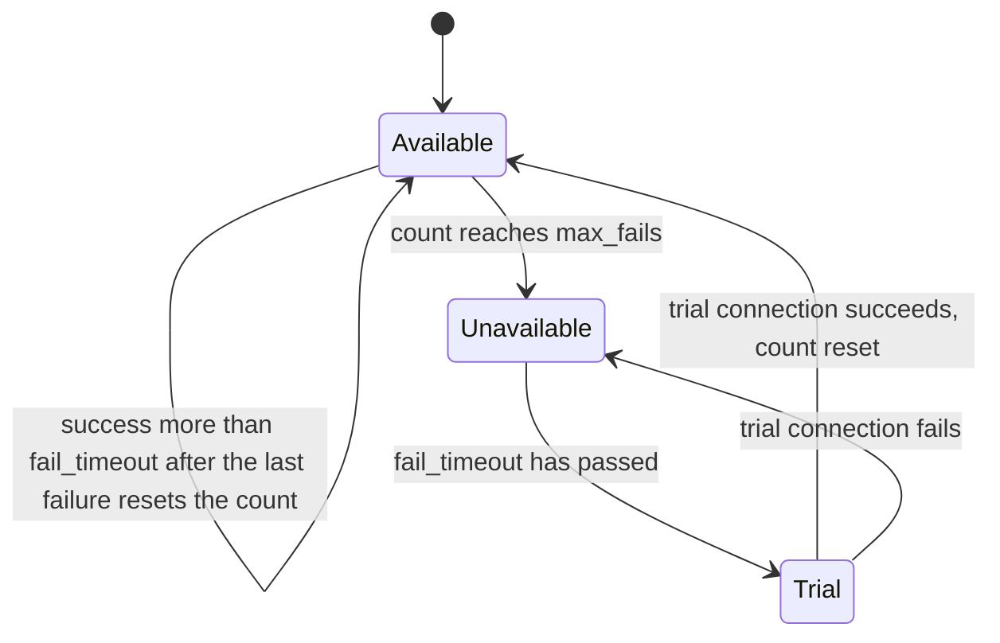

<span id="intro"></span>

## Introduction

NGINX Open Source and F5 NGINX Plus can test your TCP upstream servers, stop sending connections to servers that fail, and add recovered servers back to the load-balanced group:

- **Passive health checks**, in NGINX Open Source and NGINX Plus: NGINX counts failed connection attempts, and marks a server unavailable after failures.
- **Active health checks**, in NGINX Plus: NGINX Plus connects to each server at regular intervals, optionally exchanges data with it, and checks the result.

<span id="prereq"></span>

## Prerequisites

- An upstream group of TCP servers in the [stream](https://nginx.org/en/docs/stream/ngx_stream_core_module.html#stream) context, and a server that passes TCP connections to it, for example:

    ```nginx
    stream {
        upstream stream_backend {
            server backend1.example.com:12345;
            server backend2.example.com:12345;
            server backend3.example.com:12345;
        }

        server {
            listen     12345;
            proxy_pass stream_backend;
        }
    }
    ```

    For details, see [TCP and UDP Load Balancing]().

- NGINX Plus, or NGINX Open Source with the stream module. The packages from nginx.org include it. If you build NGINX Open Source from source, add the `--with-stream` option to `configure`.
- For active health checks, NGINX Plus.
- Permission to edit the configuration and reload NGINX. On most systems, this means root or `sudo` access.

---

<span id="hc_passive"></span>

## Passive TCP health checks

NGINX counts a failure for a server when it can't connect to it: the connection is refused, fails, or takes longer than [proxy_connect_timeout](https://nginx.org/en/docs/stream/ngx_stream_proxy_module.html#proxy_connect_timeout). With [proxy_ssl](https://nginx.org/en/docs/stream/ngx_stream_proxy_module.html#proxy_ssl) on, a failed TLS handshake also counts. Once NGINX is connected, errors on the connection don't count. After a failure, NGINX tries the next server, as allowed by [proxy_next_upstream](https://nginx.org/en/docs/stream/ngx_stream_proxy_module.html#proxy_next_upstream), which is `on` by default.

Two parameters of the [server](https://nginx.org/en/docs/stream/ngx_stream_upstream_module.html#server) directive set when NGINX marks a server unavailable:

- [max_fails](https://nginx.org/en/docs/stream/ngx_stream_upstream_module.html#max_fails) – The number of failures after which NGINX marks the server unavailable. The default is `1`. The value `0` turns off the accounting for the server.
- [fail_timeout](https://nginx.org/en/docs/stream/ngx_stream_upstream_module.html#fail_timeout) – How long NGINX then considers the server unavailable. The default is `10s`.

NGINX adds each failure to a count for the server. A successful connection resets the count only if NGINX sent it more than `fail_timeout` after the last failure. So failures that are further apart than `fail_timeout` still add up, unless such a connection succeeds in between. When the count reaches `max_fails`, NGINX marks the server unavailable. After `fail_timeout`, NGINX sends one trial connection to the server. If it succeeds, the count is reset and the server is available again. If it fails, the server is unavailable for another `fail_timeout`.



Text description: A server starts as available. Each failure adds to its count of failures, and a successful connection more than `fail_timeout` after the last failure resets the count. When the count reaches `max_fails`, NGINX marks the server unavailable. After `fail_timeout`, NGINX sends one trial connection: if it succeeds, the server is available again, and if it fails, the server is unavailable for another `fail_timeout`.

This example marks `backend2` unavailable for 30 seconds after 2 failures. The `weight` and `max_conns` parameters are described in [TCP and UDP Load Balancing]():

```nginx
upstream stream_backend {
    server backend1.example.com:12345 weight=5;
    server backend2.example.com:12345 max_fails=2 fail_timeout=30s;
    server backend3.example.com:12345 max_conns=3;
}
```

If a group has only one server address and no backup servers, NGINX ignores `max_fails` and `fail_timeout` and never marks the server unavailable. NGINX logs `upstream server temporarily disabled` at the `warn` level when it marks a server unavailable. If no server in the group is available, NGINX logs `no live upstreams` and closes the client connection.

Without a shared memory zone, each worker process keeps its own count of failures for each server. With several worker processes, a failed server then gets more connections before every worker process stops using it. To share the counts between the worker processes, add the [zone](https://nginx.org/en/docs/stream/ngx_stream_upstream_module.html#zone) directive to the upstream group, as in the [example](#example).

<span id="slow_start"></span>

### Server slow start

This feature needs NGINX Plus.

A recently recovered server can get more connections than it can handle, and be marked unavailable again. With slow start, a server's weight rises from zero to its configured value over a set time after it recovers or becomes available. Set it with the [slow_start](https://nginx.org/en/docs/stream/ngx_stream_upstream_module.html#slow_start) parameter of the [server](https://nginx.org/en/docs/stream/ngx_stream_upstream_module.html#server) directive:

```nginx
upstream stream_backend {
    server backend1.example.com:12345 slow_start=30s;
    server backend2.example.com:12345;
    server 192.0.2.1:12345 backup;
}
```

If a group has only one server, NGINX Plus ignores `slow_start`.

<span id="hc_active"></span>

## Active TCP health checks

This feature needs NGINX Plus.

NGINX Plus sends health checks to each upstream server and checks the result. If NGINX Plus can't connect to the server, the health check fails, and the server is unhealthy. NGINX Plus doesn't pass client connections to unhealthy servers. If several health checks are configured for an upstream group, a failure of any of them makes the server unhealthy.

To turn on active health checks:

1. Add a shared memory zone, where the worker processes share the state of the servers, with the [zone](https://nginx.org/en/docs/stream/ngx_stream_upstream_module.html#zone) directive. Set the zone name, here `stream_backend`, and its size, here 64 KB:

    ```nginx
    stream {
        upstream stream_backend {
            zone   stream_backend 64k;
            server backend1.example.com:12345;
            server backend2.example.com:12345;
            server backend3.example.com:12345;
        }
    }
    ```

2. Turn on active health checks for the group with the [health_check](https://nginx.org/en/docs/stream/ngx_stream_upstream_hc_module.html#health_check) directive in the server that passes connections to it:

    ```nginx
    stream {
        server {
            listen       12345;
            proxy_pass   stream_backend;
            health_check;
        }
    }
    ```

3. Optionally, set how long a health check may take with the [health_check_timeout](https://nginx.org/en/docs/stream/ngx_stream_upstream_hc_module.html#health_check_timeout) directive. For health checks, it replaces the [proxy_timeout](https://nginx.org/en/docs/stream/ngx_stream_proxy_module.html#proxy_timeout) value, which is usually much longer:

    ```nginx
    stream {
        server {
            listen               12345;
            proxy_pass           stream_backend;
            health_check;
            health_check_timeout 5s;
        }
    }
    ```

4. Optionally, send health checks to another port. By default, NGINX Plus uses the port of each `server` directive in the `upstream` block. Another port helps when you monitor several services on the same host. Set it with the [port](https://nginx.org/en/docs/stream/ngx_stream_upstream_hc_module.html#health_check_port) parameter of the `health_check` directive:

    ```nginx
    stream {
        server {
            listen               12345;
            proxy_pass           stream_backend;
            health_check         port=12346;
            health_check_timeout 5s;
        }
    }
    ```

<span id="hc_active_finetune"></span>

### Fine-tuning TCP health checks

By default, NGINX Plus tries to connect to each server in the group every 5 seconds. If it can't connect, the health check fails, NGINX Plus marks the server unhealthy, and stops passing client connections to it.

To change this, use these parameters of the [health_check](https://nginx.org/en/docs/stream/ngx_stream_upstream_hc_module.html#health_check) directive:

- [interval](https://nginx.org/en/docs/stream/ngx_stream_upstream_hc_module.html#health_check_interval) – The time between health checks. The default is 5 seconds.
- [passes](https://nginx.org/en/docs/stream/ngx_stream_upstream_hc_module.html#health_check_passes) – The number of consecutive passed checks after which the server is healthy. The default is `1`.
- [fails](https://nginx.org/en/docs/stream/ngx_stream_upstream_hc_module.html#health_check_fails) – The number of consecutive failed checks after which the server is unhealthy. The default is `1`.

```nginx
stream {
    server {
        listen       12345;
        proxy_pass   stream_backend;
        health_check interval=10 passes=2 fails=3;
    }
}
```

In this example, NGINX Plus checks every 10 seconds, marks a server unhealthy after 3 consecutive failed checks, and healthy again after 2 consecutive passed checks.

<span id="hc_active_match"></span>

### The "match {}" configuration block

You can define your own tests of the servers' responses to health checks, in a [match](https://nginx.org/en/docs/stream/ngx_stream_upstream_hc_module.html#match) block in the `stream` context.

1. In the `stream` context, add a `match` block and name it, for example `tcp_test`. It contains the tests described in step 3:

    ```nginx
    stream {
        match tcp_test {
            # ...
        }
    }
    ```

2. Refer to the block with the [match](https://nginx.org/en/docs/stream/ngx_stream_upstream_hc_module.html#health_check_match) parameter of the `health_check` directive:

    ```nginx
    stream {
        server {
            listen       12345;
            health_check match=tcp_test;
            proxy_pass   stream_backend;
        }
    }
    ```

3. In the `match` block, set the tests that a server must pass. The block can contain one of each of these directives:

    - [send](https://nginx.org/en/docs/stream/ngx_stream_upstream_hc_module.html#match_send) – A text string, or hexadecimal values (`\x` followed by two hex digits), that NGINX Plus sends to the server.
    - [expect](https://nginx.org/en/docs/stream/ngx_stream_upstream_hc_module.html#match_expect) – A literal string or regular expression that the data from the server must match.

    The directives work like this:

    - Without `send` and `expect`, the health check tests only whether NGINX Plus can connect to the server.
    - With only `expect`, the server must send data first, and the data must match:

        ```nginx
        match pop3 {
            expect ~* "\+OK";
        }
        ```

    - With only `send`, NGINX Plus connects and sends the string. The check passes if that succeeds:

        ```nginx
        match pop_quit {
            send QUIT;
        }
        ```

    - With both, NGINX Plus sends the string from `send`, and the server's response must match `expect`:

        ```nginx
        stream {
            upstream stream_backend {
                zone   stream_backend 64k;
                server backend1.example.com:12345;
            }

            match http {
                send      "GET / HTTP/1.0\r\nHost: localhost\r\n\r\n";
                expect ~* "200 OK";
            }

            server {
                listen       12345;
                health_check match=http;
                proxy_pass   stream_backend;
            }
        }
        ```

        In this example, a server passes the health check if it answers the HTTP request with a response that contains `200 OK`.

---

## Example

This complete configuration uses passive health checks, which work in NGINX Open Source and NGINX Plus. It's a whole **nginx.conf**, so back up your existing file first. If your existing file loads the stream module with `load_module` or includes **modules-enabled**, keep those lines at the top. To add only the load balancer to an existing configuration, add the `stream` block at the top level. Replace `192.0.2.11` and `192.0.2.12` with the addresses of your servers.

```nginx
error_log /var/log/nginx/error.log warn;

events {}

stream {
    upstream stream_backend {
        zone   stream_backend 64k;
        server 192.0.2.11:12345 max_fails=2 fail_timeout=30s;
        server 192.0.2.12:12345 max_fails=2 fail_timeout=30s;
    }

    server {
        listen                12345;
        proxy_pass            stream_backend;
        proxy_connect_timeout 2s;
    }
}
```

- The `zone` directive shares the failure counts between the worker processes.
- The short `proxy_connect_timeout` makes NGINX detect a server that doesn't answer faster than the 60-second default.
- With NGINX Plus, add `health_check;` to the `server` block to also run active health checks.

---

## Verify the configuration

1. Test and reload the configuration:

    ```shell
    sudo nginx -t && sudo nginx -s reload
    ```

2. Stop the service on one of the upstream servers, and open several connections:

    ```shell
    for i in $(seq 1 6); do nc -w 5 127.0.0.1 12345 </dev/null; done
    ```

    Each connection prints the reply or banner of the server that's still running, because `proxy_next_upstream` passes failed connection attempts to the next server.

3. Check the error log:

    ```shell
    sudo grep -E 'connect\(\) failed|upstream timed out|temporarily disabled' /var/log/nginx/error.log | tail -3
    ```

    The output shows two failed connection attempts to the stopped server, `connect() failed` if the host refuses the connection or `upstream timed out` if it doesn't answer, and a `[warn]` line with `upstream server temporarily disabled`.

---

## Troubleshooting

### A failed server still gets connections

**Symptom**: Clients connect to NGINX, but some get no data from the upstream service.

**Cause**: The upstream server accepts connections but doesn't work. Passive health checks only count failed connection attempts.

**Fix**: With NGINX Plus, use an active health check with a `match` block that tests the service's response.

### Clients are disconnected right away

**Symptom**: Clients connect to NGINX, and NGINX closes the connection at once without data. The error log shows `no live upstreams`.

**Cause**: All servers in the group are unavailable, or at their `max_conns` limit.

**Fix**: Check the servers and the network. The servers become available again after `fail_timeout`, when a trial connection succeeds.

### Failed servers are detected slowly

**Symptom**: Clients wait a long time before NGINX tries another server.

**Cause**: NGINX waits for `proxy_connect_timeout`, 60 seconds by default, before it counts a connection attempt to a server that doesn't answer as failed.

**Fix**: Lower `proxy_connect_timeout`, for example to a few seconds.

---

## References

For more information, see:

- [TCP and UDP Load Balancing]()
- [UDP Health Checks]()
- [HTTP Health Checks]()
- [ngx_stream_upstream_hc_module reference](https://nginx.org/en/docs/stream/ngx_stream_upstream_hc_module.html) on nginx.org
