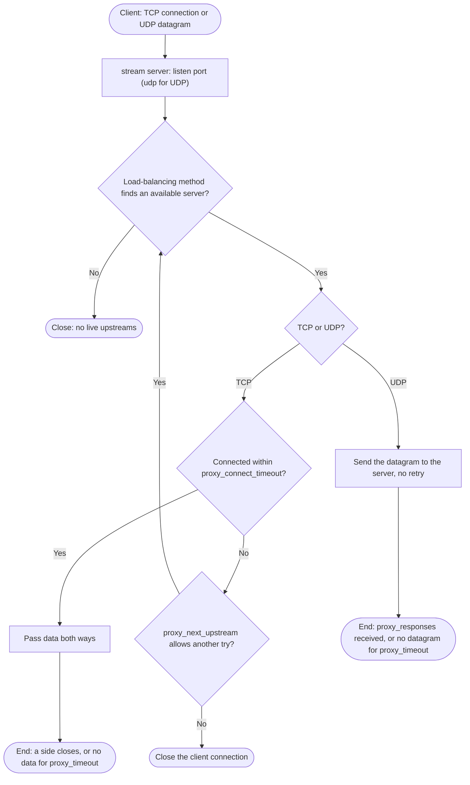

## Introduction {#intro}

[Load balancing](https://www.f5.com/glossary/load-balancer) distributes network traffic across several servers.

F5 NGINX Plus and NGINX Open Source proxy and load balance traffic at Layer 4, the transport layer, for both the Transmission Control Protocol (TCP) and the User Datagram Protocol (UDP). TCP is a connection-oriented protocol used by services such as LDAP, MySQL, and RTMP. UDP is used by services that send short messages and need low latency, such as DNS, syslog, and RADIUS.

For Layer 7 (application layer) HTTP load balancing, see [HTTP Load Balancing]().

## Prerequisites

- NGINX Plus, or [NGINX Open Source](https://nginx.org/en/download.html) with the stream module. The packages from nginx.org include it. If you build NGINX Open Source from source, add the `--with-stream` option to `configure`, or `--with-stream=dynamic` to build it as a dynamic module.
- An application, database, or service that communicates over TCP or UDP.
- Two or more servers that run the same application, database, or service.
- Permission to edit the configuration and reload NGINX. On most systems, this means root or `sudo` access.

---

## How TCP and UDP proxying works

TCP and UDP proxying is configured in the [stream](https://nginx.org/en/docs/stream/ngx_stream_core_module.html#stream) context, separately from HTTP.

For each **TCP connection**, NGINX does the following:

1. A `server` block in the `stream` context accepts the connection on the address and port of its `listen` directive.
2. NGINX chooses a server from the upstream group in `proxy_pass` with the group's load-balancing method. If no server is available, because all are down, unavailable, or at their `max_conns` limit, NGINX closes the client connection and logs `no live upstreams`.
3. NGINX connects to the server. If the connection fails, or takes longer than [proxy_connect_timeout](https://nginx.org/en/docs/stream/ngx_stream_proxy_module.html#proxy_connect_timeout) (60 seconds by default), NGINX tries the next server, as allowed by [proxy_next_upstream](https://nginx.org/en/docs/stream/ngx_stream_proxy_module.html#proxy_next_upstream), which is `on` by default.
4. NGINX passes data in both directions until one side closes the connection, or until no data passes for [proxy_timeout](https://nginx.org/en/docs/stream/ngx_stream_proxy_module.html#proxy_timeout), 10 minutes by default. By default, when the client closes its sending side, NGINX closes the whole connection, without waiting for the server's response. To wait for it, set [proxy_half_close](https://nginx.org/en/docs/stream/ngx_stream_proxy_module.html#proxy_half_close) to `on`.

For **UDP**, NGINX groups datagrams into sessions:

1. A `server` block with `listen ... udp` receives a datagram. A datagram from a client address and port that has an open session belongs to that session.
2. For a new session, NGINX chooses a server with the load-balancing method and sends it the datagram. There's no connection setup, so `proxy_connect_timeout` doesn't apply, and NGINX doesn't send the datagram to another server if this one doesn't answer.
3. NGINX passes the server's responses to the client. The session ends when the expected number of responses has arrived, as set by [proxy_responses](https://nginx.org/en/docs/stream/ngx_stream_proxy_module.html#proxy_responses) for each client datagram, or when no datagram passes for `proxy_timeout`.

All datagrams of a session go to the same server. With `proxy_responses`, a session usually covers one request, so the next request from the same client can go to another server. To keep a client on one server, use the [Hash](#upstream) method with `$remote_addr`.



Text description: NGINX chooses an upstream server with the load-balancing method, and closes the client connection if no server is available. For TCP, NGINX connects to the server, tries another server if the connection fails and `proxy_next_upstream` allows it, and then passes data both ways until a side closes or no data passes for `proxy_timeout`. For UDP, NGINX sends the datagram to the chosen server without retries, and ends the session when the expected responses have arrived or no datagram passes for `proxy_timeout`.

---

## Configuring reverse proxy {#proxy_pass}

Configure NGINX to forward TCP connections or UDP datagrams from clients to an upstream group or a single server:

1. Create a top-level [stream](https://nginx.org/en/docs/stream/ngx_stream_core_module.html#stream) block, next to the `http` block, not inside it:

    ```nginx
    stream {
        # ...
    }
    ```

2. In the `stream` block, define a [server](https://nginx.org/en/docs/stream/ngx_stream_core_module.html#server) block for each virtual server.

3. In each `server` block, add the [listen](https://nginx.org/en/docs/stream/ngx_stream_core_module.html#listen) directive with the port, and optionally the IP address, where the server accepts traffic. The `listen` directive is required in the `stream` context.

    For UDP traffic, add the `udp` parameter. TCP is the default, so there's no `tcp` parameter:

    ```nginx
    stream {

        server {
            listen 12345;
            # ...
        }

        server {
            listen 53 udp;
            # ...
        }
    }
    ```

4. Add the [proxy_pass](https://nginx.org/en/docs/stream/ngx_stream_proxy_module.html#proxy_pass) directive with the upstream group or the server to forward traffic to. Unlike in the `http` context, `proxy_pass` takes no protocol, such as `http://`, and a server needs a port:

    ```nginx
    stream {

        server {
            listen     12345;
            # TCP traffic is forwarded to the "stream_backend" upstream group
            proxy_pass stream_backend;
        }

        server {
            listen     12346;
            # TCP traffic is forwarded to the specified server
            proxy_pass backend.example.com:12346;
        }

        server {
            listen     53 udp;
            # UDP traffic is forwarded to the "dns_servers" upstream group
            proxy_pass dns_servers;
        }
    }
    ```

    The `stream_backend` and `dns_servers` groups are created in [Configuring TCP or UDP load balancing](#upstream). Until they exist, `nginx -t` reports `no port in upstream "stream_backend"`.

    If `proxy_pass` names a single host name that resolves to several IP addresses, NGINX distributes the traffic across them with the Round Robin method.

5. Optionally, if the proxy server has several network interfaces, choose the source IP address for connections to the upstream servers with the [proxy_bind](https://nginx.org/en/docs/stream/ngx_stream_proxy_module.html#proxy_bind) directive. This is useful when the upstream servers accept connections only from certain IP addresses. The address must belong to an interface of the NGINX host and be able to reach the upstream servers:

    ```nginx
    stream {
        server {
            listen     12345;
            proxy_pass backend.example.com:12345;
            proxy_bind 192.0.2.10;
        }
    }
    ```

6. Optionally, change the size of the two buffers that hold data from the client and from the upstream server, with the [proxy_buffer_size](https://nginx.org/en/docs/stream/ngx_stream_proxy_module.html#proxy_buffer_size) directive. The default is `16k`. NGINX forwards data as soon as it receives it. Smaller buffers save memory for many connections with little data. Larger buffers reduce the number of read and write operations for large volumes of data. For UDP, NGINX reads each response datagram into this buffer, so keep it at least as large as the largest response; otherwise, NGINX truncates the response:

    ```nginx
    stream {
        server {
            listen            12345;
            proxy_pass        backend.example.com:12345;
            proxy_buffer_size 16k;
        }
    }
    ```

## Configuring TCP or UDP load balancing {#upstream}

1. Create an upstream group with the [upstream](https://nginx.org/en/docs/stream/ngx_stream_upstream_module.html#upstream) directive in the `stream` context, and name it, for example `stream_backend` for TCP servers and `dns_servers` for UDP servers. Use these names in the `proxy_pass` directives from [Configuring reverse proxy](#proxy_pass):

    ```nginx
    stream {

        upstream stream_backend {
            server backend1.example.com:12345;
        }

        upstream dns_servers {
            server 192.168.136.130:53;
        }
    }
    ```

    A group needs at least one `server` directive, which you add in the next step.

2. Add a [server](https://nginx.org/en/docs/stream/ngx_stream_upstream_module.html#server) directive for each upstream server, with its IP address or host name and its port, which is required. A host name can resolve to several IP addresses. You don't set the protocol for the servers: NGINX uses the protocol of the `listen` directive of the `server` block that passes traffic to the group.

    ```nginx
    stream {

        upstream stream_backend {
            server backend1.example.com:12345;
            server backend2.example.com:12345;
            server backend3.example.com:12346;
        }

        upstream dns_servers {
            server 192.168.136.130:53;
            server 192.168.136.131:53;
        }
    }
    ```

3. Optionally, choose the load-balancing method. Put its directive in the `upstream` block, before the `server` directives:

    - **Round Robin** – NGINX distributes connections across the servers in turn, taking server weights into account. This is the default; it has no directive.

    - **[Least Connections](https://nginx.org/en/docs/stream/ngx_stream_upstream_module.html#least_conn)** – NGINX chooses the server with the fewest active connections relative to its weight.

    - **[Least Time](https://nginx.org/en/docs/stream/ngx_stream_upstream_module.html#least_time)** (NGINX Plus, and NGINX Open Source 1.31.0 and later) – NGINX chooses the server with the lowest average time and the fewest active connections. A parameter, which is required, sets which time NGINX measures:

        - `connect` – Time to connect to the upstream server.
        - `first_byte` – Time to receive the first byte of data.
        - `last_byte` – Time to receive the last byte of data.

        With the optional `inflight` parameter, NGINX also counts connections that are still in progress.

        ```nginx
        upstream stream_backend {
            least_time first_byte;
            server backend1.example.com:12345;
            server backend2.example.com:12345;
            server backend3.example.com:12346;
        }
        ```

    - **[Hash](https://nginx.org/en/docs/stream/ngx_stream_upstream_module.html#hash)** – NGINX chooses the server from a key that you define, for example the client IP address in [$remote_addr](https://nginx.org/en/docs/stream/ngx_stream_core_module.html#var_remote_addr):

        ```nginx
        upstream stream_backend {
            hash $remote_addr;
            server backend1.example.com:12345;
            server backend2.example.com:12345;
            server backend3.example.com:12346;
        }
        ```

        With `$remote_addr` as the key, the Hash method also provides session persistence: connections from one client go to the same server, unless that server is unavailable. The optional `consistent` parameter turns on ketama consistent hashing, so that only a few keys move to other servers when you add or remove a server:

        ```nginx
        hash $remote_addr consistent;
        ```

    - **[Random](https://nginx.org/en/docs/stream/ngx_stream_upstream_module.html#random)** – NGINX passes each connection to a randomly chosen server, taking server weights into account. With the `two` parameter, NGINX chooses two servers at random, then picks one of them with a second method:

        - `least_conn` – The server with fewer active connections. This is the default.
        - `least_time=connect` (NGINX Plus) – The lower average time to connect ([$upstream_connect_time](https://nginx.org/en/docs/stream/ngx_stream_upstream_module.html#var_upstream_connect_time)).
        - `least_time=first_byte` (NGINX Plus) – The lower average time to receive the first byte ([$upstream_first_byte_time](https://nginx.org/en/docs/stream/ngx_stream_upstream_module.html#var_upstream_first_byte_time)).
        - `least_time=last_byte` (NGINX Plus) – The lower average time to receive the last byte ([$upstream_session_time](https://nginx.org/en/docs/stream/ngx_stream_upstream_module.html#var_upstream_session_time)).

        ```nginx
        upstream stream_backend {
            random two least_conn;
            server backend1.example.com:12345;
            server backend2.example.com:12345;
            server backend3.example.com:12346;
            server backend4.example.com:12346;
        }
        ```

        Use the Random method when several load balancers pass traffic to the same servers. When one load balancer sees all traffic, use another method.

4. Optionally, set parameters for each upstream server, such as the [weight](https://nginx.org/en/docs/stream/ngx_stream_upstream_module.html#weight), the [maximum number of connections](https://nginx.org/en/docs/stream/ngx_stream_upstream_module.html#max_conns), and the [max_fails](https://nginx.org/en/docs/stream/ngx_stream_upstream_module.html#max_fails) and [fail_timeout](https://nginx.org/en/docs/stream/ngx_stream_upstream_module.html#fail_timeout) parameters for passive health checks. By default, `max_fails=1` and `fail_timeout=10s`:

    ```nginx
    upstream stream_backend {
        hash   $remote_addr consistent;
        server backend1.example.com:12345 weight=5;
        server backend2.example.com:12345;
        server backend3.example.com:12346 max_conns=3;
    }

    upstream dns_servers {
        least_conn;
        server 192.168.136.130:53;
        server 192.168.136.131:53;
    }
    ```

### Configuring UDP sessions

For a request-response protocol such as DNS, tell NGINX how many datagrams to expect from the server for each client datagram, with the [proxy_responses](https://nginx.org/en/docs/stream/ngx_stream_proxy_module.html#proxy_responses) directive. NGINX then ends the session when the response has arrived, instead of waiting for `proxy_timeout`. By default, the number of responses isn't limited. Also set a short `proxy_timeout`, which limits how long NGINX waits for a lost response; otherwise, an unanswered session lasts 10 minutes.

The [proxy_requests](https://nginx.org/en/docs/stream/ngx_stream_proxy_module.html#proxy_requests) directive sets after how many datagrams from a client NGINX starts a new session for its next datagram. By default, there's no limit.

```nginx
stream {
    server {
        listen          53 udp;
        proxy_pass      dns_servers;
        proxy_responses 1;
        proxy_timeout   20s;
    }
}
```

## Configuring health checks {#health}

NGINX can test your TCP or UDP upstream servers, stop sending traffic to servers that fail, and add servers back when they recover. NGINX Open Source uses passive health checks, set with the `max_fails` and `fail_timeout` parameters. NGINX Plus adds active health checks.

For UDP, NGINX counts a failure when the server reports that the port is closed. A server that doesn't answer counts as failed only if `proxy_responses` is set, because only then does NGINX expect a response.

For instructions, see [TCP Health Checks]() and [UDP Health Checks]().

## On-the-fly configuration

This feature needs NGINX Plus.

With the NGINX Plus API, you can change upstream groups without a reload: view the servers of a group, change the parameters of a server, and add or remove servers.

1. In the `http` context, create a location for API requests, for example `/api`, with the [api](https://nginx.org/en/docs/http/ngx_http_api_module.html#api) directive. By default, the API is read-only. The `write=on` parameter allows changes:

    ```nginx
    http {
        server {
            listen 80;

            location /api {
                api write=on;
            }
        }
    }
    ```

2. Limit access to this location with the [allow](https://nginx.org/en/docs/http/ngx_http_access_module.html#allow) and [deny](https://nginx.org/en/docs/http/ngx_http_access_module.html#deny) directives:

    ```nginx
    location /api {
        api   write=on;
        allow 127.0.0.1; # permit access from localhost
        deny  all;       # deny access from everywhere else
    }
    ```

3. With write access, allow the `PATCH`, `POST`, and `DELETE` methods only to authenticated users, with [HTTP Basic authentication]():

    ```nginx
    location /api {
        limit_except GET {
            auth_basic           "NGINX Plus API";
            auth_basic_user_file /path/to/passwd/file;
        }
        api   write=on;
        allow 127.0.0.1;
        deny  all;
    }
    ```

4. In the `stream` context, add the [zone](https://nginx.org/en/docs/stream/ngx_stream_upstream_module.html#zone) directive to the upstream group, so that all worker processes share its configuration. Set the zone name, here `stream_backend`, and its size, here 64 KB:

    ```nginx
    stream {
        upstream stream_backend {
            zone stream_backend 64k;
            server backend1.example.com:12345;
        }
    }
    ```

### On-the-fly configuration example

```nginx
stream {
    # Configuration of an upstream server group
    upstream appservers {
        zone appservers 64k;
        server appserv1.example.com:12345 weight=5;
        server appserv2.example.com:12345 fail_timeout=5s;
        server backup1.example.com:12345 backup;
        server backup2.example.com:12345 backup;
    }

    server {
        # Server that proxies connections to the upstream group
        listen     12345;
        proxy_pass appservers;
        health_check;
    }
}

http {
    server {
        listen 80;

        # Location for API requests
        location /api {
            limit_except GET {
                auth_basic           "NGINX Plus API";
                auth_basic_user_file /path/to/passwd/file;
            }
            api   write=on;
            allow 127.0.0.1;
            deny  all;
        }
    }
}
```

This configuration allows API requests only from the local address `127.0.0.1`.

To change the configuration, send an API request, for example with `curl`.

To add a server to the group, send a `POST` request:

```shell
curl -X POST -d '{ "server": "appserv3.example.com:12345", "weight": 4 }' -s 'http://127.0.0.1/api/9/stream/upstreams/appservers/servers'
```

To remove a server from the group, send a `DELETE` request with the server's ID:

```shell
curl -X DELETE -s 'http://127.0.0.1/api/9/stream/upstreams/appservers/servers/0'
```

To change a parameter of a server, send a `PATCH` request:

```shell
curl -X PATCH -d '{ "down": true }' -s 'http://127.0.0.1/api/9/stream/upstreams/appservers/servers/0'
```

## Example of TCP and UDP load-balancing configuration {#example}

This complete configuration load balances TCP connections and DNS traffic over UDP, and logs each session. It's a whole **nginx.conf**, so back up your existing file first. To add only the TCP and UDP load balancing to an existing configuration, add the `stream` block at the top level, next to the `http` block.

```nginx
events {}

stream {
    log_format sessions '$remote_addr [$time_local] $protocol $status '
                        '$bytes_sent $bytes_received $session_time "$upstream_addr"';
    access_log /var/log/nginx/stream.log sessions;

    upstream stream_backend {
        least_conn;
        server backend1.example.com:12345 weight=5;
        server backend2.example.com:12345 max_fails=2 fail_timeout=30s;
        server backend3.example.com:12345 max_conns=3;
    }

    upstream dns_servers {
        least_conn;
        server 192.168.136.130:53;
        server 192.168.136.131:53;
        server 192.168.136.132:53;
    }

    server {
        listen                12345;
        proxy_pass            stream_backend;
        proxy_timeout         3s;
        proxy_connect_timeout 1s;
    }

    server {
        listen          53 udp;
        proxy_pass      dns_servers;
        proxy_responses 1;
        proxy_timeout   20s;
    }

    server {
        listen     12346;
        proxy_pass backend4.example.com:12346;
    }
}
```

In this example:

- The `log_format` and `access_log` directives log each TCP connection and UDP session, with the upstream server that handled it.
- Two upstream groups each have three servers that run the same service. Each `server` directive has a port, which is required. The groups use the [Least Connections](https://nginx.org/en/docs/stream/ngx_stream_upstream_module.html#least_conn) method: a connection goes to the server with the fewest active connections relative to its weight.
- In **stream_backend**, `backend1` has weight 5, so it gets about five times as many connections as the others. `backend2` is considered unavailable for 30 seconds after 2 failures within 30 seconds. `backend3` accepts at most 3 connections at a time.
- The first virtual server listens on port 12345 and passes TCP connections to the **stream_backend** group. The [proxy_connect_timeout](https://nginx.org/en/docs/stream/ngx_stream_proxy_module.html#proxy_connect_timeout) directive sets how long NGINX waits for a connection to an upstream server: 1 second here, 60 seconds by default. The [proxy_timeout](https://nginx.org/en/docs/stream/ngx_stream_proxy_module.html#proxy_timeout) directive closes the connection if no data passes in either direction for 3 seconds. That's a value for testing; services with long-lived idle connections, such as databases, need a longer one.
- The second virtual server listens on UDP port 53 and passes DNS datagrams to the **dns_servers** group. It ends each session after one response, or after 20 seconds without one. Without the `udp` parameter, it would listen for TCP connections.
- The third virtual server listens on port 12346 and passes TCP connections to **backend4.example.com**. If that name resolves to several IP addresses, NGINX distributes the connections across them with the Round Robin method.

---

## Verify the configuration

1. Test and reload the configuration:

    ```shell
    sudo nginx -t && sudo nginx -s reload
    ```

2. Check that NGINX listens on the TCP and UDP ports:

    ```shell
    sudo ss -lntup | grep nginx
    ```

    The output has `tcp` lines for ports 12345 and 12346 and a `udp` line for port 53.

3. Connect to the TCP port, for example with `nc`, and check that you get the reply or the banner of your upstream service. A successful connection alone doesn't show that NGINX reached an upstream server, because NGINX accepts the connection first:

    ```shell
    nc -v 127.0.0.1 12345
    ```

4. Send a DNS query through NGINX:

    ```shell
    dig @127.0.0.1 -p 53 example.com
    ```

5. Check the session log to see which upstream server handled each connection and query:

    ```shell
    sudo tail -2 /var/log/nginx/stream.log
    ```

    Each line ends with the upstream server's address, for example `"192.168.136.130:53"`. A status of `502` and no upstream address mean that no upstream server was available.

---

## Troubleshooting

### The configuration test reports "host not found in upstream"

**Symptom**: `nginx -t` fails with `host not found in upstream "backend1.example.com:12345"`.

**Cause**: NGINX resolves the host names of upstream servers when it starts or reloads, and the name doesn't resolve.

**Fix**: Check the name with `getent hosts backend1.example.com`, or use an IP address. In NGINX Plus and NGINX Open Source 1.27.3 and later, the `resolve` parameter of the `server` directive lets NGINX start without resolving the name; it needs a `zone` in the group and a `resolver` directive.

### The configuration test reports "no port in upstream"

**Symptom**: `nginx -t` fails with `no port in upstream "backend1.example.com"`.

**Cause**: In the `stream` context, every upstream server and every server in `proxy_pass` needs a port. NGINX also reports this when `proxy_pass` names an upstream group that doesn't exist, because it then treats the name as a host name.

**Fix**: Add the port, for example `backend1.example.com:12345`, or check the spelling of the upstream group name.

### The configuration test reports that "stream" or "listen" isn't allowed

**Symptom**: `nginx -t` fails with `"stream" directive is not allowed here`, `unknown directive "stream"`, or `"listen" directive is not allowed here`.

**Cause**: The `stream` block is inside the `http` block, NGINX was built without the stream module, or a `listen` directive is outside a `server` block.

**Fix**: Move the `stream` block to the top level, and put each `listen` directive in a `server` block. Check that `nginx -V` shows `--with-stream`. If the stream module is a dynamic module, load it in the main context, for example with `load_module modules/ngx_stream_module.so;`.

### Clients are disconnected after a period of inactivity

**Symptom**: Long-lived TCP connections, such as database connections, are closed after some time without traffic.

**Cause**: NGINX closes connections when no data passes for `proxy_timeout`, 10 minutes by default.

**Fix**: Increase `proxy_timeout` for that server, or let the application send keepalive messages. TCP keepalive probes don't count as data.

### UDP responses get lost or sessions stay open

**Symptom**: UDP clients don't get responses or get only part of them, or NGINX keeps many UDP sessions open.

**Cause**: One of these:

- `proxy_responses` is lower than the number of datagrams that the server sends, so NGINX ends the session early.
- The chosen server is down or doesn't answer. NGINX doesn't retry UDP datagrams with another server.
- A response datagram is larger than `proxy_buffer_size`, so NGINX truncates it.
- Without `proxy_responses`, NGINX keeps each UDP session open until `proxy_timeout` expires.

**Fix**: Set `proxy_responses` to the number of datagrams that the server sends for each request, for example `1` for DNS, and a short `proxy_timeout`. Make `proxy_buffer_size` at least as large as the largest response. Check the error log for `upstream timed out` messages.

## Compatibility note {#compat}

- [TCP proxying](https://nginx.org/en/docs/stream/ngx_stream_core_module.html) and [load balancing](https://nginx.org/en/docs/stream/ngx_stream_upstream_module.html) are supported in NGINX Plus since [Release 5]() and in NGINX Open Source since 1.9.0.
- [UDP proxying](https://nginx.org/en/docs/stream/ngx_stream_core_module.html#udp) and load balancing are supported in NGINX Plus since [Release 9]() and in NGINX Open Source since 1.9.13.
- The [least_time](https://nginx.org/en/docs/stream/ngx_stream_upstream_module.html#least_time) load-balancing method is supported in NGINX Plus since [Release 6]() and in NGINX Open Source since 1.31.0.

## See also

- [TCP Health Checks]()
- [UDP Health Checks]()
- [HTTP Load Balancing]()
- [Load Balancing DNS Traffic with NGINX and NGINX Plus](https://www.f5.com/company/blog/nginx/load-balancing-dns-traffic-nginx-plus)
- [TCP/UDP Load Balancing with NGINX: Overview, Tips, and Tricks](https://blog.nginx.org/blog/tcp-load-balancing-udp-load-balancing-nginx-tips-tricks)
