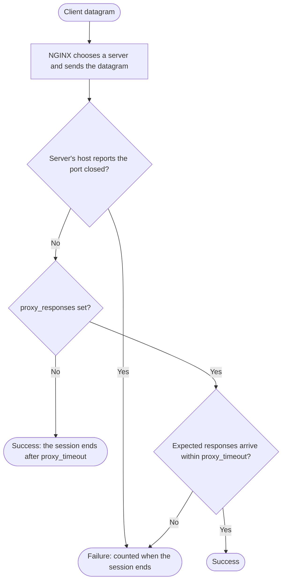

NGINX Open Source and F5 NGINX Plus can test your upstream servers that handle UDP traffic, such as DNS, NTP, RADIUS, or syslog servers. NGINX stops sending datagrams to servers that fail, and adds them back when they recover:

- **Passive health checks**, in NGINX Open Source and NGINX Plus: NGINX watches the UDP sessions it passes to each server, and marks a server unavailable after failures.
- **Active health checks**, in NGINX Plus: NGINX Plus sends its own datagrams to each server at regular intervals, and checks the responses.

## Prerequisites {#prereq}

- An upstream group of servers that handle UDP traffic in the [stream](https://nginx.org/en/docs/stream/ngx_stream_core_module.html#stream) context, and a server that passes UDP datagrams to it, for example:

    ```nginx
    stream {
        upstream dns_upstream {
            server 192.168.136.130:53;
            server 192.168.136.131:53;
            server 192.168.136.132:53;
        }

        server {
            listen          53 udp;
            proxy_pass      dns_upstream;
            proxy_timeout   1s;
            proxy_responses 1;
            error_log       /var/log/nginx/dns.log warn;
        }
    }
    ```

    The `warn` level of the `error_log` directive makes NGINX log when it marks a server unavailable. For details, see [TCP and UDP Load Balancing]().

- NGINX Plus, or NGINX Open Source with the stream module. The packages from nginx.org include it. If you build NGINX Open Source from source, add the `--with-stream` option to `configure`.
- For active health checks, NGINX Plus.
- Permission to edit the configuration and reload NGINX. On most systems, this means root or `sudo` access.

## Passive UDP health checks {#hc_passive}

With passive health checks, NGINX counts failed UDP sessions for each server. A session fails in these cases:

- The server's host reports that the port is closed, with an ICMP "Port Unreachable" message. NGINX logs `recv() failed (111: Connection refused)`. NGINX counts the failure when the session ends: after the responses set by `proxy_responses` arrive, or after `proxy_timeout`.
- [proxy_responses](https://nginx.org/en/docs/stream/ngx_stream_proxy_module.html#proxy_responses) is set, and the expected responses don't arrive within [proxy_timeout](https://nginx.org/en/docs/stream/ngx_stream_proxy_module.html#proxy_timeout). NGINX logs `upstream timed out`.
- NGINX can't send to the server at all, for example because the network is unreachable. NGINX logs `connect() failed`.

Without `proxy_responses`, NGINX doesn't expect a response, so a server that doesn't answer doesn't count as failed. Also, without `proxy_responses`, an ICMP error counts only when the session ends after `proxy_timeout`, 10 minutes by default.

In the first two cases, NGINX doesn't send the datagram to another server, so the client gets no response for it. Only if NGINX can't send the datagram at all does it try the next server, as allowed by [proxy_next_upstream](https://nginx.org/en/docs/stream/ngx_stream_proxy_module.html#proxy_next_upstream).



Text description: NGINX sends the client datagram to the chosen server. If the server's host reports that the port is closed, the session counts as a failure when it ends. Otherwise, without `proxy_responses`, the session ends after `proxy_timeout` and counts as a success. With `proxy_responses`, the session counts as a success if the expected responses arrive within `proxy_timeout`, and as a failure if they don't.

Two parameters of the [server](https://nginx.org/en/docs/stream/ngx_stream_upstream_module.html#server) directive set when NGINX marks a server unavailable:

- [max_fails](https://nginx.org/en/docs/stream/ngx_stream_upstream_module.html#max_fails) – The number of failures after which NGINX marks the server unavailable. The default is `1`. The value `0` turns off the accounting for the server.
- [fail_timeout](https://nginx.org/en/docs/stream/ngx_stream_upstream_module.html#fail_timeout) – How long NGINX then considers the server unavailable. The default is `10s`.

NGINX adds each failure to a count for the server. A successful session resets the count only if NGINX started it more than `fail_timeout` after the last failure. So failures that are further apart than `fail_timeout` still add up. When the count reaches `max_fails`, NGINX marks the server unavailable. After `fail_timeout`, NGINX sends one trial session to the server. If it succeeds, the count is reset. If it fails, the server is unavailable for another `fail_timeout`.

With the defaults, if one session fails, NGINX marks the server unavailable for 10 seconds. This example marks a server unavailable for 60 seconds after 2 failures:

```nginx
upstream dns_upstream {
    server 192.168.136.130:53 max_fails=2 fail_timeout=60s;
    server 192.168.136.131:53 max_fails=2 fail_timeout=60s;
}
```

If a group has only one server address and no backup servers, NGINX never marks the server unavailable. NGINX logs `upstream server temporarily disabled` at the `warn` level when it marks a server unavailable, so set the `error_log` level to `warn` or lower to see it.

Without a shared memory zone, each worker process keeps its own count of failures for each server. With several worker processes, a failed server then gets more datagrams before every worker process stops using it. To share the counts between the worker processes, add the [zone](https://nginx.org/en/docs/stream/ngx_stream_upstream_module.html#zone) directive to the upstream group, as in the [example](#example).

## Active UDP health checks {#hc_active}

This feature needs NGINX Plus.

Active health checks find more kinds of failures. For example, with passive health checks, NGINX finds a failed DNS server only after a client's query to it fails. With active health checks, NGINX Plus sends its own health-check datagrams to each server and checks the responses. NGINX Plus doesn't pass client datagrams to servers that fail the checks. If several health checks are configured for an upstream group, a failure of any of them makes the server unhealthy.

To turn on active health checks:

1. In the upstream group, add a shared memory zone, where the worker processes share the state of the servers, with the [zone](https://nginx.org/en/docs/stream/ngx_stream_upstream_module.html#zone) directive. Set the zone name, here `dns_zone`, and its size, here `64k`:

    ```nginx
    stream {
        upstream dns_upstream {
            zone   dns_zone 64k;
            server 192.168.136.130:53;
            server 192.168.136.131:53;
            server 192.168.136.132:53;
        }
    }
    ```

2. In the existing `server` block that passes traffic to the upstream group with [proxy_pass](https://nginx.org/en/docs/stream/ngx_stream_proxy_module.html#proxy_pass), add the `health_check` directive with the [udp](https://nginx.org/en/docs/stream/ngx_stream_upstream_hc_module.html#health_check_udp) parameter. Keep the other directives of the block:

    ```nginx
    stream {
        server {
            listen       53 udp;
            proxy_pass   dns_upstream;
            health_check udp;
        }
    }
    ```

By default, NGINX Plus sends the string `nginx health check` to each server, and the check passes if no ICMP "Destination Unreachable" message comes back. To test the server's responses, define your own tests in a `match` block. See [The "match {}" configuration block](#hc_active_match).

### Fine-tuning UDP health checks {#hc_active_finetune}

To change how often and how strictly NGINX Plus checks the servers, use these parameters of the [health_check](https://nginx.org/en/docs/stream/ngx_stream_upstream_hc_module.html#health_check) directive:

- `interval` – The time between health checks. The default is 5 seconds.
- `passes` – The number of consecutive passed checks after which the server is healthy. The default is `1`.
- `fails` – The number of consecutive failed checks after which the server is unhealthy. The default is `1`.

```nginx
server {
    listen       53 udp;
    proxy_pass   dns_upstream;
    health_check interval=20 passes=2 fails=2 udp;
}
```

In this example, NGINX Plus checks every 20 seconds, marks a server unhealthy after 2 consecutive failed checks, and healthy again after 2 consecutive passed checks.

### The "match {}" configuration block {#hc_active_match}

You can define tests of the servers' responses to health checks in a [match](https://nginx.org/en/docs/stream/ngx_stream_upstream_hc_module.html#match) block.

1. In the `stream` context, add a `match` block and name it, for example `udp_test`:

    ```nginx
    stream {
        match udp_test {
            # ...
        }
    }
    ```

2. Refer to the block with the [match](https://nginx.org/en/docs/stream/ngx_stream_upstream_hc_module.html#health_check_match) parameter of the `health_check` directive:

    ```nginx
    stream {
        server {
            listen       53 udp;
            proxy_pass   dns_upstream;
            health_check match=udp_test udp;
        }
    }
    ```

3. In the `match` block, set the tests with these directives. The block can contain one of each:

    - [send](https://nginx.org/en/docs/stream/ngx_stream_upstream_hc_module.html#match_send) – A text string, or hexadecimal values (`\x` followed by two hex digits), that NGINX Plus sends to the server.
    - [expect](https://nginx.org/en/docs/stream/ngx_stream_upstream_hc_module.html#match_expect) – A literal string or regular expression that the data from the server must match.

## Usage scenarios

These scenarios use active health checks, which need NGINX Plus.

### NTP health checks {#example_ntp}

An NTP health check sends an NTP client request and checks the response. The `send` directive sends a 48-byte NTP request: `\xe3` (version 4, client mode) followed by 47 zero bytes. A synchronized server's response starts with the byte `\x24` (version 4, server mode). The `expect` regular expression below isn't anchored, so it matches the byte `\x24` anywhere in the response:

```nginx
match ntp {
    send \xe3\x00\x00\x00\x00\x00\x00\x00\x00\x00\x00\x00\x00\x00\x00\x00\x00\x00\x00\x00\x00\x00\x00\x00\x00\x00\x00\x00\x00\x00\x00\x00\x00\x00\x00\x00\x00\x00\x00\x00\x00\x00\x00\x00\x00\x00\x00\x00;
    expect ~* \x24;
}
```

#### Complete NTP health check configuration example

NTP servers use UDP port 123:

```nginx
stream {
    upstream ntp_upstream {
        zone   ntp_zone 64k;
        server 192.168.136.130:123;
        server 192.168.136.131:123;
        server 192.168.136.132:123;
    }

    server {
        listen          123 udp;
        proxy_pass      ntp_upstream;
        health_check    match=ntp udp;
        proxy_timeout   1s;
        proxy_responses 1;
        error_log       /var/log/nginx/ntp.log warn;
    }

    match ntp {
        send \xe3\x00\x00\x00\x00\x00\x00\x00\x00\x00\x00\x00\x00\x00\x00\x00\x00\x00\x00\x00\x00\x00\x00\x00\x00\x00\x00\x00\x00\x00\x00\x00\x00\x00\x00\x00\x00\x00\x00\x00\x00\x00\x00\x00\x00\x00\x00\x00;
        expect ~* \x24;
    }
}
```

### DNS health checks {#example_dns}

A [DNS health check](#hc_active) can send a real DNS query to each server and check the response.

The process has three steps:

1. [Create a CNAME test record](#create-a-cname-record) on your DNS server.
2. [Construct a raw DNS query packet](#construct-a-raw-dns-query-packet) for NGINX Plus to send.
3. [Check the response](#configure-the-match-block-for-dns-lookup) in a `match` block. The `send` directive contains the query packet, and `expect` matches the target of the CNAME record in the response.

#### Create a CNAME record

Create a CNAME record for the health check on your DNS server. For example, with a BIND DNS server on Linux:

1. Open the zone file in a text editor:

    ```shell
    sudo nano /etc/bind/zones/db.example.com
    ```

2. Add a CNAME record that makes `healthcheck.example.com` an alias of `healthy.svcs.example.com`:

    ```none
    healthcheck    IN    CNAME    healthy.svcs.example.com.
    ```

3. Increase the serial number in the SOA record of the zone, so that secondary DNS servers get the new record.

4. Check the zone file, save it, and reload the DNS service:

    ```shell
    sudo named-checkzone example.com /etc/bind/zones/db.example.com
    sudo systemctl reload bind9
    ```

5. Check that the record resolves on each upstream DNS server:

    ```shell
    dig +short healthcheck.example.com @192.168.136.130
    ```

    The first line of the output is `healthy.svcs.example.com.`

#### Construct a raw DNS query packet

The `send` directive of the `match` block sends raw bytes. Construct a DNS query packet that asks for the A record of `healthcheck.example.com`. Because the name is a CNAME, the response contains the CNAME record. Build the packet in the [DNS message format](https://datatracker.ietf.org/doc/html/rfc1035#section-4.1), with a header and a question section.

To create the packet, use a DNS packet library, such as Python Scapy or dnslib, or a packet analyzer, such as tcpdump or Wireshark. From a packet analyzer, take only the DNS layer, without the Ethernet, IP, and UDP headers.

This is the raw DNS query for `healthcheck.example.com`, as one line of hexadecimal values with `\x` prefixes:

```none
\x00\x01\x01\x00\x00\x01\x00\x00\x00\x00\x00\x00\x0b\x68\x65\x61\x6c\x74\x68\x63\x68\x65\x63\x6b\x07\x65\x78\x61\x6d\x70\x6c\x65\x03\x63\x6f\x6d\x00\x00\x01\x00\x01
```

The parts of the packet are:



| HEX              | Description            |
|------------------|------------------------|
| \x00\x01         | Transaction ID: 0x0001 |
| \x01\x00         | Flags: Standard query, recursion desired |
| \x00\x01         | Questions: 1           |
| \x00\x00         | Answer RRs: 0          |
| \x00\x00         | Authority RRs: 0       |
| \x00\x00         | Additional RRs: 0      |
| \x0b\x68\x65\x61\x6c\x74\x68\x63\x68\x65\x63\x6b | Length 11, "healthcheck" |
| \x07\x65\x78\x61\x6d\x70\x6c\x65 | Length 7, "example" |
| \x03\x63\x6f\x6d | Length 3, "com"        |
| \x00             | End of name            |
| \x00\x01         | Type: A                |
| \x00\x01         | Class: IN              |



#### Configure the match block for DNS lookup

In the `match` block, the `send` directive contains the query packet, and the `expect` directive matches the CNAME target in the server's response.

A DNS response doesn't contain the target as text, such as `healthy.svcs.example.com`. It contains each label of the name after a byte with its length. DNS servers usually also replace the end of a name that's already in the message, here `example.com`, with a short pointer. So match the labels that the target doesn't share with the query: `healthy\x04svcs` matches the label `healthy`, the length byte of the next label, and `svcs`:

```nginx
match dns {
    send \x00\x01\x01\x00\x00\x01\x00\x00\x00\x00\x00\x00\x0b\x68\x65\x61\x6c\x74\x68\x63\x68\x65\x63\x6b\x07\x65\x78\x61\x6d\x70\x6c\x65\x03\x63\x6f\x6d\x00\x00\x01\x00\x01;
    expect ~* "healthy\x04svcs";
}
```

#### Complete DNS health check configuration example

```nginx
stream {
    upstream dns_upstream {
        zone   dns_zone 64k;
        server 192.168.136.130:53;
        server 192.168.136.131:53;
        server 192.168.136.132:53;
    }

    server {
        listen          53 udp;
        proxy_pass      dns_upstream;
        health_check    match=dns udp;
        proxy_timeout   1s;
        proxy_responses 1;
        error_log       /var/log/nginx/dns.log warn;
    }

    match dns {
        # The CNAME record healthcheck.example.com must exist
        send \x00\x01\x01\x00\x00\x01\x00\x00\x00\x00\x00\x00\x0b\x68\x65\x61\x6c\x74\x68\x63\x68\x65\x63\x6b\x07\x65\x78\x61\x6d\x70\x6c\x65\x03\x63\x6f\x6d\x00\x00\x01\x00\x01;
        expect ~* "healthy\x04svcs";
    }
}
```

## Example

This complete configuration load balances DNS traffic with passive health checks, which work in NGINX Open Source and NGINX Plus. It's a whole **nginx.conf**, so back up your existing file first. It has no `http` block, so it replaces any websites in your existing file. If your existing file loads the stream module with `load_module` or includes **modules-enabled**, keep those lines at the top. To add only the load balancer to an existing configuration, add the `stream` block at the top level.

```nginx
error_log /var/log/nginx/error.log warn;

events {}

stream {
    upstream dns_upstream {
        zone   dns_zone 64k;
        server 192.168.136.130:53 max_fails=2 fail_timeout=30s;
        server 192.168.136.131:53 max_fails=2 fail_timeout=30s;
    }

    server {
        listen          53 udp;
        proxy_pass      dns_upstream;
        proxy_responses 1;
        proxy_timeout   1s;
    }
}
```

- `proxy_responses 1` tells NGINX to expect one response for each query, so a query without a response within `proxy_timeout` counts as a failure.
- After 2 failures, NGINX doesn't send queries to the server for 30 seconds.
- The `zone` directive shares the failure counts between the worker processes.
- With NGINX Plus, add `health_check udp;` to the `server` block to also run active health checks.

## Verify the configuration

1. Test and reload the configuration:

    ```shell
    sudo nginx -t && sudo nginx -s reload
    ```

2. Stop the DNS service on one of the upstream servers, and send several queries with one try each. Use a name that your DNS servers resolve; this example uses `example.com`, which needs recursive DNS servers:

    ```shell
    for i in $(seq 1 8); do dig +short +tries=1 +time=2 @127.0.0.1 example.com | head -1; done
    ```

    The queries that NGINX sends to the stopped server get no answer, and `dig` prints `;; communications error to 127.0.0.1#53: timed out`. NGINX doesn't resend them to the other server. After the second failure, NGINX marks the stopped server unavailable, and the next queries all get an answer.

3. Check the error log:

    ```shell
    sudo grep -E 'temporarily disabled|Connection refused|upstream timed out' /var/log/nginx/error.log | tail -3
    ```

    The output has two `recv() failed (111: Connection refused)` lines, or `upstream timed out` lines if the server's host doesn't answer at all, and a `[warn]` line with `upstream server temporarily disabled`.

## Troubleshooting

### A failed server still gets datagrams

**Symptom**: Clients keep getting no responses from one server, but NGINX doesn't mark it unavailable.

**Cause**: `proxy_responses` isn't set, so NGINX doesn't expect responses, and the server's host doesn't report a closed port. For example, a firewall drops the datagrams.

**Fix**: Set `proxy_responses` to the number of responses for each request, for example `1` for DNS. With NGINX Plus, add an active health check.

### Healthy servers are marked unavailable

**Symptom**: The error log shows `upstream timed out` and `upstream server temporarily disabled` for servers that work.

**Cause**: The servers sometimes take longer than `proxy_timeout` to answer, for example a DNS server that resolves a name that isn't in its cache. Or `proxy_responses` is higher than the number of responses that the server sends.

**Fix**: Raise `proxy_timeout`, and set `proxy_responses` to the number of responses that the server actually sends.

### The DNS health check always fails

**Symptom**: With the `match dns` block, NGINX Plus marks all DNS servers unhealthy.

**Cause**: The CNAME record doesn't exist, or the `expect` regular expression doesn't match the bytes of the response.

**Fix**: Check the record with `dig`. Capture a response with `tcpdump -X udp port 53`, and match the labels as they appear in it.

## References {#see-also}

For more information, see:

- [TCP Health Checks]()
- [TCP and UDP Load Balancing]()
- [ngx_stream_upstream_hc_module reference](https://nginx.org/en/docs/stream/ngx_stream_upstream_hc_module.html) on nginx.org
- [Load Balancing DNS Traffic with NGINX and NGINX Plus](https://www.f5.com/company/blog/nginx/load-balancing-dns-traffic-nginx-plus)
- [TCP/UDP Load Balancing with NGINX: Overview, Tips, and Tricks](https://blog.nginx.org/blog/tcp-load-balancing-udp-load-balancing-nginx-tips-tricks#activeHealthCheck)
