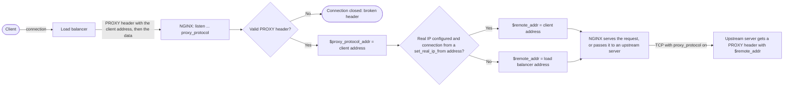

This article explains how to configure NGINX Open Source and F5 NGINX Plus to accept the PROXY protocol. It covers how to replace the IP address of a load balancer or proxy with the client address from the PROXY protocol header, how to log the client's IP address, and how to send the PROXY protocol from NGINX to a TCP upstream server.

<span id="intro"></span>

## Introduction

When a load balancer or proxy passes a connection to NGINX, NGINX sees the address of the load balancer, not of the client. The [PROXY protocol](https://www.haproxy.org/download/1.8/doc/proxy-protocol.txt) solves this: the load balancer, such as HAProxy or an AWS load balancer, sends a short header with the client connection information before the data of the connection. The header has the client IP address and port, and the IP address and port that the client connected to.

With the PROXY protocol, NGINX can learn the client's IP address for HTTP, HTTPS, HTTP/2, WebSocket, and TCP connections. It doesn't work for HTTP/3 or UDP. You can use the address to choose a website language, deny access to some addresses, or log it for statistics.

NGINX gets the client's IP address from the PROXY protocol header in two ways:

- The [$proxy_protocol_addr](https://nginx.org/en/docs/http/ngx_http_core_module.html#var_proxy_protocol_addr) and [$proxy_protocol_port](https://nginx.org/en/docs/http/ngx_http_core_module.html#var_proxy_protocol_port) variables contain the client's IP address and port. The [$remote_addr](https://nginx.org/en/docs/http/ngx_http_core_module.html#var_remote_addr) and [$remote_port](https://nginx.org/en/docs/http/ngx_http_core_module.html#var_remote_port) variables still contain the IP address and port of the load balancer.

- The [Real IP](https://nginx.org/en/docs/http/ngx_http_realip_module.html) module replaces the values of `$remote_addr` and `$remote_port` with the client's IP address and port. Then the [$realip_remote_addr](https://nginx.org/en/docs/http/ngx_http_realip_module.html#var_realip_remote_addr) and [$realip_remote_port](https://nginx.org/en/docs/http/ngx_http_realip_module.html#var_realip_remote_port) variables contain the address and port of the load balancer. The `$proxy_protocol_addr` and `$proxy_protocol_port` variables still contain the client's IP address and port.

<span id="prereq"></span>

## Prerequisites

- A load balancer or proxy in front of NGINX that sends the PROXY protocol header. NGINX accepts versions 1 and 2 of the PROXY protocol.
- For the PROXY protocol version 2, NGINX Plus [R16]() and later, or NGINX Open Source [1.13.11](https://nginx.org/en/CHANGES) and later.
- To accept the PROXY protocol for HTTP, NGINX Plus [R3]() and later, or NGINX Open Source [1.5.12](https://nginx.org/en/CHANGES) and later. The client port, in `$proxy_protocol_port` and with the Real IP module, needs NGINX Open Source 1.11.0 or later.
- To send the PROXY protocol to TCP upstream servers, NGINX Plus [R7]() and later, or NGINX Open Source [1.9.2](https://nginx.org/en/CHANGES) and later. To send version 2, NGINX Open Source 1.31.4 or later.
- To accept the PROXY protocol for TCP, NGINX Plus [R11]() and later, or NGINX Open Source [1.11.4](https://nginx.org/en/CHANGES) and later.
- To replace the load balancer's address with the client's address, the Real IP modules for [HTTP](https://nginx.org/en/docs/http/ngx_http_realip_module.html) and [TCP](https://nginx.org/en/docs/stream/ngx_stream_realip_module.html). NGINX Plus and the packages from nginx.org include them. If you build NGINX Open Source from source, add `--with-http_realip_module`, `--with-stream`, and `--with-stream_realip_module` to `configure`, and for TLS also `--with-http_ssl_module` and `--with-stream_ssl_module`. Without `--with-stream`, `configure` ignores `--with-stream_realip_module`. For details, see [Installing NGINX Open Source]().
- Permission to edit the configuration and reload NGINX. On most systems, this means root or `sudo` access.

---

## How the PROXY protocol works

1. The client connects to the load balancer.
2. The load balancer connects to NGINX, and first sends a PROXY protocol header with the client's IP address and port.
3. NGINX reads the header on a `listen` socket with the `proxy_protocol` parameter, and sets the `$proxy_protocol_addr` and `$proxy_protocol_port` variables. Every connection to that socket must start with the header. NGINX closes connections with an invalid header. A header with no address, such as `PROXY UNKNOWN` from a health check, is accepted, and the variables stay empty.
4. If the Real IP module is configured and the connection comes from a trusted address, NGINX sets `$remote_addr` and `$remote_port` to the client's address and port. For HTTP, this also needs `real_ip_header proxy_protocol`.
5. NGINX processes the request or connection, or passes it to an upstream server. For TCP, NGINX can send its own PROXY protocol header to the upstream server.



Text description: The client connects to the load balancer. The load balancer connects to NGINX and sends a PROXY protocol header with the client's address before the data. NGINX reads the header on a `listen` socket with the `proxy_protocol` parameter, and closes the connection if the header is invalid. Otherwise, NGINX sets `$proxy_protocol_addr` to the client's address. If the Real IP module is configured and the connection comes from an address listed in `set_real_ip_from`, NGINX also sets `$remote_addr` to the client's address. Otherwise, `$remote_addr` keeps the load balancer's address. NGINX then serves the request or passes it to an upstream server. For TCP with `proxy_protocol on`, NGINX sends the upstream server its own PROXY protocol header with the address in `$remote_addr`.

 Anyone who can connect to a socket with the `proxy_protocol` parameter can send a header with any client address. Allow only your load balancers to connect to it, for example with a firewall, and list only their addresses in `set_real_ip_from`. The `$proxy_protocol_addr` variable always contains the address that the sender claims, even from addresses that aren't in `set_real_ip_from`. When the Real IP module is configured, `$remote_addr` contains the claimed address only for trusted senders. 

<span id="listen"></span>

## Configure NGINX to accept the PROXY protocol

To accept PROXY protocol headers, add the `proxy_protocol` parameter to the `listen` directive in a `server` block in the [http](https://nginx.org/en/docs/http/ngx_http_core_module.html#listen) or [stream](https://nginx.org/en/docs/stream/ngx_stream_core_module.html#listen) context:

```nginx
http {
    server {
        listen 80  proxy_protocol;
        listen 443 ssl proxy_protocol;

        ssl_certificate     /etc/nginx/ssl/public.example.com.pem;
        ssl_certificate_key /etc/nginx/ssl/public.example.com.key;
    }
}

stream {
    server {
        listen     12345 proxy_protocol;
        proxy_pass backend.example.com:12345;
    }
}
```

The `proxy_protocol` parameter applies to the address and port, so to every `server` block that listens on it. A connection to that port without a PROXY protocol header fails, even for a `server` block whose `listen` directive doesn't have the parameter. `nginx -t` doesn't warn about this. Use a separate port for clients that connect directly.

NGINX accepts the PROXY protocol only for TCP connections. The `proxy_protocol` parameter doesn't work with the `udp` parameter in the `stream` context, or with the `quic` parameter for HTTP/3.

You can now use the `$proxy_protocol_addr` and `$proxy_protocol_port` variables for the client's IP address and port. The `$proxy_protocol_server_addr` and `$proxy_protocol_server_port` variables, in NGINX 1.17.6 and later, contain the address and port that the client connected to. To also replace the load balancer's address in `$remote_addr` and `$remote_port`, configure the Real IP modules as described in the next section.

<span id="realip"></span>

## Change the load balancer's IP address to the client IP address

The Real IP modules for [HTTP](https://nginx.org/en/docs/http/ngx_http_realip_module.html) and [TCP](https://nginx.org/en/docs/stream/ngx_stream_realip_module.html) replace the address of the load balancer or proxy with the client's IP address from the PROXY protocol header. Then the `$remote_addr` and `$remote_port` variables contain the client's IP address and port, and the `$realip_remote_addr` and `$realip_remote_port` variables contain the IP address and port of the load balancer. Access control with [allow](https://nginx.org/en/docs/http/ngx_http_access_module.html#allow) and [deny](https://nginx.org/en/docs/http/ngx_http_access_module.html#deny), and other modules that use `$remote_addr`, then use the client's address.

To replace the load balancer's IP address with the client's IP address:

1. Configure NGINX to accept the PROXY protocol headers. See [Configure NGINX to accept the PROXY protocol](#listen).

2. Check that your NGINX includes the stream module and the Real IP modules for HTTP and TCP:

    ```shell
    nginx -V 2>&1 | tr ' ' '\n' | grep -E '^--with-(stream(=dynamic)?|http_realip_module|stream_realip_module)$'
    ```

    The output lists `--with-http_realip_module`, `--with-stream` or `--with-stream=dynamic`, and `--with-stream_realip_module`. If one is missing, build NGINX with it. See [Installing NGINX Open Source](). NGINX Plus includes both modules.

3. In the `server` block, list the IP address or CIDR range of your load balancers with the `set_real_ip_from` directive for [HTTP](https://nginx.org/en/docs/http/ngx_http_realip_module.html#set_real_ip_from), [TCP](https://nginx.org/en/docs/stream/ngx_stream_realip_module.html#set_real_ip_from), or both:

    ```nginx
    server {
        listen           80 proxy_protocol;
        set_real_ip_from 192.168.1.0/24;
    }
    ```

    For TCP, this is all you need: the TCP Real IP module always takes the address from the PROXY protocol header.

4. For HTTP, also set the [real_ip_header](https://nginx.org/en/docs/http/ngx_http_realip_module.html#real_ip_header) directive to `proxy_protocol`, so that NGINX takes the client's address from the PROXY protocol header:

    ```nginx
    http {
        server {
            listen           80 proxy_protocol;
            set_real_ip_from 192.168.1.0/24;
            real_ip_header   proxy_protocol;
        }
    }
    ```

<span id="log"></span>

## Log the original IP address

When NGINX knows the client's IP address, you can log it, and pass it to your upstream servers so that they can log it too:

1. For HTTP, pass the client's IP address to the upstream servers in request headers, with the `$proxy_protocol_addr` variable and the [proxy_set_header](https://nginx.org/en/docs/http/ngx_http_proxy_module.html#proxy_set_header) directive:

    ```nginx
    http {
        proxy_set_header X-Real-IP       $proxy_protocol_addr;
        proxy_set_header X-Forwarded-For $proxy_protocol_addr;
    }
    ```

    A `server` or `location` block that has its own `proxy_set_header` directives doesn't inherit any from the `http` context. In that case, add these directives to the block, as in the [example](#example). If you configured the Real IP module, you can use `$remote_addr` instead, which contains the claimed address only for trusted load balancers.

2. Add the `$proxy_protocol_addr` variable to a log format, with the `log_format` directive for [HTTP](https://nginx.org/en/docs/http/ngx_http_log_module.html#log_format) or [TCP](https://nginx.org/en/docs/stream/ngx_stream_log_module.html#log_format), and use the format in an `access_log` directive. Give the format a new name: `combined` is predefined for HTTP, and NGINX doesn't allow redefining it.

    - In the `http` context:

        ```nginx
        http {
            log_format proxied '$proxy_protocol_addr - $remote_user [$time_local] '
                               '"$request" $status $body_bytes_sent '
                               '"$http_referer" "$http_user_agent"';
            access_log /var/log/nginx/access.log proxied;
        }
        ```

    - In the `stream` context. The `$remote_user` variable doesn't exist for TCP:

        ```nginx
        stream {
            log_format basic '$proxy_protocol_addr [$time_local] '
                             '$protocol $status $bytes_sent $bytes_received '
                             '$session_time';
            access_log /var/log/nginx/stream.log basic;
        }
        ```

<span id="proxy_protocol"></span>

## PROXY protocol for a TCP connection to an upstream

For TCP, NGINX can also send the PROXY protocol to the upstream server, so that the server learns the client's address. To do this, add the [proxy_protocol](https://nginx.org/en/docs/stream/ngx_stream_proxy_module.html#proxy_protocol) directive to a `server` block in the `stream` context:

```nginx
stream {
    server {
        listen         12345;
        proxy_pass     example.com:12345;
        proxy_protocol on;
    }
}
```

With `proxy_protocol on`, NGINX sends version 1 of the PROXY protocol. In NGINX Open Source 1.31.4 and later, `proxy_protocol v2;` sends version 2. The header has the client's address as NGINX sees it in `$remote_addr`, and the local address and port of NGINX as the destination. So if NGINX itself received the PROXY protocol and the Real IP module is configured, the upstream server gets the original client's address. The upstream server must accept the PROXY protocol on that port.

If clients can use IPv6 and NGINX connects to the upstream server over IPv4, or the other way around, use `proxy_protocol v2;`. A version 1 header can't carry addresses of two families correctly.

<span id="example"></span>

## Example

This complete configuration accepts the PROXY protocol from a load balancer for HTTP, HTTPS, and TCP. It's a whole **nginx.conf**, so back up your existing file first. It replaces everything in the existing file, such as the `user` directive, `include mime.types`, and the includes of **conf.d** or **sites-enabled**. If your existing file loads modules with `load_module` or includes **modules-enabled**, keep those lines at the top.

Replace these values with your own: the certificate and key paths, `192.0.2.21:8080`, `backend.example.com:12345`, and the load balancer range `192.168.1.0/24`. NGINX resolves `backend.example.com` when it starts, so `nginx -t` fails with `host not found in upstream` until you replace it.

```nginx
events {}

http {
    log_format proxied '$proxy_protocol_addr - $remote_user [$time_local] '
                       '"$request" $status $body_bytes_sent '
                       '"$http_referer" "$http_user_agent"';
    access_log /var/log/nginx/access.log proxied;

    upstream backend1 {
        server 192.0.2.21:8080;
    }

    server {
        server_name localhost;

        listen 80  proxy_protocol;
        listen 443 ssl proxy_protocol;

        ssl_certificate     /etc/nginx/ssl/public.example.com.pem;
        ssl_certificate_key /etc/nginx/ssl/public.example.com.key;

        set_real_ip_from 192.168.1.0/24;
        real_ip_header   proxy_protocol;

        location /app/ {
            proxy_pass       http://backend1;
            proxy_set_header Host            $host;
            proxy_set_header X-Real-IP       $proxy_protocol_addr;
            proxy_set_header X-Forwarded-For $proxy_protocol_addr;
        }
    }
}

stream {
    log_format basic '$proxy_protocol_addr [$time_local] '
                     '$protocol $status $bytes_sent $bytes_received '
                     '$session_time';
    access_log /var/log/nginx/stream.log basic;

    server {
        listen              12345 ssl proxy_protocol;

        ssl_certificate     /etc/nginx/ssl/cert.pem;
        ssl_certificate_key /etc/nginx/ssl/cert.key;

        set_real_ip_from    192.168.1.0/24;

        proxy_pass          backend.example.com:12345;
        proxy_protocol      on;
    }
}
```

The example assumes a load balancer in front of NGINX, at an address in `192.168.1.0/24`. The load balancer passes TCP connections through without decrypting them, and adds the PROXY protocol header:

- NGINX accepts HTTP on port 80, HTTPS on port 443, and TCP with TLS on port 12345. The `proxy_protocol` parameter of each `listen` directive makes NGINX read the PROXY protocol header first.
- NGINX decrypts HTTPS and TLS with the [ssl_certificate](https://nginx.org/en/docs/http/ngx_http_ssl_module.html#ssl_certificate) and [ssl_certificate_key](https://nginx.org/en/docs/http/ngx_http_ssl_module.html#ssl_certificate_key) directives, and passes the data to the upstream servers: HTTP requests to the **backend1** group, and TCP data to **backend.example.com:12345**.
- The `set_real_ip_from` and `real_ip_header` directives replace the load balancer's address in `$remote_addr` with the client's address.
- The `proxy_set_header` directives pass the client's IP address to the HTTP upstream servers.
- The `log_format` and `access_log` directives log the client's IP address for HTTP and TCP.
- The `proxy_protocol on` directive makes NGINX send its own PROXY protocol header, with the client's address, to the TCP upstream server.

---

## Verify the configuration

1. Test and reload the configuration:

    ```shell
    sudo nginx -t && sudo nginx -s reload
    ```

2. On the NGINX host, send an HTTP request with a PROXY protocol header, as a load balancer would:

    ```shell
    printf 'PROXY TCP4 203.0.113.7 127.0.0.1 51234 80\r\nGET /app/ HTTP/1.1\r\nHost: localhost\r\nConnection: close\r\n\r\n' | nc 127.0.0.1 80 | head -1
    ```

    The output is the status line of the response, for example `HTTP/1.1 200 OK`.

3. Check the access log:

    ```shell
    sudo tail -1 /var/log/nginx/access.log
    ```

    The line starts with `203.0.113.7`, the client address from the PROXY protocol header.

4. Check HTTPS with `curl` 8.2 or later. The `--haproxy-clientip` option sets the client address in the PROXY protocol header:

    ```shell
    curl -sk --haproxy-protocol --haproxy-clientip 198.51.100.4 https://127.0.0.1/app/ -o /dev/null -w '%{http_code}\n'
    sudo tail -1 /var/log/nginx/access.log
    ```

    The output is `200`, and the log line starts with `198.51.100.4`.

5. Send a request without the header:

    ```shell
    curl -s http://127.0.0.1/app/; echo "exit code $?"
    ```

    The output is `exit code 52`: NGINX closes connections without a PROXY protocol header, and `curl` gets no reply.

---

## Troubleshooting

### NGINX closes connections and logs "broken header"

**Symptom**: Clients get an empty reply or a closed connection, and the error log shows `broken header: "GET / HTTP/1.1" while reading PROXY protocol`, or `broken header` with binary data for TLS connections.

**Cause**: Connections reach a port with the `proxy_protocol` parameter without a PROXY protocol header. For example, clients connect to NGINX directly, the load balancer's health checks don't send the header, or the PROXY protocol isn't turned on at the load balancer. A health check that connects and sends nothing doesn't cause this message. NGINX closes it after a timeout: `proxy_protocol_timeout` for TCP, 30 seconds by default, or `client_header_timeout` for HTTP.

**Fix**: Turn on the PROXY protocol at the load balancer. For clients and health checks that connect directly, add a `listen` directive on another port without the `proxy_protocol` parameter. A port with the parameter requires the header for all `server` blocks on it.

### The configuration test reports a log_format or variable error

**Symptom**: `nginx -t` fails with `duplicate "log_format" name "combined"`, or `unknown "remote_user" variable`.

**Cause**: The `combined` format is predefined for HTTP and can't be redefined. The `$remote_user` variable exists only for HTTP.

**Fix**: Give your log format another name, and use only stream variables in `stream` log formats.

### The logs still show the load balancer's address

**Symptom**: `$remote_addr` contains the load balancer's address.

**Cause**: The Real IP module isn't configured, or the load balancer's address isn't in `set_real_ip_from`. For HTTP, `real_ip_header proxy_protocol` might be missing. Or the load balancer sends headers without an address, such as `PROXY UNKNOWN` or a version 2 `LOCAL` header, so the PROXY protocol variables are empty.

**Fix**: Add the load balancer's address or range to `set_real_ip_from`. For HTTP, add `real_ip_header proxy_protocol;`. Or log `$proxy_protocol_addr` instead.

---

## References

For more information, see:

- [PROXY protocol specification](https://www.haproxy.org/download/1.8/doc/proxy-protocol.txt)
- [ngx_http_realip_module reference](https://nginx.org/en/docs/http/ngx_http_realip_module.html) on nginx.org
- [ngx_stream_realip_module reference](https://nginx.org/en/docs/stream/ngx_stream_realip_module.html) on nginx.org
- [TCP and UDP Load Balancing]()
