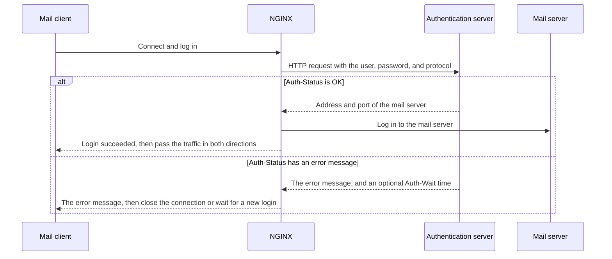

<span id="introduction"></span>

## Overview

NGINX can proxy the IMAP, POP3, and SMTP protocols to the mail servers that host the mail accounts. Clients then use NGINX as their single endpoint. This makes it easier to:

- Add mail servers.
- Choose a mail server by rules, for example the server nearest to the IP address of the client.
- Spread the load across mail servers.

For each login, NGINX asks an authentication server over HTTP. The authentication server checks the credentials, and tells NGINX which mail server to use:



The client connects to NGINX and logs in. NGINX sends the credentials to the authentication server. If the authentication server accepts them, it returns the address of a mail server. NGINX logs in there, and passes the traffic between the client and the mail server. If it rejects them, NGINX returns its error message to the client.

---

<span id="prerequisites"></span>

## Before you begin

Before you begin, make sure you have:

- **NGINX with the mail modules**: NGINX Plus includes them. The NGINX Open Source packages from nginx.org include them too, built with `--with-mail` and `--with-mail_ssl_module`. If you build NGINX Open Source from source, add these two options:

    ```shell
    ./configure --with-mail --with-mail_ssl_module
    ```

- **An authentication server**: NGINX needs one for the mail proxy. You can write your own, as described in [Set up the authentication server](#mail_auth).
- **Mail servers**: IMAP, POP3, or SMTP servers, or an external mail service.

---

<span id="mail_conf"></span><span id="configuring-smtpimappop3-mail-proxy-servers"></span>

## Set up the mail proxy

In the NGINX configuration file:

1. Create a top-level [`mail`](https://nginx.org/en/docs/mail/ngx_mail_core_module.html#mail) block, at the same level as the [`http`](https://nginx.org/en/docs/http/ngx_http_core_module.html#http) block:

    ```nginx
    mail {
        # ...
    }
    ```

1. Set the name of your mail server with the [`server_name`](https://nginx.org/en/docs/mail/ngx_mail_core_module.html#server_name) directive:

    ```nginx
    mail {
        server_name mail.example.com;
        # ...
    }
    ```

1. Set the authentication server with the [`auth_http`](https://nginx.org/en/docs/mail/ngx_mail_auth_http_module.html#auth_http) directive. The authentication server checks the credentials of clients, chooses a mail server for each client, and reports errors. For details, see [Set up the authentication server](#mail_auth).

    ```nginx
    mail {
        server_name mail.example.com;
        auth_http   localhost:9000/cgi-bin/nginxauth.cgi;
        # ...
    }
    ```

1. Optionally, pass error messages of the mail servers to clients with the [`proxy_pass_error_message`](https://nginx.org/en/docs/mail/ngx_mail_proxy_module.html#proxy_pass_error_message) directive. A mail server can reject a login that the authentication server accepted. Some POP3 servers do this on purpose, for example to tell a user that the mailbox is full. By default, NGINX doesn't pass such messages, because they can contain internal details.

    ```nginx
    mail {
        server_name mail.example.com;
        auth_http   localhost:9000/cgi-bin/nginxauth.cgi;

        proxy_pass_error_message on;
        # ...
    }
    ```

1. Add a [`server`](https://nginx.org/en/docs/mail/ngx_mail_core_module.html#server) block for each SMTP, IMAP, or POP3 server. In each one, set:

    - The port, with the [`listen`](https://nginx.org/en/docs/mail/ngx_mail_core_module.html#listen) directive.
    - The protocol, with the [`protocol`](https://nginx.org/en/docs/mail/ngx_mail_core_module.html#protocol) directive. Without it, NGINX detects the protocol from well-known ports. These are 143 and 993 for IMAP, 110 and 995 for POP3, and 25, 465, and 587 for SMTP.
    - The authentication methods that clients may use, with the [`imap_auth`](https://nginx.org/en/docs/mail/ngx_mail_imap_module.html#imap_auth), [`pop3_auth`](https://nginx.org/en/docs/mail/ngx_mail_pop3_module.html#pop3_auth), and [`smtp_auth`](https://nginx.org/en/docs/mail/ngx_mail_smtp_module.html#smtp_auth) directives. The defaults are `plain` for IMAP and POP3, and `plain login` for SMTP.

    ```nginx
    server {
        listen    25;
        protocol  smtp;
        smtp_auth login plain cram-md5;
    }

    server {
        listen    110;
        protocol  pop3;
        pop3_auth plain apop cram-md5;
    }

    server {
        listen   143;
        protocol imap;
    }
    ```

    The `apop` and `cram-md5` methods work only if the authentication server has the passwords unencrypted. For these methods, the authentication server returns the plain password in the `Auth-Pass` response header. NGINX uses it to log in to the mail server. For details, see the [protocol of the auth_http module](https://nginx.org/en/docs/mail/ngx_mail_auth_http_module.html#protocol).

---

<span id="mail_auth"></span><span id="setting-up-authentication-for-a-mail-proxy"></span>

## Set up the authentication server

NGINX sends every login of an IMAP, POP3, or SMTP client to the authentication server first. You can write your own authentication server, following the [protocol of the auth_http module](https://nginx.org/en/docs/mail/ngx_mail_auth_http_module.html#protocol). It's based on HTTP: NGINX sends the details of the login in request headers, and reads the answer from the response headers. It ignores the response body.

A request from NGINX looks like this:

```none
GET /auth HTTP/1.0
Host: localhost
Auth-Method: plain
Auth-User: user
Auth-Pass: password
Auth-Protocol: imap
Auth-Login-Attempt: 1
Client-IP: 192.0.2.42
```

For SMTP, the request also has the `Client-Host` header, with the host name of the client.

If the login is valid, the authentication server returns the address and port of the mail server to use:

```none
HTTP/1.0 200 OK
Auth-Status: OK
Auth-Server: 198.51.100.1
Auth-Port: 143
```

If the login fails, it returns the error message for the client in the `Auth-Status` header:

```none
HTTP/1.0 200 OK
Auth-Status: Invalid login or password
Auth-Wait: 3
```

Both responses have the status `200 OK`, which can be confusing: the `Auth-Status` header tells success from failure.

The `Auth-Wait` header is the number of seconds to wait before the client can try again. NGINX waits that long, sends the error message to the client, and accepts another login on the same connection. Without `Auth-Wait`, NGINX sends the error message and closes the connection.

NGINX keeps some memory for each failed login until the session ends. So limit the logins per session: after 10 to 20 failed attempts, respond without `Auth-Wait`. The `Auth-Login-Attempt` request header has the number of the attempt.

For all request and response headers, see the [ngx_mail_auth_http_module](https://nginx.org/en/docs/mail/ngx_mail_auth_http_module.html#protocol) reference.

---

<span id="mail_ssl"></span><span id="setting-up-ssltls-for-a-mail-proxy"></span>

## Set up TLS for the mail proxy

TLS protects the data between the clients and NGINX. To set it up:

1. Check that your NGINX has the mail TLS module. The output of this command must include `with-mail_ssl_module`:

    ```shell
    nginx -V 2>&1 | grep -o with-mail_ssl_module
    ```

1. Get a server certificate and its private key, and put them on the server. You can get the certificate from a trusted certificate authority (CA), or create one with a tool such as OpenSSL.

1. Set the certificate and the private key, both in PEM format, with the [`ssl_certificate`](https://nginx.org/en/docs/mail/ngx_mail_ssl_module.html#ssl_certificate) and [`ssl_certificate_key`](https://nginx.org/en/docs/mail/ngx_mail_ssl_module.html#ssl_certificate_key) directives:

    ```nginx
    mail {
        # ...
        ssl_certificate     /etc/ssl/certs/server.crt;
        ssl_certificate_key /etc/ssl/certs/server.key;
    }
    ```

1. Turn on TLS in one or both of these ways:

    - For TLS from the first byte, add the `ssl` parameter to the [`listen`](https://nginx.org/en/docs/mail/ngx_mail_core_module.html#listen) directive. The usual ports are 993 for IMAP, 995 for POP3, and 465 for SMTP:

        ```nginx
        server {
            listen   993 ssl;
            protocol imap;
        }
        ```

    - For TLS on the plain ports, use the [`starttls`](https://nginx.org/en/docs/mail/ngx_mail_ssl_module.html#starttls) directive. It turns on STLS for POP3, and STARTTLS for IMAP and SMTP. With `starttls only`, clients must switch to TLS before they log in.

        ```nginx
        mail {
            # ...
            starttls on;
        }
        ```

    NGINX 1.25.1 removed the `ssl` directive, so `ssl on;` makes `nginx -t` fail with `unknown directive "ssl"`.

1. Optionally, change the TLS versions and ciphers with the [`ssl_protocols`](https://nginx.org/en/docs/mail/ngx_mail_ssl_module.html#ssl_protocols) and [`ssl_ciphers`](https://nginx.org/en/docs/mail/ngx_mail_ssl_module.html#ssl_ciphers) directives. Since NGINX 1.27.3, the default protocols are TLSv1.2 and TLSv1.3. The default ciphers are `HIGH:!aNULL:!MD5`:

    ```nginx
    mail {
        # ...
        ssl_protocols TLSv1.2 TLSv1.3;
        ssl_ciphers   HIGH:!aNULL:!MD5;
    }
    ```

<span id="optimizing-ssltls-for-mail-proxy"></span>

### Make TLS faster

These settings make TLS for the mail proxy faster:

1. Run one worker process for each CPU core, with the [`worker_processes`](https://nginx.org/en/docs/ngx_core_module.html#worker_processes) directive at the top level of the configuration:

    ```nginx
    worker_processes auto;

    mail {
        # ...
    }
    ```

1. Share the TLS sessions between the worker processes with a cache in shared memory, set with the [`ssl_session_cache`](https://nginx.org/en/docs/mail/ngx_mail_ssl_module.html#ssl_session_cache) directive. Give the cache its own name, such as `MAIL`. If the `http` block has a session cache with the same name, `nginx -t` fails with `the shared memory zone "SSL" is already declared for a different use`.

    ```nginx
    mail {
        # ...
        ssl_session_cache shared:MAIL:10m;
    }
    ```

1. Optionally, keep the sessions longer than the default 5 minutes, with the [`ssl_session_timeout`](https://nginx.org/en/docs/mail/ngx_mail_ssl_module.html#ssl_session_timeout) directive:

    ```nginx
    mail {
        # ...
        ssl_session_cache   shared:MAIL:10m;
        ssl_session_timeout 10m;
    }
    ```

---

## Complete example

```nginx
worker_processes auto;

mail {
    server_name mail.example.com;
    auth_http   localhost:9000/cgi-bin/nginxauth.cgi;

    proxy_pass_error_message on;

    ssl_certificate     /etc/ssl/certs/server.crt;
    ssl_certificate_key /etc/ssl/certs/server.key;
    ssl_session_cache   shared:MAIL:10m;
    ssl_session_timeout 10m;

    starttls on;

    server {
        listen    25;
        protocol  smtp;
        smtp_auth login plain cram-md5;
    }

    server {
        listen    110;
        protocol  pop3;
        pop3_auth plain apop cram-md5;
    }

    server {
        listen   143;
        protocol imap;
    }

    server {
        listen   993 ssl;
        protocol imap;
    }
}
```

This example has proxy servers for SMTP, POP3, and IMAP on their plain ports, with STARTTLS. It also has an IMAP server with TLS on port 993. The worker processes share a cache of TLS sessions. Error messages of the mail servers reach the clients. The authentication server isn't part of this example.

---

## Verify the mail proxy

1. Test the configuration, and reload NGINX:

    ```shell
    sudo nginx -t && sudo nginx -s reload
    ```

1. Log in through the proxy with `curl`, which supports IMAP. Replace the user name and password with an account that the authentication server accepts:

    - Over STARTTLS on port 143:

        ```shell
        curl --ssl-reqd imap://mail.example.com/ -u user:password
        ```

    - Over TLS on port 993:

        ```shell
        curl imaps://mail.example.com/ -u user:password
        ```

    If the login works, `curl` lists the mailbox folders, and exits with code `0`. If `curl` doesn't trust the certificate, for example a self-signed one, add the `-k` option. Or pass the CA certificate with `--cacert`.

---

## Troubleshooting

### nginx -t reports an unknown directive "ssl"

**Symptom**: `nginx -t` fails with `nginx: [emerg] unknown directive "ssl"`.

**Cause**: The configuration uses `ssl on;`. NGINX 1.25.1 removed the `ssl` directive.

**Fix**: Remove `ssl on;`. Then add the `ssl` parameter to the `listen` directives of the TLS ports. For details, see [Set up TLS for the mail proxy](#mail_ssl).

---

### nginx -t reports that a shared memory zone is already declared

**Symptom**: `nginx -t` fails with a message such as `nginx: [emerg] the shared memory zone "SSL" is already declared for a different use`.

**Cause**: The `mail` and `http` blocks use the same name for their TLS session caches.

**Fix**: Give the cache in the `mail` block its own name, for example `ssl_session_cache shared:MAIL:10m;`.

---

### The client gets an error and the connection closes

**Symptom**: After a failed login, the client gets an error message such as `NO Invalid login or password`, and NGINX closes the connection.

**Cause**: The authentication server rejected the login, and its response has no `Auth-Wait` header.

**Fix**: Check the credentials. To let clients try again on the same connection, the authentication server can add the `Auth-Wait` header to its error responses. For details, see [Set up the authentication server](#mail_auth).

---

## References

For more information, see:

- [Module ngx_mail_core_module](https://nginx.org/en/docs/mail/ngx_mail_core_module.html)
- [Module ngx_mail_auth_http_module](https://nginx.org/en/docs/mail/ngx_mail_auth_http_module.html)
- [Module ngx_mail_proxy_module](https://nginx.org/en/docs/mail/ngx_mail_proxy_module.html)
- [Module ngx_mail_ssl_module](https://nginx.org/en/docs/mail/ngx_mail_ssl_module.html)
