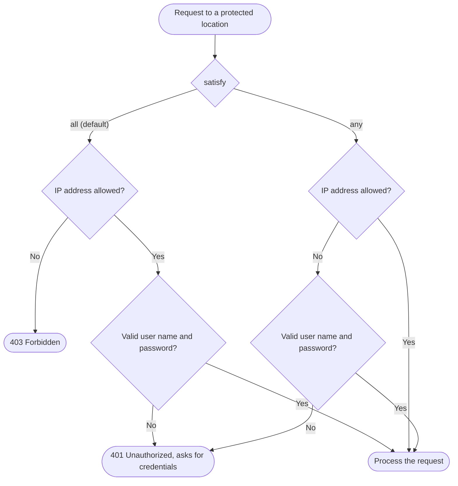

<span id="intro"></span>

## Introduction

With HTTP Basic authentication, NGINX Open Source and F5 NGINX Plus ask clients for a user name and password before they give access to a website or part of it. NGINX checks the credentials against a password file, which you create with a tool such as `htpasswd`.

You can combine Basic authentication with other access restrictions, for example by [IP address]() or by [geographical location]().

Basic authentication sends the password in every request, encoded but not encrypted. Use it only over HTTPS. Refer to [NGINX SSL Termination]().

<span id="prereq"></span>

## Prerequisites

- NGINX Open Source or NGINX Plus.
- A tool to create the password file, such as `htpasswd` from the `apache2-utils` package (Debian, Ubuntu) or the `httpd-tools` package (RHEL, CentOS, Oracle Linux).
- Permission to edit the configuration and reload NGINX. On most systems, this means root or `sudo` access.

---

## How access checks work

NGINX checks access to a location in its access phase:

- The [allow](https://nginx.org/en/docs/http/ngx_http_access_module.html#allow) and [deny](https://nginx.org/en/docs/http/ngx_http_access_module.html#deny) directives check the client IP address.
- The [auth_basic](https://nginx.org/en/docs/http/ngx_http_auth_basic_module.html#auth_basic) directive checks the user name and password.

The [satisfy](https://nginx.org/en/docs/http/ngx_http_core_module.html#satisfy) directive decides how the checks combine. With `satisfy all`, the default, the request must pass every check. With `satisfy any`, one passing check is enough.



Text description: With `satisfy all`, NGINX returns `403` if the IP address isn't allowed, and `401` if the credentials aren't valid; it processes the request only if both checks pass. With `satisfy any`, NGINX processes the request if either the IP address is allowed or the credentials are valid, and returns `401` otherwise.

---

<span id="pass"></span>

## Creating a password file

1. Make sure `htpasswd` is installed. It's in the `apache2-utils` package (Debian, Ubuntu) or the `httpd-tools` package (RHEL, CentOS, Oracle Linux).

2. Create a password file and the first user. Run `htpasswd` with the `-c` flag, which creates a new file, the path of the file, and the user name:

    ```shell
    sudo htpasswd -c /etc/apache2/.htpasswd user1
    ```

    Type the password for **user1** when prompted.

3. Add more users without the `-c` flag, because the file already exists. With `-c`, `htpasswd` would replace the file:

    ```shell
    sudo htpasswd /etc/apache2/.htpasswd user2
    ```

4. Check that the file contains the user names and hashed passwords:

    ```shell
    sudo cat /etc/apache2/.htpasswd
    ```

    ```none
    user1:$apr1$...
    user2:$apr1$...
    ```

5. Let the NGINX worker processes read the file, for example on Debian and Ubuntu:

    ```shell
    sudo chown root:www-data /etc/apache2/.htpasswd
    sudo chmod 640 /etc/apache2/.htpasswd
    ```

NGINX supports these password formats: the `$apr1$` format, which `htpasswd` uses by default; `{SHA}`, `{SSHA}`, and `{PLAIN}`; and the formats of the system's `crypt()` function, such as bcrypt (`htpasswd -B`) on most current Linux systems.

<span id="config"></span>

## Configuring NGINX and NGINX Plus for HTTP Basic Authentication

1. In the location to protect, add the [auth_basic](https://nginx.org/en/docs/http/ngx_http_auth_basic_module.html#auth_basic) directive with the name of the protected area. Browsers show this name when they ask for credentials:

    ```nginx
    location /api {
        auth_basic "Administrator’s Area";
    }
    ```

2. Add the [auth_basic_user_file](https://nginx.org/en/docs/http/ngx_http_auth_basic_module.html#auth_basic_user_file) directive with the path of the password file. A relative path is relative to the directory of the main configuration file.

    ```nginx
    location /api {
        auth_basic           "Administrator’s Area";
        auth_basic_user_file /etc/apache2/.htpasswd;
    }
    ```

3. Test and reload the configuration:

    ```shell
    sudo nginx -t && sudo nginx -s reload
    ```

NGINX reads the password file for each request, so changes to the file take effect without a reload.

To protect a whole website but keep some areas public, use `auth_basic` at the `server` level, and `auth_basic off` in the public locations. The `off` value cancels the setting inherited from the higher level:

```nginx
server {
    listen 80;

    auth_basic           "Administrator’s Area";
    auth_basic_user_file conf/htpasswd;

    location /public/ {
        auth_basic off;
    }
}
```

<span id="combine"></span>

## Combining Basic authentication with access restriction by IP address

You can combine Basic authentication with access restriction by IP address in two ways:

- A client must both have an allowed IP address and authenticate.
- A client must either have an allowed IP address or authenticate.

1. Allow or deny IP addresses with the [allow](https://nginx.org/en/docs/http/ngx_http_access_module.html#allow) and [deny](https://nginx.org/en/docs/http/ngx_http_access_module.html#deny) directives:

    ```nginx
    location /api {
        deny  192.168.1.2;
        allow 192.168.1.0/24;
        allow 127.0.0.1;
        deny  all;
    }
    ```

    NGINX checks the rules in order and uses the first one that matches. In this example, it allows the `192.168.1.0/24` network except `192.168.1.2`, and the address `127.0.0.1`. It denies all other addresses with code `403`.

2. Combine the IP address rules and Basic authentication with the [satisfy](https://nginx.org/en/docs/http/ngx_http_core_module.html#satisfy) directive. With `all`, the default, a client must pass both checks. With `any`, one passing check is enough:

    ```nginx
    location /api {
        satisfy all;

        deny  192.168.1.2;
        allow 192.168.1.0/24;
        allow 127.0.0.1;
        deny  all;

        auth_basic           "Administrator’s Area";
        auth_basic_user_file conf/htpasswd;
    }
    ```

<span id="example"></span>

## Complete example

This complete configuration protects the **/admin/** area of a website with Basic authentication, and allows access only from the local network. It's a whole **nginx.conf**, so back up your existing file first. To add only the website to a configuration that reads files from `conf.d`, put the `server` block in a file there.

```nginx
events {}

http {
    server {
        listen 80;
        root   /usr/share/nginx/html;

        location /admin/ {
            satisfy all;

            allow 192.168.1.0/24;
            allow 127.0.0.1;
            deny  all;

            auth_basic           "Administrator’s Area";
            auth_basic_user_file /etc/apache2/.htpasswd;
        }
    }
}
```

To protect the NGINX Plus API in the same way, use these directives in the location with the `api` directive.

---

## Verify the configuration

1. Request the protected area without credentials:

    ```shell
    curl -s -o /dev/null -w '%{http_code}\n' http://localhost/admin/
    ```

    The output is `401`. A browser shows a dialog that asks for a user name and password:

    

2. Request it with valid credentials:

    ```shell
    curl -s -o /dev/null -w '%{http_code}\n' -u user1 http://localhost/admin/
    ```

    Type the password when prompted. The output is the status of the page, for example `200`, or `404` if **/admin/** has no index file.

---

## Troubleshooting

### Valid credentials are rejected with 401

**Symptom**: NGINX returns `401` even with the correct user name and password. The error log shows `user "user1": password mismatch` or `user "user1" was not found in ...`.

**Cause**: The password doesn't match the hash in the file, the user isn't in the file, or the hash format isn't supported.

**Fix**: Create the user again with `htpasswd`, and check that the file contains the user.

### Requests with credentials return 403 or 500

**Symptom**: Requests with a user name and password return `403 Forbidden` or `500 Internal Server Error`, and the error log shows `open() "/etc/apache2/.htpasswd" failed`.

**Cause**: With `403`, the password file doesn't exist at that path. With `500`, NGINX can't open it for another reason, usually because the worker processes can't read it.

**Fix**: Check the path in `auth_basic_user_file`, and let the worker processes' user read the file.

### Allowed clients get 403

**Symptom**: Clients that should have access get `403 Forbidden`, and the error log shows `access forbidden by rule`.

**Cause**: An earlier `allow` or `deny` rule matches the client. Behind a proxy or load balancer, NGINX sees the proxy's address, not the client's.

**Fix**: Check the order of the rules. Behind a proxy, use the [realip](https://nginx.org/en/docs/http/ngx_http_realip_module.html) module so that NGINX uses the real client address.

---

## References

For more information, see:

- [ngx_http_auth_basic_module reference](https://nginx.org/en/docs/http/ngx_http_auth_basic_module.html) on nginx.org
- [ngx_http_access_module reference](https://nginx.org/en/docs/http/ngx_http_access_module.html) on nginx.org
- [NGINX SSL Termination]()
