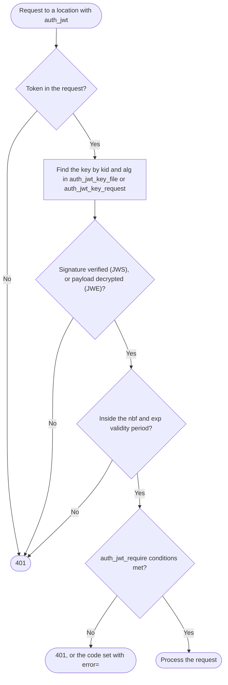

<span id="intro"></span>

## Overview {#introduction}

With F5 NGINX Plus, you can control access to your resources with JSON Web Token (JWT) authentication. A client sends a JWT with each request, and NGINX Plus checks the token with a local key file or with keys from a remote service. NGINX Plus passes only requests with a valid token.

JWT is the format for user information in OpenID Connect, the standard identity layer on top of the OAuth 2.0 protocol. Many APIs and microservices use JWT because it's simple and flexible.

Use this guide to configure NGINX Plus to check JWTs, get the keys, check claims, and handle nested tokens.

---

<span id="prereq"></span>

## Before you begin {#prerequisites}

Before you begin, make sure you have:

- NGINX Plus [Release 10]() (R10) for native [JWT support](https://www.nginx.com/blog/nginx-plus-r10-released/#r10-jwt)
- NGINX Plus [Release 14]() for access to [nested JWT claims and longer signing keys](https://www.nginx.com/blog/nginx-plus-r14-released/#jwt)
- NGINX Plus [Release 17]() for [getting JSON Web keys from a remote location](https://www.nginx.com/blog/nginx-plus-r17-released/#r17-openid)
- NGINX Plus [Release 24]() (R24) for support of encrypted tokens (JWE)
- NGINX Plus [Release 25]() (R25) for support of Nested JWT, multiple sources of JSON Web keys, condition-based JWT authentication
- NGINX Plus [Release 26]() (R26) for support of [JWT key caching](https://nginx.org/en/docs/http/ngx_http_auth_jwt_module.html#auth_jwt_key_cache)
- An identity provider (IdP) or service that creates JWTs. To create test tokens yourself, see [Verify the configuration](#verify-the-configuration), or the "Issuing a JWT to API Clients" section of the [Authenticating API Clients with JWT and NGINX Plus](https://www.f5.com/company/blog/nginx/authenticating-api-clients-jwt-nginx-plus) blog post.

<span id="auth_jwt_type"></span>

NGINX Plus supports the following types of JWT:

- JSON Web Signature (JWS) - JWT content is digitally signed. The following algorithms can be used for signing:
  - HS256, HS384, HS512
  - RS256, RS384, RS512
  - ES256, ES384, ES512
  - EdDSA (Ed25519 and Ed448 signatures)

- JSON Web Encryption (JWE) - the contents of JWT is encrypted. The following content encryption algorithms (the "enc" field of JWE header) are supported:
  - A128CBC-HS256, A192CBC-HS384, A256CBC-HS512
  - A128GCM, A192GCM, A256GCM

   The following key management algorithms (the "alg" field of JWE header) are supported:
  - A128KW, A192KW, A256KW
  - A128GCMKW, A192GCMKW, A256GCMKW
  - dir - direct use of a shared symmetric key as the content encryption key
  - RSA-OAEP, RSA-OAEP-256, RSA-OAEP-384, RSA-OAEP-512

- Nested JWT - support for JWS enclosed into JWE

---

<span id="jwt_validate"></span>

## How NGINX Plus validates a JWT {#how-nginx-plus-validates-a-jwt}

A JWT is considered to be valid when the following conditions are met:

- The signature can be verified (for JWS) or payload can be decrypted (for JWE) with the key found in the [`auth_jwt_key_file`](https://nginx.org/en/docs/http/ngx_http_auth_jwt_module.html#auth_jwt_key_file) or [`auth_jwt_key_request`](https://nginx.org/en/docs/http/ngx_http_auth_jwt_module.html#auth_jwt_key_request) (matching on the `kid` ("key ID"), if present, and `alg` ("algorithm") header fields).
- The JWT is presented inside the validity period, when defined by one or both of the `nbf` ("not before") and `exp` ("expires") claims.
- The additional conditions set with [`auth_jwt_require`](#auth_jwt_require), if any, are met.



Text description: For a request to a location with `auth_jwt`, NGINX Plus first looks for the token. Without a token, the request gets `401`. NGINX Plus finds the key by the token's `kid` and `alg` fields, and verifies the signature or decrypts the payload. If that fails, or if the token is outside its `nbf` and `exp` validity period, the request gets `401`. If conditions set with `auth_jwt_require` aren't met, the request gets `401`, or the code set with its `error=` parameter. Otherwise, NGINX Plus processes the request.

---

<span id="auth_jwt"></span>

## Configure NGINX Plus to authenticate an API {#configuring-nginx-plus-to-authenticate-api}

In this guide, NGINX Plus is a gateway (`proxy_pass http://api_server`) to a number of API servers (the [`upstream {}`](https://nginx.org/en/docs/http/ngx_http_upstream_module.html#upstream) block), and requests passed to the API servers must be authenticated:

```nginx
upstream api_server {
    server 10.0.0.1;
    server 10.0.0.2;
}

server {
    listen 80;

    location /products/ {
        proxy_pass http://api_server;
    }
}
```

To implement JWT for authentication:

1. Create a JWT that will be issued to a client. You can use your identity provider (IdP) or your own service to create JWTs. For testing purposes, you can create your own JWT, as described in [Verify the configuration](#verify-the-configuration).

2. Configure NGINX Plus to accept JWT: specify the [`auth_jwt`](https://nginx.org/en/docs/http/ngx_http_auth_jwt_module.html#auth_jwt) directive that enables JWT authentication and also defines the authentication area (or "realm", "API" in the example):

    ```nginx
    server {
        listen 80;

        location /products/ {
            proxy_pass http://api_server;
            auth_jwt   "API";
        }
    }
    ```

    NGINX Plus can also obtain the JWT from a query string parameter. To configure this, include the `token=` parameter to the [`auth_jwt`](https://nginx.org/en/docs/http/ngx_http_auth_jwt_module.html#auth_jwt) directive:

    ```nginx
    auth_jwt "API" token=$arg_apijwt;
    ```

    A token in the query string appears in the access log, because `$request` contains it, and in the logs of other proxies. [RFC 6750](https://www.rfc-editor.org/rfc/rfc6750#section-2.3) advises against this method, so use it only if clients can't send an `Authorization` header.

    This configuration doesn't check the token's signature yet, because it has no key. Don't use it in production until you add a key in step 4.

3. Specify the type of JWT - `signed` (JWS), `encrypted` (JWE) or `nested` (Nested JWT) - with the [`auth_jwt_type`](https://nginx.org/en/docs/http/ngx_http_auth_jwt_module.html#auth_jwt_type) directive. The default value of the directive is `signed`, so for JWS, the directive can be omitted.

    ```nginx
    server {
        listen 80;

        location /products/ {
            proxy_pass        http://api_server;
            auth_jwt          "API";
            auth_jwt_type     encrypted;
        }
    }
    ```

4. Specify the path to the [JSON Web Key file](#jwk_create) that will be used to verify JWT signature or decrypt JWT content, depending on what you are using. This can be done with the [`auth_jwt_key_file`](https://nginx.org/en/docs/http/ngx_http_auth_jwt_module.html#auth_jwt_key_file) and/or [`auth_jwt_key_request`](https://nginx.org/en/docs/http/ngx_http_auth_jwt_module.html#auth_jwt_key_request) directives. Specifying both directives at the same time will allow you to specify more than one source for keys. If none of the directives are specified, JWS signature verification will be skipped.

    In this scenario, the keys will be taken from two files: the `key.jwk` file and the `keys.json` file:

    ```nginx
    server {
        listen 80;

        location /products/ {
            proxy_pass        http://api_server;
            auth_jwt          "API";
            auth_jwt_type     encrypted;
            auth_jwt_key_file conf/key.jwk;
            auth_jwt_key_file conf/keys.json;
        }
    }
    ```

    In this scenario, there are also two sources for the keys, but the private keys will be taken from the local file `private_jwe_keys.jwk`, while the public keys will be taken from the external identity provider service `https://idp.example.com` in a [subrequest](#auth_jwt_key_request). Private keys decrypt a JWE, and public keys verify a JWS signature, so this combination is for [nested tokens](#nested), a JWS inside a JWE:

    ```nginx
    server {
        listen 80;

        location /products/ {
            proxy_pass           http://api_server;
            auth_jwt             "API";
            auth_jwt_type        nested;
            auth_jwt_key_file    private_jwe_keys.jwk;
            auth_jwt_key_request /public_jws_keys;
        }

        location = /public_jws_keys {
            internal;
            proxy_set_header              Content-Length "";
            proxy_ssl_server_name         on;
            proxy_ssl_verify              on;
            proxy_ssl_trusted_certificate /etc/ssl/certs/ca-certificates.crt;
            proxy_pass                    "https://idp.example.com/keys";
        }
    }
    ```

    - The `internal` directive makes the key location available only to subrequests, so clients can't request it.
    - The empty `Content-Length` header keeps the IdP from waiting for a request body, if the client's request has one.
    - The `proxy_ssl_*` directives make NGINX check the IdP's certificate, so that nobody else can send keys. See [Securing HTTP Traffic to Upstream Servers]().
    - Replace `idp.example.com` with your IdP. NGINX resolves the name when it starts, and fails with `host not found in upstream` if it can't.

5. Turn on JWT key caching to get the best performance from the JWT module. For example, the [`auth_jwt_key_cache`](https://nginx.org/en/docs/http/ngx_http_auth_jwt_module.html#auth_jwt_key_cache) directive in this configuration caches the keys for one hour. If [`auth_jwt_key_request`](https://nginx.org/en/docs/http/ngx_http_auth_jwt_module.html#auth_jwt_key_request) or [`auth_jwt_key_file`](https://nginx.org/en/docs/http/ngx_http_auth_jwt_module.html#auth_jwt_key_file) contain variables, [`auth_jwt_key_cache`](https://nginx.org/en/docs/http/ngx_http_auth_jwt_module.html#auth_jwt_key_cache) can't be used.

    ```nginx
    server {
        listen 80;

        location /products/ {
            proxy_pass           http://api_server;
            auth_jwt             "API";
            auth_jwt_type        nested;
            auth_jwt_key_file    private_jwe_keys.jwk;
            auth_jwt_key_request /public_jws_keys;
            auth_jwt_key_cache   1h;
        }

        location = /public_jws_keys {
            internal;
            proxy_set_header              Content-Length "";
            proxy_ssl_server_name         on;
            proxy_ssl_verify              on;
            proxy_ssl_trusted_certificate /etc/ssl/certs/ca-certificates.crt;
            proxy_pass                    "https://idp.example.com/keys";
        }
    }
    ```

---

<span id="jwk_create"></span>

## Create a JSON Web Key file {#creating-a-json-web-key-file}

To verify a signature or to decrypt data with a key, NGINX Plus needs a JSON Web Key file, such as `key.jwk`. The file format is defined by the [JSON Web Key specification](https://tools.ietf.org/html/rfc7517):

```json
{"keys":
    [{
        "k":"ZmFudGFzdGljand0",
        "kty":"oct",
        "kid":"0001"
    }]
}
```

- `k` is the symmetric key, the secret `fantasticjwt` encoded in base64url. To encode a secret, use this command; the output is `ZmFudGFzdGljand0`:

    ```shell
    echo -n fantasticjwt | base64 | tr '+/' '-_' | tr -d '='
    ```

- `kty` is the key type, here `oct`, a symmetric key (octet sequence).
- `kid` is the key ID. NGINX Plus uses the key whose `kid` matches the `kid` in the token's header.

The secret `fantasticjwt` is only an example. For HS256, the key must be at least 256 bits (32 bytes) long, as required by [RFC 7518](https://www.rfc-editor.org/rfc/rfc7518#section-3.2). To create a random 32-byte key in base64url:

```shell
openssl rand 32 | base64 | tr '+/' '-_' | tr -d '='
```

---

<span id="auth_jwt_key_request"></span>

## Get JWKs with a subrequest {#getting-jwks-from-subrequest}

NGINX Plus can be configured to fetch JSON Web Keys from the remote location - usually an identity provider, especially when using OpenID Connect. The IdP URI where the subrequest will be sent to is configured with the [`auth_jwt_key_request`](https://nginx.org/en/docs/http/ngx_http_auth_jwt_module.html#auth_jwt_key_request) directive:

```nginx
http {
    upstream api_server {
        server 10.0.0.1;
        server 10.0.0.2;
    }

    server {
        listen 80;

        location / {
            auth_jwt             "closed site";
            auth_jwt_key_request /_jwks_uri; # Keys will be fetched by subrequest

            proxy_pass http://api_server;
        }
    }
}
```

The URI refers to an internal location (`/_jwks_uri`) in the same `server` block, so that the JSON Web Key Set can be cached with the [`proxy_cache`](https://nginx.org/en/docs/http/ngx_http_proxy_module.html#proxy_cache) and [`proxy_cache_path`](https://nginx.org/en/docs/http/ngx_http_proxy_module.html#proxy_cache_path) directives to avoid validation overhead. Turning on caching is recommended for high-load API gateways even if [JWT key caching](https://nginx.org/en/docs/http/ngx_http_auth_jwt_module.html#auth_jwt_key_cache) is used, as it will help to avoid overwhelming a key server with key requests when a JWT key cache expires.

NGINX accepts any certificate from an HTTPS server unless you turn on [proxy_ssl_verify](https://nginx.org/en/docs/http/ngx_http_proxy_module.html#proxy_ssl_verify). Turn it on for the key location, so that an attacker can't send NGINX Plus their own keys. See [Securing HTTP Traffic to Upstream Servers]().

```nginx
http {
    proxy_cache_path /var/cache/nginx/jwk levels=1 keys_zone=jwk:1m max_size=10m;

    server {
        listen 80;

        location = /_jwks_uri {
            internal;
            proxy_method                  GET;
            proxy_cache                   jwk; # Cache responses
            proxy_cache_valid             200 12h;
            proxy_set_header              Content-Length "";
            proxy_ssl_server_name         on;
            proxy_ssl_verify              on;
            proxy_ssl_trusted_certificate /etc/ssl/certs/ca-certificates.crt;
            proxy_pass                    https://idp.example.com/oauth2/keys; # Obtain keys from here
        }
    }
}
```

The `/etc/ssl/certs/ca-certificates.crt` file is the system's CA bundle on Debian and Ubuntu. On other systems, use the path of your CA bundle.

The two examples in this section are parts of one configuration: put the `/_jwks_uri` location in the same `server` block as the location that it protects. NGINX keeps the response of a subrequest in a memory buffer, set by [subrequest_output_buffer_size](https://nginx.org/en/docs/http/ngx_http_core_module.html#subrequest_output_buffer_size), 4 KB or 8 KB by default. Some key sets are larger. If yours is, add for example `subrequest_output_buffer_size 16k;` to the `/_jwks_uri` location.

---

<span id="auth_jwt_require"></span>

## Check other JWT claims {#arbitrary-jwt-claims-validation}

During JWT verification, NGINX Plus automatically validates only `nbf` ("not before") and `exp` ("expires") claims. However, in some cases you need to set more conditions for a successful JWT validation, in particular when dealing with application-specific or protocol level claims. For example, OpenID Connect Core requires validation of the `iss` ("issuer") and `aud` ("audience") claims, among others, for an ID token.

Additional conditions for JWT validation can be set as variables with the [`map`](https://nginx.org/en/docs/http/ngx_http_map_module.html) module and then evaluated with the [`auth_jwt_require`](https://nginx.org/en/docs/http/ngx_http_auth_jwt_module.html#auth_jwt_require) directive.

In this scenario, we are verifying that:

- the recipient of the token (audience) is our APIs (map rule 1)
- the token was issued by a trusted identity provider (map rule 2)
- scopes in APIs called on behalf of administrators (map rule 3)

The values of three resulting variables are evaluated in the [`auth_jwt_require`](https://nginx.org/en/docs/http/ngx_http_auth_jwt_module.html#auth_jwt_require) directive, and if the value of each variable is `1`, the JWT will be accepted:

```nginx
upstream api_server {
    server 10.0.0.1;
    server 10.0.0.2;
}

map $jwt_claim_aud $valid_app_id {    #map rule 1:
    "~^api\d\.example\.com$" 1;       #token issued only for target apps
}

map $jwt_claim_iss $valid_issuer {    #map rule 2:
    "https://idp.example.com/sts" 1;  #token issued by trusted IdP
}

map $jwt_claim_scope $valid_scope {   #map rule 3:
    "~(^|\s)access_as_admin(\s|$)" 1; #access as admin only
}

server {
    listen 80;

    location /products/ {
        auth_jwt          "API";
        auth_jwt_key_file conf/api_secret.jwk;
        auth_jwt_require  $valid_app_id $valid_issuer $valid_scope;
        proxy_pass        http://api_server;
    }
}
```

The regular expressions are anchored with `^` and `$`, and their dots are escaped. Without this, a regular expression in a `map` matches any value that contains the text, and a dot matches any character, so a token for `api1xexample.com.attacker.net` would pass. The `scope` claim is usually a list of scopes separated by spaces, so rule 3 matches `access_as_admin` as one word in the list. Check the format of the claims that your IdP issues: for example, the `aud` claim can also be a list of audiences, and rule 1 accepts only a single audience.

In some cases the [`auth_jwt_require`](https://nginx.org/en/docs/http/ngx_http_auth_jwt_module.html#auth_jwt_require) directive can be specified multiple times, for example, for the purpose of authentication and then for authorization. In case of an error, the `401` code will be displayed. Assigning the custom error code `403` to another `auth_jwt_require` directive makes it possible to differentiate authentication and authorization use cases and handle corresponding failures appropriately. In this example, a token for another audience or from another issuer gets `401`, and a valid token without the admin scope gets `403`:

```nginx
location /products/ {
    auth_jwt          "API";
    auth_jwt_key_file conf/api_secret.jwk;
    auth_jwt_require  $valid_app_id $valid_issuer;
    auth_jwt_require  $valid_scope error=403;
    proxy_pass        http://api_server;
}
```

---

<span id="nested"></span>

## Extract a nested JWT {#nested-jwt-extraction}

A Nested JWT is a JWS token enclosed into JWE. In a Nested JWT, the sensitive information from JWS is protected with extra encryption of JWE.

Using Nested JWT may be preferable over JWE because:

- in case of JWE, the target application/service needs to decrypt the token first, then verify the signature. Decrypt operation on the application side may be time and resource consuming.

- in case of Nested JWT, as NGINX Plus resides in the same trusted network with the target application, there is no need for token encryption between NGINX Plus and the application. NGINX Plus decrypts the JWE, checks the enclosed JWS, and sends the Bearer Token to the application. This will offload JWE decryption from the application to NGINX Plus.

- if your application doesn't support JWE, using Nested JWT enables full protection for JWS.

To enable Nested tokens:

1. Specify the `nested` type of JWT with the [`auth_jwt_type`](https://nginx.org/en/docs/http/ngx_http_auth_jwt_module.html#auth_jwt_type) directive.

    ```nginx
    auth_jwt_type nested;
    ```

2. Pass the decrypted payload (the [`$jwt_payload`](https://nginx.org/en/docs/http/ngx_http_auth_jwt_module.html#var_jwt_payload) variable) to the application as the Bearer token value in the `Authorization` header:

    ```nginx
    proxy_set_header Authorization "Bearer $jwt_payload";
    ```

---

## Example

This example sums up the nested JWT steps into one configuration:

```nginx
http {
    upstream api_server {
        server 10.0.0.1;
        server 10.0.0.2;
    }

    server {
        listen 80;

        location / {
            auth_jwt          "API";
            auth_jwt_type     nested;
            auth_jwt_key_file conf/api_secret.jwk;

            proxy_pass       http://api_server;
            proxy_set_header Authorization "Bearer $jwt_payload";
        }
    }
}
```

The `upstream` block is inside the `http` block, and `proxy_pass` is inside a `location`. NGINX doesn't accept either of them in other places.

---

## Verify the configuration

These steps create a signed test token (JWS) with the HS256 algorithm, for the key file from [Create a JSON Web Key file](#jwk_create), and send requests with it. The secret `fantasticjwt` is shorter than RFC 7518 requires, so use it only for this test.

1. Save the key file from [Create a JSON Web Key file](#jwk_create) as `/etc/nginx/key.jwk`, and protect the location with it. The JWT type is `signed`, the default:

    ```nginx
    location /products/ {
        auth_jwt          "API";
        auth_jwt_key_file /etc/nginx/key.jwk;
        proxy_pass        http://api_server;
    }
    ```

2. Test and reload the configuration:

    ```shell
    sudo nginx -t && sudo nginx -s reload
    ```

3. Create a token that expires in one hour, signed with the secret `fantasticjwt` and the key ID `0001`:

    ```shell
    b64url() { openssl base64 -A | tr '+/' '-_' | tr -d '='; }
    header=$(printf '{"alg":"HS256","typ":"JWT","kid":"0001"}' | b64url)
    payload=$(printf '{"sub":"alice","exp":%d}' $(( $(date +%s) + 3600 )) | b64url)
    signature=$(printf '%s.%s' "$header" "$payload" | openssl dgst -sha256 -hmac 'fantasticjwt' -binary | b64url)
    token="$header.$payload.$signature"
    ```

4. Send a request without a token, and one with the token:

    ```shell
    curl -s -o /dev/null -w '%{http_code}\n' http://localhost/products/
    curl -s -o /dev/null -w '%{http_code}\n' -H "Authorization: Bearer $token" http://localhost/products/
    ```

    The first request gets `401`. The second gets the status from your API server, for example `200`.

---

## Troubleshooting

### Requests with a token get 401

**Symptom**: Requests with a token get `401 Unauthorized`.

**Cause**: One of these:

- The token's `kid` or `alg` doesn't match a key in the key file or key set.
- The signature doesn't match, for example because the token was signed with another secret, or the `k` value isn't the secret in base64url.
- The token has expired (`exp`), or isn't valid yet (`nbf`). Check that the clocks of NGINX Plus and the IdP are correct.
- A condition in `auth_jwt_require` isn't met.

**Fix**: Decode the token's header and payload, which are base64url-encoded JSON, and compare them with the key file and the conditions. For example, to show the payload of the token in `$token`, run `cut -d. -f2 <<< "$token" | tr '_-' '/+' | base64 -d 2>/dev/null`; the output can lack the closing brace if the padding is missing.

### Requests get 500 Internal Server Error

**Symptom**: Requests to the protected location get `500 Internal Server Error`.

**Cause**: NGINX Plus couldn't load the keys. For example, the key file doesn't exist or isn't valid JSON, or the key subrequest failed.

**Fix**: Check the error log for the reason. Check the key file's path and format, and that the key location can reach the IdP and verify its certificate.

### NGINX doesn't start: "host not found in upstream"

**Symptom**: `nginx -t` fails with `host not found in upstream "idp.example.com"`.

**Cause**: The example host names don't exist.

**Fix**: Replace `idp.example.com` and the other example names with your servers.

### NGINX doesn't start: "invalid URL prefix"

**Symptom**: `nginx -t` fails with `invalid URL prefix`.

**Cause**: The URL in `proxy_pass` doesn't start with `http://` or `https://`, for example because of a typo such as `https_//`.

**Fix**: Correct the URL.

### NGINX doesn't start: "directive is not allowed here"

**Symptom**: `nginx -t` fails with `"upstream" directive is not allowed here` or `"proxy_pass" directive is not allowed here`.

**Cause**: The `upstream` block is outside the `http` block, or `proxy_pass` is directly in a `server` block.

**Fix**: Put `upstream` blocks in the `http` context, and `proxy_pass` in a `location`.

---

<span id="see_also"></span>

## References {#see-also}

- [Authenticating API Clients with JWT and NGINX Plus](https://www.f5.com/company/blog/nginx/authenticating-api-clients-jwt-nginx-plus)
- [ngx_http_auth_jwt_module reference](https://nginx.org/en/docs/http/ngx_http_auth_jwt_module.html) on nginx.org
- [Single Sign-On with OpenID Connect and Identity Providers]()
