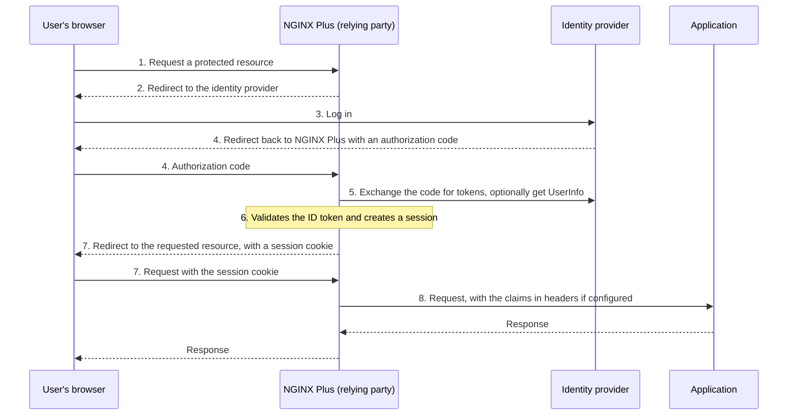

## Overview

This guide explains how to enable single sign-on (SSO) for applications being proxied by F5 NGINX Plus using:

- OpenID Connect as the authentication mechanism.
- An external Identity Provider (IdP) such as AD FS, Auth0, Cognito, Entra ID, Keycloak, OneLogin, Okta, Ping Identity and others.
- NGINX Plus as an OIDC client application that verifies user identity (Relying Party).

OpenID Connect is an identity protocol that utilizes the authorization and authentication mechanisms of OAuth 2.0. With it, NGINX Plus can provide a layer of authentication for protected applications that do not natively support it.

NGINX Plus consumes authorization and claims from OpenID Connect Identity Providers by utilizing JWT-based identity tokens that are delivered via the OAuth 2.0 framework. It supports several specific flows suitable for browser-based and desktop/mobile applications. OpenID Connect allows the client (NGINX Plus) to retrieve an ID token in addition to an access token. The ID token provides information about the authenticated user.

For the target client application, OIDC authentication can be enabled with great flexibility on different levels. It can be enabled globally, or more granular at a per-server or a per-location level. Additionally, OIDC supports auto discovery and retrieval of the OpenID provider configuration metadata while also allowing the definition of additional metadata if needed.

## How OpenID Connect works with NGINX Plus {#oidc-workflow}

1. A user accesses a protected resource.

2. NGINX Plus redirects the user to the IdP for user authentication and authorization.

3. The IdP collects user credentials and authenticates the user.

4. The IdP redirects the user back to NGINX Plus with an authorization code.

5. NGINX Plus exchanges the authorization code at the IdP for an `id_token` and an access token. With `userinfo on` (NGINX Plus R35 and later), it also retrieves profile data for the user from the `UserInfo` endpoint.

6. NGINX Plus validates the `id_token` and the profile data, and creates a session for the user.

7. NGINX Plus sends the user back to the requested resource, with a session cookie.

8. NGINX Plus passes the user's requests to the protected application. You can pass the user's claims, such as the name and email address, to the application in request headers.

<span style="display: inline-block; margin-top: 20px; margin-bottom: 50px;">

</span>

The same flow as a sequence diagram:



Text description: The user's browser requests a protected resource. NGINX Plus redirects the browser to the identity provider, where the user logs in. The identity provider redirects the browser back to NGINX Plus with an authorization code. NGINX Plus exchanges the code for an ID token and an access token, and can get the user's profile from the UserInfo endpoint. It validates the token, creates a session, and redirects the browser to the requested resource with a session cookie. NGINX Plus then passes the user's requests to the application, with the claims in headers if configured, and returns the responses.

## Before you begin {#prerequisites}

Before you begin, make sure you have:

- An identity provider (IdP) set up on your network or in the cloud. You need admin access to the IdP.

- An [NGINX Plus subscription](https://www.f5.com/products/nginx/nginx-plus) and NGINX Plus [Release 34]() or later.
  To install NGINX Plus, follow the steps in [Installing NGINX Plus](https://docs.nginx.com/nginx/admin-guide/installing-nginx/installing-nginx-plus/).

- A domain name that points to your NGINX Plus instance (for example, `demo.example.com`).

- A TLS certificate and key for that domain name. The examples use `/etc/ssl/certs/fullchain.pem` and `/etc/ssl/private/key.pem`; replace them with your files.

## Set up your identity provider (IdP) {#idp-setup}

The setup steps are similar for most identity providers, but some details may differ.

1. Log in to your IdP's admin console.

2. Create a new OpenID Connect (OIDC) application.

   - Give the app a name.
   - Add the users or groups who need access.

3. Add the redirect URI that the IdP sends users back to after login, for example `https://demo.example.com/oidc_callback`. The IdP accepts only redirect URIs that you register. The [deployment guides](#deployment-guildes) show where to set it for each IdP.

4. Find the **Client ID** and **Client Secret** for your app.
   You'll need these later when you [set up NGINX Plus as the relying party](#setup-oidc-provider2).

5. Find the **issuer** value.

   You can find the issuer value in your IdP app settings or in the discovery document, at the issuer URL followed by `/.well-known/openid-configuration`, for example:

   `https://your-idp-domain/idp/.well-known/openid-configuration`

   where:

   - the `https://your-idp-domain/idp` is your IdP's issuer URL

   - the `/.well-known/openid-configuration` is the standard path of the discovery document

   The metadata also contains other addresses of the IdP, for example:

   - the `userinfo_endpoint` is the URL where NGINX Plus can get the user's profile data (claims).

   - the `end_session_endpoint` is the URL where NGINX Plus sends the user's browser to log out at the IdP, for an RP‑initiated logout.

   The IdP configuration metadata is returned in the JSON format, for example:

   ```json
   {
       ...
       "issuer": "https://your-idp-domain/idp",
       "authorization_endpoint": "https://your-idp-domain/idp/oauth2/authorize/",
       "token_endpoint": "https://your-idp-domain/idp/oauth2/token/",
       "jwks_uri": "https://your-idp-domain/idp/discovery/keys",
       "userinfo_endpoint": "https://your-idp-domain/idp/userinfo",
       "end_session_endpoint": "https://your-idp-domain/idp/oauth2/logout",
       ...
   }
   ```

   Copy the **issuer** value. You will need it later when [configuring NGINX Plus as the Relying Party](#setup-oidc-provider2).

6. Optionally, for RP‑initiated logout (supported since [NGINX Plus R35]()), register the post-logout redirect URI, where the IdP sends the user after logout, for example `https://demo.example.com/post_logout/`. It must be the same as the `post_logout_uri` value in the NGINX Plus configuration.

## Configure the Relying Party (NGINX Plus) {#rp-setup}

With your IdP configured, you can enable OIDC on NGINX Plus. NGINX Plus serves as the Relying Party (RP) client service that verifies user identity.

1.  Check that you use NGINX Plus R34 or later, or R35 or later for RP‑initiated logout, by running the `nginx -v` command in a terminal:

    ```shell
    nginx -v
    ```

    For example, the output for NGINX Plus Release 35 is:

    ```none
    nginx version: nginx/1.29.0 (nginx-plus-r35)
    ```

2.  Ensure that you have the values of the **Client ID**, **Client Secret**, and **Issuer** obtained from your IdP Provider.

3.  In your preferred text editor, open the NGINX configuration file (`/etc/nginx/nginx.conf` for Linux or `/usr/local/etc/nginx/nginx.conf` for FreeBSD).

4.  In the [`http {}`](https://nginx.org/en/docs/http/ngx_http_core_module.html#http) context, make sure your DNS resolver is specified with the [`resolver`](https://nginx.org/en/docs/http/ngx_http_core_module.html#resolver) directive: By default, NGINX Plus re‑resolves DNS records at the frequency specified by time‑to‑live (TTL) in the record, but you can override the TTL value with the `valid` parameter:

    ```nginx
    http {
        resolver 10.0.0.1 ipv4=on valid=300s;

        # ...
    }
    ```

    <span id="setup-oidc-provider"></span>
5.  In the [`http {}`](https://nginx.org/en/docs/http/ngx_http_core_module.html#http) context, define the IdP provider named `my_idp` by specifying the [`oidc_provider {}`](https://nginx.org/en/docs/http/ngx_http_oidc_module.html#oidc_provider) context:

    ```nginx
    http {
        resolver 10.0.0.1 ipv4=on valid=300s;

        oidc_provider my_idp {

            # ...

        }
        # ...
    }
    ```

    <span id="setup-oidc-provider2"></span>
6.  In the [`oidc_provider {}`](https://nginx.org/en/docs/http/ngx_http_oidc_module.html#oidc_provider) context, specify:

    - Your actual **Client ID** obtained from your IdP with the [`client_id`](https://nginx.org/en/docs/http/ngx_http_oidc_module.html#client_id) directive

    - Your **Client Secret** obtained from your IdP with the [`client_secret`](https://nginx.org/en/docs/http/ngx_http_oidc_module.html#client_secret) directive

    - The **Issuer** URL obtained from your IdP with the [`issuer`](https://nginx.org/en/docs/http/ngx_http_oidc_module.html#issuer) directive

     By default, NGINX Plus creates the metadata URL by appending the `/.well-known/openid-configuration` part to the Issuer URL. If your Issuer is different, you can explicitly specify the metadata document with the [`config_url`](https://nginx.org/en/docs/http/ngx_http_oidc_module.html#config_url) directive.

    - A valid system CA bundle with the [`ssl_trusted_certificate`](https://nginx.org/en/docs/http/ngx_http_oidc_module.html#ssl_trusted_certificate) so that NGINX Plus could validate the IdP TLS certificates.

    - Optionally, in NGINX Plus [PLS.37.2.0.1 CR]() and later: if OIDC sessions are synchronized between NGINX Plus cluster nodes, you can use the [`session_sync_leeway`](https://nginx.org/en/docs/http/ngx_http_oidc_module.html#session_sync_leeway) directive to fix synchronization delays. When a request contains a session cookie but the corresponding session has not yet appeared in the local key-value zone, NGINX Plus waits for the specified period of time between `0` and `5s` - use the smallest value suitable for your environment.

    ```nginx
    http {
        resolver 10.0.0.1 ipv4=on valid=300s;

        oidc_provider my_idp {
            issuer        https://your-idp-domain/idp;
            client_id     <CLIENT_ID>;
            client_secret <CLIENT_SECRET>;

            ssl_trusted_certificate /etc/ssl/certs/ca-certificates.crt;

            # Only for clusters, PLS.37.2.0.1 CR and later:
            # session_sync_leeway 1s;
        }

        # ...
    }
    ```

    Replace `<CLIENT_ID>` with the client ID of your application and `<CLIENT_SECRET>` with the client secret of your application.

7.  Make sure you have configured a [server](https://nginx.org/en/docs/http/ngx_http_core_module.html#server) that corresponds to `demo.example.com`, and there is a [location](https://nginx.org/en/docs/http/ngx_http_core_module.html#location) that [points](https://nginx.org/en/docs/http/ngx_http_proxy_module.html#proxy_pass) to your application (see [Step 10](#oidc_app)) at `http://127.0.0.1:8080` that is going to be OIDC-protected:

    ```nginx
    http {
        # ...

        server {
            listen      443 ssl;
            server_name demo.example.com;

            ssl_certificate     /etc/ssl/certs/fullchain.pem;
            ssl_certificate_key /etc/ssl/private/key.pem;

            location / {
                # ...

                proxy_pass http://127.0.0.1:8080;
            }
        }
        # ...
    }
    ```

8.  Protect this [location](https://nginx.org/en/docs/http/ngx_http_core_module.html#location) with IdP OIDC by specifying the [`auth_oidc`](https://nginx.org/en/docs/http/ngx_http_oidc_module.html#auth_oidc) directive that will point to the `my_idp` configuration specified in the [`oidc_provider {}`](https://nginx.org/en/docs/http/ngx_http_oidc_module.html#oidc_provider) context in [Step 5](#setup-oidc-provider):

    ```nginx
    # ...
    location / {
         auth_oidc my_idp;

         # ...

         proxy_pass http://127.0.0.1:8080;

    }
    # ...
    ```

9.  Pass the OIDC claims as headers to the application ([Step 10](#oidc_app)) with the [`proxy_set_header`](https://nginx.org/en/docs/http/ngx_http_proxy_module.html#proxy_set_header) directive. These claims are extracted from the ID token returned by the IdP:

    - [`$oidc_claim_sub`](https://nginx.org/en/docs/http/ngx_http_oidc_module.html#var_oidc_claim_) - a unique `Subject` identifier assigned for each user by the IdP

    - [`$oidc_claim_email`](https://nginx.org/en/docs/http/ngx_http_oidc_module.html#var_oidc_claim_) the e-mail address of the user

    - [`$oidc_claim_name`](https://nginx.org/en/docs/http/ngx_http_oidc_module.html#var_oidc_claim_) - the full name of the user

    - Any other OIDC claim using the [`$oidc_claim_ `](https://nginx.org/en/docs/http/ngx_http_oidc_module.html#var_oidc_claim_) variable

    ```nginx
    # ...
    location / {
         auth_oidc my_idp;

         proxy_set_header sub   $oidc_claim_sub;
         proxy_set_header email $oidc_claim_email;
         proxy_set_header name  $oidc_claim_name;

         proxy_pass http://127.0.0.1:8080;
    }
    # ...
    ```

    <span id="oidc_app"></span>
10. Create a simple test application referenced by the `proxy_pass` directive which returns the authenticated user's full name and email upon successful authentication:

    ```nginx
    # ...
    server {
        listen 127.0.0.1:8080;

        location / {
            return 200 "Hello, $http_name!\nEmail: $http_email\nIdP sub: $http_sub\n";
            default_type text/plain;
        }
    }
    ```

    The application listens only on `127.0.0.1`. If clients could connect to it directly, they could send their own `name`, `email`, and `sub` headers, and the application would trust them.

11. Save the NGINX configuration file, then test and reload the configuration:

    ```shell
    sudo nginx -t && sudo nginx -s reload
    ```

## Example {#example}

This configuration example summarizes the steps outlined above. It includes only essential settings such as specifying the DNS resolver, defining the OIDC provider, configuring SSL, and proxying requests to an internal server. The logout and UserInfo settings need NGINX Plus R35 or later; on R34, remove them.

The example is the `http` block of **nginx.conf**. A complete **nginx.conf** also needs an `events` block, and usually the other settings of your existing file.

```nginx
http {
    # Use a public DNS resolver for Issuer discovery, etc.
    resolver 10.0.0.1 ipv4=on valid=300s;

    oidc_provider my_idp {
        # The 'issuer' typically matches your IdP's base URL
        issuer https://<IDP_SERVER>/idp;

        # Provide a CA bundle for certificate validation
        ssl_trusted_certificate /etc/ssl/certs/ca-certificates.crt;

        # Replace with your actual IdP's client_id and secret
        client_id <CLIENT_ID>;
        client_secret <CLIENT_SECRET>;

        # Only for clusters, PLS.37.2.0.1 CR and later:
        # session_sync_leeway 1s;

        # RP‑initiated logout, R35 and later
        logout_uri        /logout;
        post_logout_uri   https://demo.example.com/post_logout/;
        logout_token_hint on;

        # Fetch userinfo claims, R35 and later
        userinfo on;

        # If the .well-known endpoint cannot be derived automatically,
        # specify config_url:
        # config_url https://<IDP_SERVER>/auth/realms/main/.well-known/openid-configuration;
    }

    server {
        listen 443 ssl;
        server_name demo.example.com;

        ssl_certificate     /etc/ssl/certs/fullchain.pem;
        ssl_certificate_key /etc/ssl/private/key.pem;

        location / {
            # Protect this location with OIDC
            auth_oidc my_idp;

            # Forward OIDC claims as headers if desired
            proxy_set_header sub   $oidc_claim_sub;
            proxy_set_header email $oidc_claim_email;
            proxy_set_header name  $oidc_claim_name;

            proxy_pass http://127.0.0.1:8080;
        }

        location /post_logout/ {
            return 200 "You have been logged out.\n";
            default_type text/plain;
        }
    }

    server {
        # simple test oidc-protected application
        listen 127.0.0.1:8080;

        location / {
            return 200 "Hello, $http_name!\nEmail: $http_email\nIdP sub: $http_sub\n";
            default_type text/plain;
        }
    }
}
```

Replace `<IDP_SERVER>` with the address of your identity provider server.

## Verify the configuration {#testing}

1. Open `https://demo.example.com/` in a browser. You should be redirected to your IdP's login page.

2. Enter valid IdP credentials for a user assigned to the application that you created in your IdP.
   Upon successful sign-in, the IdP redirects you back to NGINX Plus, and you will see the proxied application content, for example:

    ```none
    Hello, Jane Doe!
    Email: jane.doe@example.com
    IdP sub: 00u1a2b3c4d5e6f7g8h9
    ```

3. With NGINX Plus R35 or later and the logout settings from the [Example](#example), open `https://demo.example.com/logout`. NGINX Plus logs you out at the IdP, and the browser shows `You have been logged out.`

## Troubleshooting

### NGINX doesn't start: "unknown directive oidc_provider"

**Symptom**: `nginx -t` fails with `unknown directive "oidc_provider"`.

**Cause**: The NGINX binary doesn't have the OIDC module. NGINX Open Source doesn't include it, and NGINX Plus includes it in R34 and later.

**Fix**: Check the version with `nginx -v`, and upgrade to NGINX Plus R34 or later.

### The application shows empty claims

**Symptom**: The application shows `Hello, !` or an empty email address.

**Cause**: The ID token doesn't contain the `name` or `email` claim. Which claims an IdP puts in the ID token depends on the IdP and on the application's settings there.

**Fix**: Check the claims that your IdP issues for the application. Many IdPs include `name` and `email` only for the `profile` and `email` scopes; see the [scope](https://nginx.org/en/docs/http/ngx_http_oidc_module.html#scope) directive. In NGINX Plus R35 and later, to also get the claims from the UserInfo endpoint, add `userinfo on;` to the `oidc_provider` block, as in the [Example](#example).

### Users get the application without logging in

**Symptom**: Requests reach the application without a login.

**Cause**: The requests don't go through a location with `auth_oidc`. For example, clients connect to the application's port directly, or another `location` that matches the request has no `auth_oidc` directive.

**Fix**: Make the application listen only on `127.0.0.1` or on a private network, and put `auth_oidc` in the `server` block, or in every `location` that leads to the application.

## Tested identity providers {#deployment-guildes}

NGINX Plus has tested support with the following Identity Providers:



| IdP Provider    | Resource                              |
|-----------------|-------------------------------------------------------------------------------------------------------------|
| Amazon Cognito  | [Deployment Guide for Amazon Cognito]() |
| Auth0           | [Deployment Guide for Auth0]() |
| Microsoft AD FS | [Deployment Guide for AD FS]() |
| Microsoft Entra / Azure ID| [Deployment Guide for Entra ID]() |
| Keycloak        | [Deployment Guide for Keycloak]() |
| OneLogin        | [Deployment Guide for OneLogin]() |
| Okta            | [Deployment Guide for Okta]() |
| Ping Identity   | [Deployment Guide for Ping Identity]() |



## Glossary {#glossary}



| Term                    | Description                                        |
|-------------------------|----------------------------------------------------|
| Identity Provider (IdP) | A service that authenticates users and verifies their identity for client applications. |
| Protected Resource      | A resource that is hosted by the resource server and requires an access token to be accessed. |
| Relying Party (RP)      | A client service required to verify user identity. |
| JSON Web Token (JWT)    | An open standard (RFC 7519) that defines a compact and self-contained way for securely transmitting information between parties as a JSON object. A JWT can be digitally signed, so that the information can be verified and trusted. An OIDC ID token must be signed. |
| ID Token                | Specific to OIDC, the primary use of the token in JWT format is to provide information about the authentication operation's outcome. |
| Access Token            | Defined in OAuth2, this short lifetime token provides access to specific user resources as defined in the scope values in the request to the authorization server (can be a JSON token as well). |
| Refresh Token           | Coming from OAuth2 specs, the token is usually long-lived and may be used to obtain new access tokens. |



## References {#see-also}

- [Simplifying OIDC and SSO with the New NGINX Plus R34 OIDC Module blog post](https://community.f5.com/kb/technicalarticles/simplifying-oidc-and-sso-with-the-new-nginx-plus-r34-oidc-module/340552)

- [NGINX Plus Native OIDC Module Reference documentation](https://nginx.org/en/docs/http/ngx_http_oidc_module.html)

- [Release Notes for NGINX Plus R34]()
