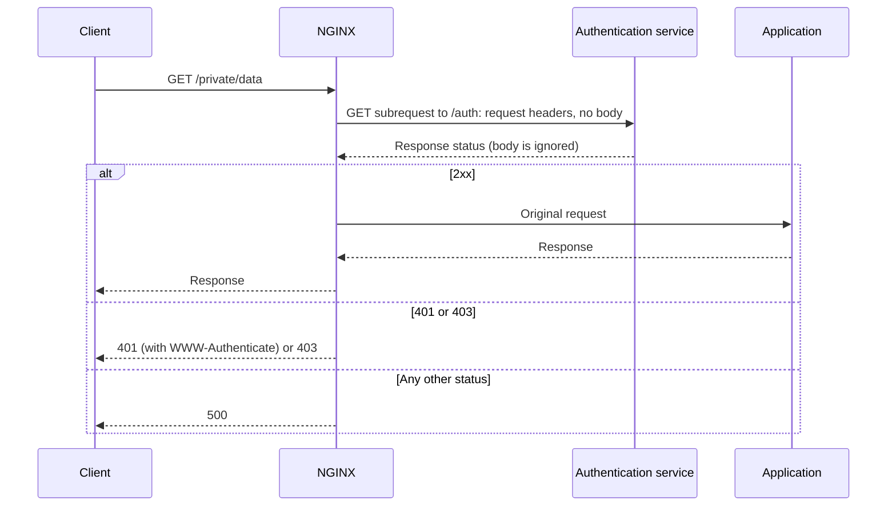

<span id="intro"></span>

## Overview {#introduction}

NGINX Open Source and F5 NGINX Plus can ask an external service to authenticate each request. Before NGINX passes a request to your application or serves a file, it sends an HTTP subrequest to the service. The response status decides whether the client gets access. With this method, you can use any authentication scheme that your service implements, such as LDAP, OAuth, or multifactor authentication.

Use this guide to configure NGINX to authenticate requests with an external service, and to pass data from the service to your application.

---

## Before you begin {#prerequisites}

Before you begin, make sure you have:

- **NGINX Plus, or NGINX Open Source with the auth_request module**: NGINX Plus and the NGINX Open Source packages from nginx.org include it. If you build NGINX Open Source from source, add `--with-http_auth_request_module` to `configure`. To check, run this command; the output must contain `--with-http_auth_request_module`:

    ```shell
    nginx -V 2>&1 | grep -o -- --with-http_auth_request_module
    ```

- **An authentication service** that NGINX can reach over HTTP, and that answers as described in [How subrequest authentication works](#response-codes).
- **Permission to edit the configuration and reload NGINX**: On most systems, this means root or `sudo` access.

---

## How subrequest authentication works {#response-codes}

For each request to a protected location, NGINX sends a subrequest to the authentication service before it passes the request on or serves content. The status of the service's response decides what happens:

| Response status | Result |
|---|---|
| 2xx, such as `200` or `204` | NGINX allows the request, and processes it. |
| `401` | NGINX returns `401` to the client, with the `WWW-Authenticate` header from the service's response. |
| `403` | NGINX returns `403` to the client. |
| Any other status | NGINX returns `500` to the client, and logs `auth request unexpected status`. This includes errors such as `502` when NGINX can't connect to the service. |



Text description: A client requests a protected URI. NGINX sends a `GET` subrequest to the authentication service, with the request's headers but without its body. If the service responds with a 2xx status, NGINX processes the original request, for example by passing it to the application, and returns the response to the client. If the service responds with `401` or `403`, NGINX returns that status to the client. For any other status, NGINX returns `500`.

NGINX ignores the body of the service's response, and its headers, except `WWW-Authenticate` with `401`. For example, a `Set-Cookie` header from the service doesn't reach the client. To pass a header, save it with `auth_request_set` and add it with [add_header](https://nginx.org/en/docs/http/ngx_http_headers_module.html#add_header).

The check runs in the access phase, together with other access checks such as `allow`, `deny`, and `auth_basic`. With [satisfy any](https://nginx.org/en/docs/http/ngx_http_core_module.html#satisfy), a request is allowed if any one of the checks allows it. If the other checks deny the request and the service fails, the client gets `500`.

The access phase comes after the rewrite phase. Directives such as `return`, `rewrite`, `set`, and `if` in the protected location run before the check, so a `return` in that location answers without authentication. Also, a request goes to the location that matches it best. A regular expression location, such as `location ~ \.json$`, takes priority over the prefix location `/private/`, so its requests aren't checked. To prevent this, use `location ^~ /private/`, which stops the search for regular expressions, or put `auth_request` in the `server` block and turn it off with `auth_request off` for public locations.

---

<span id="config"></span>

## Configure NGINX {#configuring-nginx-and-nginx-plus}

1. In the location that you want to protect, add the [auth_request](https://nginx.org/en/docs/http/ngx_http_auth_request_module.html#auth_request) directive with the URI of an internal location:

    ```nginx
    location ^~ /private/ {
        auth_request /auth;
        proxy_pass   http://127.0.0.1:8080;
    }
    ```

    For each request to a URI that starts with `/private/`, NGINX sends a subrequest to `/auth`. Nested locations inherit the directive. To turn it off in one of them, use `auth_request off;`.

2. Add the internal location that passes the subrequests to the authentication service with the [proxy_pass](https://nginx.org/en/docs/http/ngx_http_proxy_module.html#proxy_pass) directive:

    ```nginx
    location = /auth {
        internal;
        proxy_pass              http://127.0.0.1:9000;
        proxy_pass_request_body off;
        proxy_set_header        Content-Length "";
        proxy_set_header        X-Original-URI $request_uri;
    }
    ```

    - `internal` makes the location available only to subrequests and internal redirects. A client that requests `/auth` directly gets `404`.
    - NGINX sends the subrequest with the `GET` method, and without the request body, even for a `POST` request. But it passes the original `Content-Length` header, so a service that reads the body waits for data that never comes. The empty value in `proxy_set_header Content-Length ""` removes this header, because NGINX doesn't send headers with empty values. [proxy_pass_request_body](https://nginx.org/en/docs/http/ngx_http_proxy_module.html#proxy_pass_request_body) `off` states that no body is sent.
    - The service gets a request for `/auth`, or for the URI in `proxy_pass` if you add one, so it doesn't see the original URI. The `X-Original-URI` header passes it, with the arguments, in [$request_uri](https://nginx.org/en/docs/http/ngx_http_core_module.html#var_request_uri).
    - NGINX passes the other headers of the original request, such as `Authorization` and `Cookie`, so the service can check the client's credentials. As for any proxied request, NGINX replaces the `Host` header with the host in `proxy_pass`, and doesn't pass headers such as `Connection`, `Keep-Alive`, `TE`, `Expect`, and `Upgrade`.

    Replace `127.0.0.1:9000` with the address of your authentication service, and `127.0.0.1:8080` with your application.

3. Optionally, pass data from the service's response to your application. The [auth_request_set](https://nginx.org/en/docs/http/ngx_http_auth_request_module.html#auth_request_set) directive sets a variable after the subrequest. For example, if the service returns the user name in an `X-User` header:

    ```nginx
    location ^~ /private/ {
        auth_request     /auth;
        auth_request_set $auth_user $upstream_http_x_user;
        proxy_set_header X-User $auth_user;
        proxy_pass       http://127.0.0.1:8080;
    }
    ```

    In `auth_request_set`, variables such as `$upstream_status` and `$upstream_http_x_user` refer to the subrequest. Use the new variable, here `$auth_user`, in the protected location.

    The application must trust the `X-User` header only from requests through this location. In this location, NGINX replaces an `X-User` header that the client sends. Through another location without this `proxy_set_header`, or with a direct connection to the application, a client could send its own `X-User` header.

4. Optionally, send clients without valid credentials to a login page instead of showing `401`:

    ```nginx
    location ^~ /private/ {
        auth_request /auth;
        error_page   401 = @login;
        proxy_pass   http://127.0.0.1:8080;
    }

    location @login {
        return 302 /login?return_to=$request_uri;
    }
    ```

    `$request_uri` isn't URL-encoded, so a URI with its own arguments, such as `/private/x?a=1&b=2`, adds arguments to the login URL. The login application must check that `return_to` is a path on your site before it redirects to it, so that it can't be used to send users to another site.

---

<span id="example"></span>

## Example {#complete-example}

This configuration protects `/private/` with an authentication service on port 9000. It passes the user name from the service to an application on port 8080, and logs the result of each check. Both services must run before you test the configuration.

The example is a complete `http` block. If your **nginx.conf** includes files from `conf.d` in its `http` block, put the `log_format` directive and the `server` block in a file there, without the `http` block around them:

```nginx
http {
    log_format auth '$remote_addr "$request" $status '
                    'auth_status=$auth_status user=$auth_user';

    server {
        listen      80;
        server_name www.example.com;
        access_log  /var/log/nginx/auth.log auth;

        location ^~ /private/ {
            auth_request     /auth;
            auth_request_set $auth_status $upstream_status;
            auth_request_set $auth_user   $upstream_http_x_user;
            proxy_set_header X-User $auth_user;
            proxy_pass       http://127.0.0.1:8080;
        }

        location = /auth {
            internal;
            proxy_pass              http://127.0.0.1:9000;
            proxy_pass_request_body off;
            proxy_set_header        Content-Length "";
            proxy_set_header        X-Original-URI $request_uri;
        }
    }
}
```

In this example:

- Every request to `/private/` triggers a subrequest to the service on port 9000, with the original URI in the `X-Original-URI` header.
- If the service allows the request, NGINX passes it to the application on port 8080, with the user name from the service's `X-User` header.
- The log shows the status that the service returned, and the user name.

---

## Verify the configuration

1. Test and reload the configuration:

    ```shell
    sudo nginx -t && sudo nginx -s reload
    ```

2. Send a request without credentials:

    ```shell
    curl -si -H 'Host: www.example.com' http://localhost/private/ | head -1
    ```

    If your service denies requests without credentials, the output is `HTTP/1.1 401 Unauthorized` or `HTTP/1.1 403 Forbidden`.

3. Send a request with valid credentials, for example a token that your service accepts:

    ```shell
    curl -si -H 'Host: www.example.com' -H 'Authorization: Bearer <valid-token>' http://localhost/private/ | head -1
    ```

    The output is `HTTP/1.1 200 OK`, or the status that your application returns.

4. Check the log:

    ```shell
    sudo tail -2 /var/log/nginx/auth.log
    ```

    The output shows the service's status for each request, and the user name for the allowed one:

    ```none
    127.0.0.1 "GET /private/ HTTP/1.1" 401 auth_status=401 user=
    127.0.0.1 "GET /private/ HTTP/1.1" 200 auth_status=200 user=alice
    ```

---

## Troubleshooting

### Clients get 500 Internal Server Error

**Symptom**: All requests to the protected location get `500 Internal Server Error`. The error log shows `auth request unexpected status: 502`, or another status.

**Cause**: The service returned a status other than 2xx, `401`, or `403`. `502` or `504` means that NGINX couldn't connect to the service, or the service didn't respond in time. The error log shows the reason, for example `connect() failed (111: Connection refused) while connecting to upstream`.

**Fix**: Check that the service runs and that the address in `proxy_pass` is correct. Make the service return only 2xx, `401`, or `403`. A redirect status such as `302` also leads to `500`; to redirect clients, use `error_page` as in step 4 of [Configure NGINX](#configuring-nginx-and-nginx-plus).

### The service doesn't respond, or times out

**Symptom**: Requests to the protected location take a long time, then get `500`. The error log shows `upstream timed out (110: Connection timed out) while reading response header from upstream`, then `auth request unexpected status: 504`.

**Cause**: The service doesn't respond within [proxy_read_timeout](https://nginx.org/en/docs/http/ngx_http_proxy_module.html#proxy_read_timeout), 60 seconds by default. Often, the service waits for a request body: for a request with a body, such as a `POST`, the subrequest has the original `Content-Length` header, but no body.

**Fix**: Add `proxy_pass_request_body off;` and `proxy_set_header Content-Length "";` to the `/auth` location. If the service is slow, check it, or increase `proxy_read_timeout` in the `/auth` location.

### The service always denies access

**Symptom**: All requests get `401` or `403`, even with valid credentials.

**Cause**: The service doesn't get the data that it checks. For example, it checks the original URI or method, but the subrequest is a `GET` request for `/auth`.

**Fix**: Pass the data in headers, such as `X-Original-URI`, or `X-Original-Method` with `$request_method`, and check them in the service's logs. NGINX passes the original request's headers, but not its body.

---

## References

For more information, see:

- [Restricting Access with HTTP Basic Authentication]()
- [ngx_http_auth_request_module reference](https://nginx.org/en/docs/http/ngx_http_auth_request_module.html) on nginx.org
