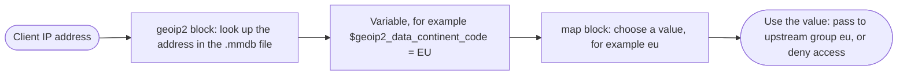

<span id="intro"></span>

## Overview {#introduction}

F5 NGINX Plus can find the country, city, or continent of each client from its IP address. You can then, for example, send clients to the nearest servers, serve different content in different countries, or deny access from some countries.

NGINX looks up the address in a [MaxMind](https://www.maxmind.com/) GeoIP2 or GeoLite2 database with the [GeoIP2 dynamic module](). The module stores the results in variables. You use these variables in [map](https://nginx.org/en/docs/http/ngx_http_map_module.html) or [split_clients](https://nginx.org/en/docs/http/ngx_http_split_clients_module.html) blocks, and in other directives. This works for HTTP, and for TCP and UDP in the `stream` context.

MaxMind [discontinued](https://blog.maxmind.com/2018/01/discontinuation-of-the-geolite-legacy-databases) its GeoLite Legacy databases. The GeoIP2 module reads the current GeoIP2 and GeoLite2 databases. The [GeoIP]() module reads only the legacy format.

---

<span id="prereq"></span>

## Before you begin {#prerequisites}

Before you begin, make sure you have:

- **The GeoIP2 dynamic module**: For NGINX Plus, install it as described in [Configure GeoIP2 in NGINX Plus](#config). The module is developed outside the NGINX project, at [leev/ngx_http_geoip2_module](https://github.com/leev/ngx_http_geoip2_module). To use it with NGINX Open Source, build it from source as that project describes.
- **A MaxMind account and license key**: You need them to download the databases, including the free GeoLite2 databases. See [Get the databases](#db).
- **Optionally, the `mmdblookup` tool**, to look up addresses in a database file. See [Understand the database structure](#mmdblookup).
- **Permission to edit the configuration and reload NGINX**: On most systems, this means root or `sudo` access.

---

## How location lookups work

For each request or connection, NGINX looks up the client's IP address in the database when a directive first uses one of the module's variables:



Text description: NGINX looks up the client's IP address in the MaxMind database, as defined in a `geoip2` block. It stores a field of the result, such as the continent code, in a variable. A `map` block turns this value into another value, such as the name of an upstream group. NGINX then uses that value, for example to pass the request to the group, or to deny access.

If the database has no data for an address, for example for private addresses such as `192.168.1.10`, the variable has no value, unless you set a default value. A `map` treats it as an empty string, and the access log shows `-`.

---

<span id="db"></span>

## Get the databases {#getting-the-databases}

MaxMind provides the free GeoLite2 databases and the commercial GeoIP2 databases. To download either, you need a MaxMind account. The old download addresses without an account, such as `geolite.maxmind.com`, don't work anymore.

1. [Sign up for GeoLite2](https://dev.maxmind.com/geoip/geolite2-free-geolocation-data/), or log in to your MaxMind account.
2. In your account, create a license key. Note your account ID and the license key.
3. Download the databases. You can download them from your account page, or use the `geoipupdate` tool to download and update them. On Debian and Ubuntu, install the tool. On Ubuntu, the package is in the `universe` repository:

    ```shell
    sudo apt-get install geoipupdate
    ```

4. In `/etc/GeoIP.conf`, set your account ID and license key, and the databases to download:

    ```none
    AccountID YOUR_ACCOUNT_ID
    LicenseKey YOUR_LICENSE_KEY
    EditionIDs GeoLite2-Country GeoLite2-City
    ```

5. Download the databases:

    ```shell
    sudo geoipupdate
    ```

    By default, `geoipupdate` saves the files in `/var/lib/GeoIP`, for example `/var/lib/GeoIP/GeoLite2-Country.mmdb`. The Debian and Ubuntu package also installs a cron job and a systemd timer to update them regularly.

The examples on this page use the files in `/var/lib/GeoIP`. If you save them elsewhere, change the paths.

NGINX opens each database file when it reads its configuration. After `geoipupdate` replaces a file, reload NGINX, or add `auto_reload <interval>;` to the `geoip2` block, for example `auto_reload 60m;`, so that NGINX checks the file for changes at that interval.

---

<span id="mmdblookup"></span>

## Understand the database structure {#understanding-database-structure}

A database record is a tree of data. To see the data for an address, use the `mmdblookup` tool from the [libmaxminddb](https://maxmind.github.io/libmaxminddb/) library:

- For Debian and Ubuntu:

    ```shell
    sudo apt-get install mmdb-bin
    ```

- For Amazon Linux, CentOS, Oracle Linux, and RHEL:

    ```shell
    sudo yum install libmaxminddb-devel
    ```

- For SLES:

    ```shell
    sudo zypper install libmaxminddb-devel
    ```

The command has this format:

```none
mmdblookup --file <database-file> --ip <ip-address> [<data-path> ...]
```

For example, to see all the data for the address `8.8.8.8`:

```shell
mmdblookup --file /var/lib/GeoIP/GeoLite2-Country.mmdb --ip 8.8.8.8
```

In the country database, the record has the keys `continent`, `country`, and `registered_country`. Each has a `geoname_id`, a `names` map with the name in several languages, and a code: `continent` has `code`, and the others have `iso_code`. The city database adds keys such as `city`, `location`, `postal`, and `subdivisions`.

To see one value, add its path to the command. For example, to see the country's ISO code:

```shell
mmdblookup --file /var/lib/GeoIP/GeoLite2-Country.mmdb --ip 8.8.8.8 country iso_code
```

The output shows the value and its type, for example `"US" <utf8_string>`. You use the same path, `country iso_code`, to define a variable in the GeoIP2 module.

---

<span id="config"></span>

## Configure GeoIP2 in NGINX Plus {#configuring-geoip2-in-nginx-plus}

1. Install the GeoIP2 dynamic module for NGINX Plus:

    - For Amazon Linux, CentOS, Oracle Linux, and RHEL:

        ```shell
        sudo yum install nginx-plus-module-geoip2
        ```

    - For Debian and Ubuntu:

        ```shell
        sudo apt-get install nginx-plus-module-geoip2
        ```

    - For SLES:

        ```shell
        sudo zypper install nginx-plus-module-geoip2
        ```

2. Load the module with the [load_module](https://nginx.org/en/docs/ngx_core_module.html#load_module) directive at the top level of **nginx.conf**. Load the HTTP module, the stream module, or both:

    ```nginx
    load_module modules/ngx_http_geoip2_module.so;
    load_module modules/ngx_stream_geoip2_module.so;
    ```

3. In the `http` context, the `stream` context, or both, add a `geoip2` block for each database. In the block, define a variable for each value that you need. Each variable has a path in the database, as shown by `mmdblookup`:

    ```nginx
    http {
        geoip2 /var/lib/GeoIP/GeoLite2-Country.mmdb {
            $geoip2_data_continent_code   continent code;
            $geoip2_data_country_iso_code country iso_code;
        }

        geoip2 /var/lib/GeoIP/GeoLite2-City.mmdb {
            $geoip2_data_city_name   city names en;
            $geoip2_data_postal_code postal code;
            $geoip2_data_latitude    location latitude;
            $geoip2_data_longitude   location longitude;
            $geoip2_data_state_name  subdivisions 0 names en;
            $geoip2_data_state_code  subdivisions 0 iso_code;
        }
    }
    ```

    - The variable names are your choice.
    - Use only one `geoip2` block for each database file, with all the variables that you need from it. A second block for the same file makes `nginx -t` fail with `Duplicate GeoIP2 mmdb`.
    - `subdivisions 0` is the first element of the `subdivisions` list.
    - Use an absolute path. A relative path is relative to the NGINX installation prefix, not to the configuration directory.
    - To set a value for addresses that aren't in the database, add `default=<value>` before the path, for example `$geoip2_data_country_iso_code default=US country iso_code;`. Don't use a default value that an access rule allows: with `default=US`, every address that isn't in the database, including private addresses, passes a rule that allows `US`.

    By default, the module looks up the client address, `$remote_addr`. To look up another address, add `source=<variable>` before the path. In the `stream` context, the `geoip2` block has the same format.

---

<span id="scenario1"></span>

## Choose the nearest servers {#scenario-choosing-the-nearest-server}

To reduce latency, you can send each client to an upstream group on its continent:

1. Define an upstream group for each continent that has servers, and a group for all other clients. In this example, `eu` is for Europe, `na` is for North America, and `all` is for the other continents and for addresses that aren't in the database.
2. Add a variable for the continent code to the `geoip2` block.
3. Create a `map` block that turns the continent code into the name of a group. The `default` value, `all`, applies to every other code, and to an empty code.
4. Use the result in the `proxy_pass` directive.

The following examples are complete `stream` and `http` blocks. If your **nginx.conf** already has such a block, add the directives inside it instead. The `stream` block is at the top level of **nginx.conf**, not in a file in `conf.d`, because the default configuration includes those files in the `http` block. Replace `all1.example.com` and the other names with your servers. NGINX resolves the names when it starts, and fails with `host not found in upstream` if it can't.

In the `stream` context, `proxy_pass` takes the name of the group:

```nginx
stream {
    geoip2 /var/lib/GeoIP/GeoLite2-Country.mmdb {
        $geoip2_data_continent_code continent code;
    }

    map $geoip2_data_continent_code $nearest_server {
        default all;
        EU      eu;
        NA      na;
    }

    upstream all {
        server all1.example.com:12345;
        server all2.example.com:12345;
    }

    upstream eu {
        server eu1.example.com:12345;
        server eu2.example.com:12345;
    }

    upstream na {
        server na1.example.com:12345;
        server na2.example.com:12345;
    }

    server {
        listen     12346;
        proxy_pass $nearest_server;
    }
}
```

In the `http` context, `proxy_pass` is in a `location`, and the group name follows the scheme:

```nginx
http {
    geoip2 /var/lib/GeoIP/GeoLite2-Country.mmdb {
        $geoip2_data_continent_code continent code;
    }

    map $geoip2_data_continent_code $nearest_server {
        default all;
        EU      eu;
        NA      na;
    }

    upstream all {
        server all1.example.com:8080;
    }

    upstream eu {
        server eu1.example.com:8080;
    }

    upstream na {
        server na1.example.com:8080;
    }

    server {
        listen 80;

        location / {
            proxy_pass http://$nearest_server;
        }
    }
}
```

Every value of the `map` must be the name of an `upstream` group. If it isn't, the request fails: in HTTP, NGINX treats the value as a host name, and without a [resolver](https://nginx.org/en/docs/http/ngx_http_core_module.html#resolver) returns `502`. In the `stream` context, NGINX closes the connection, because the value has no port. To add a continent, such as Asia (`AS`), add an `upstream` group and a line in the `map`.

<span id="example1"></span>

---

## Deny access by country {#example}

To serve content only in some countries, map the country code to a flag, and return `403 (Forbidden)` for other countries. This example allows only the United States and Canada:

```nginx
http {
    geoip2 /var/lib/GeoIP/GeoLite2-Country.mmdb {
        $geoip2_data_country_iso_code country iso_code;
    }

    map $geoip2_data_country_iso_code $allowed_country {
        default no;
        US      yes;
        CA      yes;
    }

    log_format geo '$remote_addr country=$geoip2_data_country_iso_code '
                   'allowed=$allowed_country "$request" $status';

    server {
        listen     80;
        access_log /var/log/nginx/geo.log geo;

        if ($allowed_country = no) {
            return 403;
        }

        location / {
            root /usr/share/nginx/html;
        }
    }
}
```

- The `map` sets `$allowed_country` to `yes` for the codes `US` and `CA`, and to `no` for all other codes. Addresses that aren't in the database, such as private addresses, get `no` too. To allow them, add a line with an empty key: `"" yes;`.
- The `if` block in the `server` context returns `403` before NGINX chooses a `location`.
- The log shows the country and the decision for each request.

In the `stream` context, there's no `if` directive. To restrict TCP or UDP clients by country, map the country code to the name of an upstream group. Send denied clients to a local server that closes the connection with the [return](https://nginx.org/en/docs/stream/ngx_stream_return_module.html) directive:

```nginx
stream {
    geoip2 /var/lib/GeoIP/GeoLite2-Country.mmdb {
        $geoip2_data_country_iso_code country iso_code;
    }

    map $geoip2_data_country_iso_code $stream_backend {
        default blocked;
        US      allowed;
        CA      allowed;
    }

    upstream allowed {
        server app.example.com:12345;
    }

    upstream blocked {
        server 127.0.0.1:12399;
    }

    server {
        listen     12346;
        proxy_pass $stream_backend;
    }

    server {
        listen 127.0.0.1:12399;
        return "";
    }
}
```

---

## Verify the configuration

1. Test and reload the configuration:

    ```shell
    sudo nginx -t && sudo nginx -s reload
    ```

    If the module isn't loaded, `nginx -t` fails with `unknown directive "geoip2"`.

2. Send a request from a client on the internet, and check the log:

    ```shell
    sudo tail -1 /var/log/nginx/geo.log
    ```

    The output shows the client's country code and the decision, for example:

    ```none
    203.0.113.7 country=CA allowed=yes "GET / HTTP/1.1" 200
    ```

3. To test an address without a client in that country, let NGINX take the client address from the `X-Forwarded-For` header of local requests. Add this directive to the `http` context, and reload NGINX:

    ```nginx
    geoip2_proxy 127.0.0.1;
    ```

    Then send a request with an address from the country that you want to test, and compare the log with `mmdblookup`:

    ```shell
    curl -s -o /dev/null -w '%{http_code}\n' -H 'X-Forwarded-For: 8.8.8.8' http://localhost/
    sudo tail -1 /var/log/nginx/geo.log
    mmdblookup --file /var/lib/GeoIP/GeoLite2-Country.mmdb --ip 8.8.8.8 country iso_code
    ```

    The country code in the log is the one that `mmdblookup` shows. The log still shows `127.0.0.1` as the client address. If another `server` block is the default server for port 80, send the request to a name in this server's `server_name`. Remove `geoip2_proxy` when you finish, because it lets local clients choose their address.

    The `geoip2_proxy` directive exists only in the `http` context.

---

## Troubleshooting

### NGINX doesn't start: "unknown directive geoip2"

**Symptom**: `nginx -t` fails with `unknown directive "geoip2"`.

**Cause**: Neither GeoIP2 module is loaded.

**Fix**: Add the `load_module` directive for each context in which you use `geoip2`, at the top level of **nginx.conf**.

### NGINX doesn't start: "geoip2 directive is not allowed here"

**Symptom**: `nginx -t` fails with `"geoip2" directive is not allowed here`.

**Cause**: The `load_module` directives load only the HTTP module, but you use `geoip2` in the `stream` context, or the other way around. Or the `geoip2` block isn't directly in the `http` or `stream` context, for example it's in a `server` block.

**Fix**: Load the module for each context, and move the `geoip2` block to the `http` or `stream` context.

### NGINX doesn't start: "Duplicate GeoIP2 mmdb"

**Symptom**: `nginx -t` fails with `Duplicate GeoIP2 mmdb`.

**Cause**: Two `geoip2` blocks in the same context open the same database file.

**Fix**: Put all the variables for a file in one `geoip2` block.

### NGINX doesn't start: "MMDB_open failed"

**Symptom**: `nginx -t` fails with `MMDB_open("...") failed`.

**Cause**: The database file doesn't exist, NGINX can't read it, or it isn't a MaxMind DB file. A relative path is relative to the installation prefix.

**Fix**: Use the absolute path of the `.mmdb` file, and check its permissions.

### The country variable has no value

**Symptom**: The log shows `country=-`.

**Cause**: The client address isn't in the database, for example a private address. Behind a load balancer or a proxy, NGINX sees that device's address.

**Fix**: Set a default value with `default=`, if it doesn't open an access rule. Behind an HTTP proxy, use `geoip2_proxy` with the proxy's address, or the [realip](https://nginx.org/en/docs/http/ngx_http_realip_module.html) module. In the `stream` context, use the PROXY protocol with the stream realip module, as described in [Accepting the PROXY Protocol]().

### Clients get errors after a map change

**Symptom**: Some clients get `502 Bad Gateway` (HTTP), or are disconnected (stream). The error log shows `no resolver defined to resolve` (HTTP), or `no port in upstream` (stream).

**Cause**: A `map` value isn't the name of an `upstream` group.

**Fix**: Add the missing `upstream` group, or change the `map` value.

---

<span id="info"></span>

## References {#more-info}

For more information, see:

- [GeoIP2 Dynamic Module Installation Instructions]()
- [GeoIP2 module documentation](https://github.com/leev/ngx_http_geoip2_module) on GitHub
- [MaxMind GeoIP2 Databases](https://www.maxmind.com/en/geoip2-databases)
- [MaxMind GeoLite2 Free Geolocation Data](https://dev.maxmind.com/geoip/geolite2-free-geolocation-data/)
- [Updating GeoIP databases with geoipupdate](https://dev.maxmind.com/geoip/updating-databases)
