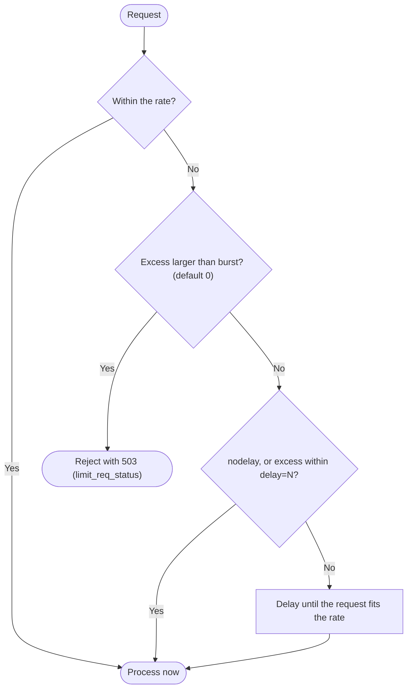

<span id="intro"></span>

## Introduction

With NGINX Open Source and F5 NGINX Plus, you can limit:

- The number of connections per key value, for example per client IP address.
- The request rate per key value: the number of requests that NGINX processes per second or per minute.
- The download speed of a response.

Many clients can share one IP address behind a NAT device or proxy. Choose limits per IP address with care.

---

## Before you begin

Before you begin, make sure you have:

- **NGINX Open Source or NGINX Plus installed and running**.
- **Permission to edit the configuration and reload NGINX**: On most systems, this means root or `sudo` access.

---

## How rate limiting works

The request rate limit uses the "leaky bucket" method. For each key, such as a client IP address, NGINX tracks the requests that are above the configured rate, called _excess_ requests. As time passes, the excess drains at the configured rate.

For each request in a location with `limit_req`, NGINX does the following:

1. If the request is within the rate, NGINX processes it right away.
2. If it's above the rate, NGINX compares the excess with the `burst` parameter, which is `0` by default. If the excess is larger, NGINX rejects the request with code `503`, or the code set by `limit_req_status`.
3. Otherwise, NGINX delays the request until it fits the rate. With `nodelay`, it processes the request right away. With `delay=N`, it processes the first `N` excess requests right away, and delays the others by (excess − `N`) / rate. Rejected requests don't add to the excess.

If a location has several `limit_req` directives, NGINX checks all of them. Any of them can reject the request, and NGINX uses the longest delay of all of them. NGINX doesn't limit requests whose key is empty.



Text description: A request within the rate is processed right away. A request above the rate is rejected if the excess is larger than `burst`, which is `0` by default. Otherwise, it's processed right away with `nodelay` or when the excess is within `delay`, and delayed until it fits the rate in all other cases.

`limit_req` and `limit_conn` apply in the preaccess phase. A `return` directive runs earlier, in the rewrite phase, so these limits don't apply to responses from `return`.

A `limit_req` or `limit_conn` directive in a `location` replaces the ones inherited from the `server` or `http` level; it doesn't add to them.

---

<span id="limit_conn"></span>

## Limiting the number of connections

1. Define the key and the shared memory zone with the [limit_conn_zone](https://nginx.org/en/docs/http/ngx_http_limit_conn_module.html#limit_conn_zone) directive in the `http` context. The worker processes share the counters for each key in this zone. The first parameter is the key. The `zone` parameter sets the name and size of the zone:

    ```nginx
    limit_conn_zone $binary_remote_addr zone=addr:10m;
    ```

2. Apply the limit with the [limit_conn](https://nginx.org/en/docs/http/ngx_http_limit_conn_module.html#limit_conn) directive in the `http`, `server`, or `location` context. The first parameter is the zone name, and the second is the number of connections allowed per key:

    ```nginx
    location /download/ {
        limit_conn addr 1;
    }
    ```

    The [$binary_remote_addr](https://nginx.org/en/docs/http/ngx_http_core_module.html#var_binary_remote_addr) key limits the connections per client IP address.

NGINX counts a connection only while it processes a request on it, after it has read the request header. With HTTP/2 and HTTP/3, each request that's processed at the same time counts as one connection. NGINX rejects requests over the limit with code `503`, or the code set by [limit_conn_status](https://nginx.org/en/docs/http/ngx_http_limit_conn_module.html#limit_conn_status).

To limit the connections per virtual server instead, use the [$server_name](https://nginx.org/en/docs/http/ngx_http_core_module.html#var_server_name) variable as the key. The server needs a `server_name`; with an empty key, NGINX doesn't limit anything:

```nginx
http {
    limit_conn_zone $server_name zone=servers:10m;

    server {
        listen      80;
        server_name www.example.com;
        limit_conn  servers 1000;
    }
}
```

<span id="limit_req"></span>

## Limiting the request rate

Rate limiting can slow down denial-of-service attacks, and keep proxied servers from getting too many requests at once.

1. Define the key, the shared memory zone, and the rate with the [limit_req_zone](https://nginx.org/en/docs/http/ngx_http_limit_req_module.html#limit_req_zone) directive in the `http` context:

    - **key** – A value that tells clients apart, usually a variable.
    - **zone** – The name and size of the shared memory zone that keeps the state of each key.
    - **rate** – The rate limit, in requests per second (`r/s`) or per minute (`r/m`). Use `r/m` for rates below one request per second.

    ```nginx
    http {
        limit_req_zone $binary_remote_addr zone=one:10m rate=1r/s;
    }
    ```

    This creates a 10 MB zone named `one`, which keeps the state of each client IP address. The [$binary_remote_addr](https://nginx.org/en/docs/http/ngx_http_core_module.html#var_binary_remote_addr) variable holds the address in binary form, which is shorter than the text form in [$remote_addr](https://nginx.org/en/docs/http/ngx_http_core_module.html#var_remote_addr).

2. Apply the limit with the [limit_req](https://nginx.org/en/docs/http/ngx_http_limit_req_module.html#limit_req) directive in the `http`, `server`, or `location` context:

    ```nginx
    http {
        limit_req_zone $binary_remote_addr zone=one:10m rate=1r/s;

        server {
            listen 80;

            location /search/ {
                limit_req zone=one;
            }
        }
    }
    ```

    With this configuration, NGINX processes at most 1 request per second per client in the `/search/` location. Without the `burst` parameter, NGINX rejects every request above the rate right away with code `503`.

To size the zone: with `$binary_remote_addr`, an IPv4 address takes 4 bytes, and the state of one key takes 128 bytes on 64-bit platforms. So 1 MB holds the state of about 8,000 IP addresses. If the zone is full when NGINX needs to add a key, it removes keys that have been unused for a while, and then the least recently used key. If that doesn't free enough space, NGINX rejects the request with code `503`, or the code set by [limit_req_status](https://nginx.org/en/docs/http/ngx_http_limit_req_module.html#limit_req_status).

<span id="limit_req_dry_run"></span>

### Testing the request rate limit

To try a rate limit before you enforce it, use the dry run mode of the [limit_req_dry_run](https://nginx.org/en/docs/http/ngx_http_limit_req_module.html#limit_req_dry_run) directive. In this mode, NGINX doesn't limit requests, but it still counts them in the zone and logs the requests that would be limited:

```nginx
http {
    limit_req_zone $binary_remote_addr zone=one:10m rate=1r/s;

    server {
        listen 80;

        location /search/ {
            limit_req zone=one;
            limit_req_dry_run on;
        }
    }
}
```

NGINX logs each request that would exceed the rate with a `dry run` mark:

```none
2019/09/03 10:28:45 [error] 142#142: *13246 limiting requests, dry run, excess: 1.000 by zone "one", client: 172.19.0.1, server: www.example.com, request: "GET /search/ HTTP/1.0", host: "www.example.com:80"
```

NGINX logs the requests it would delay as `delaying request, dry run` at the `warn` level, which the default `error` level of the error log hides. To log the result of each request in the access log, use the [$limit_req_status](https://nginx.org/en/docs/http/ngx_http_limit_req_module.html#var_limit_req_status) variable, which can be `PASSED`, `DELAYED`, `REJECTED`, `DELAYED_DRY_RUN`, or `REJECTED_DRY_RUN`.

<span id="limit_req_burst"></span>

### Handling excessive requests

Traffic is often bursty, and rejecting every request above the rate can hurt legitimate clients. The `burst` parameter of [limit_req](https://nginx.org/en/docs/http/ngx_http_limit_req_module.html#limit_req) sets how many excess requests NGINX accepts and delays to fit the rate:

```nginx
http {
    limit_req_zone $binary_remote_addr zone=one:10m rate=1r/s;

    server {
        listen 80;

        location /search/ {
            limit_req zone=one burst=5;
        }
    }
}
```

With this configuration, NGINX processes the first request right away and delays up to 5 excess requests, so that it processes 1 request per second. It rejects requests beyond the 5 excess requests with code `503`.

To process the requests within the burst without delay, add the `nodelay` parameter:

```nginx
http {
    limit_req_zone $binary_remote_addr zone=one:10m rate=1r/s;

    server {
        listen 80;

        location /search/ {
            limit_req zone=one burst=5 nodelay;
        }
    }
}
```

With `nodelay`, NGINX processes up to 5 excess requests right away, and rejects the requests beyond them with code `503`. The excess still drains at the configured rate, so a client gets new burst capacity only as time passes.

<span id="limit_req_delay"></span>

### Delaying excessive requests

To process some excess requests without delay and delay the rest, use the `delay` parameter together with `burst`:

```nginx
http {
    limit_req_zone $binary_remote_addr zone=one:10m rate=1r/s;

    server {
        listen 80;

        location /search/ {
            limit_req zone=one burst=5 delay=3;
        }
    }
}
```

With this configuration, NGINX processes the first request and the next 3 excess requests right away. It delays the next 2 excess requests (`burst` minus `delay`) to fit the rate, and rejects further excess requests with code `503`.

<span id="limit_req_zone_sync"></span>

### Synchronizing contents of many shared memory zones

This feature needs NGINX Plus.

In a cluster of NGINX Plus instances that all use `limit_req`, the instances can share the contents of their zones when:

- The [zone_sync](https://nginx.org/en/docs/stream/ngx_stream_zone_sync_module.html#zone_sync) feature is configured on each instance.
- The zones in the [limit_req_zone](https://nginx.org/en/docs/http/ngx_http_limit_req_module.html#limit_req_zone) directives have the same name on all instances.
- The [sync](https://nginx.org/en/docs/http/ngx_http_limit_req_module.html#limit_req_zone_sync) parameter of `limit_req_zone` is set on each instance:

```nginx
http {
    limit_req_zone $binary_remote_addr zone=one:10m rate=1r/s sync;
}
```

For details, see [Runtime State Sharing in a Cluster]().

<span id="limit_rate"></span>

## Limiting the bandwidth

To limit the download speed of a response, use the [limit_rate](https://nginx.org/en/docs/http/ngx_http_core_module.html#limit_rate) directive. The limit applies to each request, so with HTTP/2 and HTTP/3, to each stream:

```nginx
location /download/ {
    limit_rate 50k;
}
```

With this setting, a client can download each response at most at 50 KB per second. A client can download several responses at the same time, though. To limit the total speed, also limit the number of connections, which counts HTTP/2 and HTTP/3 streams too. For example, allow one connection per IP address with the `addr` zone from [Limiting the number of connections](#limit_conn):

```nginx
location /download/ {
    limit_conn addr 1;
    limit_rate 50k;
}
```

To start limiting only after a client has downloaded some data, use the [limit_rate_after](https://nginx.org/en/docs/http/ngx_http_core_module.html#limit_rate_after) directive. For example, a client can quickly get the start of a video file, which holds its index, while the rest downloads at the limited speed:

```nginx
location /download/ {
    limit_rate_after 500k;
    limit_rate       20k;
}
```

The following configuration combines connection and bandwidth limits. It allows 5 connections per client address, which is enough for most browsers. The location for downloads allows 1 connection per client address:

```nginx
http {
    limit_conn_zone $binary_remote_addr zone=addr:10m;

    server {
        listen 80;
        root /www/data;
        limit_conn addr 5;

        location / {
        }

        location /download/ {
            limit_conn       addr 1;
            limit_rate_after 1m;
            limit_rate       50k;
        }
    }
}
```

<span id="limit_rate_var"></span>

For proxied responses, keep in mind:

- NGINX ignores `limit_rate` when `proxy_buffering` is `off`.
- The proxied server can set the limit for its response with the `X-Accel-Limit-Rate` header, which overrides `limit_rate`.

### Dynamic bandwidth control

The value of [limit_rate](https://nginx.org/en/docs/http/ngx_http_core_module.html#limit_rate) can be a variable, so that the limit depends on the request. This example sets the limit by TLS version:

```nginx
map $ssl_protocol $response_rate {
    "TLSv1.2" 100k;
    "TLSv1.3" 1000k;
    default   10k;
}

upstream my_backend {
    server 127.0.0.1:8000;
}

server {
    listen 443 ssl;
    ssl_protocols       TLSv1.2 TLSv1.3;
    ssl_certificate     www.example.com.crt;
    ssl_certificate_key www.example.com.key;

    location / {
        limit_rate       $response_rate; # Limit bandwidth based on TLS version
        limit_rate_after 512;            # Apply limit after the first 512 bytes
        proxy_pass       http://my_backend;
    }
}
```

---

## Example

This complete configuration limits each client IP address to 10 requests per second with a burst of 20 for the whole site. In **/download/**, it allows 2 connections per client address and limits each download to 1 MB per second. It returns code `429 Too Many Requests` instead of `503`.

It's a whole **nginx.conf**, so back up your existing file first. It has no `include mime.types` line and no other websites; add what your site needs. To add only the limits to a configuration that reads files from `conf.d`, put the zone and status directives and the `server` block in a file there. Give the server a `server_name`, and use that name in the verification requests, because the package's default server might answer requests for `localhost`.

```nginx
events {}

http {
    limit_req_zone  $binary_remote_addr zone=perip:10m rate=10r/s;
    limit_conn_zone $binary_remote_addr zone=addr:10m;

    limit_req_status  429;
    limit_conn_status 429;

    server {
        listen 80;
        root   /usr/share/nginx/html;

        limit_req zone=perip burst=20 nodelay;

        location /download/ {
            limit_conn addr 2;
            limit_rate 1m;
        }
    }
}
```

---

## Verify the configuration

1. Test and reload the configuration:

    ```shell
    sudo nginx -t && sudo nginx -s reload
    ```

2. Send more requests than the limit allows at the same time, and count the status codes:

    ```shell
    for i in $(seq 1 40); do curl -s -o /dev/null -w '%{http_code}\n' http://localhost/ & done; wait
    ```

    With the example configuration, about 21 requests return `200`, and the rest return `429`. The exact numbers depend on timing: the excess drains while the requests arrive, so slower requests get more `200` responses. Wait a few seconds before you run the command again. For `200` responses, **/usr/share/nginx/html** needs an **index.html** file.

3. Check the error log for the limited requests:

    ```shell
    sudo grep 'limiting requests' /var/log/nginx/error.log | tail -1
    ```

    The path is the one for packages. If you built NGINX from source, the error log is **logs/error.log** inside the installation directory.

---

## Troubleshooting

### The limit has no effect

**Symptom**: Clients aren't limited, and the error log has no `limiting requests` messages.

**Cause**: One of these:

- The location answers with `return`, which runs before the limits apply.
- The `limit_req` directive is in another location than the one that processes the request, or a `limit_req` in the location replaces the inherited one.
- Another `server` block answers the request.
- The key is empty, for example `$server_name` in a server without `server_name`.
- `limit_req_dry_run` is on.

**Fix**: Check which server and location process the request, and the key. Don't rely on `limit_req` or `limit_conn` for responses from `return`. Turn off dry run mode.

### Legitimate clients get 503

**Symptom**: Normal users get `503` responses, and the error log shows `limiting requests, excess: ...`.

**Cause**: The rate is too low for normal traffic, there's no `burst`, or many clients share one IP address behind a NAT device or proxy.

**Fix**: Add `burst`, usually with `nodelay`, raise the rate, or use a different key. Behind a proxy, use the [realip](https://nginx.org/en/docs/http/ngx_http_realip_module.html) module so that `$binary_remote_addr` holds the real client address. Set `limit_req_status 429` to tell clients that they were rate limited.

### Requests are slow instead of rejected

**Symptom**: Some requests take whole seconds longer than usual.

**Cause**: With `burst` and without `nodelay`, NGINX delays excess requests to fit the rate.

**Fix**: Add `nodelay`, or `delay=N` to delay only the requests beyond the first `N` excess requests.

---

<span id="see_also"></span>

## See also

- [Rate Limiting with NGINX and NGINX Plus](https://www.nginx.com/blog/rate-limiting-nginx/)
- [ngx_http_limit_req_module reference](https://nginx.org/en/docs/http/ngx_http_limit_req_module.html) on nginx.org
- [ngx_http_limit_conn_module reference](https://nginx.org/en/docs/http/ngx_http_limit_conn_module.html) on nginx.org
