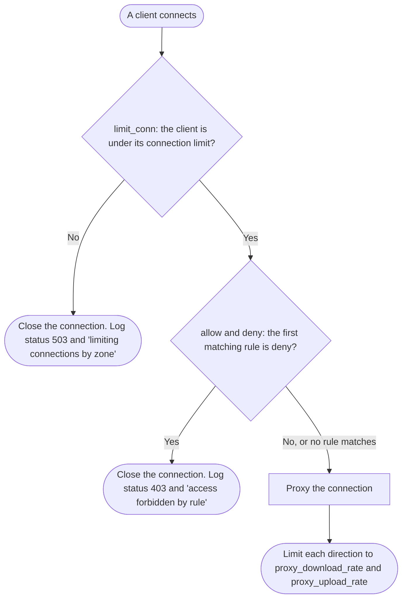

## Overview

NGINX Open Source and F5 NGINX Plus can protect a database, media server, or other application that communicates over TCP or UDP. In the `stream` context, NGINX can:

- Allow or deny connections by client IP address.
- Limit the number of simultaneous connections from one client.
- Limit the download and upload speed of each connection.

Use this guide to set these restrictions. For HTTP, see [Limiting Access to Proxied HTTP Resources]().

---

## Before you begin

Before you begin, make sure you have:

- **NGINX with the stream module**: NGINX Plus and the NGINX Open Source packages from nginx.org include it. If you build NGINX Open Source from source, add `--with-stream` to `configure`. The access and connection limit modules are built with it, unless you turn them off.
- **A TCP or UDP server that NGINX proxies**, configured as in [TCP and UDP Load Balancing]().
- **Permission to edit the configuration and reload NGINX**: On most systems, this means root or `sudo` access.

---

## How NGINX applies the restrictions

NGINX checks each new connection in this order:

1. **Connection limit**: If the client already has the maximum number of connections, NGINX closes the new one.
2. **IP address rules**: If the first `allow` or `deny` rule that matches the client is a `deny` rule, NGINX closes the connection. If no rule matches, NGINX allows the connection.
3. **Bandwidth limits**: Otherwise, NGINX proxies the connection, and limits the speed of each direction.



Text description: When a client connects, NGINX first checks the connection limit. If the client has too many connections, NGINX closes the new connection, and logs status 503. Then NGINX checks the `allow` and `deny` rules. If the first rule that matches the client is a `deny` rule, NGINX closes the connection, and logs status 403. If no rule matches, the client is allowed. Otherwise, NGINX proxies the connection, and limits its download and upload speed.

The connection limit is checked before the IP address rules, so a denied client's connection is counted for a moment too. If you use the PROXY protocol with the [realip](https://nginx.org/en/docs/stream/ngx_stream_realip_module.html) module, both checks use the client address from the PROXY protocol header. This needs the `proxy_protocol` parameter of `listen` and the `set_real_ip_from` directive. If you build NGINX Open Source from source, the realip module needs `--with-stream_realip_module`. See [Accepting the PROXY Protocol]().

---

<span id="restrict"></span>

## Restricting access by IP address {#restricting-access-by-ip-address}

Use the [allow](https://nginx.org/en/docs/stream/ngx_stream_access_module.html#allow) and [deny](https://nginx.org/en/docs/stream/ngx_stream_access_module.html#deny) directives in the `stream` context or in a `server` block:

```nginx
stream {
    server {
        listen     12345;
        listen     [::]:12345;
        proxy_pass 127.0.0.1:3306;

        deny       192.168.1.2;
        allow      192.168.1.0/24;
        allow      2001:db8::/32;
        deny       all;
    }
}
```

NGINX checks the rules in order, and uses the first rule that matches the client's address. In this example:

- `192.168.1.2` is denied by the first rule.
- The other addresses in `192.168.1.0/24`, and the IPv6 range `2001:db8::/32`, are allowed.
- All other addresses are denied by `deny all`.
- The second `listen` directive accepts IPv6 connections. Without it, NGINX listens only on IPv4, and the IPv6 rule never matches.

Because the first matching rule wins, put specific rules before general ones. If `deny all` came first, no `allow` rule would ever match. If no rule matches a client, NGINX allows it, so end the list with `deny all`.

Write networks with their first address, such as `192.168.1.0/24`. If you write `192.168.1.1/24`, NGINX uses `192.168.1.0/24`, and `nginx -t` warns `low address bits of 192.168.1.1/24 are meaningless`.

A `server` block that has no `allow` or `deny` directives inherits them from the `stream` context. If it has any, it uses only its own.

---

<span id="limit_conn"></span>

## Limiting the number of TCP connections {#limiting-the-number-of-tcp-connections}

You can limit the number of simultaneous connections from one client IP address. This prevents one client from using all the connections that your server can handle.

For UDP, NGINX counts sessions. A UDP session lasts until the time set by [proxy_timeout](https://nginx.org/en/docs/stream/ngx_stream_proxy_module.html#proxy_timeout) passes without data, 10 minutes by default, or until the server sends the number of responses set by [proxy_responses](https://nginx.org/en/docs/stream/ngx_stream_proxy_module.html#proxy_responses). Until then, a new session from the same client, for example from another source port, counts against the limit.

1. In the `stream` context, define a shared memory zone with the [limit_conn_zone](https://nginx.org/en/docs/stream/ngx_stream_limit_conn_module.html#limit_conn_zone) directive:

    ```nginx
    stream {
        limit_conn_zone $binary_remote_addr zone=ip_addr:10m;
    }
    ```

    - `$binary_remote_addr` is the key: NGINX counts connections for each client IP address. In binary form, the address takes 4 bytes for IPv4, and 16 bytes for IPv6.
    - `zone=ip_addr:10m` names the zone `ip_addr` and makes it 10 megabytes. The zone keeps the current number of connections for each key, and all worker processes share it.

2. In the `stream` context or in a `server` block, set the limit with the [limit_conn](https://nginx.org/en/docs/stream/ngx_stream_limit_conn_module.html#limit_conn) directive. Its parameters are the zone name and the maximum number of connections for each key:

    ```nginx
    stream {
        limit_conn_zone $binary_remote_addr zone=ip_addr:10m;

        server {
            listen     12345;
            proxy_pass 127.0.0.1:3306;
            limit_conn ip_addr 1;
        }
    }
    ```

When a client exceeds the limit, NGINX closes the new connection. The client gets no data. NGINX logs `limiting connections by zone "ip_addr"` at the `error` level. If you set an [access_log](https://nginx.org/en/docs/stream/ngx_stream_log_module.html#access_log), the session has status `503` there. The `stream` context has no access log by default. To change the log level, use [limit_conn_log_level](https://nginx.org/en/docs/stream/ngx_stream_limit_conn_module.html#limit_conn_log_level).

To test a limit without enforcing it, use [limit_conn_dry_run](https://nginx.org/en/docs/stream/ngx_stream_limit_conn_module.html#limit_conn_dry_run) `on`, available since NGINX 1.17.6. NGINX then lets the connection through, and logs `limiting connections, dry run, by zone "ip_addr"`.

If the zone is full, NGINX also closes new connections with status `503`, but doesn't log `limiting connections`. Make the zone bigger if this happens.

Several clients behind a network address translation (NAT) device share one IP address, so they share one limit.

---

<span id="limit_bandwidth"></span>

## Limiting the bandwidth {#limiting-the-bandwidth}

To limit the speed of each connection, use the [proxy_download_rate](https://nginx.org/en/docs/stream/ngx_stream_proxy_module.html#proxy_download_rate) and [proxy_upload_rate](https://nginx.org/en/docs/stream/ngx_stream_proxy_module.html#proxy_upload_rate) directives:

```nginx
stream {
    server {
        listen              12345;
        proxy_pass          127.0.0.1:3306;
        proxy_download_rate 100k;
        proxy_upload_rate   50k;
    }
}
```

- `proxy_download_rate` limits the data that NGINX reads from the upstream server and sends to the client. Here, it's 100 KB per second.
- `proxy_upload_rate` limits the data that NGINX reads from the client and sends to the upstream server. Here, it's 50 KB per second.

The default, `0`, means no limit. In NGINX 1.17.0 and later, the rates can contain variables.

The rates apply to each connection. A client that opens several connections gets the rate on each of them. To limit the total speed of each client, also limit the client to one connection, as shown in the [Example](#example).

---

## Example

This configuration protects a MySQL server on port 3306. It accepts connections only from the `192.168.1.0/24` network, except `192.168.1.2`, allows one connection for each client IP address, and limits each connection to 100 KB per second down and 50 KB per second up:

```nginx
stream {
    limit_conn_zone $binary_remote_addr zone=ip_addr:10m;

    log_format limits '$remote_addr [$time_local] $status '
                      '$bytes_sent $bytes_received $session_time';

    server {
        listen              12345;
        proxy_pass          127.0.0.1:3306;
        access_log          /var/log/nginx/tcp-limits.log limits;

        deny                192.168.1.2;
        allow               192.168.1.0/24;
        deny                all;

        limit_conn          ip_addr 1;
        proxy_download_rate 100k;
        proxy_upload_rate   50k;
    }
}
```

The access log shows the status of each session, the bytes sent and received, and how long the session took.

---

## Verify the configuration

To test the configuration from the NGINX server itself, temporarily add `allow 127.0.0.1;` before `deny all;`, then reload NGINX. Remove it when you finish.

1. Test and reload the configuration:

    ```shell
    sudo nginx -t && sudo nginx -s reload
    ```

2. Check the connection limit. Keep one connection open, and open a second one:

    ```shell
    nc localhost 12345 </dev/null >/dev/null & sleep 1; nc -w 2 localhost 12345 </dev/null; kill %1
    ```

    The second `nc` ends right away, without any data. The NGINX error log shows `limiting connections by zone "ip_addr"`, and the access log shows status `503` for that session.

3. Check the IP address rules from an address that isn't allowed. On Linux, you can use another loopback address as the source:

    ```shell
    nc -s 127.0.0.2 -w 2 127.0.0.1 12345 </dev/null
    ```

    The connection ends right away. The error log shows `access forbidden by rule while initializing session, client: 127.0.0.2`, and the access log shows status `403`.

4. Check the download rate with an upstream server that sends data when a client connects:

    ```shell
    time (nc localhost 12345 </dev/null | wc -c)
    ```

    For example, if the server sends 1 MB, the command takes about 10 seconds at `100k`. The `$session_time` field of the access log shows the same time.

---

## Troubleshooting

### nginx -t warns "low address bits are meaningless"

**Symptom**: `nginx -t` warns `low address bits of 192.168.1.1/24 are meaningless`.

**Cause**: The network address has host bits set.

**Fix**: Write the network with its first address, such as `192.168.1.0/24`.

### All clients are denied

**Symptom**: Every connection ends right away, and the error log shows `access forbidden by rule`.

**Cause**: A `deny all` rule comes before the `allow` rules, or the clients' addresses aren't in an `allow` rule. Behind another proxy or a load balancer, NGINX sees that device's address.

**Fix**: Put the `allow` rules before `deny all`. Behind a load balancer that sends the PROXY protocol, set the client address with the realip module, as described in [Accepting the PROXY Protocol]().

### Clients can't open a second connection

**Symptom**: A second connection from the same client ends right away. The error log shows `limiting connections by zone`. For UDP, a new session gets no reply.

**Cause**: The client reached its `limit_conn` limit. Clients behind one NAT device share one limit.

**Fix**: Increase the limit, or use a key other than `$binary_remote_addr`. For UDP, end sessions sooner with `proxy_timeout` or `proxy_responses`.

---

## References

For more information, see:

- [TCP and UDP Load Balancing]()
- [Accepting the PROXY Protocol]()
- [ngx_stream_access_module](https://nginx.org/en/docs/stream/ngx_stream_access_module.html), [ngx_stream_limit_conn_module](https://nginx.org/en/docs/stream/ngx_stream_limit_conn_module.html), and [ngx_stream_proxy_module](https://nginx.org/en/docs/stream/ngx_stream_proxy_module.html) on nginx.org
