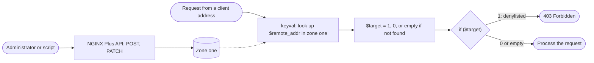

This section describes how to create a denylist or allowlist of specific client IP addresses, which denies or allows them access to your site, and how to dynamically maintain the list of addresses.

## Overview

In F5 NGINX Plus [Release 13]() (R13) and later, you can denylist some IP addresses as well as create and maintain a database of denylisted IP addresses. You can also explicitly allowlist other IP addresses. The IP addresses database is managed with the NGINX Plus <a href="https://nginx.org/en/docs/http/ngx_http_api_module.html">API</a> and <a target="_blank" href="https://nginx.org/en/docs/http/ngx_http_keyval_module.html">keyval</a> modules.

NGINX Plus [Release 19]() extends this capability by matching an IP address to any address within a subnet or network range.

---

<span id="prereq"></span>

## Before you begin {#prerequisites}

Before you begin, make sure you have:

- NGINX Plus [Release 13]() and later, NGINX Plus [Release 19]() and later for network ranges support.
- **A user name and password for the API**, in the password file `/etc/nginx/api.htpasswd`. The examples use the user name `admin`. See [Restricting Access with HTTP Basic Authentication]().
- **Shell access to the NGINX Plus host**, because the configuration allows API requests only from `127.0.0.1`.

---

## How the denylist works

For each request, NGINX Plus looks up the client address in the key-value database, and sets a variable to the value that it finds. An `if` rule then returns `403` if the value means "denied". The API changes the database while NGINX Plus runs:



Text description: For each request, NGINX Plus looks up the client address in the key-value zone `one`, and sets `$target` to the value that it finds, or to an empty value if the address isn't there. If `$target` is `1`, NGINX Plus returns `403`. If it's `0` or empty, NGINX Plus processes the request. An administrator or a script changes the zone with the NGINX Plus API, and the change applies to the next requests.

The `if` directive treats an empty value and `0` as false, and any other value as true. So addresses with the value `0`, and addresses that aren't in the database, are allowed.

---

## Set up the denylist {#setup}

First, enable the database for storing the list of denylisted and allowlisted IP addresses.

1. In NGINX Plus configuration file, include the [keyval_zone](https://nginx.org/en/docs/http/ngx_http_keyval_module.html#keyval_zone) directive in the [http](https://nginx.org/en/docs/http/ngx_http_core_module.html#http) context to create a memory zone for storing keys and values. This sample directive creates a 1‑MB zone called **one**.

    ```nginx
    http {
        # ...
        keyval_zone zone=one:1m;
    }
    ```

    To perform matching of an IP address against subnets (for example, `192.168.13.0/24`), specify the `type=ip` parameter of the [keyval_zone](https://nginx.org/en/docs/http/ngx_http_keyval_module.html#keyval_zone) directive:

    ```nginx
    http {
        # ...
        keyval_zone zone=one:1m type=ip;
    }
    ```

    Note that the size of [keyval_zone](https://nginx.org/en/docs/http/ngx_http_keyval_module.html#keyval_zone) should also be increased as the `type=ip` parameter also enables an extra index stored in the zone.

    You can optionally include the `state` parameter to create a file where the key‑value database is stored and so persists across NGINX Plus reloads and restarts; in this example, **one.keyval**:

    ```nginx
    keyval_zone zone=one:1m state=one.keyval;
    ```

2. Enable the NGINX Plus API in read‑write mode with the [api](https://nginx.org/en/docs/http/ngx_http_api_module.html#api) directive. Restrict access to this location: allow it only from `localhost` (`127.0.0.1`), and require HTTP basic authentication for all methods except `GET` and `HEAD`, such as `PATCH`, `POST`, and `DELETE`:

    ```nginx
    server {
        listen 80;
        server_name www.example.com;

        location /api {
            api   write=on;

            allow 127.0.0.1;
            deny  all;

            limit_except GET {
                auth_basic "NGINX Plus API";
                auth_basic_user_file /etc/nginx/api.htpasswd;
            }
        }
    }
    ```

    With this configuration, send API requests from the NGINX Plus host to `127.0.0.1`, with the server name in the `Host` header, and give the user name with `curl -u` for requests that change the database. Requests from other addresses get `403`, and changes without a valid password get `401`. `GET` requests need no password, so any user on the host can read the list.

    Then test and reload the configuration, so that the API is available for the next step:

    ```shell
    sudo nginx -t && sudo nginx -s reload
    ```

3. Populate the key‑value database with the API's [POST](https://nginx.org/en/docs/http/ngx_http_api_module.html#postHttpKeyvalZoneData) method, supplying the data in JSON format. You can use the `curl` command as in the following example; it asks for the password of the `admin` user. If the zone is empty, you can enter several key‑value pairs at once; otherwise, pairs must be added one at a time.

    ```shell
    curl -u admin -X POST -H 'Host: www.example.com' -H 'Content-Type: application/json' -d '{
        "10.0.0.1": "1",
        "10.0.0.2": "1",
        "10.0.0.3": "0",
        "10.0.0.4": "0"
    }' -s http://127.0.0.1/api/6/http/keyvals/one
    ```

    If you have specified matching of IP addresses against network ranges (with the `type=ip` parameter of the [keyval_zone](https://nginx.org/en/docs/http/ngx_http_keyval_module.html#keyval_zone) directive), send the `POST` command with the network range specified in CIDR notation:

    ```shell
    curl -u admin -X POST -H 'Host: www.example.com' -H 'Content-Type: application/json' -d '{
        "192.168.13.0/24": "1"
    }' -s http://127.0.0.1/api/6/http/keyvals/one
    ```

4. Define how client IP addresses are evaluated against the key‑value database, by including the [keyval](https://nginx.org/en/docs/http/ngx_http_keyval_module.html#keyval) directive in the [http](https://nginx.org/en/docs/http/ngx_http_core_module.html#http) context.

    The directive takes advantage of the standard NGINX and NGINX Plus variable [`$remote_addr`](https://nginx.org/en/docs/http/ngx_http_core_module.html#var_remote_addr), which is set to the client IP address automatically for every request.

    As it processes each request, NGINX Plus:

    - Looks up the first parameter (here, `$remote_addr`, preset to the client's IP address) in the key‑value database specified by the `zone=` parameter (here, **one**).

    - If a key in the database matches `$remote_addr`, sets the second parameter (here, `$target`) to the value corresponding to the key. Without `type=ip`, the key must be the same address. With `type=ip`, the key can also be a network that contains the address. In our example, the value is `1` for denylisted addresses or `0` for allowlisted addresses.

    ```nginx
    http {
        # ...
        keyval_zone zone=one:1m type=ip state=one.keyval;
        keyval $remote_addr $target zone=one; # Client address is the key,
                                              # $target is the value;
    }
    ```

5. Create a rule with the [if](https://nginx.org/en/docs/http/ngx_http_rewrite_module.html#if) directive that either allows or denies access depending on the client IP address. With this rule, access is allowed when `$target` is `0` or empty, and denied when it is `1`. Any other value, such as `00` or `true`, also denies access, so use only `0` and `1`:

    ```nginx
    if ($target) {
        return 403;
    }
    ```

    Put the rule in the `server` block, as in the [Full Example](#full-example). There, NGINX Plus checks it before it chooses a `location`, so it applies to all requests to the server.

---

<span id="manage"></span><span id="curl"></span>

## Managing the Key-Value Database {#managing-the-key-value-database}

You can use API methods to update a key‑value database dynamically, without requiring a reload of NGINX Plus.

All of the following examples operate on the **one** zone, which is accessible at `http://127.0.0.1/api/6/http/keyvals/one` on the NGINX Plus host. The commands that change the zone ask for the password of the `admin` user.

- To get the list of all database entries for a zone:

    ```shell
    curl -s -H 'Host: www.example.com' 'http://127.0.0.1/api/6/http/keyvals/one'
    ```

- To update the value for an existing entry (in this example to change the access status for IP address `10.0.0.4` from allowlisted to denylisted):

    ```shell
    curl -u admin -X PATCH -H 'Host: www.example.com' -H 'Content-Type: application/json' -d '{"10.0.0.4": "1"}' -s 'http://127.0.0.1/api/6/http/keyvals/one'
    ```

- To add an entry to a populated zone:

    ```shell
    curl -u admin -X POST -H 'Host: www.example.com' -H 'Content-Type: application/json' -d '{"10.0.0.5": "1"}' -s 'http://127.0.0.1/api/6/http/keyvals/one'
    ```

- To delete an entry:

    ```shell
    curl -u admin -X PATCH -H 'Host: www.example.com' -H 'Content-Type: application/json' -d '{"10.0.0.4":null}' -s 'http://127.0.0.1/api/6/http/keyvals/one'
    ```

---

<span id="example"></span>

## Full Example

The full NGINX Plus configuration:

```nginx
http {
    # ...
    keyval_zone zone=one:1m type=ip state=one.keyval;
    keyval $remote_addr $target zone=one;

    server {
        listen 80;
        server_name www.example.com;

        location /api {
            api   write=on;

            allow 127.0.0.1;
            deny  all;

            limit_except GET {
                auth_basic "NGINX Plus API";
                auth_basic_user_file /etc/nginx/api.htpasswd;
            }
        }

        if ($target) {
            return 403;
        }
    }
}
```

This configuration:

- Creates a 1 MB keyval zone **one** that accepts network ranges and also creates the file **one.keyval** to make the database of key‑value pairs persist across reloads and restarts of NGINX Plus.

- Enables the NGINX Plus API in write mode so that the zone can be populated with IP addresses. Only clients on the NGINX Plus host can use the API, and changes need a password.

- Enables lookup of the IP address `$remote_addr` in the key-value database as the key, and puts the value of the found key into the `$target` variable.

- Enables a simple rule to check for the resulting value: if the value of `$target` is `1` (address is denylisted), return `403 (Forbidden)` to the client. The rule applies to the API location too, so don't denylist `127.0.0.1`, or you lose access to the API.

If you didn't populate the zone in [step 3](#setup), the following `curl` command populates the empty keyval zone **one** with IP addresses that are denylisted (value is `1`) or allowlisted (value is `0`):

```shell
curl -u admin -X POST -H 'Host: www.example.com' -H 'Content-Type: application/json' -d '{
    "10.0.0.1": "1",
    "192.168.13.0/24": "1",
    "10.0.0.3": "0",
    "10.0.0.4": "0"
}' -s 'http://127.0.0.1/api/6/http/keyvals/one'
```

---

## Verify the configuration

On Linux, you can use another loopback address, such as `127.0.0.2`, as a test client on the NGINX Plus host.

1. Test and reload the configuration:

    ```shell
    sudo nginx -t && sudo nginx -s reload
    ```

2. Send a request from the test address. It isn't in the database yet, so it's allowed:

    ```shell
    curl -s -o /dev/null -w '%{http_code}\n' --interface 127.0.0.2 -H 'Host: www.example.com' http://127.0.0.1/
    ```

    The output is the status of your site, for example `200`.

3. Denylist the test address, and send the request again:

    ```shell
    curl -u admin -X POST -H 'Host: www.example.com' -H 'Content-Type: application/json' -d '{"127.0.0.2": "1"}' -s http://127.0.0.1/api/6/http/keyvals/one
    curl -s -o /dev/null -w '%{http_code}\n' --interface 127.0.0.2 -H 'Host: www.example.com' http://127.0.0.1/
    ```

    The output of the second command is `403`. If the address is already in the zone, use `PATCH` instead of `POST` to change its value.

4. Remove the test address:

    ```shell
    curl -u admin -X PATCH -H 'Host: www.example.com' -H 'Content-Type: application/json' -d '{"127.0.0.2": null}' -s http://127.0.0.1/api/6/http/keyvals/one
    ```

---

## Troubleshooting

### API requests get 403 Forbidden

**Symptom**: `curl` requests to the API get `403`.

**Cause**: The request doesn't come from `127.0.0.1`, for example because you used the server's public name or address, or the client address is in the denylist.

**Fix**: Send the request on the NGINX Plus host to `http://127.0.0.1/api/...`, with `-H 'Host: www.example.com'`.

If `127.0.0.1` itself is denylisted, the `if` rule denies all API requests, including the request that would remove it, and the `state` file keeps the entry across restarts. To recover, comment out the `if` block, reload NGINX Plus, delete the `127.0.0.1` entry with a `PATCH` request, then restore the `if` block and reload again.

### API changes get 401 Unauthorized

**Symptom**: `POST` and `PATCH` requests get `401`, while `GET` requests work.

**Cause**: The request has no user name and password, or they aren't in the password file. The `limit_except GET` block requires them for all methods except `GET` and `HEAD`.

**Fix**: Add `-u <user>` to the `curl` command, and check the password file.

### A denylisted address still gets access

**Symptom**: Requests from an address in the database aren't denied.

**Cause**: The value isn't `1`, or the `if` rule isn't in the `server` block that handles the request. Behind a load balancer or a proxy, `$remote_addr` is that device's address, not the client's. Without `type=ip`, a network key such as `192.168.13.0/24` doesn't match any address.

**Fix**: Check the entry with a `GET` request to the API. Behind a proxy, set the client address with the [realip](https://nginx.org/en/docs/http/ngx_http_realip_module.html) module. In [set_real_ip_from](https://nginx.org/en/docs/http/ngx_http_realip_module.html#set_real_ip_from), list only the addresses of your proxies: if you trust other addresses, any client can send `X-Forwarded-For: 127.0.0.1`, and pass the `allow 127.0.0.1` rule of the API. For network ranges, use `type=ip`.

---

## References {#see-also}

- [Dynamic IP Denylisting with NGINX Plus and fail2ban](https://www.f5.com/company/blog/nginx/dynamic-ip-denylisting-with-nginx-plus-and-fail2ban)
- [Using the NGINX Plus API to configure upstream servers]()
- [ngx_http_keyval_module](https://nginx.org/en/docs/http/ngx_http_keyval_module.html) and [ngx_http_api_module](https://nginx.org/en/docs/http/ngx_http_api_module.html) references on nginx.org
