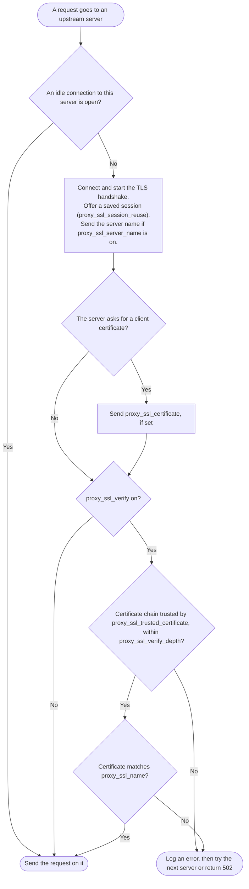

## Overview

By default, NGINX Open Source and F5 NGINX Plus pass requests to upstream servers over plain HTTP. If the network between NGINX and the servers isn't trusted, encrypt this traffic with HTTPS. You can also make NGINX and the servers check each other's certificates, which is called mutual TLS.

Use this guide to configure NGINX to connect to upstream servers over HTTPS, check their certificates, and send a client certificate.

---

## Before you begin {#prerequisites}

Before you begin, make sure you have:

- **NGINX Open Source or NGINX Plus** with the SSL module. NGINX Plus and the packages from nginx.org include it. If you build NGINX Open Source from source, add `--with-http_ssl_module` to `configure`.
- **A [proxied server]() or an [upstream group]()** that accepts HTTPS connections.
- **Certificates and keys**: a server certificate for each upstream server, and optionally a client certificate for NGINX. See [Get the certificates](#serever_certs).
- **Permission to edit the configuration and reload NGINX**: On most systems, this means root or `sudo` access.

---

## How NGINX connects to an upstream server over TLS

When `proxy_pass` uses the `https` scheme, NGINX opens a TLS connection to the server:



Text description: When a request goes to an upstream server, NGINX first uses an idle connection to that server if one is open. Otherwise, it connects and starts a TLS handshake. It offers a saved session, and sends the server name if `proxy_ssl_server_name` is on. If the server asks for a client certificate, NGINX sends the one set by `proxy_ssl_certificate`. If `proxy_ssl_verify` is on, NGINX checks that the server's certificate chain is trusted and that the certificate matches the expected name. If a check fails, NGINX logs an error and tries the next server, or returns `502`. Otherwise, it sends the request.

By default, `proxy_ssl_verify` is off, so NGINX encrypts the traffic but accepts any certificate. To make sure that NGINX talks to your servers and not to an attacker, turn on verification.

---

## Get the certificates {#serever_certs}

Each upstream server needs a server certificate and its private key. You can get the certificates from a public certificate authority (CA), or from your own internal CA. NGINX checks the server certificate against the name that it expects for the server, so the certificate must include that name. See [Configure NGINX](#config).

<span id="client_certs"></span>

For mutual TLS, NGINX also needs a client certificate and its private key. NGINX sends the client certificate to identify itself to the upstream servers. The servers must trust the CA that issued it.

### Create test certificates with a private CA

To try this guide, you can create your own CA, a server certificate, and a client certificate with OpenSSL. In production, use the certificates of your organization's CA.

1. Create the CA's key and certificate:

    ```shell
    openssl req -x509 -newkey rsa:2048 -nodes -days 365 -subj "/CN=Example Internal CA" -keyout ca.key -out ca.crt
    ```

2. Create a server certificate for each upstream server. Each certificate includes the server's own name, and the shared name `backend.example.com` that NGINX checks:

    ```shell
    for name in backend1 backend2; do
        openssl req -newkey rsa:2048 -nodes -subj "/CN=$name.example.com" -keyout $name.key -out $name.csr
        printf 'subjectAltName=DNS:%s.example.com,DNS:backend.example.com\n' $name > $name.ext
        openssl x509 -req -in $name.csr -CA ca.crt -CAkey ca.key -CAcreateserial -days 365 -extfile $name.ext -out $name.crt
    done
    ```

    On `backend1.example.com`, save `backend1.crt` as `/etc/ssl/certs/server.crt`, `backend1.key` as `/etc/ssl/private/server.key`, and `ca.crt` as `/etc/ssl/certs/ca.crt`. Do the same with the `backend2` files on `backend2.example.com`. Make the key files readable only by root.

3. Create the client certificate for NGINX:

    ```shell
    openssl req -newkey rsa:2048 -nodes -subj "/CN=nginx-proxy" -keyout client.key -out client.csr
    openssl x509 -req -in client.csr -CA ca.crt -CAkey ca.key -CAcreateserial -days 365 -out client.pem
    ```

    Copy `client.pem` and `client.key` to `/etc/nginx/` on the NGINX server, and copy `ca.crt` there as `/etc/nginx/trusted_ca_cert.crt`. Make `client.key` readable only by root.

Keep `ca.key` in a safe place, away from the servers. Anyone with it can create certificates that your servers trust.

---

## Configure NGINX {#config}

1. Use the `https` scheme in the [proxy_pass](https://nginx.org/en/docs/http/ngx_http_proxy_module.html#proxy_pass) directive:

    ```nginx
    upstream backend {
        server backend1.example.com:443;
        server backend2.example.com:443;
    }

    server {
        listen      80;
        server_name www.example.com;

        location /upstream {
            proxy_pass https://backend;
        }
    }
    ```

    Replace `backend1.example.com` and `backend2.example.com` with the names or IP addresses of your servers. NGINX resolves the names when it starts, and fails with `host not found in upstream` if it can't. To try this guide, you can add the names to `/etc/hosts`.

    Give the port in the `server` directives. In an `upstream` block, a server without a port uses port 80, even with `https`. Port 443 is the default only when `proxy_pass` names a server directly, as in `proxy_pass https://backend1.example.com;`.

2. Turn on the check of the servers' certificates. Set the CA certificates that NGINX trusts with [proxy_ssl_trusted_certificate](https://nginx.org/en/docs/http/ngx_http_proxy_module.html#proxy_ssl_trusted_certificate), and turn on [proxy_ssl_verify](https://nginx.org/en/docs/http/ngx_http_proxy_module.html#proxy_ssl_verify):

    ```nginx
    location /upstream {
        proxy_pass                    https://backend;
        proxy_ssl_trusted_certificate /etc/nginx/trusted_ca_cert.crt;
        proxy_ssl_verify              on;
        proxy_ssl_verify_depth        2;
        proxy_ssl_name                backend.example.com;
        proxy_ssl_server_name         on;
        proxy_set_header              Host backend.example.com;
    }
    ```

    - `proxy_ssl_trusted_certificate` is a PEM file with one or more CA certificates. NGINX doesn't use the system's CA store, so set this directive even for certificates from a public CA, for example to `/etc/ssl/certs/ca-certificates.crt` on Debian and Ubuntu. Without it, `nginx -t` fails for a `location` that has `proxy_ssl_verify on` and an `https` address in `proxy_pass`.
    - [proxy_ssl_verify_depth](https://nginx.org/en/docs/http/ngx_http_proxy_module.html#proxy_ssl_verify_depth) limits the length of the certificate chain. The default `1` allows one intermediate CA certificate between the server certificate and the trusted CA. Increase it if your chain has more intermediate certificates.
    - [proxy_ssl_name](https://nginx.org/en/docs/http/ngx_http_proxy_module.html#proxy_ssl_name) sets the name that the server certificate must match. By default, it's the host in `proxy_pass`, which here is the name of the upstream group, `backend`. All servers in the group must have a certificate for this name.
    - [proxy_ssl_server_name](https://nginx.org/en/docs/http/ngx_http_proxy_module.html#proxy_ssl_server_name) sends this name to the server with Server Name Indication (SNI). It's off by default. Turn it on if the upstream servers choose the certificate by name. NGINX doesn't send IP addresses as names.
    - [proxy_set_header](https://nginx.org/en/docs/http/ngx_http_proxy_module.html#proxy_set_header) sends the same name in the `Host` header. By default, NGINX sends the host from `proxy_pass`, here `backend`. An upstream server that runs NGINX chooses the `server` block for the TLS handshake by SNI, and for the request by the `Host` header. If the `Host` header isn't exactly the SNI name, and the port has several `server` blocks, the request can go to another block. If that block checks client certificates, the server returns `421 Misdirected Request`.

3. If the upstream servers require a client certificate, add the certificate and key that NGINX sends, with [proxy_ssl_certificate](https://nginx.org/en/docs/http/ngx_http_proxy_module.html#proxy_ssl_certificate) and [proxy_ssl_certificate_key](https://nginx.org/en/docs/http/ngx_http_proxy_module.html#proxy_ssl_certificate_key):

    ```nginx
    location /upstream {
        # ...
        proxy_ssl_certificate     /etc/nginx/client.pem;
        proxy_ssl_certificate_key /etc/nginx/client.key;
    }
    ```

4. Optionally, choose the protocols and ciphers for the upstream connections with [proxy_ssl_protocols](https://nginx.org/en/docs/http/ngx_http_proxy_module.html#proxy_ssl_protocols) and [proxy_ssl_ciphers](https://nginx.org/en/docs/http/ngx_http_proxy_module.html#proxy_ssl_ciphers). By default, NGINX 1.27.3 and later uses TLSv1.2 and TLSv1.3, and the OpenSSL cipher list `DEFAULT`:

    ```nginx
    location /upstream {
        # ...
        proxy_ssl_protocols TLSv1.3;
    }
    ```

You can set the `proxy_ssl_*` directives in the `http`, `server`, or `location` context. A block inherits them from the enclosing context, unless it sets the same directive itself.

---

## Configure the upstream servers {#config_upstream}

Each upstream server must accept HTTPS connections. If the server is NGINX, configure it like this:

1. Set the server certificate and key with [ssl_certificate](https://nginx.org/en/docs/http/ngx_http_ssl_module.html#ssl_certificate) and [ssl_certificate_key](https://nginx.org/en/docs/http/ngx_http_ssl_module.html#ssl_certificate_key).
2. For mutual TLS, set the CA that issued NGINX's client certificate with [ssl_client_certificate](https://nginx.org/en/docs/http/ngx_http_ssl_module.html#ssl_client_certificate), and require a valid client certificate with [ssl_verify_client](https://nginx.org/en/docs/http/ngx_http_ssl_module.html#ssl_verify_client) `on`.

```nginx
server {
    listen                 443 ssl;
    server_name            backend1.example.com backend.example.com;

    ssl_certificate        /etc/ssl/certs/server.crt;
    ssl_certificate_key    /etc/ssl/private/server.key;
    ssl_client_certificate /etc/ssl/certs/ca.crt;
    ssl_verify_client      on;

    location /upstream {
        proxy_pass http://127.0.0.1:8080;
    }
}
```

With `ssl_verify_client on`, the server rejects a client without a certificate with the error `400 No required SSL certificate was sent`, and a client with an invalid certificate with `400 The SSL certificate error`. With `optional`, it accepts clients without a certificate, so it doesn't require mutual TLS.

NGINX passes the request URI unchanged to the upstream server, so the `location` on the upstream server must match it. In this example, the upstream server passes the requests to an application on port 8080. Replace `127.0.0.1:8080` with the address of your application.

---

## Speed up connections to upstream servers

A TLS handshake costs CPU on both sides. NGINX avoids most handshakes in two ways:

- **Keepalive connections**: In NGINX 1.29.7 and later, each worker process keeps up to 32 idle connections to the servers of an `upstream` group open by default, and uses them for the next requests. In earlier versions, set the [keepalive](https://nginx.org/en/docs/http/ngx_http_upstream_module.html#keepalive) directive in the `upstream` block, `proxy_http_version 1.1;`, and `proxy_set_header Connection "";`.
- **Session reuse**: For a new connection, NGINX offers the parameters of an earlier TLS session with the server, which makes the handshake shorter. The [proxy_ssl_session_reuse](https://nginx.org/en/docs/http/ngx_http_proxy_module.html#proxy_ssl_session_reuse) directive turns this on or off; it's on by default.

---

## Example {#example}

This configuration of the NGINX proxy passes requests for `/upstream` to two upstream servers over HTTPS. It checks the servers' certificates, and sends its own client certificate:

```nginx
http {
    upstream backend {
        server backend1.example.com:443;
        server backend2.example.com:443;
    }

    server {
        listen      80;
        server_name www.example.com;

        location /upstream {
            proxy_pass                    https://backend;

            proxy_ssl_trusted_certificate /etc/nginx/trusted_ca_cert.crt;
            proxy_ssl_verify              on;
            proxy_ssl_verify_depth        2;
            proxy_ssl_name                backend.example.com;
            proxy_ssl_server_name         on;
            proxy_set_header              Host backend.example.com;

            proxy_ssl_certificate         /etc/nginx/client.pem;
            proxy_ssl_certificate_key     /etc/nginx/client.key;
            proxy_ssl_protocols           TLSv1.2 TLSv1.3;
        }
    }
}
```

Each upstream server is configured as in [Configure the upstream servers](#config_upstream), with its own name in `server_name`. To see the result of the client certificate check, add a log format to the upstream server:

```nginx
http {
    log_format mtls '$remote_addr "$request" $status '
                    'client_verify=$ssl_client_verify client_dn="$ssl_client_s_dn" '
                    'sni=$ssl_server_name $ssl_protocol';

    server {
        listen                 443 ssl;
        server_name            backend1.example.com backend.example.com;
        access_log             /var/log/nginx/mtls.log mtls;

        ssl_certificate        /etc/ssl/certs/server.crt;
        ssl_certificate_key    /etc/ssl/private/server.key;
        ssl_client_certificate /etc/ssl/certs/ca.crt;
        ssl_verify_client      on;

        location /upstream {
            proxy_pass http://127.0.0.1:8080;
        }
    }
}
```

In this example:

- The `https` scheme in `proxy_pass` makes NGINX connect to the servers of the `backend` group over TLS.
- NGINX accepts a server certificate only if it's issued by the CA in `trusted_ca_cert.crt`, and is valid for `backend.example.com`. It sends this name with SNI and in the `Host` header.
- NGINX sends `client.pem` when the server asks for a client certificate. The upstream server accepts only clients with a certificate from the CA in `ca.crt`.
- The upstream server's log shows the result of the client certificate check, the client certificate's subject, and the name that NGINX sent.

---

## Verify the configuration

1. Test and reload the configuration on the NGINX proxy and on each upstream server:

    ```shell
    sudo nginx -t && sudo nginx -s reload
    ```

2. On the NGINX proxy, send a request:

    ```shell
    curl -i -H 'Host: www.example.com' http://localhost/upstream
    ```

    You get the application's response. A `502 Bad Gateway` response means that NGINX couldn't connect to any server. See [Troubleshooting](#troubleshooting).

3. On the upstream server, check the log:

    ```shell
    sudo tail -1 /var/log/nginx/mtls.log
    ```

    The output shows that the client certificate was verified, and that NGINX sent the name `backend.example.com`:

    ```none
    192.0.2.10 "GET /upstream HTTP/1.1" 200 client_verify=SUCCESS client_dn="CN=nginx-proxy" sni=backend.example.com TLSv1.3
    ```

    Before version 1.29.7, NGINX uses HTTP/1.0 for upstream connections by default, so the log shows `HTTP/1.0`.

4. On the upstream server, check that it rejects clients without a client certificate:

    ```shell
    curl -sk --resolve backend1.example.com:443:127.0.0.1 https://backend1.example.com/upstream | grep title
    ```

    The output is `<head><title>400 No required SSL certificate was sent</title></head>`.

---

## Troubleshooting

### NGINX doesn't start: "no proxy_ssl_trusted_certificate for proxy_ssl_verify"

**Symptom**: `nginx -t` fails with `no proxy_ssl_trusted_certificate for proxy_ssl_verify`.

**Cause**: `proxy_ssl_verify` is on, but NGINX has no CA certificates to check the servers' certificates with.

**Fix**: Set `proxy_ssl_trusted_certificate` to a file with the CA certificates, in the `location` that has `proxy_ssl_verify on`, or in an enclosing context.

### Clients get 502: "upstream SSL certificate verify error"

**Symptom**: Clients get `502 Bad Gateway`. The error log shows `upstream SSL certificate verify error: (21:unable to verify the first certificate) while SSL handshaking to upstream`, `(20:unable to get local issuer certificate)`, or another error code.

**Cause**: The error code shows the cause:

- `(21:unable to verify the first certificate)`: The server's certificate isn't issued by a CA in the `proxy_ssl_trusted_certificate` file, or the server doesn't send its intermediate certificates.
- `(20:unable to get local issuer certificate)`: The chain has more intermediate certificates than `proxy_ssl_verify_depth` allows, or its root CA isn't trusted.
- `(10:certificate has expired)`: The server's certificate expired.

**Fix**: Add the issuing CA to `proxy_ssl_trusted_certificate`, make the server send its intermediate certificates, increase `proxy_ssl_verify_depth`, or renew the certificate.

After a failed check, NGINX marks the server unavailable for 10 seconds by default, and logs `upstream server temporarily disabled` at the `warn` level. If all servers in the group are unavailable, NGINX returns `502` without trying them until that time passes. A group with only one server is never marked unavailable. See [HTTP Health Checks]().

### Clients get 502: "upstream SSL certificate does not match"

**Symptom**: Clients get `502 Bad Gateway`. The error log shows `upstream SSL certificate does not match "backend" while SSL handshaking to upstream`.

**Cause**: The server's certificate doesn't include the name that NGINX checks. Without `proxy_ssl_name`, NGINX checks the host in `proxy_pass`, which is often the name of the upstream group.

**Fix**: Set `proxy_ssl_name` to a name in the servers' certificates, or add the name to the certificates.

### The upstream server returns 421 Misdirected Request

**Symptom**: Clients get `421 Misdirected Request` from the upstream server. With `error_log ... info;`, its error log shows `client attempted to request the server name different from the one that was negotiated`.

**Cause**: The `Host` header isn't exactly the name that NGINX sent with SNI, and the `server` block that the upstream server chose for the request checks client certificates. This happens only if the port has several `server` blocks, even if both names are in the same block.

**Fix**: Send the SNI name in the `Host` header, for example with `proxy_set_header Host backend.example.com;` when `proxy_ssl_name` is `backend.example.com`.

### The upstream server returns 400: "No required SSL certificate was sent"

**Symptom**: Clients get `400 Bad Request` from the upstream server, with the text `No required SSL certificate was sent`. With `ssl_verify_client optional`, the request succeeds, but the upstream log shows `client_verify=NONE`.

**Cause**: NGINX doesn't send a client certificate, because `proxy_ssl_certificate` isn't set in the `location` that proxies the request or in an enclosing context.

**Fix**: Set `proxy_ssl_certificate` and `proxy_ssl_certificate_key`.

### The upstream server returns 400: "The SSL certificate error"

**Symptom**: Clients get `400 Bad Request` from the upstream server, with the text `The SSL certificate error`. The upstream log shows `client_verify=FAILED:unable to verify the first certificate` or another reason.

**Cause**: The upstream server doesn't trust the CA that issued NGINX's client certificate, or the certificate expired.

**Fix**: Add the CA that issued NGINX's certificate to the upstream server's `ssl_client_certificate` file, or renew the certificate.

---

## References

For more information, see:

- [NGINX Reverse Proxy]()
- [NGINX SSL Termination]()
- [Securing TCP Traffic to Upstream Servers]()
- [ngx_http_proxy_module reference](https://nginx.org/en/docs/http/ngx_http_proxy_module.html) on nginx.org
