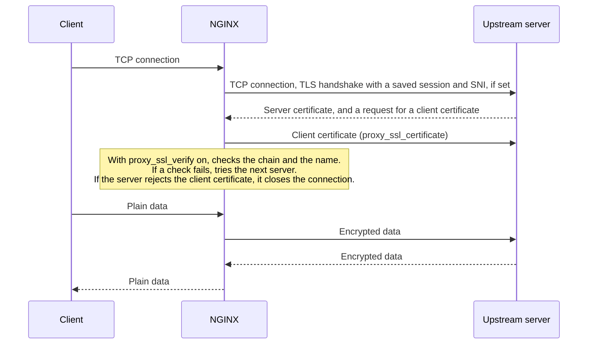

## Overview

By default, NGINX Open Source and F5 NGINX Plus pass TCP connections to upstream servers without encryption. If the network between NGINX and the servers isn't trusted, NGINX can encrypt these connections with TLS. NGINX and the servers can also check each other's certificates, which is called mutual TLS.

Use this guide to configure NGINX to connect to TCP upstream servers over TLS, check their certificates, and send a client certificate. For HTTP, see [Securing HTTP Traffic to Upstream Servers]().

---

## Before you begin {#prerequisites}

Before you begin, make sure you have:

- **NGINX with the stream and stream SSL modules**: NGINX Plus [R6]() and later, and the NGINX Open Source packages from nginx.org, include them. NGINX Open Source supports TLS to upstream TCP servers since version 1.9.0. If you build it from source, add `--with-stream` and `--with-stream_ssl_module` to `configure`.
- **A proxied TCP server or an [upstream group of TCP servers]()** that accepts TLS connections.
- **Certificates and keys**: a server certificate for each upstream server, and optionally a client certificate for NGINX.
- **Permission to edit the configuration and reload NGINX**: On most systems, this means root or `sudo` access.

---

## How NGINX connects to an upstream server over TLS

For each client connection, NGINX opens a new connection to an upstream server, and starts a TLS handshake:

1. NGINX offers the parameters of an earlier TLS session with this server, if it has one. It sends the server name with Server Name Indication (SNI) if `proxy_ssl_server_name` is on.
2. If the server asks for a client certificate, NGINX sends the one set by `proxy_ssl_certificate`.
3. If `proxy_ssl_verify` is on, NGINX checks the server's certificate chain against `proxy_ssl_trusted_certificate`, and checks that the certificate matches the name set by `proxy_ssl_name`.
4. If the handshake or one of these checks fails, NGINX logs an error and tries the next server in the group. If no server is left, it closes the client connection.
5. Otherwise, NGINX passes the client's data to the server over the TLS connection.

An upstream server that runs NGINX checks the client certificate after the handshake. If it rejects the certificate, it closes the connection. For the NGINX proxy, the handshake succeeded, so it logs no error and doesn't try another server. The client is disconnected.



Text description: A client opens a TCP connection to NGINX. NGINX opens a TCP connection to an upstream server and starts a TLS handshake, with a saved session and the server name if configured. The server sends its certificate and can ask for a client certificate, which NGINX sends. With `proxy_ssl_verify` on, NGINX checks the server's certificate, and tries the next server if the check fails. If the server rejects the client certificate, it closes the connection. NGINX then encrypts the client's data before it passes it to the server, and decrypts the server's data before it passes it to the client.

By default, `proxy_ssl_verify` is off, so NGINX encrypts the traffic but accepts any certificate, even from an attacker who pretends to be your server. To prevent this, turn on verification.

---

## Get the certificates {#obtaining-ssl-server-certificates}

Each upstream server needs a server certificate and its private key. You can get them from a public certificate authority (CA), or from your own internal CA. NGINX checks the server certificate against the name that it expects for the server, so the certificate must include that name.

<span id="obtaining-an-ssl-client-certificate"></span>

For mutual TLS, NGINX also needs a client certificate and its private key. The upstream servers must trust the CA that issued it.

To create test certificates with your own CA, follow the steps in [Create test certificates with a private CA](). That procedure creates server certificates that include the name `backend.example.com`, which this guide uses. This guide's example has three servers, so add `backend3` to the list of names in the procedure's `for` loop. Instead of the paths in that procedure, on the NGINX proxy, save `client.pem` as `/etc/ssl/certs/backend.crt`, `client.key` as `/etc/ssl/private/backend.key`, and `ca.crt` as `/etc/ssl/certs/trusted_ca_cert.crt`.

---

## Configure NGINX {#configuring-nginx}

1. Add the [proxy_ssl](https://nginx.org/en/docs/stream/ngx_stream_proxy_module.html#proxy_ssl) directive to the `server` block in the `stream` context. The `stream` block is at the top level of **nginx.conf**, next to the `http` block. Don't put it in a file in `conf.d`, because the default **nginx.conf** includes those files in the `http` block:

    ```nginx
    stream {
        upstream backend {
            server backend1.example.com:12345;
            server backend2.example.com:12345;
        }

        server {
            listen     12345;
            proxy_pass backend;
            proxy_ssl  on;
        }
    }
    ```

    Replace `backend1.example.com` and `backend2.example.com` with the names or IP addresses of your servers. NGINX resolves the names when it starts, and fails with `host not found in upstream` if it can't.

2. Turn on the check of the servers' certificates:

    ```nginx
    server {
        listen                        12345;
        proxy_pass                    backend;
        proxy_ssl                     on;

        proxy_ssl_trusted_certificate /etc/ssl/certs/trusted_ca_cert.crt;
        proxy_ssl_verify              on;
        proxy_ssl_verify_depth        2;
        proxy_ssl_name                backend.example.com;
        proxy_ssl_server_name         on;
    }
    ```

    - [proxy_ssl_trusted_certificate](https://nginx.org/en/docs/stream/ngx_stream_proxy_module.html#proxy_ssl_trusted_certificate) is a PEM file with the CA certificates that NGINX trusts. NGINX doesn't use the system's CA store, so set this directive even for certificates from a public CA. Without it, `nginx -t` fails when `proxy_ssl_verify` is on.
    - [proxy_ssl_verify](https://nginx.org/en/docs/stream/ngx_stream_proxy_module.html#proxy_ssl_verify) turns on the check. It's off by default.
    - [proxy_ssl_verify_depth](https://nginx.org/en/docs/stream/ngx_stream_proxy_module.html#proxy_ssl_verify_depth) limits the length of the certificate chain. The default `1` allows one intermediate CA certificate between the server certificate and the trusted CA.
    - [proxy_ssl_name](https://nginx.org/en/docs/stream/ngx_stream_proxy_module.html#proxy_ssl_name) sets the name that the server certificate must match. By default, it's the host in `proxy_pass`, which here is the name of the upstream group, `backend`.
    - [proxy_ssl_server_name](https://nginx.org/en/docs/stream/ngx_stream_proxy_module.html#proxy_ssl_server_name) sends this name with SNI. It's off by default. Turn it on if the upstream servers choose the certificate by name.

3. If the upstream servers require a client certificate, add the certificate and key that NGINX sends, with [proxy_ssl_certificate](https://nginx.org/en/docs/stream/ngx_stream_proxy_module.html#proxy_ssl_certificate) and [proxy_ssl_certificate_key](https://nginx.org/en/docs/stream/ngx_stream_proxy_module.html#proxy_ssl_certificate_key):

    ```nginx
    server {
        listen                    12345;
        proxy_pass                backend;
        proxy_ssl                 on;

        proxy_ssl_certificate     /etc/ssl/certs/backend.crt;
        proxy_ssl_certificate_key /etc/ssl/private/backend.key;
    }
    ```

4. Optionally, choose the protocols and ciphers with [proxy_ssl_protocols](https://nginx.org/en/docs/stream/ngx_stream_proxy_module.html#proxy_ssl_protocols) and [proxy_ssl_ciphers](https://nginx.org/en/docs/stream/ngx_stream_proxy_module.html#proxy_ssl_ciphers). By default, NGINX 1.27.3 and later uses TLSv1.2 and TLSv1.3, and the OpenSSL cipher list `DEFAULT`. For example, to use only TLSv1.3, add `proxy_ssl_protocols TLSv1.3;`.

NGINX opens a new upstream connection for each client connection. To make these handshakes shorter, NGINX reuses the TLS sessions with each server by default. The [proxy_ssl_session_reuse](https://nginx.org/en/docs/stream/ngx_stream_proxy_module.html#proxy_ssl_session_reuse) directive turns this on or off.

You can set all of the `proxy_ssl*` directives in the `stream` or `server` context. A `server` block inherits them from the `stream` context, unless it sets the same directive itself.

---

## Configure the upstream servers

Each upstream server must accept TLS connections. If the server is NGINX, it terminates TLS as described in [SSL Termination for TCP Upstream Servers](). For mutual TLS, it also checks the client certificate:

```nginx
stream {
    server {
        listen                 12345 ssl;
        proxy_pass             127.0.0.1:8080;

        ssl_certificate        /etc/ssl/certs/server.crt;
        ssl_certificate_key    /etc/ssl/private/server.key;
        ssl_client_certificate /etc/ssl/certs/ca.crt;
        ssl_verify_client      on;
    }
}
```

- [ssl_client_certificate](https://nginx.org/en/docs/stream/ngx_stream_ssl_module.html#ssl_client_certificate) is the CA certificate that issued NGINX's client certificate.
- With [ssl_verify_client](https://nginx.org/en/docs/stream/ngx_stream_ssl_module.html#ssl_verify_client) `on`, the server ends the handshake if the client doesn't send a valid certificate. This directive is supported in the `stream` context since NGINX 1.11.8.

In this example, the upstream server passes the decrypted data to an application on port 8080.

---

## Example {#complete-example}

This configuration of the NGINX proxy accepts plain TCP connections on port 12345, and passes them to three upstream servers over TLS. It checks the servers' certificates, and sends its own client certificate:

```nginx
stream {
    upstream backend {
        zone   backend 64k;
        server backend1.example.com:12345;
        server backend2.example.com:12345;
        server backend3.example.com:12345;
    }

    server {
        listen                        12345;
        proxy_pass                    backend;
        proxy_ssl                     on;

        proxy_ssl_trusted_certificate /etc/ssl/certs/trusted_ca_cert.crt;
        proxy_ssl_verify              on;
        proxy_ssl_verify_depth        2;
        proxy_ssl_name                backend.example.com;
        proxy_ssl_server_name         on;

        proxy_ssl_certificate         /etc/ssl/certs/backend.crt;
        proxy_ssl_certificate_key     /etc/ssl/private/backend.key;
        proxy_ssl_protocols           TLSv1.2 TLSv1.3;
    }
}
```

In this example:

- `proxy_ssl on` makes NGINX connect to the servers over TLS.
- NGINX accepts a server certificate only if it's issued by a CA in `trusted_ca_cert.crt`, and is valid for `backend.example.com`. It sends this name with SNI.
- NGINX sends `backend.crt` when a server asks for a client certificate.
- NGINX reuses TLS sessions with each server by default.
- The `zone` directive shares the group's state among the worker processes. Without it, each worker process chooses servers in turn on its own, and keeps its own TLS sessions.

To see the result of the checks, add a log format to each upstream server that runs NGINX:

```nginx
stream {
    log_format mtls '$remote_addr $status client_verify=$ssl_client_verify '
                    'client_dn="$ssl_client_s_dn" sni=$ssl_server_name '
                    'reused=$ssl_session_reused';

    server {
        listen                 12345 ssl;
        proxy_pass             127.0.0.1:8080;
        access_log             /var/log/nginx/mtls.log mtls;

        ssl_certificate        /etc/ssl/certs/server.crt;
        ssl_certificate_key    /etc/ssl/private/server.key;
        ssl_client_certificate /etc/ssl/certs/ca.crt;
        ssl_verify_client      on;
    }
}
```

---

## Verify the configuration

1. Test and reload the configuration on the NGINX proxy and on each upstream server:

    ```shell
    sudo nginx -t && sudo nginx -s reload
    ```

2. On the NGINX proxy, connect to port 12345 several times, with a client for your application's protocol. To test the TLS connections without such a client, use `nc`:

    ```shell
    for i in 1 2 3 4; do printf 'hello\n' | nc -w 2 localhost 12345; done
    ```

    You get the application's responses, if it sends any.

3. On `backend1.example.com`, check the log:

    ```shell
    sudo tail -2 /var/log/nginx/mtls.log
    ```

    The output shows that the client certificate was verified, that NGINX sent the name `backend.example.com`, and that the second connection reused the TLS session (`r`):

    ```none
    192.0.2.10 200 client_verify=SUCCESS client_dn="CN=nginx-proxy" sni=backend.example.com reused=.
    192.0.2.10 200 client_verify=SUCCESS client_dn="CN=nginx-proxy" sni=backend.example.com reused=r
    ```

    NGINX passes connections to the servers in turn, so with three servers, `backend1.example.com` gets the first and the fourth connection. On the other servers, the log has one line from this test.

---

## Troubleshooting

### NGINX doesn't start: "no proxy_ssl_trusted_certificate for proxy_ssl_verify"

**Symptom**: `nginx -t` fails with `no proxy_ssl_trusted_certificate for proxy_ssl_verify`.

**Cause**: `proxy_ssl_verify` is on, but NGINX has no CA certificates to check the servers' certificates with.

**Fix**: Set `proxy_ssl_trusted_certificate` in the same `server` block as `proxy_ssl_verify`, or in the `stream` context.

### Clients are disconnected: "upstream SSL certificate verify error"

**Symptom**: Clients are disconnected right away. The NGINX error log shows `upstream SSL certificate verify error: (21:unable to verify the first certificate) while SSL handshaking to upstream`, `(20:unable to get local issuer certificate)`, or another error code.

**Cause**: The server's certificate isn't issued by a CA in the `proxy_ssl_trusted_certificate` file, the server doesn't send its intermediate certificates, or the chain is longer than `proxy_ssl_verify_depth` allows.

**Fix**: Add the issuing CA to `proxy_ssl_trusted_certificate`, make the server send its intermediate certificates, or increase `proxy_ssl_verify_depth`.

After a failed check, NGINX marks the server unavailable for 10 seconds by default. If all servers are unavailable, the error log shows `no live upstreams while connecting to upstream` instead of the certificate error, until that time passes.

### Clients are disconnected: "upstream SSL certificate does not match"

**Symptom**: Clients are disconnected right away. The NGINX error log shows `upstream SSL certificate does not match "backend" while SSL handshaking to upstream`.

**Cause**: The server's certificate doesn't include the name that NGINX checks. Without `proxy_ssl_name`, NGINX checks the host in `proxy_pass`, here the name of the upstream group.

**Fix**: Set `proxy_ssl_name` to a name in the servers' certificates, or add the name to the certificates.

### Clients are disconnected: "SSL_do_handshake() failed"

**Symptom**: Clients are disconnected right away. The NGINX error log shows `SSL_do_handshake() failed ... while SSL handshaking to upstream`, with `wrong version number` or `alert protocol version`.

**Cause**: With `wrong version number`, the upstream server doesn't accept TLS on that port, for example because its `listen` directive has no `ssl` parameter. With `alert protocol version`, NGINX and the server have no TLS protocol version in common.

**Fix**: Turn on TLS on the upstream server, or check `proxy_ssl_protocols` against the protocols that the server accepts.

### Clients are disconnected: "client sent no required SSL certificate"

**Symptom**: Clients are disconnected without getting any data. The NGINX proxy logs no error, and doesn't try another server. With `error_log ... info;`, the upstream server's error log shows `client sent no required SSL certificate while SSL handshaking`, or `client SSL certificate verify error: (21:unable to verify the first certificate)`.

**Cause**: The upstream server requires a client certificate. NGINX doesn't send one because `proxy_ssl_certificate` isn't set, or the upstream server doesn't trust the CA that issued it.

**Fix**: Set `proxy_ssl_certificate` and `proxy_ssl_certificate_key`. Check that the CA that issued NGINX's certificate is in the upstream server's `ssl_client_certificate` file.

---

## References

For more information, see:

- [Securing HTTP Traffic to Upstream Servers]()
- [SSL Termination for TCP Upstream Servers]()
- [TCP and UDP Load Balancing]()
- [ngx_stream_proxy_module reference](https://nginx.org/en/docs/stream/ngx_stream_proxy_module.html) on nginx.org
