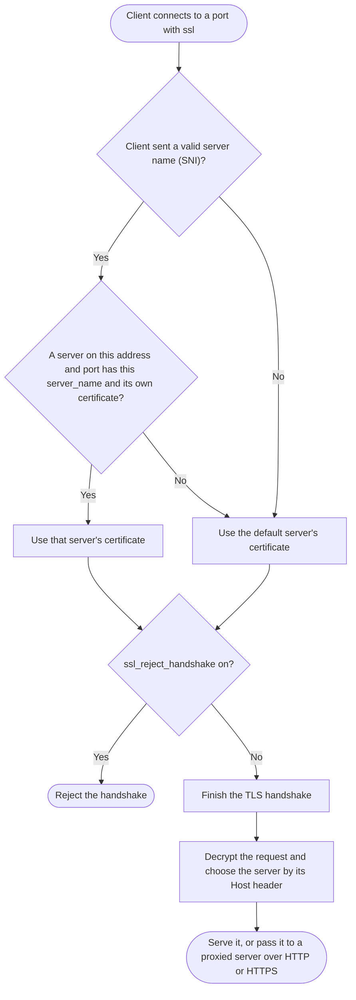

## Overview

With SSL/TLS termination, NGINX Open Source or F5 NGINX Plus handles the encryption of client connections. Your web and application servers then don't spend resources on it. Use this guide to set up an HTTPS server, configure certificates, and choose protocols.

---

## Before you begin

Before you begin, make sure you have:

- **NGINX with the SSL module**: NGINX Plus and the packages from nginx.org include it. If you build NGINX Open Source from source, add `--with-http_ssl_module` to `configure`.
- **A certificate and its private key** for each server name, in PEM format. For a certificate from a certificate authority (CA), you also need the CA's intermediate certificates.
- **Permission to edit the configuration and reload NGINX**: On most systems, this means root or `sudo` access.

---

## How TLS termination works

When a client connects to a port with the `ssl` parameter, NGINX does the following:

1. It starts the TLS handshake. If the client sends a valid server name with the Server Name Indication (SNI) extension, NGINX looks for a `server` block with that name among the servers that listen on the same address and port. Exact, wildcard, and regular expression names all count. If it finds one that has its own certificate, NGINX uses that certificate.
2. Otherwise, NGINX uses the certificate of the default server for that address and port.
3. If the chosen server has `ssl_reject_handshake on`, NGINX rejects the handshake instead.
4. After the handshake, NGINX decrypts the request and processes it like any HTTP request. It chooses the server for the request by its `Host` header, as for plain HTTP, so SNI decides only the certificate.



Text description: When a client connects, NGINX checks whether the client sent a valid server name with SNI. If a server on the same address and port has that name and its own certificate, NGINX uses that certificate. Otherwise, it uses the default server's certificate. If the chosen server has `ssl_reject_handshake on`, NGINX rejects the handshake. After the handshake, NGINX decrypts the request, chooses the server by the `Host` header, and serves or proxies the request.

---

## Setting up an HTTPS server {#setup}

1. In the `server` block, add the `ssl` parameter to the [listen](https://nginx.org/en/docs/http/ngx_http_core_module.html#listen) directive.

2. Set the certificate and private key files with the [ssl_certificate](https://nginx.org/en/docs/http/ngx_http_ssl_module.html#ssl_certificate) and [ssl_certificate_key](https://nginx.org/en/docs/http/ngx_http_ssl_module.html#ssl_certificate_key) directives. A relative path is relative to the directory of the main configuration file.

    ```nginx
    server {
        listen              443 ssl;
        server_name         www.example.com;
        ssl_certificate     www.example.com.crt;
        ssl_certificate_key www.example.com.key;
        ssl_protocols       TLSv1.2 TLSv1.3;
        ssl_ciphers         HIGH:!aNULL:!MD5;
    }
    ```

3. Restrict access to the private key file, for example with `sudo chmod 600 www.example.com.key`. NGINX reads it in the master process, which usually runs as root. If the `ssl_certificate` or `ssl_certificate_key` path contains variables, the worker processes load the files during the handshake instead, so they must be readable by the worker processes' user.

The certificate is public: NGINX sends it to every client. The private key is secret. You can also keep the key in the same file as the certificate:

```nginx
ssl_certificate     www.example.com.cert;
ssl_certificate_key www.example.com.cert;
```

In this case, restrict access to that file. NGINX sends only the certificate to clients, not the key.

### Choose protocols and ciphers

The [ssl_protocols](https://nginx.org/en/docs/http/ngx_http_ssl_module.html#ssl_protocols) and [ssl_ciphers](https://nginx.org/en/docs/http/ngx_http_ssl_module.html#ssl_ciphers) directives set which TLS versions and ciphers clients can use. In NGINX Open Source 1.27.3 and later, the defaults are:

```nginx
ssl_protocols TLSv1.2 TLSv1.3;
ssl_ciphers   HIGH:!aNULL:!MD5;
```

Earlier versions also allow TLSv1 and TLSv1.1 by default. These old versions use weak ciphers, and they're affected by attacks such as BEAST ([CVE-2011-3389](https://nvd.nist.gov/vuln/detail/CVE-2011-3389)). Don't use SSLv3, which is affected by the POODLE attack ([CVE-2014-3566](https://nvd.nist.gov/vuln/detail/CVE-2014-3566)). If you run an older version, set `ssl_protocols TLSv1.2 TLSv1.3;` explicitly.

### OCSP validation of client certificates {#setup_ocsp}

NGINX can use the Online Certificate Status Protocol (OCSP) to check X.509 client certificates. NGINX sends an OCSP request for each client certificate to an OCSP responder, which returns its status:

- `Good` – The certificate isn't revoked.
- `Revoked` – The certificate is revoked.
- `Unknown` – The responder has no information about the certificate.

The [ssl_ocsp](https://nginx.org/en/docs/http/ngx_http_ssl_module.html#ssl_ocsp) directive has two modes: `on` checks every certificate in the client's chain, including intermediate certificates, and `leaf` checks only the client certificate.

To turn on OCSP validation of client certificates, add the [ssl_ocsp](https://nginx.org/en/docs/http/ngx_http_ssl_module.html#ssl_ocsp) directive together with [ssl_verify_client](https://nginx.org/en/docs/http/ngx_http_ssl_module.html#ssl_verify_client), which turns on certificate verification:

```nginx
server {
    listen 443 ssl;

    ssl_certificate     /etc/ssl/foo.example.com.crt;
    ssl_certificate_key /etc/ssl/foo.example.com.key;

    ssl_verify_client       on;
    ssl_trusted_certificate /etc/ssl/cachain.pem;
    ssl_ocsp                on; # Enable OCSP validation

    resolver                127.0.0.53; # to resolve the OCSP responder's name
}
```

NGINX resolves the host name of the OCSP responder with the [resolver](https://nginx.org/en/docs/http/ngx_http_core_module.html#resolver) directive. Without it, clients get `400 The SSL certificate error`, and NGINX logs `no resolver defined to resolve ... while requesting certificate status`. Replace `127.0.0.53` with the address of your DNS server.

NGINX sends the OCSP request to the URI in the client certificate, unless you set another URI with the [ssl_ocsp_responder](https://nginx.org/en/docs/http/ngx_http_ssl_module.html#ssl_ocsp_responder) directive. NGINX supports only `http://` OCSP responders; with `https://`, the configuration test fails with `invalid URL prefix in OCSP responder`:

```nginx
ssl_ocsp_responder http://ocsp.example.com/;
```

To cache OCSP responses in a memory zone shared by all worker processes, set the zone's name and size with the [ssl_ocsp_cache](https://nginx.org/en/docs/http/ngx_http_ssl_module.html#ssl_ocsp_cache) directive. NGINX keeps a response for 1 hour, unless the `nextUpdate` value in the response sets another time:

```nginx
ssl_ocsp_cache shared:one:10m;
```

The [$ssl_client_verify](https://nginx.org/en/docs/http/ngx_http_ssl_module.html#var_ssl_client_verify) variable holds the result of the verification, including the reason for an OCSP failure.

## HTTPS server optimization {#optimize}

TLS uses extra CPU, and the handshake uses the most. Two things reduce the number of handshakes per client:

- Keepalive connections, which carry several requests over one connection.
- Reusing TLS session parameters, which avoids full handshakes for parallel and later connections.

NGINX can reuse sessions in two ways:

- **Session tickets**: The client keeps the session state, encrypted by NGINX. The [ssl_session_tickets](https://nginx.org/en/docs/http/ngx_http_ssl_module.html#ssl_session_tickets) directive turns them on or off; they're on by default.
- **Session cache**: NGINX keeps the session state in a cache shared by the worker processes, set with the [ssl_session_cache](https://nginx.org/en/docs/http/ngx_http_ssl_module.html#ssl_session_cache) directive. The default is `none`, so set a shared cache for clients that don't use tickets. One megabyte holds roughly 4,000 sessions.

Sessions expire after 5 minutes by default; change this with the [ssl_session_timeout](https://nginx.org/en/docs/http/ngx_http_ssl_module.html#ssl_session_timeout) directive.

This configuration suits a multi-core system, with a 10 MB shared session cache:

```nginx
worker_processes auto;

events {}

http {
    ssl_session_cache   shared:SSL:10m;
    ssl_session_timeout 10m;

    server {
        listen              443 ssl;
        server_name         www.example.com;
        keepalive_timeout   70;

        ssl_certificate     www.example.com.crt;
        ssl_certificate_key www.example.com.key;
        ssl_protocols       TLSv1.2 TLSv1.3;
        ssl_ciphers         HIGH:!aNULL:!MD5;
    }
}
```

<span id="ssl-certificate-chains"></span>

## SSL certificate chains {#cert_chains}

Most CAs sign server certificates with an intermediate certificate, which browsers don't always have. Without it, some browsers reject the server certificate while others accept it. The CA provides a bundle of intermediate certificates. Add the bundle after your server certificate in one file, with the server certificate first:

```shell
cat www.example.com.crt bundle.crt > www.example.com.chained.crt
```

If `www.example.com.crt` doesn't end with a newline, `cat` joins two certificate lines, and the configuration test fails with `PEM_read_bio_X509_AUX() failed ... bad end line`. Check the combined file, and add the missing newline. The bundle doesn't need to include the CA's root certificate.

Use the combined file in the [ssl_certificate](https://nginx.org/en/docs/http/ngx_http_ssl_module.html#ssl_certificate) directive:

```nginx
server {
    listen              443 ssl;
    server_name         www.example.com;
    ssl_certificate     www.example.com.chained.crt;
    ssl_certificate_key www.example.com.key;
}
```

If the server certificate and the bundle are in the wrong order, NGINX doesn't start. It uses the key with the first certificate in the file, which is the bundle's certificate, and reports an error like this. The exact text depends on the OpenSSL version:

```none
SSL_CTX_use_PrivateKey("/etc/nginx/www.example.com.key") failed
   (SSL: error:05800074:x509 certificate routines::key values mismatch)
```

Browsers often keep intermediate certificates they've received before, so a browser might not complain about a missing bundle. To check that your server sends the whole chain, use `openssl s_client`:

```shell
openssl s_client -connect www.example.com:443 -servername www.example.com -showcerts </dev/null
```

The output lists each certificate under `Certificate chain`. Certificate `0` is your server certificate. Its issuer (`i:`) must be the subject (`s:`) of certificate `1`, and so on, up to a certificate issued by a well-known CA. If NGINX doesn't send the bundle, the list shows only certificate `0`.

## A single HTTP/HTTPS server {#single}

One server can handle both HTTP and HTTPS requests. Add one `listen` directive with the `ssl` parameter and one without:

```nginx
server {
    listen              80;
    listen              443 ssl;
    server_name         www.example.com;
    ssl_certificate     www.example.com.crt;
    ssl_certificate_key www.example.com.key;
}
```

Use the `ssl` parameter of `listen` to turn on TLS. NGINX Open Source 1.25.1 and later doesn't have the `ssl` directive, which older versions used to turn on TLS for a whole server.

## Name-based HTTPS servers {#name}

If several HTTPS servers listen on one IP address and a client doesn't use SNI, NGINX can't tell which server the client wants:

```nginx
server {
    listen              443 ssl;
    server_name         www.example.com;
    ssl_certificate     www.example.com.crt;
    ssl_certificate_key www.example.com.key;
}

server {
    listen              443 ssl;
    server_name         www.example.org;
    ssl_certificate     www.example.org.crt;
    ssl_certificate_key www.example.org.key;
}
```

The TLS connection is set up before the client sends the HTTP request, so NGINX doesn't know the requested server name. Without SNI, a client gets the default server's certificate, here the one for `www.example.com`, whatever name it requested.

Today almost all clients support SNI, so this configuration usually works. For clients without SNI, give each HTTPS server its own IP address:

```nginx
server {
    listen              192.168.1.1:443 ssl;
    server_name         www.example.com;
    ssl_certificate     www.example.com.crt;
    ssl_certificate_key www.example.com.key;
}

server {
    listen              192.168.1.2:443 ssl;
    server_name         www.example.org;
    ssl_certificate     www.example.org.crt;
    ssl_certificate_key www.example.org.key;
}
```

For TLS between NGINX and proxied servers, see the proxy directives such as [proxy_ssl_ciphers](https://nginx.org/en/docs/http/ngx_http_proxy_module.html#proxy_ssl_ciphers), [proxy_ssl_protocols](https://nginx.org/en/docs/http/ngx_http_proxy_module.html#proxy_ssl_protocols), and [proxy_ssl_session_reuse](https://nginx.org/en/docs/http/ngx_http_proxy_module.html#proxy_ssl_session_reuse), and [Securing HTTP Traffic to Upstream Servers]().

### An SSL certificate with several names

Another way to share one IP address among several HTTPS servers is one certificate for all their names:

- A certificate can list several names in its `SubjectAltName` field, for example `www.example.com` and `www.example.org`. The length of the field is limited.
- A wildcard certificate, for example for `*.example.org`, covers the subdomains one level deep. It matches `www.example.org`, but not `example.org` or `www.sub.example.org`.
- A certificate can list both exact and wildcard names in `SubjectAltName`, for example `example.org` and `*.example.org`.

You can put a certificate with several names and its key in the `http` context, so that all servers use it without repeating the directives. Before NGINX Open Source 1.27.2, this also kept only one copy of the certificate in memory; later versions share the loaded certificate between servers that use the same file in any case:

```nginx
ssl_certificate     common.crt;
ssl_certificate_key common.key;

server {
    listen          443 ssl;
    server_name     www.example.com;
}

server {
    listen          443 ssl;
    server_name     www.example.org;
}
```

### Server Name Indication

The [TLS Server Name Indication](https://en.wikipedia.org/wiki/Server_Name_Indication) (SNI) extension ([RFC 6066](https://tools.ietf.org/html/rfc6066)) lets a client send the requested server name during the TLS handshake. NGINX then knows which certificate to use. Modern browsers and TLS libraries support SNI. Some old ones don't, for example Internet Explorer on Windows XP.

A client can send only a domain name with SNI. Some clients send the server's IP address as the name when the request uses a literal IP address. Don't rely on this.

To use SNI, NGINX needs an OpenSSL library with SNI support, both when NGINX is built and at runtime. If NGINX supports SNI, `nginx -V` shows it:

```shell
nginx -V 2>&1 | grep SNI
```

```none
TLS SNI support enabled
```

If NGINX was built with SNI support but runs with an OpenSSL library without it, NGINX logs this warning:

```none
nginx was built with SNI support, however, now it is linked
dynamically to an OpenSSL library which has no tlsext support,
therefore SNI is not available
```

---

## Example

This complete **nginx.conf** serves `www.example.com` over HTTPS, redirects HTTP requests to HTTPS, and reuses TLS sessions. It replaces your existing **nginx.conf**, so back up that file first. To add only the HTTPS servers to a configuration that reads files from `conf.d`, put the `ssl_session_cache` and `ssl_session_timeout` directives and the two `server` blocks in a file there. The redirect uses the fixed name `www.example.com`, so that clients aren't redirected to whatever host name they sent.

```nginx
events {}

http {
    include       mime.types;
    default_type  application/octet-stream;

    ssl_session_cache   shared:SSL:10m;
    ssl_session_timeout 10m;

    server {
        listen      80;
        server_name www.example.com;
        return 301 https://www.example.com$request_uri;
    }

    server {
        listen              443 ssl;
        server_name         www.example.com;

        ssl_certificate     /etc/nginx/ssl/www.example.com.chained.crt;
        ssl_certificate_key /etc/nginx/ssl/www.example.com.key;
        ssl_protocols       TLSv1.2 TLSv1.3;

        location / {
            root /usr/share/nginx/html;
        }
    }
}
```

---

## Verify the configuration

1. Test and reload the configuration:

    ```shell
    sudo nginx -t && sudo nginx -s reload
    ```

2. Check the certificate and the protocol that NGINX uses:

    ```shell
    openssl s_client -connect localhost:443 -servername www.example.com </dev/null 2>/dev/null | grep -E 'subject=|^New,|Verify return code'
    ```

    The output shows your certificate's subject, the negotiated TLS version and cipher, and whether the client could verify the certificate. For a certificate from a public CA, the verify code is `0 (ok)`. For a certificate from a private CA, add `-CAfile ca.crt` with that CA's certificate. The code `21 (unable to verify the first certificate)` usually means that NGINX doesn't send the intermediate certificates.

    ```none
    subject=CN = www.example.com
    New, TLSv1.3, Cipher is TLS_AES_256_GCM_SHA384
    Verify return code: 0 (ok)
    ```

3. Check that NGINX rejects an old protocol:

    ```shell
    openssl s_client -connect localhost:443 -servername www.example.com -tls1_1 -cipher 'DEFAULT@SECLEVEL=0' </dev/null
    ```

    The `-cipher 'DEFAULT@SECLEVEL=0'` option lets a modern OpenSSL client offer TLSv1.1. If NGINX rejects it, the output contains `tlsv1 alert protocol version` and `SSL alert number 70`. The message `no protocols available` means that the local client refused to offer TLSv1.1, which says nothing about NGINX.

---

## Troubleshooting

### NGINX doesn't start: "key values mismatch"

**Symptom**: `nginx -t` fails with `SSL_CTX_use_PrivateKey(...) failed` and `key values mismatch`.

**Cause**: The key doesn't belong to the first certificate in the `ssl_certificate` file. The file has the bundle before the server certificate, or the key belongs to another certificate.

**Fix**: Put the server certificate first in the file. Check that the certificate and key match: the outputs of `openssl x509 -noout -pubkey -in www.example.com.crt` and `openssl pkey -pubout -in www.example.com.key` must be the same.

### NGINX doesn't start: "cannot load certificate"

**Symptom**: `nginx -t` fails with `cannot load certificate` or `cannot load certificate key`, followed by `No such file or directory`, `Permission denied`, or `PEM_read_bio_X509_AUX() failed ... no start line`.

**Cause**: The path is wrong, the process can't read the file, or the file isn't a PEM certificate or key, for example a DER file or the key named as the certificate. A relative path is relative to the directory of the main configuration file. Running `nginx -t` without `sudo` also fails with `Permission denied` for a key that only root can read.

**Fix**: Use an absolute path, check the file's permissions, run `nginx -t` with `sudo`, and convert DER files to PEM with `openssl x509 -inform der`.

### Browsers report an untrusted or incomplete certificate

**Symptom**: Some browsers or `curl` report that the certificate isn't trusted, while others accept it.

**Cause**: NGINX doesn't send the intermediate certificates.

**Fix**: Add the CA's bundle after the server certificate, as described in [SSL certificate chains](#ssl-certificate-chains), and check the chain with `openssl s_client -showcerts`.

### Clients get the wrong certificate

**Symptom**: A client gets the certificate of another server name on the same IP address and port.

**Cause**: The client doesn't send SNI, or no `server` block has the requested name, so NGINX uses the default server's certificate.

**Fix**: Check the `server_name` directives, and that the server has its own `ssl_certificate`. For clients without SNI, use a certificate with several names or a separate IP address. To refuse connections for unknown names instead, add a default server with `ssl_reject_handshake on`:

```nginx
server {
    listen               443 ssl default_server;
    ssl_reject_handshake on;
}
```

---

## Compatibility notes

- SNI is supported since version 0.5.23. `nginx -V` shows the SNI status since versions 0.8.21 and 0.7.62.
- The `ssl` parameter of the [listen](https://nginx.org/en/docs/http/ngx_http_core_module.html#listen) directive is supported since version 0.7.14. Before version 0.8.21, it could be used only together with the `default` parameter.
- The `ssl` directive was removed in version 1.25.1.
- The shared SSL session cache is supported since version 0.5.6.

### SSL protocols

- Version 1.27.3 and later: the default SSL protocols are `TLSv1.2` and `TLSv1.3`, if the OpenSSL library supports them. With OpenSSL 1.0.0 or older, the defaults are `TLSv1` and `TLSv1.1`.
- Version 1.23.4 and later: the default SSL protocols are `TLSv1`, `TLSv1.1`, `TLSv1.2`, and `TLSv1.3`, if the OpenSSL library supports them.
- Version 1.9.1 and later: the default SSL protocols are `TLSv1`, `TLSv1.1`, and `TLSv1.2`, if the OpenSSL library supports them.
- Version 1.1.13 and later: the default SSL protocols are `SSLv3`, `TLSv1`, `TLSv1.1`, and `TLSv1.2`, if the OpenSSL library supports them.
- Versions 0.7.65, 0.8.19, and later: the default SSL protocols are `SSLv3` and `TLSv1`.
- Versions 0.7.64, 0.8.18, and earlier: the default SSL protocols are `SSLv2`, `SSLv3`, and `TLSv1`.

### SSL ciphers

- Version 1.0.5 and later: the default SSL ciphers are `HIGH:!aNULL:!MD5`.
- Versions 0.7.65, 0.8.20, and later: the default SSL ciphers are `HIGH:!ADH:!MD5`.
- Version 0.8.19: the default SSL ciphers are `ALL:!ADH:RC4+RSA:+HIGH:+MEDIUM`.
- Versions 0.7.64, 0.8.18, and earlier: the default SSL ciphers are `ALL:!ADH:RC4+RSA:+HIGH:+MEDIUM:+LOW:+SSLv2:+EXP`.

---

## References

For more information, see:

- [Securing HTTP Traffic to Upstream Servers]()
- [ngx_http_ssl_module reference](https://nginx.org/en/docs/http/ngx_http_ssl_module.html) on nginx.org
- [Configuring HTTPS servers](https://nginx.org/en/docs/http/configuring_https_servers.html) on nginx.org
