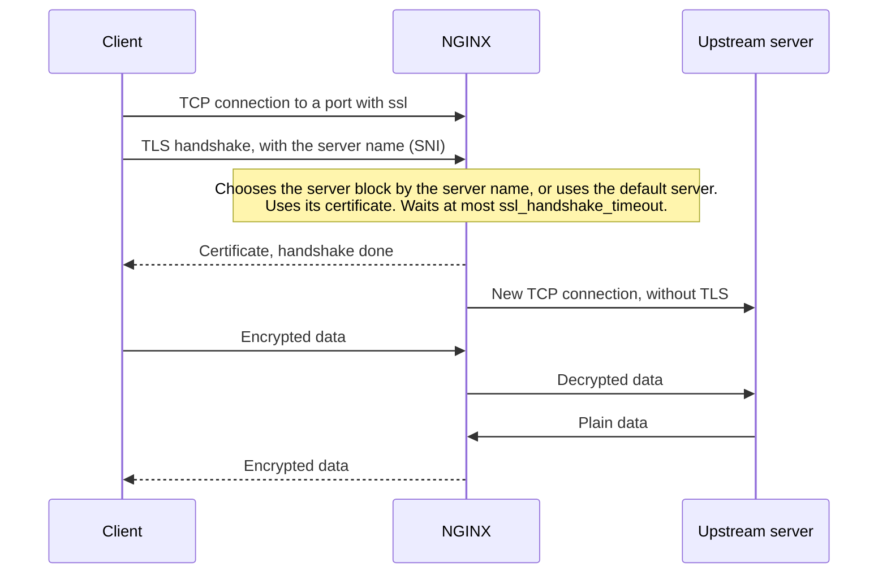

## Overview

With TLS termination, NGINX Open Source or F5 NGINX Plus handles the encryption of client connections, and passes plain TCP to your servers. Your servers then don't spend resources on encryption, and you manage certificates in one place.

Use this guide to accept TLS connections on a TCP port, add certificates, and speed up repeated connections. This guide is for TCP. For HTTPS, see [NGINX SSL Termination]().

---

## Before you begin {#prerequisites}

Before you begin, make sure you have:

- **NGINX with the stream and stream SSL modules**: NGINX Plus [R6]() and later, and the NGINX Open Source packages from nginx.org, include them. NGINX Open Source supports TLS termination for TCP since version 1.9.0. If you build it from source, add `--with-stream` and `--with-stream_ssl_module` to `configure`.
- **A group of TCP servers** in an `upstream` block. See [TCP and UDP Load Balancing]().
- **A certificate and its private key** in PEM format.
- **Permission to edit the configuration and reload NGINX**: On most systems, this means root or `sudo` access.

<span id="obtaining-ssl-certificates"></span>

You can get a certificate from a certificate authority (CA), or create one with a library such as [OpenSSL](https://www.openssl.org/). Clients trust a certificate from a private CA or a self-signed certificate only if you give them the CA's certificate.

TLS termination works only for TCP. The `ssl` parameter of the `listen` directive can't be used together with `udp`.

---

## How TLS termination works for TCP {#what-is-ssl-termination}

NGINX is the TLS endpoint for the client. The client connection stays open while NGINX decrypts the data that the client sends, and encrypts the data that it sends back. For each client connection, NGINX opens a separate, unencrypted TCP connection to a server in the upstream group:



Text description: The client connects to a port with the `ssl` parameter and starts the TLS handshake. NGINX chooses the `server` block by the server name that the client sends, or uses the default server, and sends that server's certificate. If the handshake doesn't finish within `ssl_handshake_timeout`, NGINX closes the connection. After the handshake, NGINX opens a new TCP connection to an upstream server, without TLS. It decrypts the client's data before it passes it on, and encrypts the server's data before it sends it to the client.

To encrypt the connections to the upstream servers too, see [Securing TCP Traffic to Upstream Servers]().

---

## Set up TLS termination {#configuring-nginx-plus}

### Turn on TLS for the port {#enabling-ssl}

Add the `ssl` parameter to the [listen](https://nginx.org/en/docs/stream/ngx_stream_core_module.html#listen) directive of the `server` block in the `stream` context:

```nginx
stream {
    upstream stream_backend {
        server backend1.example.com:12345;
        server backend2.example.com:12345;
    }

    server {
        listen              12345 ssl;
        proxy_pass          stream_backend;

        ssl_certificate     /etc/ssl/certs/server.crt;
        ssl_certificate_key /etc/ssl/certs/server.key;
    }
}
```

With the `ssl` parameter, every connection to this port must start with a TLS handshake. To accept both TLS and plain TCP, use two ports.

### Add the certificate and key {#adding-ssl-certificates}

Set the certificate with the [ssl_certificate](https://nginx.org/en/docs/stream/ngx_stream_ssl_module.html#ssl_certificate) directive, and its private key with [ssl_certificate_key](https://nginx.org/en/docs/stream/ngx_stream_ssl_module.html#ssl_certificate_key), as in the previous example. Both must be in PEM format:

- If the CA gave you intermediate certificates, put them in the certificate file after your server's certificate.
- A relative path is relative to the directory of the main configuration file.
- The worker processes don't need to read the files, because the master process loads them. Make the key file readable only by root.

If you set the directives in the `stream` context, all servers inherit them.

### Choose protocols and ciphers

By default, NGINX 1.27.3 and later accepts TLSv1.2 and TLSv1.3, and uses the ciphers `HIGH:!aNULL:!MD5`. To change them, use the [ssl_protocols](https://nginx.org/en/docs/stream/ngx_stream_ssl_module.html#ssl_protocols) and [ssl_ciphers](https://nginx.org/en/docs/stream/ngx_stream_ssl_module.html#ssl_ciphers) directives. For example, to accept only TLSv1.3:

```nginx
server {
    listen              12345 ssl;
    proxy_pass          stream_backend;

    ssl_certificate     /etc/ssl/certs/server.crt;
    ssl_certificate_key /etc/ssl/certs/server.key;
    ssl_protocols       TLSv1.3;
}
```

The `ssl_ciphers` directive sets the ciphers for TLSv1.2 and older protocols. With OpenSSL, it doesn't change the TLSv1.3 cipher suites. To change those, use the [ssl_conf_command](https://nginx.org/en/docs/stream/ngx_stream_ssl_module.html#ssl_conf_command) directive, for example `ssl_conf_command Ciphersuites TLS_AES_256_GCM_SHA384;`. It needs NGINX 1.19.4 or later and OpenSSL 1.1.0 or later.

### Several TLS servers on one port

In NGINX 1.25.5 and later, several `server` blocks can listen on the same port with different certificates. NGINX chooses the `server` block by the [server_name](https://nginx.org/en/docs/stream/ngx_stream_core_module.html#server_name) directive and the name that the client sends with Server Name Indication (SNI). Each server can pass the connections to a different upstream group. If the client doesn't send a name, or no server has it, NGINX uses the default server of the port:

```nginx
server {
    listen              12345 ssl;
    server_name         db.example.com;
    proxy_pass          db_backend;

    ssl_certificate     /etc/ssl/certs/db.example.com.crt;
    ssl_certificate_key /etc/ssl/certs/db.example.com.key;
}

server {
    listen              12345 ssl;
    server_name         mq.example.com;
    proxy_pass          mq_backend;

    ssl_certificate     /etc/ssl/certs/mq.example.com.crt;
    ssl_certificate_key /etc/ssl/certs/mq.example.com.key;
}
```

In NGINX 1.15.9 and later, you can also load the certificate and key by name with variables. Use a [map](https://nginx.org/en/docs/stream/ngx_stream_map_module.html#map) with a default, so that clients without SNI, or with an unknown name, get a certificate too. Otherwise, NGINX logs `cannot load certificate` and the handshake fails:

```nginx
map $ssl_server_name $cert_name {
    db.example.com db.example.com;
    mq.example.com mq.example.com;
    default        server;
}

server {
    listen              12345 ssl;
    proxy_pass          stream_backend;

    ssl_certificate     /etc/ssl/certs/$cert_name.crt;
    ssl_certificate_key /etc/ssl/certs/$cert_name.key;
}
```

NGINX then loads the files at each handshake, so the worker processes must be able to read them. In NGINX 1.27.4 and later, to keep loaded files in memory, use the [ssl_certificate_cache](https://nginx.org/en/docs/stream/ngx_stream_ssl_module.html#ssl_certificate_cache) directive.

---

## Speed up TLS connections {#speeding-up-secure-tcp-connections}

The TLS handshake uses the most CPU. If a client connects again, it can skip the full handshake by reusing the parameters of an earlier session. NGINX supports two ways:

- **Session tickets**: The client keeps the session parameters, encrypted with a key that only NGINX knows. Tickets are on by default, and most clients use them.
- **Session cache**: NGINX keeps the session parameters. It stores sessions only for clients that don't use tickets, or if you turn tickets off.

In both cases, a session can be reused for the time set by the [ssl_session_timeout](https://nginx.org/en/docs/stream/ngx_stream_ssl_module.html#ssl_session_timeout) directive, 5 minutes by default.

### Session cache {#optimizing-the-ssl-session-cache}

Set the session cache with the [ssl_session_cache](https://nginx.org/en/docs/stream/ngx_stream_ssl_module.html#ssl_session_cache) directive. The default is `none`, so NGINX doesn't keep any sessions. Set a cache in shared memory even if your clients use tickets: in NGINX 1.23.2 and later, NGINX also keeps the ticket keys in it. See [Session tickets](#session-tickets).

All worker processes share a cache in shared memory. One megabyte holds about 4,000 sessions. The `builtin` cache of the SSL library works only in one worker process, and can fragment memory.

A longer session timeout needs a bigger cache for clients without tickets. For example, this configuration keeps sessions and tickets valid for 4 hours, with a 20 MB cache named `SSL`:

```nginx
server {
    listen              12345 ssl;
    proxy_pass          stream_backend;

    ssl_certificate     /etc/ssl/certs/server.crt;
    ssl_certificate_key /etc/ssl/certs/server.key;

    ssl_session_cache   shared:SSL:20m;
    ssl_session_timeout 4h;
}
```

When the cache is full, NGINX removes the oldest session to make room for a new one.

### Session tickets {#session-tickets}

With session tickets, the client keeps the session parameters, encrypted with a key that only NGINX knows. Session tickets are on by default. To turn them off, use `ssl_session_tickets off;` from the [ssl_session_tickets](https://nginx.org/en/docs/stream/ngx_stream_ssl_module.html#ssl_session_tickets) directive.

By default, each NGINX instance creates its own ticket key at startup. A reload or restart creates a new key, so tickets issued before don't work afterward. In NGINX 1.23.2 and later, if you also set a shared session cache, NGINX keeps the key in the cache across reloads, and changes it regularly.

If several NGINX instances serve the same clients, for example behind a network load balancer, a ticket from one instance works on another only if both use the same key:

1. Create two key files with 80 bytes of random data each, and copy them to every instance. NGINX doesn't start if a key file is missing:

    ```shell
    sudo mkdir -p /etc/ssl/session_ticket_keys
    sudo openssl rand -out /etc/ssl/session_ticket_keys/current.key 80
    sudo openssl rand -out /etc/ssl/session_ticket_keys/previous.key 80
    sudo chmod 600 /etc/ssl/session_ticket_keys/*.key
    ```

2. Set the key with the [ssl_session_ticket_key](https://nginx.org/en/docs/stream/ngx_stream_ssl_module.html#ssl_session_ticket_key) directive:

    ```nginx
    server {
        listen                 12345 ssl;
        proxy_pass             stream_backend;

        ssl_certificate        /etc/ssl/certs/server.crt;
        ssl_certificate_key    /etc/ssl/certs/server.key;

        ssl_session_ticket_key /etc/ssl/session_ticket_keys/current.key;
        ssl_session_ticket_key /etc/ssl/session_ticket_keys/previous.key;
    }
    ```

    NGINX encrypts new tickets with the first key, and accepts tickets encrypted with any of the keys. To change the key, rename `current.key` to `previous.key`, create a new `current.key`, and reload NGINX on every instance. With keys from files, NGINX doesn't change them on its own.

### Handshake timeout

NGINX closes a connection if the client doesn't finish the TLS handshake within 60 seconds. To change this, use the [ssl_handshake_timeout](https://nginx.org/en/docs/stream/ngx_stream_ssl_module.html#ssl_handshake_timeout) directive. A shorter timeout frees resources from idle or slow clients sooner. A timeout that's too short makes clients on slow networks fail.

---

## Example {#complete-example}

This configuration accepts TLS connections on port 12345, and passes the data unencrypted to three servers. Replace `backend1.example.com` and the other names with the addresses of your servers. NGINX resolves the names when it starts, and fails if it can't:

```nginx
stream {
    upstream stream_backend {
        server backend1.example.com:12345;
        server backend2.example.com:12345;
        server backend3.example.com:12345;
    }

    log_format tls '$remote_addr [$time_local] $status '
                   '$ssl_protocol $ssl_cipher $ssl_session_reused '
                   '$bytes_sent $bytes_received "$upstream_addr"';

    server {
        listen                12345 ssl;
        proxy_pass            stream_backend;
        access_log            /var/log/nginx/tls-stream.log tls;

        ssl_certificate       /etc/ssl/certs/server.crt;
        ssl_certificate_key   /etc/ssl/certs/server.key;
        ssl_protocols         TLSv1.2 TLSv1.3;
        ssl_session_cache     shared:SSL:20m;
        ssl_session_timeout   4h;
        ssl_handshake_timeout 30s;
    }
}
```

In this example:

- The `ssl` parameter makes NGINX expect a TLS handshake on port 12345. NGINX uses the certificate and key from `ssl_certificate` and `ssl_certificate_key`, and accepts TLSv1.2 and TLSv1.3.
- Clients can reuse their sessions for 4 hours. The 20 MB cache is shared by all worker processes. It keeps the session ticket keys, and the sessions of clients without tickets.
- A client that doesn't finish the handshake within 30 seconds is disconnected.
- The access log records the protocol, the cipher, and whether the client reused a session (`r`) or not (`.`).
- NGINX passes the decrypted data to the servers in the `stream_backend` group.

The `stream` block is at the top level of **nginx.conf**, next to the `http` block, not inside it.

---

## Verify the configuration

1. Test and reload the configuration:

    ```shell
    sudo nginx -t && sudo nginx -s reload
    ```

2. Connect with the OpenSSL client, and save the session:

    ```shell
    sleep 1 | openssl s_client -connect localhost:12345 -servername localhost -sess_out /tmp/tls-session 2>&1 | grep -E '^subject=|^New,|^Reused,|^Verify return code'
    ```

    `sleep 1` keeps the connection open for one second. With TLSv1.3, NGINX sends the session ticket after the handshake, so the client needs this time to receive it. The output shows your certificate's subject, and the negotiated TLS version and cipher. The exact format of the subject line depends on the OpenSSL version. For a certificate from a private CA, add `-CAfile ca.crt` with that CA's certificate to get the verify code `0 (ok)`.

    ```none
    subject=CN = www.example.com
    New, TLSv1.3, Cipher is TLS_AES_256_GCM_SHA384
    Verify return code: 0 (ok)
    ```

    To see the data that your servers send, run the command without `2>&1 | grep ...`.

3. Connect again with the saved session:

    ```shell
    sleep 1 | openssl s_client -connect localhost:12345 -servername localhost -sess_in /tmp/tls-session 2>&1 | grep -E '^New,|^Reused,'
    ```

    The output starts with `Reused`, for example `Reused, TLSv1.3, Cipher is TLS_AES_256_GCM_SHA384`.

4. Check the access log:

    ```shell
    sudo tail -2 /var/log/nginx/tls-stream.log
    ```

    The second connection has `r` for a reused session. The byte counts depend on what your servers send:

    ```none
    127.0.0.1 [17/Nov/2026:10:15:01 +0000] 200 TLSv1.3 TLS_AES_256_GCM_SHA384 . 17 0 "192.0.2.11:12345"
    127.0.0.1 [17/Nov/2026:10:15:02 +0000] 200 TLSv1.3 TLS_AES_256_GCM_SHA384 r 17 0 "192.0.2.12:12345"
    ```

---

## Troubleshooting

### NGINX doesn't start: "no ssl_certificate is defined"

**Symptom**: `nginx -t` fails with `no "ssl_certificate" is defined for the "listen ... ssl" directive`, or with `no "ssl_certificate_key" is defined for certificate`.

**Cause**: The default server of a port with the `ssl` parameter has no certificate, and doesn't inherit one from the `stream` context. Or a certificate has no matching `ssl_certificate_key` directive.

**Fix**: Add `ssl_certificate` and `ssl_certificate_key` to the server, or to the `stream` context. Give each `ssl_certificate` its own `ssl_certificate_key`.

NGINX checks this only for the default server of each port. If another server on the port has no certificate, NGINX starts, and that server's clients get the default server's certificate.

### NGINX doesn't start: "invalid number of arguments"

**Symptom**: `nginx -t` fails with `invalid number of arguments in "ssl_session_cache" directive`.

**Cause**: The `ssl_session_cache` directive has no parameter.

**Fix**: Give the cache type, for example `ssl_session_cache shared:SSL:20m;`.

### NGINX doesn't start: "cannot load certificate"

**Symptom**: `nginx -t` fails with `cannot load certificate` or `cannot load certificate key`.

**Cause**: The path is wrong, the process can't read the file, or the file isn't a PEM certificate or key.

**Fix**: Use an absolute path, check the file's permissions, and run `nginx -t` with `sudo`. To find other certificate problems, see the troubleshooting section of [NGINX SSL Termination]().

### Clients are disconnected, or report "wrong version number"

**Symptom**: One of these:

- A client without TLS is disconnected without getting any data. With `error_log ... info;`, the error log shows `SSL_do_handshake() failed` with `wrong version number`, or with `http request` for an HTTP client.
- A TLS client waits for the handshake until it times out, or reports `wrong version number` if the server sends data first.

**Cause**: Only one side uses TLS. Either the client sends plain TCP to a port with `ssl`, or the client uses TLS but the port has no `ssl` parameter.

**Fix**: Configure the client to use TLS, or add the `ssl` parameter to the `listen` directive.

### The access log shows status 500 and "(NONE)"

**Symptom**: The access log has lines such as `500 TLSv1.3 (NONE) . 0 0 "-"`.

**Cause**: The TLS handshake failed or timed out, so NGINX didn't connect to an upstream server. A handshake timeout isn't logged in the error log. Other handshake errors are logged at the `info` level.

**Fix**: To see the reason, set `error_log ... info;`. Check that the clients use TLS, support the protocols and ciphers that you set, and finish the handshake within `ssl_handshake_timeout`.

### Sessions aren't reused

**Symptom**: The access log shows `.` for `$ssl_session_reused` on every connection, or `openssl s_client -sess_in` reports `New` instead of `Reused`.

**Cause**: The client doesn't support session reuse, session tickets are off and there's no session cache, or the session expired. A reload without a shared session cache also invalidates the tickets, because NGINX creates new ticket keys.

**Fix**: Set a shared session cache with `ssl_session_cache`, and check `ssl_session_timeout`.

---

## References

For more information, see:

- [NGINX SSL Termination]()
- [Securing TCP Traffic to Upstream Servers]()
- [TCP and UDP Load Balancing]()
- [ngx_stream_ssl_module reference](https://nginx.org/en/docs/stream/ngx_stream_ssl_module.html) on nginx.org
