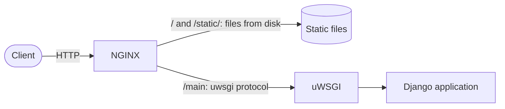

<span id="intro"></span><span id="introduction"></span>

## Overview

NGINX can pass requests to application servers over HTTP, or over interfaces made for applications: [FastCGI](https://nginx.org/en/docs/http/ngx_http_fastcgi_module.html), [SCGI](https://nginx.org/en/docs/http/ngx_http_scgi_module.html), and [uwsgi](https://nginx.org/en/docs/http/ngx_http_uwsgi_module.html). In front of an application, NGINX handles the HTTP connections, [load balancing](), [TLS termination](), [access control](), [static content](), and [caching](). The application can focus on its own logic.

In this guide, NGINX serves the static files of a Django project from disk, and passes application requests to uWSGI:



NGINX answers requests for `/` and `/static/` with files from disk. It passes requests for `/main` to uWSGI over the uwsgi protocol, and uWSGI runs them in the Django application.

<span id="about-uwsgi-django"></span>

### About uWSGI and Django

The Web Server Gateway Interface ([WSGI](https://wsgi.readthedocs.io/en/latest/)) is the standard interface between web servers and Python applications. [uWSGI](https://github.com/unbit/uwsgi) is an application server that runs WSGI applications. It speaks HTTP, FastCGI, and SCGI, but its own binary [uwsgi protocol](https://uwsgi-docs.readthedocs.io/en/latest/Protocol.html) is the fastest way for NGINX to reach it. [Django](https://www.djangoproject.com/) is a common Python web framework, and this guide uses a Django project as the example application.

NGINX supports the uwsgi protocol since version 0.8.40, and NGINX Plus supports it in all releases. The NGINX packages from nginx.org include the uwsgi module, so you don't need to change the build.

---

## Before you begin

Before you begin, make sure you have:

- **NGINX Open Source or NGINX Plus**, installed on the same host as uWSGI, or on a host that can reach it.
- **A Django project**, for example in **/var/django/projects/myapp**. Its `ALLOWED_HOSTS` setting must include the domain name of the site, `myapp.example.com` in this guide. For details, see the [Django settings reference](https://docs.djangoproject.com/en/stable/ref/settings/#allowed-hosts).
- **uWSGI with Python support**. A uWSGI installed with `pip` includes Python. Linux distribution packages, for example on Alpine Linux, load Python as a plugin. Install the Python 3 plugin package, and add `--plugin=python3` to the `uwsgi` command.

For more about setting up uWSGI, see the [Quickstart for Python/WSGI applications](https://uwsgi-docs.readthedocs.io/en/latest/WSGIquickstart.html). For more about Django, see the [Django documentation](https://docs.djangoproject.com/en/stable/).

---

<span id="configure"></span><span id="configure-nginx-and-nginx-plus-for-use-with-uwsgi-and-django"></span>

## Start the uWSGI server

Start uWSGI with the Django project. This is one way to do it:

```shell
uwsgi \
    --chdir=/var/django/projects/myapp \
    --module=myapp.wsgi:application \
    --env DJANGO_SETTINGS_MODULE=myapp.settings \
    --master --pidfile=/usr/local/var/run/uwsgi/project-master.pid \
    --socket=127.0.0.1:29000 \
    --processes=5 \
    --uid=505 --gid=505 \
    --harakiri=20 \
    --max-requests=5000 \
    --vacuum \
    --daemonize=/usr/local/var/log/uwsgi/myapp.log
```

The options do these things:

- `--chdir` and `--module`: Load the WSGI application of the Django project.
- `--socket=127.0.0.1:29000`: Accept requests over the uwsgi protocol on port 29000 of the local host. NGINX connects to this port.
- `--master` and `--processes=5`: Run a master process with five worker processes.
- `--uid` and `--gid`: Switch uWSGI to user and group 505 after it starts, so it doesn't run as `root`.
- `--harakiri=20`: Restart a worker process that takes more than 20 seconds for one request.
- `--max-requests=5000`: Restart a worker process after 5000 requests.
- `--vacuum`: Remove the files that uWSGI created, such as UNIX sockets, when it exits.
- `--pidfile` and `--daemonize`: Write the process ID of the master process to a file. Run in the background, and log to a file. The directories of both files must exist.

Check the log file. It has a line such as `uwsgi socket 0 bound to TCP address 127.0.0.1:29000`, and a line for each worker process that uWSGI started.

---

## Configure NGINX

1. Add this configuration to the `http` block:

    ```nginx
    upstream django {
        server 127.0.0.1:29000;
    }

    server {
        listen      80;
        server_name myapp.example.com;
        root        /var/www/myapp/html;

        location / {
            index index.html;
        }

        location /static/ {
            alias /var/django/projects/myapp/static/;
        }

        location /main {
            include     /etc/nginx/uwsgi_params;
            uwsgi_pass  django;
            uwsgi_param HTTP_X_FORWARDED_FOR   $proxy_add_x_forwarded_for;
            uwsgi_param HTTP_X_FORWARDED_PROTO $scheme;
        }
    }
    ```

    - The [`upstream`](https://nginx.org/en/docs/http/ngx_http_upstream_module.html#upstream) block named `django` has the address that uWSGI listens on, the `--socket` option of the `uwsgi` command.
    - The [`alias`](https://nginx.org/en/docs/http/ngx_http_core_module.html#alias) directive serves the static files of the project from disk. In the Django settings, set `STATIC_ROOT` to the same directory, and run `python manage.py collectstatic` to copy the static files there.
    - The `/main` location passes requests to uWSGI with the [`uwsgi_pass`](https://nginx.org/en/docs/http/ngx_http_uwsgi_module.html#uwsgi_pass) directive. Django gets the rest of the URI too, for example `/main/orders`, so its URL patterns must start with `main/`.

1. Test the configuration, and reload NGINX:

    ```shell
    sudo nginx -t && sudo nginx -s reload
    ```

### What Django receives

NGINX sends the request to uWSGI as a list of parameters, which Django reads as the `request.META` dictionary:

- The **uwsgi_params** file of the NGINX packages sets the standard parameters, such as `REQUEST_METHOD`, `PATH_INFO`, `REMOTE_ADDR`, and `SERVER_NAME`. Include it in each location that passes requests to uWSGI.
- NGINX also passes each request header as a parameter whose name starts with `HTTP_`. For example, the `Host` header becomes `HTTP_HOST`.
- A [`uwsgi_param`](https://nginx.org/en/docs/http/ngx_http_uwsgi_module.html#uwsgi_param) directive with the name of such a parameter replaces the header of the client. Other names reach Django as they are. For example, `uwsgi_param X-Real-IP $remote_addr` creates an `X-Real-IP` key in `request.META`. Code that reads the header looks for `HTTP_X_REAL_IP`, so it doesn't find the value.

The example sets two parameters this way:

- `HTTP_X_FORWARDED_FOR` adds the address of the client to the `X-Forwarded-For` header that the client sent, if any.
- `HTTP_X_FORWARDED_PROTO` tells uWSGI the real scheme of the request. uWSGI takes the URL scheme from the `X-Forwarded-Proto` header. Without this parameter, a client can send `X-Forwarded-Proto: https` over plain HTTP, and Django then treats the request as secure: `request.is_secure()` returns `True`.

---

## Verify the setup

1. Request a page of the application through NGINX:

    ```shell
    curl -I http://myapp.example.com/main/
    ```

    The response comes from Django. It has headers that the default middleware of Django adds, such as `X-Frame-Options: DENY` and `X-Content-Type-Options: nosniff`.

1. Request a static file, for example a file of the Django admin site, which `collectstatic` copies:

    ```shell
    curl -I http://myapp.example.com/static/admin/css/base.css
    ```

    NGINX serves the file itself, so the response has status `200` and `Content-Type: text/css`, but not the Django headers.

---

## Troubleshooting

### NGINX returns 502 Bad Gateway, and the error log reports Connection refused

**Symptom**: Requests to `/main` return `502 Bad Gateway`. The NGINX error log has a line such as `connect() failed (111: Connection refused) while connecting to upstream, ... upstream: "uwsgi://127.0.0.1:29000"`.

**Cause**: uWSGI isn't running, or it listens on another address or port.

**Fix**: Start uWSGI, and check that the `--socket` option of the `uwsgi` command matches the `server` in the `upstream` block.

---

### NGINX returns 502 Bad Gateway for requests with large headers

**Symptom**: Requests with large headers, such as long cookies, return `502 Bad Gateway`. The NGINX error log reports `recv() failed (104: Connection reset by peer) while reading response header from upstream`, and the uWSGI log reports `invalid request block size: 5462 (max 4096)...skip`.

**Cause**: The request is larger than the buffer of uWSGI for the request parameters, which is 4096 bytes by default.

**Fix**: Add a larger buffer to the `uwsgi` command, for example `--buffer-size=32768`.

---

### Django returns 400 Bad Request

**Symptom**: Requests to `/main` return `400 Bad Request`. With `DEBUG = True` in the Django settings, the uWSGI log also has a line such as `Invalid HTTP_HOST header: 'other.example.com'. You may need to add 'other.example.com' to ALLOWED_HOSTS.`

**Cause**: The domain name of the request isn't in the `ALLOWED_HOSTS` setting of Django.

**Fix**: Add the domain name to `ALLOWED_HOSTS`, and restart uWSGI.

---

<span id="conclusion"></span><span id="resources"></span>

## References

For more information, see:

- [Module ngx_http_uwsgi_module](https://nginx.org/en/docs/http/ngx_http_uwsgi_module.html)
- [NGINX support](https://uwsgi-docs.readthedocs.io/en/latest/Nginx.html) in the uWSGI documentation
- [How to use Django with uWSGI](https://docs.djangoproject.com/en/stable/howto/deployment/wsgi/uwsgi/) in the Django documentation
