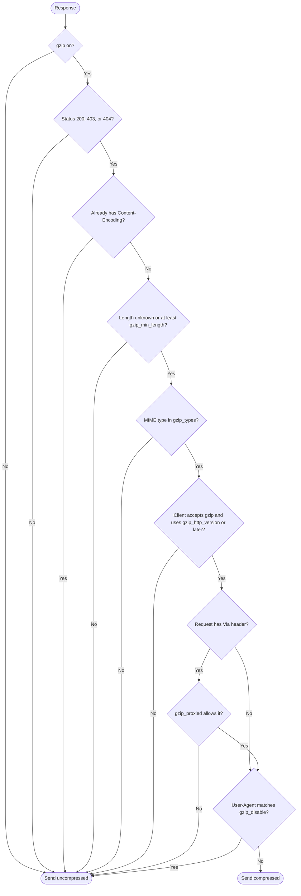

## Introduction

Compressing responses often makes the transmitted data much smaller. Compression happens at runtime, though, and uses CPU, which can affect performance. NGINX compresses responses before it sends them to clients. It doesn't compress responses that are already compressed, for example by a proxied server.

---

## Before you begin

Before you begin, make sure you have:

- **NGINX Open Source or NGINX Plus installed and running**.
- **For decompression and precompressed files in NGINX Open Source**: the `gunzip` and `gzip_static` modules. NGINX Plus and the packages from nginx.org include them. If you build NGINX Open Source from source, add `--with-http_gunzip_module` and `--with-http_gzip_static_module` to `configure`.
- **Permission to edit the configuration and reload NGINX**: On most systems, this means root or `sudo` access.

---

## How NGINX decides to compress a response

With `gzip on`, NGINX compresses a response only if all of these are true:

- The response has the status `200`, `403`, or `404`.
- The response isn't compressed already: it has no `Content-Encoding` header.
- The response length is at least `gzip_min_length`, or unknown.
- The response MIME type is listed in `gzip_types`. The default is `text/html`.
- The client accepts gzip, in the `Accept-Encoding` header, and uses at least the HTTP version set by `gzip_http_version`, by default HTTP/1.1.
- If the request has a `Via` header, so it comes through a proxy, `gzip_proxied` allows it.
- The client's `User-Agent` doesn't match [gzip_disable](https://nginx.org/en/docs/http/ngx_http_gzip_module.html#gzip_disable).

NGINX never compresses the responses to subrequests.



Text description: NGINX compresses a response only if `gzip` is on, the status is `200`, `403`, or `404`, the response isn't compressed already, its length is unknown or at least `gzip_min_length`, its type is in `gzip_types`, and the client accepts gzip with a recent enough HTTP version. For requests with a `Via` header, `gzip_proxied` must also allow it, and the `User-Agent` must not match `gzip_disable`. Otherwise, NGINX sends the response uncompressed.

---

## Enabling compression

1. Turn on compression with the [gzip](https://nginx.org/en/docs/http/ngx_http_gzip_module.html#gzip) directive, in the `http`, `server`, or `location` context:

    ```nginx
    gzip on;
    ```

2. By default, NGINX compresses only responses with the MIME type `text/html`. To compress other types, list them with the [gzip_types](https://nginx.org/en/docs/http/ngx_http_gzip_module.html#gzip_types) directive. `text/html` is always included, so don't list it. The **mime.types** file that comes with NGINX gives `.xml` files the type `text/xml`:

    ```nginx
    gzip_types text/plain text/css text/xml application/json application/javascript application/xml;
    ```

3. Optionally, set the minimum length of a response to compress with the [gzip_min_length](https://nginx.org/en/docs/http/ngx_http_gzip_module.html#gzip_min_length) directive. NGINX takes the length from the `Content-Length` header. The default is 20 bytes; this example sets it to 1000:

    ```nginx
    gzip_min_length 1000;
    ```

4. Optionally, compress responses to requests that come through a proxy. By default (`gzip_proxied off`), NGINX doesn't compress them. It recognizes them by the `Via` header. With `any`, NGINX compresses all of them. Otherwise, the parameters of the [gzip_proxied](https://nginx.org/en/docs/http/ngx_http_gzip_module.html#gzip_proxied) directive work like this:

    - `auth` – NGINX compresses the response if the request has an `Authorization` header.
    - If the response has an `Expires` header, NGINX compresses it only with `expired` and an `Expires` time in the past.
    - Otherwise, if the response has a `Cache-Control` header, NGINX compresses it only if the header contains a listed value: `no-cache`, `no-store`, or `private`.
    - A response with neither header is compressed, unless `no_last_modified` or `no_etag` is listed and the response has a `Last-Modified` or `ETag` header.

    This example compresses mostly responses that a proxy can't cache:

    ```nginx
    gzip_proxied no-cache no-store private expired auth;
    ```

5. Optionally, add the `Vary: Accept-Encoding` header with [gzip_vary](https://nginx.org/en/docs/http/ngx_http_gzip_module.html#gzip_vary), so that caches between NGINX and the clients store the compressed and uncompressed versions separately. It's `off` by default.

You can use these directives in the `http`, `server`, and `location` contexts. A complete configuration can look like this:

```nginx
server {
    listen 80;

    gzip            on;
    gzip_types      text/plain application/xml;
    gzip_proxied    no-cache no-store private expired auth;
    gzip_min_length 1000;
}
```

## Enabling decompression

Some clients don't support gzip. Still, you might want to store compressed data, or compress responses and cache them. To serve both clients that accept compressed data and clients that don't, NGINX can decompress responses for the clients that don't.

To turn on decompression, use the [gunzip](https://nginx.org/en/docs/http/ngx_http_gunzip_module.html#gunzip) directive. NGINX then decompresses responses with `Content-Encoding: gzip` for requests that fail the client checks in [How NGINX decides to compress a response](#how-nginx-decides-to-compress-a-response): a client that doesn't accept gzip, an older HTTP version than `gzip_http_version`, or a `Via` header that `gzip_proxied` doesn't allow.

Responses get `Content-Encoding: gzip` from a proxied server, or from `gzip_static always`. Files that are stored compressed on disk and served normally don't have this header, so `gunzip` doesn't decompress them. To serve stored `.gz` files to all clients, combine `gzip_static always` with `gunzip`:

```nginx
location /storage/ {
    gzip_static always;
    gunzip      on;
}
```

You can use `gunzip` in the same contexts as `gzip`:

```nginx
server {
    listen 80;

    gzip            on;
    gzip_min_length 1000;
    gunzip          on;
}
```

The `gunzip` directive belongs to the [gunzip module](https://nginx.org/en/docs/http/ngx_http_gunzip_module.html), which isn't built by default in NGINX Open Source.

## Sending compressed files

To send a file that was compressed in advance instead of the regular file, set the [gzip_static](https://nginx.org/en/docs/http/ngx_http_gzip_static_module.html#gzip_static) directive to `on`:

```nginx
location / {
    gzip_static on;
}
```

For a request for **/path/to/file**, NGINX then looks for **/path/to/file.gz** and sends it if the request passes the client checks in [How NGINX decides to compress a response](#how-nginx-decides-to-compress-a-response). If the `.gz` file doesn't exist, or the request fails these checks, NGINX sends the regular file. With `gzip_static always`, NGINX sends the `.gz` file to all clients; combine it with `gunzip on` for clients that don't accept gzip. The `gzip`, `gzip_types`, and `gzip_min_length` settings don't affect `gzip_static`.

The `gzip_static` directive doesn't compress anything. It sends files that a tool such as `gzip` compressed beforehand. Keep the original files too, because clients without gzip support need them. For example, `gzip -k` keeps the original:

```shell
gzip -9 -k /usr/share/nginx/html/static/app.js
```

To compress responses at runtime, use the `gzip` directive.

The `gzip_static` directive belongs to the [gzip_static module](https://nginx.org/en/docs/http/ngx_http_gzip_static_module.html), which isn't built by default in NGINX Open Source.

---

## Example

This complete configuration compresses text responses of a website, and sends files compressed in advance where they exist. It's a whole **nginx.conf**, so back up your existing file first. To add only the website to a configuration that reads files from `conf.d`, put the `server` block in a file there.

```nginx
events {}

http {
    include       mime.types;
    default_type  application/octet-stream;

    server {
        listen      80;
        server_name www.example.com;
        root        /usr/share/nginx/html;

        gzip            on;
        gzip_types      text/plain text/css application/javascript application/json;
        gzip_min_length 1000;
        gzip_vary       on;

        location /static/ {
            gzip_static on;
        }
    }
}
```

---

## Verify the configuration

1. Test and reload the configuration:

    ```shell
    sudo nginx -t && sudo nginx -s reload
    ```

2. Create an HTML file larger than `gzip_min_length`. The default **index.html** of NGINX is smaller than 1000 bytes, so use another file:

    ```shell
    python3 -c "print('<p>hello</p>' * 200)" | sudo tee /usr/share/nginx/html/big.html >/dev/null
    ```

3. Request the file with and without gzip support, and compare the headers:

    ```shell
    curl -s -o /dev/null -D - -H 'Host: www.example.com' -H 'Accept-Encoding: gzip' http://127.0.0.1/big.html | grep -iE 'content-encoding|vary'
    curl -s -o /dev/null -D - -H 'Host: www.example.com' http://127.0.0.1/big.html | grep -iE 'content-encoding|vary'
    ```

    The first response has `Content-Encoding: gzip` and `Vary: Accept-Encoding`. The second has only `Vary: Accept-Encoding`: NGINX adds the `Vary` header to every response that could be compressed, so that caches keep both versions apart.

---

## Troubleshooting

### Responses aren't compressed

**Symptom**: Responses have no `Content-Encoding: gzip` header, even for clients that accept gzip.

**Cause**: One of the conditions in [How NGINX decides to compress a response](#how-nginx-decides-to-compress-a-response) isn't met. Common causes are a MIME type that isn't in `gzip_types`, a response smaller than `gzip_min_length`, a request with a `Via` header from a proxy or CDN, or an HTTP/1.0 request.

**Fix**: Check the `Content-Type` and `Content-Length` of the response, and the `Via` header of the request. Add the type to `gzip_types`, or set `gzip_proxied` or `gzip_http_version` as needed.

### NGINX doesn't compress proxied responses

**Symptom**: Changes to `gzip_comp_level` or `gzip_types` have no effect on proxied responses, which arrive compressed by the proxied server, or not at all.

**Cause**: NGINX passes the client's `Accept-Encoding` header to the proxied server. If the server compresses the response, NGINX doesn't compress it again, because it already has a `Content-Encoding` header.

**Fix**: To let NGINX do the compression instead, add `proxy_set_header Accept-Encoding "";` so that the proxied server sends uncompressed responses.

---

## References

For more information, see:

- [Serve Static Content]()
- [ngx_http_gzip_module reference](https://nginx.org/en/docs/http/ngx_http_gzip_module.html) on nginx.org
- [ngx_http_gunzip_module reference](https://nginx.org/en/docs/http/ngx_http_gunzip_module.html) on nginx.org
- [ngx_http_gzip_static_module reference](https://nginx.org/en/docs/http/ngx_http_gzip_static_module.html) on nginx.org
