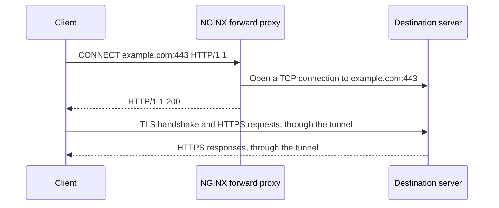

## Overview

A forward proxy sits between internal clients and external networks. It gives you one place to control the outgoing traffic of the clients. A reverse proxy works on the other side: it protects servers and services.

The forward proxy of NGINX handles the HTTP `CONNECT` method. A client asks the proxy to open a TCP connection to a host and port. The proxy then passes the bytes in both directions, without reading them:



The client sends a `CONNECT` request with the destination host and port. NGINX connects to the destination, and answers `200`. From then on, the client talks to the destination through the tunnel, for example with TLS. The tunnel can carry other TCP protocols too, such as SSH.

---

## Before you begin

Before you begin, make sure you have:

- **NGINX Plus R36 or later, or NGINX Open Source 1.31.0 or later**. Both include the [tunnel module](https://nginx.org/en/docs/http/ngx_http_tunnel_module.html) by default. The [`tunnel_allow_upstream`](https://nginx.org/en/docs/http/ngx_http_tunnel_module.html#tunnel_allow_upstream) directive and the [`num_map`](https://nginx.org/en/docs/http/ngx_http_num_map_module.html) module need NGINX Plus. NGINX Open Source can use [`if` blocks](#restrict-access-with-nginx-open-source) for access control instead.
- **For basic authentication**: NGINX Plus PLS.37.0.0.1 LTS or later, or NGINX Open Source 1.31.0 or later.
- **A DNS server** that the proxy can use to resolve the destination hosts.

---

<span id="enable-http-connect-proxy"></span>

## Turn on the forward proxy

Add the [`tunnel_pass`](https://nginx.org/en/docs/http/ngx_http_tunnel_module.html#tunnel_pass) directive to a `server` or `location` block, and a [`resolver`](https://nginx.org/en/docs/http/ngx_http_core_module.html#resolver) for the destination hosts:

```nginx
server {
    listen 10.10.1.11:3128;

    resolver 10.10.1.53;
    tunnel_pass;
}
```

- Port 3128 is a common port for forward proxies.
- Without parameters, `tunnel_pass` connects to the host and port of the request, the [`$host`](https://nginx.org/en/docs/http/ngx_http_core_module.html#var_host) and [`$request_port`](https://nginx.org/en/docs/http/ngx_http_core_module.html#var_request_port) variables.
- NGINX resolves the destination hosts when the requests arrive, so it needs the `resolver` directive. Replace `10.10.1.53` with the address of your DNS server. Without a `resolver`, every request to a host name fails with `502 Bad Gateway`.

`tunnel_pass` is a content handler, like `proxy_pass`. A `location` block doesn't inherit it from its `server` block, so add `tunnel_pass` to each `location` that handles `CONNECT` requests.

<span id="disable-other-http-methods"></span>

### Reject other HTTP methods

The forward proxy handles only `CONNECT` requests over HTTP/1.1. `tunnel_pass` rejects all other methods, such as `GET` and `POST`, with `405 Not Allowed`. A server without `tunnel_pass` rejects `CONNECT` requests the same way.

To return another status code or a message, add an [`if`](https://nginx.org/en/docs/http/ngx_http_rewrite_module.html#if) block. `CONNECT` requests match `location /`:

```nginx
server {
    listen 10.10.1.11:3128;

    resolver 10.10.1.53;

    location / {
        if ($request_method != CONNECT) {
            return 403 "Forbidden: allows only CONNECT method";
        }

        tunnel_pass;
    }
}
```

---

<span id="enable-logging"></span>

## Log the tunnels

To log the tunnels, add a [`log_format`](https://nginx.org/en/docs/http/ngx_http_log_module.html#log_format) in the `http` block, and the [`access_log`](https://nginx.org/en/docs/http/ngx_http_log_module.html#access_log) and [`error_log`](https://nginx.org/en/docs/ngx_core_module.html#error_log) directives where `tunnel_pass` is:

```nginx
log_format http_connect '$remote_addr [$time_local] '
                        '$request_method $host:$request_port $status '
                        '$upstream_addr $bytes_sent $upstream_connect_time '
                        '$request_time "$http_user_agent"';

server {
    listen 10.10.1.11:3128;

    resolver 10.10.1.53;

    location / {
        if ($request_method != CONNECT) {
            return 403 "Forbidden: allows only CONNECT method";
        }

        tunnel_pass;

        access_log /var/log/nginx/connect_access.log http_connect;
        error_log  /var/log/nginx/connect_error.log;
    }
}
```

For all the variables that you can log, see the [NGINX variables index](https://nginx.org/en/docs/varindex.html).

---

<span id="test-the-configuration"></span>

## Test the proxy

1. Test the configuration, and reload NGINX:

    ```shell
    sudo nginx -t && sudo nginx -s reload
    ```

1. Send a request through the proxy with `curl`:

    ```shell
    curl -v -x 10.10.1.11:3128 https://example.com
    ```

    In the output, the response of the proxy to the `CONNECT` request is `HTTP/1.1 200 OK`. Then the response of example.com follows.

1. Check the access log:

    ```shell
    tail -n 100 /var/log/nginx/connect_access.log
    ```

    The log has a line such as:

    ```none
    10.10.1.240 [01/Dec/2025:10:46:27 +0000] CONNECT example.com:443 200 203.0.113.10:443 4275 0.014 0.258 "curl/8.7.1"
    ```

    The client `10.10.1.240` opened a tunnel (`200`) to `example.com:443`, which resolved to `203.0.113.10:443`.

---

<span id="access-control"></span>

## Control access

Restrict access to the proxy. You can allow tunnels by:

- **Port**, with the [`num_map`](https://nginx.org/en/docs/http/ngx_http_num_map_module.html) module of NGINX Plus.
- **Client address**, with the [`geo`](https://nginx.org/en/docs/http/ngx_http_geo_module.html) module, or the [`allow` and `deny`](https://nginx.org/en/docs/http/ngx_http_access_module.html#allow) directives.
- **Host name**, with the [`map`](https://nginx.org/en/docs/http/ngx_http_map_module.html) module.

The [`tunnel_allow_upstream`](https://nginx.org/en/docs/http/ngx_http_tunnel_module.html#tunnel_allow_upstream) directive of NGINX Plus combines these checks. It allows a tunnel only if all its parameters are non-empty and not `0`. So each variable should be `1` for allowed values, and `0` otherwise.

<span id="restrict-by-ports-and-port-ranges"></span>

### Restrict by port

The `num_map` module of NGINX Plus works like `map`, but it matches numbers and number ranges. In this example, `$allowed_port` is `1` for port 443 and the ports 8080 to 8090, and `0` for the other ports:

```nginx
num_map $request_port $allowed_port {
    default   0;
    443       1;
    8080-8090 1;
}
```

`num_map` also accepts comparisons, such as `<=1023`.

<span id="restrict-by-ip-addresses"></span>

### Restrict by client address

The `geo` module sets a variable from the address of the client. In this example, `$allowed_network` is `1` for two internal networks:

```nginx
geo $allowed_network {
    default       0;
    10.10.1.0/24  1;
    10.20.11.0/24 1;
}
```

<span id="restrict-by-hostnames"></span>

### Restrict by host name

The `map` module sets a variable from the destination host. In this example, `$allowed_host` is `1` for `example.com` and its subdomains. The `hostnames` parameter allows names with wildcards:

```nginx
map $host $allowed_host {
    hostnames;
    default       0;
    example.com   1;
    *.example.com 1;
}
```

`map` can match ports too, but `num_map` is better for ports, because it supports ranges.

<span id="combine-access-control-methods"></span><span id="access-control-example"></span>

### Combine the checks with NGINX Plus

This configuration allows a tunnel only from the two networks. The tunnel must go to port 443 or ports 8080 to 8090, on `example.com` or its subdomains:

```nginx
num_map $request_port $allowed_port {
    default   0;
    443       1;
    8080-8090 1;
}

geo $allowed_network {
    default       0;
    10.10.1.0/24  1;
    10.20.11.0/24 1;
}

map $host $allowed_host {
    hostnames;
    default       0;
    example.com   1;
    *.example.com 1;
}

server {
    listen 10.10.1.11:3128;

    resolver 10.10.1.53;

    # Allow CONNECT only from certain networks, to certain ports and hosts
    tunnel_allow_upstream $allowed_network $allowed_port $allowed_host;
    tunnel_pass;
}
```

`tunnel_allow_upstream` checks its parameters each time before NGINX connects to a destination.

### Restrict access with NGINX Open Source

NGINX Open Source has no `tunnel_allow_upstream` or `num_map`. Use `map` variables, and `if` blocks that reject the request:

```nginx
map $request_port $allowed_port {
    default 0;
    443     1;
}

map $host $allowed_host {
    hostnames;
    default       0;
    example.com   1;
    *.example.com 1;
}

server {
    listen 10.10.1.11:3128;

    resolver 10.10.1.53;

    allow 10.10.1.0/24;
    allow 10.20.11.0/24;
    deny  all;

    if ($allowed_port != 1) {
        return 502;
    }

    if ($allowed_host != 1) {
        return 502;
    }

    tunnel_pass;
}
```

The `allow` and `deny` directives reject other clients with `403 Forbidden`. The `if` blocks run first. So a client outside the allowed networks gets `502` for a disallowed port or host.

---

<span id="basic-authentication"></span>

## Require a password

Since NGINX Plus PLS.37.0.0.1 LTS and NGINX Open Source 1.31.0, the forward proxy supports basic authentication. For `CONNECT` requests, the [`auth_basic`](https://nginx.org/en/docs/http/ngx_http_auth_basic_module.html#auth_basic) directive reads the credentials from the `Proxy-Authorization` header. Without valid credentials, NGINX answers `407 Proxy Authentication Required`.

1. Create a password file, for example with the `htpasswd` tool or `openssl passwd -apr1`. For details, see [Restricting Access with HTTP Basic Authentication]().

1. Add the [`auth_basic`](https://nginx.org/en/docs/http/ngx_http_auth_basic_module.html#auth_basic) and [`auth_basic_user_file`](https://nginx.org/en/docs/http/ngx_http_auth_basic_module.html#auth_basic_user_file) directives where `tunnel_pass` is:

    ```nginx
    server {
        listen 10.10.1.11:3128;

        resolver 10.10.1.53;

        auth_basic           "Forward proxy";
        auth_basic_user_file /etc/nginx/proxy.htpasswd;

        tunnel_pass;
    }
    ```

1. Test the proxy with a user name and password:

    ```shell
    curl -x 10.10.1.11:3128 --proxy-user user1:password https://example.com
    ```

Over a plain HTTP connection to the proxy, the password is only Base64-encoded, not encrypted. To protect it, also turn on TLS for the proxy, as described in [Configure mTLS](#configure-mtls).

---

<span id="mtls-authentication"></span>

## Authenticate clients with mTLS

With mutual TLS (mTLS), the client and NGINX check each other's certificates. You need:

- A server certificate and private key, which NGINX uses to authenticate itself to clients.
- The certificate of a client certificate authority (CA), which NGINX uses to check the client certificates.
- Client certificates that the client CA signed, which the clients use to authenticate to the proxy.

You can create the certificates with tools such as OpenSSL, or get them from a certificate authority.

### Configure mTLS

In the `server` block of the proxy:

1. Turn on TLS for the proxy: add the `ssl` parameter to the `listen` directive.

    ```nginx
    listen 10.10.1.11:3128 ssl;
    ```

1. Set the certificate and private key that NGINX shows to clients:

    ```nginx
    ssl_certificate     /etc/ssl/certs/forward_proxy_server.crt;
    ssl_certificate_key /etc/ssl/certs/forward_proxy_server.key;
    ```

1. Set the client CA with the [`ssl_client_certificate`](https://nginx.org/en/docs/http/ngx_http_ssl_module.html#ssl_client_certificate) directive. With [`ssl_verify_client`](https://nginx.org/en/docs/http/ngx_http_ssl_module.html#ssl_verify_client) set to `on`, every client must show a valid certificate. A client without one completes the TLS handshake, but NGINX answers its `CONNECT` request with `400 Bad Request`:

    ```nginx
    ssl_client_certificate /etc/ssl/certs/forward_proxy_client_ca.crt;

    ssl_verify_client      on;
    ssl_verify_depth       1;

    ssl_protocols             TLSv1.2 TLSv1.3;
    ssl_prefer_server_ciphers on;
    ```

<span id="conditional-forward-proxy-access-based-on-mtls"></span>

### Allow access by client certificate

You can give clients with a valid certificate more access. In this example, clients with a valid certificate can reach all hosts. Clients without one can reach only `example.com` and its subdomains.

1. Set `ssl_verify_client` to `optional`, so that clients can connect with or without a certificate:

    ```nginx
    ssl_client_certificate /etc/ssl/certs/forward_proxy_client_ca.crt;
    ssl_verify_client      optional;
    ```

1. Set `$ssl_ok` to `1` when the client certificate is valid, from the [`$ssl_client_verify`](https://nginx.org/en/docs/http/ngx_http_ssl_module.html#var_ssl_client_verify) variable:

    ```nginx
    map $ssl_client_verify $ssl_ok {
        default 0;
        SUCCESS 1;
    }
    ```

1. Set `$allowed_host` to `1` for the hosts that clients without a certificate can reach:

    ```nginx
    map $host $allowed_host {
        hostnames;
        default       0;
        example.com   1;
        *.example.com 1;
    }
    ```

1. Combine both results in `$connect_ok`. It's `1` for a valid certificate, or for an allowed host:

    ```nginx
    map "$ssl_ok:$allowed_host" $connect_ok {
        default 0;
        "1:0"   1;
        "1:1"   1;
        "0:1"   1;
    }
    ```

1. Allow tunnels only when `$connect_ok` is `1`. With NGINX Plus, use `tunnel_allow_upstream`:

    ```nginx
    tunnel_allow_upstream $connect_ok;
    tunnel_pass;
    ```

    With NGINX Open Source, use `if ($connect_ok = 0) { return 502; }` before `tunnel_pass` instead.

<span id="complete-example"></span>

### Complete mTLS example

Clients with a valid certificate can reach all hosts through this proxy. Clients without a certificate can reach only `example.com` and its subdomains. The proxy denies all other `CONNECT` requests.

```nginx
log_format http_connect '$remote_addr [$time_local] '
                        '$request_method $host:$request_port $status '
                        '$upstream_addr $bytes_sent $upstream_connect_time '
                        '$request_time "$http_user_agent"';

map $ssl_client_verify $ssl_ok {
    default 0;
    SUCCESS 1;
}

map $host $allowed_host {
    hostnames;
    default       0;
    example.com   1;
    *.example.com 1;
}

map "$ssl_ok:$allowed_host" $connect_ok {
    default 0;
    "1:0"   1;
    "1:1"   1;
    "0:1"   1;
}

server {
    listen 10.10.1.11:3128 ssl;

    ssl_certificate     /etc/ssl/certs/forward_proxy_server.crt;
    ssl_certificate_key /etc/ssl/certs/forward_proxy_server.key;

    ssl_client_certificate /etc/ssl/certs/forward_proxy_client_ca.crt;
    ssl_verify_client      optional;
    ssl_verify_depth       1;

    ssl_protocols             TLSv1.2 TLSv1.3;
    ssl_prefer_server_ciphers on;

    resolver 10.10.1.53;

    tunnel_allow_upstream $connect_ok;
    tunnel_pass;

    access_log /var/log/nginx/connect_access.log http_connect;
    error_log  /var/log/nginx/connect_error.log;
}
```

<span id="testing"></span>

### Test mTLS

1. Test the configuration, and reload NGINX:

    ```shell
    sudo nginx -t && sudo nginx -s reload
    ```

1. Connect without a client certificate. Replace `myproxy` with the name in the server certificate of the proxy, and `ca.crt` with the CA that signed it:

    ```shell
    curl -v -x https://myproxy:3128 \
         --proxy-cacert ./ca.crt \
         https://www.example.com
    ```

    Requests to `example.com` and its subdomains succeed. The proxy denies requests to other hosts, for example with `502 Bad Gateway`.

1. Connect with a valid client certificate, set with the `--proxy-cert` and `--proxy-key` options:

    ```shell
    curl -v -x https://myproxy:3128 \
         --proxy-cacert ./ca.crt \
         --proxy-cert ./client.crt \
         --proxy-key ./client.key \
         https://www.example.com
    ```

    Requests to all hosts succeed.

---

## Troubleshooting

### The proxy returns 502 Bad Gateway for host names

**Symptom**: `curl` reports that the proxy answered `CONNECT` with `502`, for any destination given by name. The error log has a line such as `no resolver defined to resolve example.com`.

**Cause**: The configuration has no `resolver` directive, so NGINX can't resolve the destination host.

**Fix**: Add a `resolver` directive with the address of your DNS server, where `tunnel_pass` is.

---

### The proxy returns 405 Not Allowed

**Symptom**: The proxy answers `405 Not Allowed`.

**Cause**: The request isn't a `CONNECT` request over HTTP/1.1, or the `server` that received it has no `tunnel_pass`. For example, `curl -x` sends a plain `GET` request to the proxy for `http://` URLs.

**Fix**: Send `CONNECT` requests, for example for `https://` URLs. To make `curl` tunnel `http://` URLs too, add the `-p` (`--proxytunnel`) option.

---

### The proxy returns 407 Proxy Authentication Required

**Symptom**: The proxy answers `407 Proxy Authentication Required`.

**Cause**: The proxy requires basic authentication, and the request has no valid credentials in the `Proxy-Authorization` header.

**Fix**: Send the user name and password, for example with the `--proxy-user` option of `curl`.

---

### The proxy returns 400 Bad Request to CONNECT over TLS

**Symptom**: `curl` reports `CONNECT tunnel failed, response 400` for a proxy with TLS.

**Cause**: The proxy has `ssl_verify_client on`, and the client sent no valid client certificate.

**Fix**: Send the client certificate and key, for example with the `--proxy-cert` and `--proxy-key` options of `curl`.

---

<span id="see-also"></span>

## References

For more information, see:

- [Module ngx_http_tunnel_module](https://nginx.org/en/docs/http/ngx_http_tunnel_module.html)
- [Module ngx_http_num_map_module](https://nginx.org/en/docs/http/ngx_http_num_map_module.html)
- [Secure and harden forward proxies in NGINX Plus](https://community.f5.com/kb/technicalarticles/secure-and-harden-forward-proxies-in-nginx-plus/344989)
- [F5 NGINX Plus R36 release blog post](https://community.f5.com/kb/technicalarticles/f5-nginx-plus-r36-release-now-available/344514)
