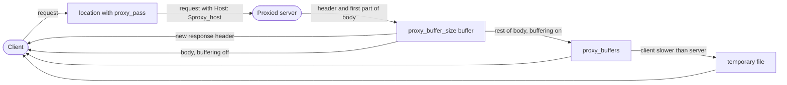

## Overview

A reverse proxy receives requests from clients, passes them to other servers, and returns their responses to the clients. Use this guide to configure NGINX Open Source or F5 NGINX Plus as a reverse proxy, change the request headers it sends, tune how it buffers responses, and choose the IP address it connects from.

## Introduction

Common reasons to use a reverse proxy are:

- Distributing the load among several servers.
- Showing content from different websites under one address.
- Passing requests to application servers over protocols other than HTTP.

---

## Before you begin

Before you begin, make sure you have:

- **NGINX Open Source or NGINX Plus installed and running**.
- **A server to proxy requests to**: The examples use an application server that listens on `127.0.0.1:8000`.
- **Permission to edit the configuration and reload NGINX**: On most systems, this means root or `sudo` access.
- **`curl`**: To test the configuration.

---

## How proxying works

When NGINX proxies a request, it does the following:

1. It chooses a location for the request, as described in [Configuring NGINX and NGINX Plus as a Web Server]().
2. It opens a connection to the proxied server and sends the request with the headers described in [Passing request headers](#headers). NGINX reuses connections only to servers in an [upstream](https://nginx.org/en/docs/http/ngx_http_upstream_module.html#upstream) group. In NGINX Open Source 1.29.7 and later, it does so by default; in earlier versions, the group needs the `keepalive` directive.
3. It reads the start of the response, which holds the response header and possibly the first part of the body, into a buffer of `proxy_buffer_size` bytes.
4. It creates its own response header for the client from the proxied server's header. By default, it doesn't pass some headers, such as `Date` and `Server`.
5. It sends the body to the client. With buffering on, NGINX reads the body into the `proxy_buffers` buffers while the client downloads it. If the client is slower than the proxied server and the buffers fill up, NGINX writes the rest to a temporary file. With buffering off, NGINX passes the body through the `proxy_buffer_size` buffer as the client accepts it.



Text description: The client sends a request to a location with `proxy_pass`. NGINX sends the request to the proxied server with the `Host` header set to `$proxy_host`. NGINX reads the response header and the first part of the body into the `proxy_buffer_size` buffer and sends its own response header to the client. With buffering off, the body passes through that buffer to the client. With buffering on, the rest of the body goes into the `proxy_buffers` buffers, and into a temporary file when the client is slower than the proxied server.

---

<span id="pass"></span>

## Passing a request to a proxied server

To pass requests to an HTTP server, add the [proxy_pass](https://nginx.org/en/docs/http/ngx_http_proxy_module.html#proxy_pass) directive to a [location](https://nginx.org/en/docs/http/ngx_http_core_module.html#location):

```nginx
location /some/path/ {
    proxy_pass http://www.example.com/link/;
}
```

NGINX passes all requests in this location to the proxied server at that address. The address can be a domain name or an IP address, and it can include a port:

```nginx
location ~ \.php$ {
    proxy_pass http://127.0.0.1:8000;
}
```

The URI in the `proxy_pass` address controls the URI that NGINX sends:

- **With a URI**, such as `/link/` in the first example, NGINX replaces the part of the request URI that matches the location with that URI. A request for `/some/path/page.html` goes to `http://www.example.com/link/page.html`. NGINX sends the URI in normalized form: it decodes percent-encoded characters that don't need encoding and merges repeated slashes.
- **Without a URI**, as in the second example, NGINX passes the request URI exactly as the client sent it.

In a regular expression location, a named location, a predicate location, an `if` block, and a `limit_except` block, `proxy_pass` can't have a URI. If it has one, the configuration test fails with `"proxy_pass" cannot have URI part in location given by regular expression...`.

NGINX also passes the full URI, ignoring the location prefix, when a `rewrite` directive with the `break` flag has changed it, or when the `proxy_pass` address contains variables.

To pass requests to servers that use other protocols, use the matching directive:

- [fastcgi_pass](https://nginx.org/en/docs/http/ngx_http_fastcgi_module.html#fastcgi_pass) passes a request to a FastCGI server.
- [uwsgi_pass](https://nginx.org/en/docs/http/ngx_http_uwsgi_module.html#uwsgi_pass) passes a request to a uwsgi server.
- [scgi_pass](https://nginx.org/en/docs/http/ngx_http_scgi_module.html#scgi_pass) passes a request to an SCGI server.
- [memcached_pass](https://nginx.org/en/docs/http/ngx_http_memcached_module.html#memcached_pass) passes a request to a memcached server.
- [grpc_pass](https://nginx.org/en/docs/http/ngx_http_grpc_module.html#grpc_pass) passes a request to a gRPC server.

These directives have their own rules for addresses and their own parameters. For details, see each module's reference documentation.

The `proxy_pass` directive can also pass requests to a [named group](https://nginx.org/en/docs/http/ngx_http_upstream_module.html#upstream) of servers. NGINX then distributes the requests among the servers with the group's load-balancing method. For details, refer to [HTTP Load Balancing]().

<span id="headers"></span>

## Passing request headers

By default, NGINX changes the request headers it passes to the proxied server:

- It sets `Host` to the value of the `$proxy_host` variable: the host name or address from the `proxy_pass` address, and the port if it isn't the default port, 80 for HTTP or 443 for HTTPS.
- It doesn't pass the `Connection`, `Keep-Alive`, `Proxy-Connection`, `TE`, `Upgrade`, and `Expect` headers from the client.
- It creates the `Content-Length` and `Transfer-Encoding` headers itself to match the request body it sends.

By default, NGINX Open Source 1.29.7 and later uses HTTP/1.1 for proxied requests and doesn't send a `Connection` header. Earlier versions use HTTP/1.0 and send `Connection: close`. To choose the version, use the [proxy_http_version](https://nginx.org/en/docs/http/ngx_http_proxy_module.html#proxy_http_version) directive.

To change or add headers, use the [proxy_set_header](https://nginx.org/en/docs/http/ngx_http_proxy_module.html#proxy_set_header) directive. You can use it in `http`, `server`, and `location` contexts:

```nginx
location /some/path/ {
    proxy_set_header Host $host;
    proxy_set_header X-Real-IP $remote_addr;
    proxy_pass http://127.0.0.1:8000;
}
```

In this configuration, NGINX sets `Host` to the [$host](https://nginx.org/en/docs/http/ngx_http_core_module.html#var_host) variable, which holds the host name that the client requested.

A `location` block inherits `proxy_set_header` directives from its parent only if it doesn't have any of its own. If you add one `proxy_set_header` to a location, repeat there all the others you need.

If the value of a `proxy_set_header` directive is an empty string, NGINX doesn't send that header. Use this to stop NGINX from passing a header from the client:

```nginx
location /some/path/ {
    proxy_set_header Accept-Encoding "";
    proxy_pass http://127.0.0.1:8000;
}
```

The `Host` header is an exception. In NGINX Open Source 1.31.4 and later, an empty `Host` value sends `$proxy_host` instead when NGINX uses HTTP/1.1. Headers that the client sends with an empty value are passed unchanged.

Because NGINX doesn't pass `Upgrade` and `Connection`, WebSocket connections need two extra headers:

```nginx
location /ws/ {
    proxy_set_header Upgrade    $http_upgrade;
    proxy_set_header Connection "upgrade";
    proxy_pass http://127.0.0.1:8000;
}
```

<span id="buffers"></span>

## Configuring buffers

By default, NGINX buffers responses from proxied servers. It reads the response as fast as the proxied server sends it, and stores it while the client downloads it. This frees the proxied server quickly, even when clients are slow.

The [proxy_buffering](https://nginx.org/en/docs/http/ngx_http_proxy_module.html#proxy_buffering) directive turns buffering on or off. It's `on` by default. The proxied server can also turn buffering on or off for one response with the `X-Accel-Buffering` response header.

Two directives control the buffer sizes:

- [proxy_buffer_size](https://nginx.org/en/docs/http/ngx_http_proxy_module.html#proxy_buffer_size) sets the size of the buffer for the first part of the response. The whole response header must fit in it. The default is one memory page, 4 KB or 8 KB depending on the platform.
- [proxy_buffers](https://nginx.org/en/docs/http/ngx_http_proxy_module.html#proxy_buffers) sets the number and size of the buffers for the rest of the response. The default is 8 buffers of one memory page each.

When all buffers are full because the client reads more slowly than the proxied server sends, NGINX writes the rest of the response to a temporary file in [proxy_temp_path](https://nginx.org/en/docs/http/ngx_http_proxy_module.html#proxy_temp_path). It logs a warning such as `an upstream response is buffered to a temporary file`. The [proxy_max_temp_file_size](https://nginx.org/en/docs/http/ngx_http_proxy_module.html#proxy_max_temp_file_size) directive limits the file's size; it's 1024 MB by default, and `0` turns temporary files off.

In this example, the number of buffers is larger and the first buffer is smaller than the defaults:

```nginx
location /some/path/ {
    proxy_buffers 16 4k;
    proxy_buffer_size 2k;
    proxy_pass http://127.0.0.1:8000;
}
```

With `proxy_buffer_size 2k`, responses with a header larger than 2 KB fail with `502`. Use a small first buffer only if you know the size of the proxied server's headers.

With buffering off, NGINX sends the response to the client as it receives it from the proxied server, and reads from the proxied server only as fast as the client accepts the data. This helps interactive clients that need the response as soon as possible. To turn buffering off in a location, add `proxy_buffering off`:

```nginx
location /some/path/ {
    proxy_buffering off;
    proxy_pass http://127.0.0.1:8000;
}
```

With buffering off, NGINX uses only the `proxy_buffer_size` buffer to store the current part of the response.

A common use of a reverse proxy is load balancing. Refer to [HTTP Load Balancing]() and [TCP and UDP Load Balancing]().

<span id="proxy_bind"></span>

## Choosing an outgoing IP address

If your proxy server has several network interfaces, you might need to choose the source IP address for connections to a proxied server. This is useful when the proxied server accepts connections only from certain IP addresses or networks.

Set the IP address with the [proxy_bind](https://nginx.org/en/docs/http/ngx_http_proxy_module.html#proxy_bind) directive. Each address must belong to a network interface of the NGINX host, and it must be able to reach the proxied server:

```nginx
location /app1/ {
    proxy_bind 192.0.2.10;
    proxy_pass http://example.com/app1/;
}

location /app2/ {
    proxy_bind 192.0.2.11;
    proxy_pass http://example.com/app2/;
}
```

The address can also be a variable. For example, [`$server_addr`](https://nginx.org/en/docs/http/ngx_http_core_module.html#var_server_addr) holds the IP address of the network interface that accepted the request:

```nginx
location /app3/ {
    proxy_bind $server_addr;
    proxy_pass http://example.com/app3/;
}
```

---

## Example

This complete **nginx.conf** passes requests for **/app/** to an application server on `127.0.0.1:8000`, with the original host name and client address in the request headers. It replaces your existing **nginx.conf**, so back that file up first. To add only the proxy to a configuration that reads files from `conf.d`, put the `server` block in a file there.

```nginx
events {}

http {
    server {
        listen      80;
        server_name www.example.com;

        location /app/ {
            proxy_set_header Host            $host;
            proxy_set_header X-Real-IP       $remote_addr;
            proxy_set_header X-Forwarded-For $proxy_add_x_forwarded_for;
            proxy_pass http://127.0.0.1:8000/;
        }
    }
}
```

Because the `proxy_pass` address ends with the URI `/`, NGINX removes the `/app/` prefix. A request for **/app/status** reaches the application server as **/status**.

---

## Verify the configuration

1. Test and reload the configuration:

    ```shell
    sudo nginx -t && sudo nginx -s reload
    ```

2. If your application server doesn't log request headers, you can use a temporary test server instead. Add this `server` block to the `http` block, in place of your application server on port 8000, and reload NGINX:

    ```nginx
    server {
        listen 127.0.0.1:8000;

        location / {
            return 200 "uri=$request_uri host=$http_host real_ip=$http_x_real_ip forwarded_for=$http_x_forwarded_for\n";
        }
    }
    ```

3. Send a request through NGINX:

    ```shell
    curl -H 'Host: www.example.com' http://localhost/app/status
    ```

    The test server shows what it received:

    ```none
    uri=/status host=www.example.com real_ip=127.0.0.1 forwarded_for=127.0.0.1
    ```

    The addresses show where `curl` ran. Remove the test server when you're done.

---

## Troubleshooting

### NGINX returns 502 Bad Gateway

**Symptom**: Requests return `502`, and the error log shows `connect() failed (111: Connection refused) while connecting to upstream`. With an upstream group of several servers, later requests can show `no live upstreams while connecting to upstream`.

**Cause**: The proxied server isn't running, or it doesn't listen on the address and port in `proxy_pass`.

**Fix**: Check that the proxied server is running, and test it directly, for example with `curl http://127.0.0.1:8000/`.

### NGINX returns 502 with "upstream sent too big header"

**Symptom**: Requests return `502`, and the error log shows `upstream sent too big header while reading response header from upstream`.

**Cause**: The response header from the proxied server doesn't fit in the `proxy_buffer_size` buffer.

**Fix**: Increase `proxy_buffer_size` and the size of the `proxy_buffers` buffers together, for example:

```nginx
location /some/path/ {
    proxy_buffer_size 16k;
    proxy_buffers     8 16k;
    proxy_pass http://127.0.0.1:8000;
}
```

If you increase only `proxy_buffer_size`, the configuration test can fail with `"proxy_busy_buffers_size" must be less than the size of all "proxy_buffers" minus one buffer`.

### NGINX returns 504 Gateway Timeout

**Symptom**: Requests return `504`, and the error log shows `upstream timed out (110: Connection timed out)`.

**Cause**: If the message ends with `while reading response header from upstream` or `while reading upstream`, the proxied server didn't send any data for longer than [proxy_read_timeout](https://nginx.org/en/docs/http/ngx_http_proxy_module.html#proxy_read_timeout). This is the time between two reads, not the time for the whole response, and it's 60 seconds by default. If the message ends with `while connecting to upstream`, NGINX couldn't connect within [proxy_connect_timeout](https://nginx.org/en/docs/http/ngx_http_proxy_module.html#proxy_connect_timeout), which is also 60 seconds by default.

**Fix**: Make the proxied server respond faster, or increase the timeout for the slow location.

### The proxied server gets the wrong URI

**Symptom**: The proxied server returns `404` for requests that work when you send them to it directly.

**Cause**: A URI in the `proxy_pass` address replaces the matching part of the request URI. A missing or extra `/` changes the result.

**Fix**: Compare the URI in the proxied server's log with the rules in [Passing a request to a proxied server](#pass).

### Headers set in a server block are missing

**Symptom**: Headers set with `proxy_set_header` in a `server` block don't reach the proxied server for some locations.

**Cause**: Those locations have their own `proxy_set_header` directives, so they don't inherit any from the `server` block.

**Fix**: Repeat all the needed `proxy_set_header` directives in those locations.

---

## References

For more information, see:

- [Configuring NGINX and NGINX Plus as a Web Server]()
- [HTTP Load Balancing]()
- [NGINX Content Caching]()
- [ngx_http_proxy_module reference](https://nginx.org/en/docs/http/ngx_http_proxy_module.html) on nginx.org
