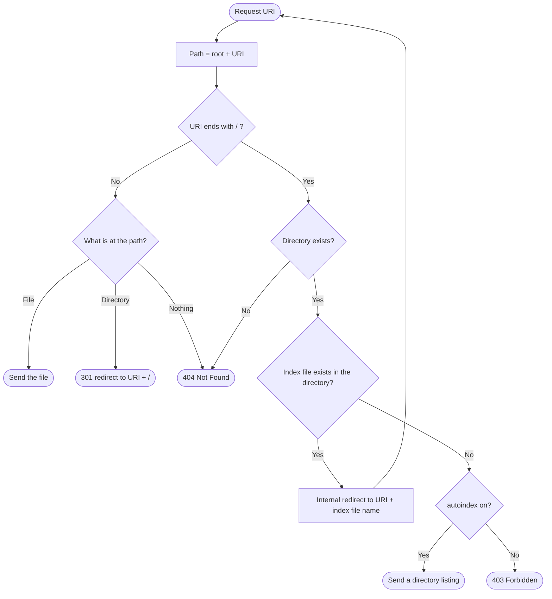

## Overview

Use this guide to configure NGINX Open Source or F5 NGINX Plus to serve files: set the directories where NGINX looks for files, configure index files and fallbacks, and tune NGINX and the operating system for performance.

---

## Before you begin

Before you begin, make sure you have:

- **NGINX Open Source or NGINX Plus installed and running**.
- **Files to serve**, readable by the user that the NGINX worker processes run as.
- **Permission to edit the configuration and reload NGINX**: On most systems, this means root or `sudo` access.

---

## How NGINX finds a file

For a request in a location that serves files, NGINX does the following:

1. It appends the request URI to the [root](https://nginx.org/en/docs/http/ngx_http_core_module.html#root) directory to get the path.
2. If the URI ends with a slash, NGINX treats it as a directory. If the directory doesn't exist, NGINX returns `404 Not Found`. If it exists, NGINX looks for an index file there, as set by the [index](https://nginx.org/en/docs/http/ngx_http_index_module.html#index) directive, and makes an internal redirect to it.
3. If the directory has no index file, NGINX sends a directory listing if [autoindex](https://nginx.org/en/docs/http/ngx_http_autoindex_module.html#autoindex) is `on`, and returns `403 Forbidden` otherwise.
4. If the URI doesn't end with a slash, NGINX sends the file. If the path is a directory, NGINX redirects the client with `301 Moved Permanently` to the URI with a trailing slash. If nothing exists at the path, NGINX returns `404`.

With the [try_files](https://nginx.org/en/docs/http/ngx_http_core_module.html#try_files) directive, NGINX checks a list of files and directories instead, and uses the first one that exists.



Text description: NGINX appends the request URI to the root directory. For a URI that doesn't end with a slash, it sends the file, redirects with `301` to the URI with a slash if the path is a directory, or returns `404`. For a URI that ends with a slash, it returns `404` if the directory doesn't exist. Otherwise, it makes an internal redirect to the index file if one exists, sends a directory listing if `autoindex` is on, and returns `403` if not.

---

<span id="root"></span>

## Root directory and index files

The [root](https://nginx.org/en/docs/http/ngx_http_core_module.html#root) directive sets the directory where NGINX looks for files. NGINX appends the request URI to it to get the file path. You can use `root` in the `http`, `server`, and `location` contexts. In this example, `root` is set for the virtual server, and it applies to all `location` blocks that don't set their own `root`:

```nginx
server {
    listen 80;
    root /www/data;

    location / {
    }

    location /images/ {
    }

    location ~ \.(mp3|mp4)$ {
        root /www/media;
    }
}
```

NGINX looks for a URI that starts with `/images/` in the `/www/data/images/` directory. A URI that ends with `.mp3` or `.mp4` matches the regular expression location, which takes precedence over the `/images/` prefix location. NGINX looks for it in `/www/media/` instead, still with the whole URI: `/images/x.mp3` maps to `/www/media/images/x.mp3`.

If a request URI ends with a slash, NGINX treats it as a request for a directory and looks for an index file there. The [index](https://nginx.org/en/docs/http/ngx_http_index_module.html#index) directive sets the name of the index file; the default is `index.html`. For example, for the URI `/images/some/path/`, NGINX sends `/www/data/images/some/path/index.html` if it exists. If it doesn't, NGINX returns `403 Forbidden` if the directory exists, and `404 Not Found` if it doesn't. To send a directory listing instead, set the [autoindex](https://nginx.org/en/docs/http/ngx_http_autoindex_module.html#autoindex) directive to `on`:

```nginx
location /images/ {
    autoindex on;
}
```

You can list several file names in the `index` directive. NGINX checks them in order and uses the first one that exists. A name can contain variables. In this example, the `$geo` variable, which the [geo](https://nginx.org/en/docs/http/ngx_http_geo_module.html#geo) directive sets from the client IP address, selects a language-specific index file:

```nginx
geo $geo {
    default        en;
    192.0.2.0/24   de;
}

server {
    listen 80;
    root /www/data;

    location / {
        index index.$geo.html index.htm index.html;
    }
}
```

To return an index file, NGINX makes an internal redirect to the URI of the index file. NGINX then searches for a location again, so the request can end up in another location:

```nginx
server {
    listen 80;
    root   /data;

    location / {
        index index.html index.php;
    }

    location ~ \.php$ {
        fastcgi_pass  localhost:8000;
        include       fastcgi_params;
        fastcgi_param SCRIPT_FILENAME $document_root$fastcgi_script_name;
    }
}
```

In this example, if the request URI is `/path/`, and `/data/path/index.html` doesn't exist but `/data/path/index.php` does, the internal redirect to `/path/index.php` goes to the second location. NGINX passes the request to the FastCGI server. The `root` is set at the `server` level so that both locations use it, and `SCRIPT_FILENAME` tells the FastCGI server which file to run; `fastcgi_params` doesn't set it.

<span id="options"></span>

## Trying several options

The [try_files](https://nginx.org/en/docs/http/ngx_http_core_module.html#try_files) directive checks whether files or directories exist, in order. NGINX uses the first one that exists. If none exists, NGINX makes an internal redirect to the URI in the last parameter. For example, to send a default image when the requested image doesn't exist:

```nginx
server {
    listen 80;
    root /www/data;

    location /images/ {
        try_files $uri /images/default.gif;
    }
}
```

NGINX maps each parameter to a file with the `root` or `alias` directive of the current location. In this example, if the file for the request URI doesn't exist, NGINX makes an internal redirect to `/images/default.gif` and sends `/www/data/images/default.gif`.

A parameter that ends with a slash, such as `$uri/`, checks for a directory; other parameters check only for files. In this example, a request for a directory, such as `/images/` or `/images/some/path/`, also gets `default.gif`, because `$uri` doesn't match directories. The fallback file must exist: otherwise, the internal redirect goes through the same location again, and NGINX returns `500` with `rewrite or internal redirection cycle` in the error log.

The last parameter can also be a status code after an equals sign, or the name of a named location. In this example, NGINX returns `404` if none of the files or directories exists:

```nginx
location / {
    try_files $uri $uri/ $uri.html =404;
}
```

In the next example, if neither the file nor the directory for the request URI exists, NGINX passes the request to the named location `@backend`, which passes it to a proxied server:

```nginx
upstream backend {
    server 127.0.0.1:8080;
}

server {
    listen 80;

    location / {
        try_files $uri $uri/ @backend;
    }

    location @backend {
        proxy_pass http://backend;
    }
}
```

<span id="optimize"></span>

## Optimize performance for serving content

These settings make NGINX send files faster and handle more connections.

### Enable `sendfile`

By default, NGINX reads a file into a buffer before it sends it. With the [sendfile](https://nginx.org/en/docs/http/ngx_http_core_module.html#sendfile) directive, the kernel copies the data directly from the file to the connection, without the extra copy. The `sendfile` directive is `off` by default.

To keep one fast connection from occupying a worker process, the [sendfile_max_chunk](https://nginx.org/en/docs/http/ngx_http_core_module.html#sendfile_max_chunk) directive limits the data sent in one `sendfile()` call. The default is `2m`; this example sets it to 1 MB:

```nginx
location /mp3 {
    sendfile           on;
    sendfile_max_chunk 1m;
}
```

### Enable `tcp_nopush`

Use the [tcp_nopush](https://nginx.org/en/docs/http/ngx_http_core_module.html#tcp_nopush) directive together with `sendfile on`. It turns on the `TCP_CORK` option on Linux, or `TCP_NOPUSH` on FreeBSD. NGINX then sends the response header and the start of the file in one packet, and sends the file in full packets. It's `off` by default.

```nginx
location /mp3 {
    sendfile   on;
    tcp_nopush on;
}
```

### Enable `tcp_nodelay`

The [tcp_nodelay](https://nginx.org/en/docs/http/ngx_http_core_module.html#tcp_nodelay) directive turns on the `TCP_NODELAY` option, which turns off [Nagle’s algorithm](https://en.wikipedia.org/wiki/Nagle's_algorithm). Nagle's algorithm collects small amounts of data into larger packets, which can delay the end of a response. The directive is `on` by default, so you only need it to turn the option back on where a higher level turned it off. NGINX applies it to keepalive connections, TLS connections, HTTP/2 connections, unbuffered proxying, and WebSocket connections:

```nginx
location /mp3  {
    tcp_nodelay on;
}
```

### Optimize the backlog queue

When a client connects, the connection waits in the listen queue of the listening socket until NGINX accepts it. Under normal load, the queue is short or empty. Under high load, it can fill up. Then the operating system drops new connections, and clients see delays and errors.

#### Display the listen queue

On Linux, show the listen queues with the `ss` command:

```shell
ss -lnt
```

For a listening socket, `Recv-Q` is the number of connections waiting to be accepted, and `Send-Q` is the maximum length of the queue:

```none
State   Recv-Q  Send-Q  Local Address:Port  Peer Address:Port
LISTEN  10      511     0.0.0.0:80          0.0.0.0:*
```

On FreeBSD, use `netstat -Lan`. The output shows the current and maximum queue lengths for each socket:

```none
Current listen queue sizes (qlen/incqlen/maxqlen)
Listen         Local Address
10/0/128        *.80
```

If the number of waiting connections often reaches the maximum, increase the queue length in the operating system and in NGINX.

#### Tune the operating system

The `net.core.somaxconn` kernel parameter on Linux, and `kern.ipc.somaxconn` on FreeBSD (`kern.ipc.soacceptqueue` on newer versions), limit the length of listen queues. Linux 5.4 and later uses `4096` by default; older versions use `128`. Check the current value first, for example with `sysctl net.core.somaxconn`. To set it to `4096`:

- On FreeBSD, run the following command, and add the same setting to `/etc/sysctl.conf` to keep it after a restart:

    ```shell
    sudo sysctl kern.ipc.somaxconn=4096
    ```

- On Linux:

    1. Run:

        ```shell
        sudo sysctl -w net.core.somaxconn=4096
        ```

    2. To keep the setting after a restart, add this line to `/etc/sysctl.conf`:

        ```none
        net.core.somaxconn = 4096
        ```

#### Tune NGINX

NGINX requests a queue length of `511` by default, and the system maximum on FreeBSD and macOS. To use a longer queue, set the `backlog` parameter of the [listen](https://nginx.org/en/docs/http/ngx_http_core_module.html#listen) directive. The operating system limits it to `somaxconn`. You can set `backlog` only once for each address and port:

```nginx
server {
    listen 80 backlog=4096;
}
```

---

## Example

This complete configuration serves a website from **/www/data**, with media files from **/www/media**, a fallback image, and file-serving optimizations. It's a whole **nginx.conf**, so back up your existing file first, and keep the `user` directive of your package. To add only the website to a configuration that reads files from `conf.d`, put the `server` block in a file there, and add the `sendfile` and `tcp_nopush` lines to it.

Before you test it, create the files that the verification uses:

```shell
sudo mkdir -p /www/data/images /www/media
echo hello | sudo tee /www/data/index.html
sudo cp /usr/share/nginx/html/*.gif /www/data/images/default.gif 2>/dev/null || printf 'GIF89a' | sudo tee /www/data/images/default.gif >/dev/null
```

```nginx
events {}

http {
    include       mime.types;
    default_type  application/octet-stream;

    sendfile    on;
    tcp_nopush  on;

    server {
        listen      80;
        server_name www.example.com;
        root        /www/data;

        location / {
            try_files $uri $uri/ =404;
        }

        location /images/ {
            try_files $uri /images/default.gif;
        }

        location ~ \.(mp3|mp4)$ {
            root /www/media;
        }
    }
}
```

---

## Verify the configuration

1. Test and reload the configuration:

    ```shell
    sudo nginx -t && sudo nginx -s reload
    ```

2. Request a file that exists, and one that doesn't:

    ```shell
    curl -s -o /dev/null -w '%{http_code}\n' -H 'Host: www.example.com' http://127.0.0.1/index.html
    curl -s -o /dev/null -w '%{http_code}\n' -H 'Host: www.example.com' http://127.0.0.1/missing.html
    ```

    The output is `200` for the existing file and `404` for the missing one.

3. Request a missing image:

    ```shell
    curl -s -o /dev/null -w '%{http_code} %{content_type}\n' -H 'Host: www.example.com' http://127.0.0.1/images/missing.png
    ```

    The output is `200 image/gif`, because NGINX sends **/www/data/images/default.gif** instead.

---

## Troubleshooting

### NGINX returns 404 for files that exist

**Symptom**: Requests return `404`, and the error log shows `open() "/www/data/images/images/a.png" failed (2: No such file or directory)`.

**Cause**: The path is the `root` directory plus the full URI. A `root` that already contains the location prefix doubles it.

**Fix**: Set `root` to the parent directory, or use the [alias](https://nginx.org/en/docs/http/ngx_http_core_module.html#alias) directive, which replaces the location prefix. With `alias`, end the path with a slash when the location ends with one:

```nginx
location /images/ {
    alias /www/data/images/;
}
```

### NGINX returns 403 for a directory

**Symptom**: Requests for a URI that ends with a slash return `403`, and the error log shows `directory index of "..." is forbidden`.

**Cause**: The directory has no index file, and `autoindex` is off.

**Fix**: Add an index file, list the right file name in `index`, or turn on `autoindex`.

### NGINX returns 403 for files

**Symptom**: Requests for existing files return `403`, and the error log shows `open() "..." failed (13: Permission denied)`.

**Cause**: The worker processes can't read the file, or can't enter one of the directories in its path.

**Fix**: Give the worker processes' user read permission on the file and execute permission on each directory in the path.

---

## References

For more information, see:

- [Configuring NGINX and NGINX Plus as a Web Server]()
- [Compression and Decompression]()
- [ngx_http_core_module reference](https://nginx.org/en/docs/http/ngx_http_core_module.html) on nginx.org
