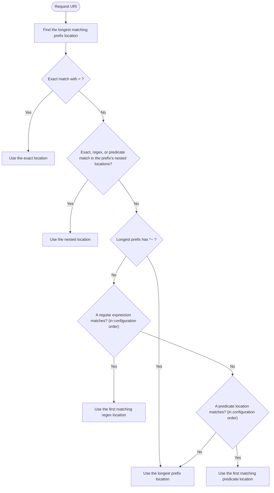

## Overview

Use this guide to configure NGINX Open Source or F5 NGINX Plus as a web server. The information applies to both. For ease of reading, the rest of the page says NGINX.

You configure a web server by defining _virtual servers_ and _locations_:

- A virtual server handles requests for particular domain names, IP addresses, or ports.
- Inside a virtual server, each location controls the processing of a set of request URIs. A location can serve files, pass the request to another server, return a status code, or redirect the request.

For an introduction to configuration files, refer to [Create NGINX Plus and NGINX Configuration Files]().

---

## Before you begin

Before you begin, make sure you have:

- **NGINX Open Source or NGINX Plus installed and running**.
- **Permission to edit the configuration and reload NGINX**: On most systems, this means root or `sudo` access.
- **`curl`**: To test the configuration.

---

## How NGINX chooses a server and a location

For each request, NGINX first chooses a virtual server and then a location inside it:

1. NGINX finds the `server` blocks that listen on the address and port where the request arrived.
2. Among them, it chooses one by the `Host` header field, as described in [Set up virtual servers](#virtual-server).
3. In that server, it chooses a location by the request URI, as described in [NGINX location priority](#location_priority).
4. It processes the request with the directives of that location.

---

<span id="virtual-server"></span>

## Set up virtual servers

A virtual server is a [server](https://nginx.org/en/docs/http/ngx_http_core_module.html#server) block in the `http` context. The configuration needs at least one. You can add as many `server` blocks as you need:

```nginx
http {
    server {
        listen 80;
        # Server configuration
    }
}
```

The [listen](https://nginx.org/en/docs/http/ngx_http_core_module.html#listen) directive sets the IP address and port, or the UNIX-domain socket path, where the server accepts requests. NGINX accepts both IPv4 and IPv6 addresses. Put IPv6 addresses in square brackets.

This server listens on IP address 127.0.0.1 and port 8080:

```nginx
server {
    listen 127.0.0.1:8080;
    # Additional server configuration
}
```

If you leave out the address, the server listens on all addresses. If you leave out the port, the server uses port 80. If a `server` block has no `listen` directive, it listens on port 80 when NGINX runs as root, and on port 8000 otherwise.

### Choose a server by name

When several servers listen on the address and port of a request, NGINX compares the request's `Host` header field with the [server_name](https://nginx.org/en/docs/http/ngx_http_core_module.html#server_name) directives of those servers. A server name can be:

- **An exact name**, such as `www.example.org`.
- **A wildcard name**, with an asterisk (`*`) at the start or the end, such as `*.example.org` or `mail.*`. The asterisk matches any sequence of characters.
- **A regular expression**, which starts with a tilde (`~`). NGINX uses PCRE syntax, which is compatible with Perl.

This server answers requests for two exact names:

```nginx
server {
    listen      80;
    server_name example.org www.example.org;
    #...
}
```

If several names match the `Host` header, NGINX uses the first match it finds in this order:

1. Exact name
2. Longest wildcard starting with an asterisk, such as `*.example.org`
3. Longest wildcard ending with an asterisk, such as `mail.*`
4. First matching regular expression, in the order they appear in the configuration

If no name matches, NGINX sends the request to the default server for the address and port. The default server is the first server in the configuration that listens on that address and port. To choose a different one, add the `default_server` parameter to its `listen` directive:

```nginx
server {
    listen 80 default_server;
    #...
}
```

<span id="locations"></span>

## Configure locations

The [location](https://nginx.org/en/docs/http/ngx_http_core_module.html#location) directive defines how to process requests whose URIs match its parameter. For example, one location can send requests to a proxied server, another location to a different proxied server, and a third can serve files from the local file system.

A `location` block can contain other `location` blocks, which refine the processing for smaller groups of URIs.

The parameter of a `location` directive is one of these:

- **A prefix string**: The request URI matches if it starts with the string.
- **A regular expression**: It starts with `~` for a case-sensitive match, or `~*` for a case-insensitive match.
- **A variable, called a predicate location** (NGINX Open Source 1.31.5 and later): The location matches if the variable's value isn't empty and isn't `0`. A predicate location usually gets its variable from a [map](https://nginx.org/en/docs/http/ngx_http_map_module.html#map).

This location with a prefix string matches request URIs that start with **/some/path/**, such as **/some/path/document.html**. It doesn't match **/my-site/some/path**, because **/some/path** isn't at the start of that URI.

```nginx
location /some/path/ {
    #...
}
```

This location with a regular expression matches URIs that contain **.html** or **.htm** anywhere:

```nginx
location ~ \.html? {
    #...
}
```

This predicate location matches requests whose `beta` query argument is `yes`:

```nginx
map $arg_beta $beta_user {
    yes      1;
    default  0;
}

server {
    listen 80;

    location $beta_user {
        root /var/www/beta;
    }
}
```

<span id="location_priority"></span>

### NGINX location priority

To find the location for a request URI, NGINX does the following:

1. It compares the URI with all prefix strings and remembers the longest match.
2. If a location with the `=` modifier matches the URI exactly, NGINX uses it and stops.
3. If the longest matching prefix contains nested locations, NGINX first searches them with these same steps. If an exact, regular expression, or predicate location matches there, NGINX uses it and stops.
4. If the longest matching prefix has the `^~` modifier, NGINX uses it. It doesn't check regular expressions or predicate locations.
5. Otherwise, it checks the regular expressions in the order they appear in the configuration. It uses the first one that matches.
6. If no regular expression matches, it checks the predicate locations in configuration order and uses the first one that matches.
7. If nothing else matches, it uses the longest matching prefix.

If NGINX chooses a regular expression or predicate location that contains nested locations, it repeats these steps inside it.

The following diagram shows the same steps.



Text description: NGINX finds the longest matching prefix location. An exact match with `=` is used immediately. Otherwise, NGINX searches the nested locations of the longest prefix, and uses an exact, regular expression, or predicate location that matches there. Otherwise, if the longest prefix has the `^~` modifier, NGINX uses it. Otherwise, NGINX uses the first matching regular expression, then the first matching predicate location, and if neither matches, the longest prefix location.

A typical use of the `=` modifier is for requests for **/**. If requests for **/** are frequent, `location = /` speeds up processing, because the search stops after the first comparison.

```nginx
location = / {
    #...
}
```

### Serve files or proxy requests

In the following example, NGINX serves requests that match the first location with files from the **/data** directory. It passes requests that match the second location to the proxied server at **www.example.com**.

```nginx
server {
    listen 80;

    location /images/ {
        root /data;
    }

    location / {
        proxy_pass http://www.example.com;
    }
}
```

The [root](https://nginx.org/en/docs/http/ngx_http_core_module.html#root) directive sets the directory where NGINX looks for files. NGINX appends the request URI to it to get the file name. In the example, NGINX answers a request for **/images/example.png** with the file **/data/images/example.png**.

The [proxy_pass](https://nginx.org/en/docs/http/ngx_http_proxy_module.html#proxy_pass) directive passes the request to the proxied server at the URL, and returns that server's response to the client. In the example, NGINX passes all requests with URIs that don't start with **/images/** to the proxied server. For more information, refer to [NGINX Reverse Proxy]().

<span id="variables"></span>

## Use variables

Variables let NGINX process requests differently depending on their properties. A variable's name starts with a dollar sign (`$`). NGINX calculates the value at runtime, for example from the request being processed. You can use variables as parameters of many directives.

NGINX has many built-in variables, such as the [core HTTP](https://nginx.org/en/docs/http/ngx_http_core_module.html#variables) variables. For example, `$remote_addr` contains the client IP address, and `$uri` contains the current URI. You can define your own variables with the [set](https://nginx.org/en/docs/http/ngx_http_rewrite_module.html#set), [map](https://nginx.org/en/docs/http/ngx_http_map_module.html#map), and [geo](https://nginx.org/en/docs/http/ngx_http_geo_module.html#geo) directives.

<span id="return-codes"></span>

## Return specific status codes

Some URIs need an immediate response with an error or redirect code, for example when a page has moved. Use the [return](https://nginx.org/en/docs/http/ngx_http_rewrite_module.html#return) directive:

```nginx
location /wrong/url {
    return 404;
}
```

The first parameter of `return` is a status code. The optional second parameter is the URL to redirect to, for codes `301`, `302`, `303`, `307`, and `308`. For other codes, it's the text of the response body. NGINX turns a relative URL, such as `/new/path`, into an absolute one.

You can also give only a URL that starts with `http://`, `https://`, or `$scheme`. NGINX then redirects with code `302`.

```nginx
location /permanently/moved/url {
    return 301 http://www.example.com/moved/here;
}
```

You can use the `return` directive in `server`, `location`, and `if` contexts.

<span id="rewrite"></span>

## Rewrite URIs in requests

The [rewrite](https://nginx.org/en/docs/http/ngx_http_rewrite_module.html#rewrite) directive changes the request URI. It has two required parameters and one optional parameter:

1. A regular expression that the URI must match.
2. The URI to replace it with.
3. Optionally, a flag that stops processing of other `rewrite` directives or sends a redirect.

```nginx
location /users/ {
    rewrite ^/users/(.*)$ /show?user=$1 last;
}

location = /show {
    # serve or proxy /show here
    return 200 "user $arg_user\n";
}
```

In this example, `$1` stands for the part of the URI that the parentheses `(.*)` matched. A request for **/users/alice** becomes **/show?user=alice**, and NGINX processes it in the `/show` location.

You can use several `rewrite` directives in `server`, `location`, and `if` contexts. NGINX runs them one by one, in the order they appear. NGINX runs the `rewrite` directives of a `server` context when it chooses the server, and again after each internal redirect, for example from `error_page`.

If a `rewrite` directive changes the URI and doesn't have the `break` flag, NGINX chooses a location for the new URI. If that location contains `rewrite` directives, NGINX runs them too, and so on.

This example combines `rewrite` directives with a `return` directive:

```nginx
server {
    listen 80;

    rewrite ^(/download/.*)/media/(\w+)\.?.*$ $1/mp3/$2.mp3 last;
    rewrite ^(/download/.*)/audio/(\w+)\.?.*$ $1/mp3/$2.ra  last;
    return  403;
}
```

NGINX changes URIs such as **/download/some/media/file** to **/download/some/mp3/file.mp3**. Because of the `last` flag, NGINX skips the second `rewrite` and the `return` directive, and then chooses a location for the new URI. Similarly, it changes **/download/some/audio/file** to **/download/some/mp3/file.ra**. If a URI matches neither `rewrite` directive, NGINX returns the `403` code.

Two flags stop the processing of `rewrite` directives:

- `last` – Stops processing the directives of the rewrite module, such as `rewrite`, `return`, `set`, and `if`, in the current context. NGINX then chooses a location for the new URI and runs that location's `rewrite` directives, which can change the URI again.
- `break` – Like the [break](https://nginx.org/en/docs/http/ngx_http_rewrite_module.html#break) directive, stops processing the directives of the rewrite module in the current context. In a `location`, NGINX keeps processing the request in that location and doesn't search for a new one. In a `server` context, NGINX still chooses a location for the new URI.

Two more flags send a redirect: `redirect` sends a `302` code, and `permanent` sends a `301` code.

<span id="sub_filter"></span>

## Rewrite HTTP responses

The [sub_filter](https://nginx.org/en/docs/http/ngx_http_sub_module.html#sub_filter) directive replaces one string with another in a response. You can use variables in the replacement string, and you can use several `sub_filter` directives in one context.

The `sub_filter` module isn't built by default in NGINX Open Source. To include it, add `--with-http_sub_module` to `configure`. Packages from nginx.org and NGINX Plus include it.

This example changes links to **/blog/** into links to **/blog-staging/**:

```nginx
location / {
    sub_filter      /blog/ /blog-staging/;
    sub_filter_once off;
}
```

The [sub_filter_once](https://nginx.org/en/docs/http/ngx_http_sub_module.html#sub_filter_once) directive controls how many times NGINX replaces each string. With `on`, the default, NGINX replaces only the first occurrence of each string. With `off`, it replaces every occurrence.

The next example changes the scheme from `http://` to `https://` and replaces the `127.0.0.1:8080` address with the host name from the request. With `sub_filter_once on`, NGINX replaces only the first link of each kind:

```nginx
location / {
    sub_filter     'href="http://127.0.0.1:8080/'    'href="https://$host/';
    sub_filter     'img src="http://127.0.0.1:8080/' 'img src="https://$host/';
    sub_filter_once on;
}
```

NGINX doesn't search the replacement text again, so one `sub_filter` doesn't change the output of another.

Keep these limits in mind:

- By default, NGINX changes only responses with the `text/html` MIME type. To change other types, list them in the [sub_filter_types](https://nginx.org/en/docs/http/ngx_http_sub_module.html#sub_filter_types) directive.
- The search ignores case.
- NGINX can't change a compressed response. If a proxied server compresses responses, add `proxy_set_header Accept-Encoding "";` so that it sends them uncompressed.

<span id="errors"></span>

## Handle errors

The [error_page](https://nginx.org/en/docs/http/ngx_http_core_module.html#error_page) directive tells NGINX what to send when an error occurs. It can return a custom page, change the error code, or redirect the client to another URI. In this example, NGINX returns the page **/404.html** with the `404` code:

```nginx
error_page 404 /404.html;
```

The `error_page` directive doesn't return an error itself; the `return` directive does that. It only sets how NGINX handles errors when they occur. The error can come from a proxied server, or from NGINX itself. For example, NGINX returns `404` when it can't find the requested file.

In this example, when NGINX can't find the page, it changes the code from `404` to `301` and redirects the client to `http://example.com/new/path.html`. This helps clients that still use the old URI. The `301` code tells the browser that the page has moved permanently.

```nginx
location /old/path.html {
    error_page 404 =301 http://example.com/new/path.html;
}
```

The next example passes a request to a proxied server when a file isn't found. There's no status code after the equals sign in `error_page`, so the client gets the status code from the proxied server, not necessarily `404`.

```nginx
upstream backend {
    server 127.0.0.1:8081;
}

server {
    listen 80;

    location /images/ {
        # Set the root directory to search for the file
        root /data/www;

        # Don't log errors about files that don't exist
        log_not_found off;

        # Make an internal redirect if the file isn't found
        error_page 404 = /fetch$uri;
    }

    location /fetch/ {
        proxy_pass http://backend/;
    }
}
```

When NGINX can't find a file, `error_page` makes an internal redirect. The `$uri` variable holds the URI of the current request, which NGINX passes in the redirect. For example, if **/images/some/file** isn't found, NGINX changes the URI to **/fetch/images/some/file** and searches for a location again. The request ends up in the second location, which passes it to the `backend` upstream group as **/images/some/file**.

The [log_not_found](https://nginx.org/en/docs/http/ngx_http_core_module.html#log_not_found) directive stops NGINX from writing `No such file or directory` errors to the error log for missing files. That's useful here, because missing files are expected and handled.

---

## Example

This complete configuration serves a website from **/usr/share/nginx/html**, returns `404` for **/wrong/url**, redirects an old URI, and rewrites user URIs. It's a whole **nginx.conf**, so it replaces your existing file. Back up the existing file first. To add only the website to a configuration that reads files from `conf.d`, use the `server` block in a file there, and remove `default_server` if another server already has it. For **/users/** requests to work, create the file **/usr/share/nginx/html/user.html**.

```nginx
events {}

http {
    server {
        listen      80 default_server;
        server_name www.example.com;

        root /usr/share/nginx/html;

        location / {
            index index.html;
        }

        location = /wrong/url {
            return 404;
        }

        location /permanently/moved/url {
            return 301 http://www.example.com/moved/here;
        }

        location /users/ {
            rewrite ^/users/(.*)$ /user.html?name=$1 last;
        }
    }
}
```

---

## Verify the configuration

1. Test and reload the configuration:

    ```shell
    sudo nginx -t && sudo nginx -s reload
    ```

2. Request the redirected URI. Replace `localhost` with your server's address if you run `curl` on another host:

    ```shell
    curl -sI http://localhost/permanently/moved/url
    ```

    The response shows the redirect. The version in the `Server` header depends on your installation:

    ```none
    HTTP/1.1 301 Moved Permanently
    Server: nginx/1.31.9
    ...
    Location: http://www.example.com/moved/here
    ```

3. Request the URI that returns `404`:

    ```shell
    curl -s -o /dev/null -w '%{http_code}\n' http://localhost/wrong/url
    ```

    The output is `404`.

---

## Troubleshooting

### Requests go to the wrong server

**Symptom**: NGINX answers a request with a different virtual server than you expect.

**Cause**: No `server_name` matches the request's `Host` header, so NGINX uses the default server for the address and port. Or the `listen` directives don't match: a server that listens on a specific IP address takes precedence over one that listens on all addresses for requests to that IP address.

**Fix**: Check the `Host` header that the client sends, the `server_name` directives, and the `listen` directives. Mark the intended fallback server with `default_server`.

### Requests go to the wrong location

**Symptom**: A request is processed by a different location than you expect.

**Cause**: A regular expression location matches the URI, and regular expressions take precedence over prefix locations that don't have `^~`. Nested locations inside the longest matching prefix, and predicate locations, also take part in the search.

**Fix**: Review the [location priority](#location_priority). Add `^~` to the prefix location, or use `=` for an exact match.

### NGINX returns 404 for files that exist

**Symptom**: Requests for existing files return `404`, and the error log shows `open() "..." failed (2: No such file or directory)`.

**Cause**: The file path is the `root` directory plus the full URI, including the location prefix. For example, with `location /images/ { root /data/images; }`, a request for **/images/a.png** looks for **/data/images/images/a.png**.

**Fix**: Compare the path in the error log with the file's real path. Change `root` to the parent directory, or use the [alias](https://nginx.org/en/docs/http/ngx_http_core_module.html#alias) directive.

### Requests fail with "rewrite or internal redirection cycle"

**Symptom**: Requests fail with `500`, and the error log shows `rewrite or internal redirection cycle while processing`.

**Cause**: A `rewrite ... last`, `error_page`, or `try_files` directive sends the request to a location that sends it back again. NGINX stops after 10 internal redirects.

**Fix**: Use the `break` flag, or change the regular expression so that the new URI doesn't match it again.

---

## References

For more information, see:

- [Create NGINX Plus and NGINX Configuration Files]()
- [Serve Static Content]()
- [NGINX Reverse Proxy]()
- [How nginx processes a request](https://nginx.org/en/docs/http/request_processing.html) on nginx.org
- [Server names](https://nginx.org/en/docs/http/server_names.html) on nginx.org
